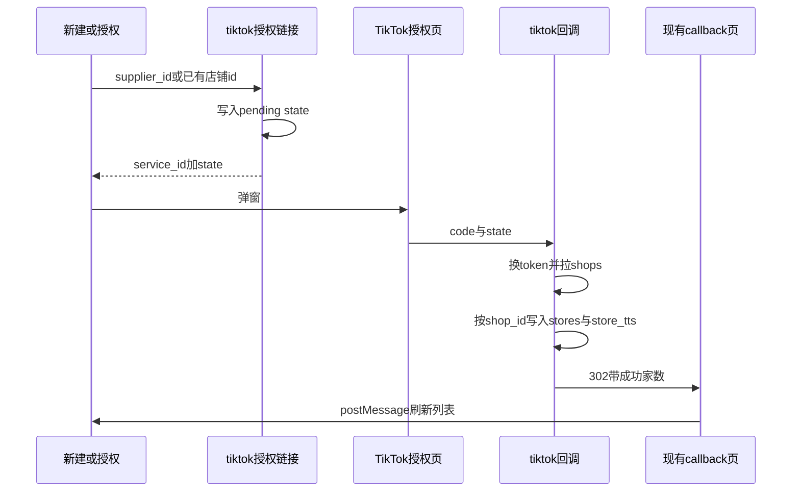

# TikTok 店铺创建与授权

本期只做建店和卖家授权落库，不做商品、订单、Webhook、定时刷新。不把 `stores` 改名为 `store_dhgate`。商品、任务、模板已经外键到 `stores.id`。

## 表

不建 `store_tts_auth`。一家 TikTok 店的 token 和店铺字段都在 `store_tts` 这一行里，查单店、查多店都查这张表。

- `[stores](hemu_oversea_fastapi/app/models/store.py)` 继续当店铺名册：`id`、`supplier_id`、`store_type`、`name`、`identifier`。TikTok 行由回调插入。`name` 用接口店铺名，`identifier` 用 shop code，`account` / `password` 写空字符串，`base_discount` 写 0。`stores` 上的 token 列保持空，不拿来表示 TikTok 是否已授权。
- `store_tts` 与 `stores` 一对一。字段：`store_id`、`supplier_id`、`shop_id`、`shop_cipher`、`shop_code`、`region`、`seller_type`、`open_id`、`user_type`、`granted_scopes`、`access_token`、`refresh_token`、两个到期时间、`oauth_authorized_at`。活跃 `shop_id` 全局唯一，活跃 `store_id` 唯一。
- `store_tts_oauth_pending` 只在点下授权、店铺行还不存在时暂存 `state`。字段：`supplier_id`、`state`（16 位 hex，唯一）、`expires_at`、`created_by`。回调用完即删。这不是 token 表。

跨境多家国家站会各有一行 `store_tts`，token 内容相同，`shop_cipher` 各自不同。`shop_cipher`、token、`open_id` 不返回前端。详情返回区域、店铺代码、卖家类型。授权状态和到期时间：敦煌读 `stores` 自己的 token，TikTok 读 `store_tts`。

## 之后怎么查

- 单店：已知 `stores.id`，查 `store_tts.store_id`。这一行上就是 `access_token` 和 `shop_cipher`。
- 多店：先按 `supplier_id` 且 `store_type = tiktok` 查出 `stores`，再取出对应的 `store_tts`。每家单独请求官方接口。不要用 `stores.access_token IS NOT NULL` 判断 TikTok 已授权，改看 `store_tts.access_token`。

刷新 token 时不要只改当前这一行。按同一 `supplier_id` + 同一 `open_id` 把这几行的 access token、refresh token、到期时间、scope 一起更新。写 token 只有两处：授权回调、刷新。都走这一条更新。本期不做定时任务，以后调用前若 access token 将过期再刷新。

## 授权之后能拿到哪些店

换到卖家 token 后调用 `GET /authorization/202309/shops`。请求头 `x-tts-access-token`，query 为 `app_key`、`timestamp`、`sign`。`data.shops[]` 含 `id`、`code`、`cipher`、`name`、`region`、`seller_type`。

- `LOCAL`：通常 1 家。
- `CROSS_BORDER`：多家国家站点，共用这份 token，每家有自己的 `cipher`。

这是这次授权给本应用的店。返回几家就建几家，用户不填名称、标识或 shop code。

`user_type` 有值且不是卖家 `0` 时整次失败，不建档。文档没写明的其它值同样失败，提示里带上实际值。

## 前端

列表点「新建店铺」后先只选类型。

- 选 `dhgate`：打开现有 `[StoreFormDrawer](hemu_oversea_fastapiadmin/src/pages/store/list/StoreFormDrawer.tsx)`，字段和提交不变。
- 选 `tiktok`：打开新的授权抽屉（`maskClosable={false}`）。没有名称、标识、折扣、账号、密码。文案说明授权成功后按返回的店铺自动创建。按钮「开始授权」。
- 未选供应商的平台账号不能发这个请求。新建入口只给 `canWriteSupplierData`。平台不出现「新建」，只对已有 TikTok 店铺点「授权 / 重新授权」。

已有行的「授权」仍走 `[openAuthorizeWindow](hemu_oversea_fastapiadmin/src/pages/store/list/openAuthorizeWindow.ts)`。落地仍用 `[/callback](hemu_oversea_fastapiadmin/src/pages/callback/index.tsx)` 和 postMessage。TikTok 详情只读，不进敦煌编辑表单。删除仍按供应商可写。

## 后端流程

- 首次授权：新的 `POST` 接口，供应商身份用绑定供应商。写入 pending，返回授权 URL。不先插入 `stores`。
- 重新授权：沿用 `POST /admin/stores/authorize-url`。TikTok 分支用该店的 `supplier_id` 建 pending。平台可调用。
- 回调 `GET /api/v1/common/oauth/tiktok/callback`：公开、无 JWT。校验 state（默认 10 分钟、单次）后删除 pending。`error` 或空 `code` 直接失败 302。
- `shops` 为空则失败，不建档。
- 同一 `shop_id` 已属于当前供应商：更新这一行 `store_tts` 和 `stores.name`，并按 `supplier_id` + `open_id` 把同卖家各行的 token 写成这次的新值。
- 同一 `shop_id` 已属于别的供应商：整次失败并回滚。提示里带上冲突的 shop code。
- 新的 `shop_id`：插入 `stores`（`store_type=tiktok`）和带齐 token 的 `store_tts`。
- 本次没返回的旧店不删除。
- 成功 `msg` 写清同步了几家、每家的名称和区域。

## 官方调用要点

开发者按 ISV。应用未上线时，只有应用所有者能授权。

- 授权链接只拼 `service_id` 和 `state`，不传 `redirect_uri`。回调地址配在 Partner Center。
- 美国：`https://services.us.tiktokshop.com/open/authorize`。其他区域：`https://services.tiktokshop.com/open/authorize`。用配置项。
- 换 token：`GET https://auth.tiktok-shops.com/api/v2/token/get`，`grant_type=authorized_code`。`app_secret` 只在服务端。
- 刷新：`GET https://auth.tiktok-shops.com/api/v2/token/refresh`，`grant_type=refresh_token`。返回了新的 refresh token 必须写入上述同一批行。
- 到期字段是 Unix 秒时间戳。成功看 body `code == 0`，失败把 `message` 带回前端。
- 签名：`app_secret + path + 排序后的 query（去掉 sign、access_token）+ body + app_secret`，HMAC-SHA256 小写十六进制。Get Authorized Shops 的 path 为 `/authorization/202309/shops`。`[tiktok_API.md](hemu_oversea_fastapi/tiktok_API.md)` 的示例漏了 path，不采用。

## 配置与代码落点

`[config.py](hemu_oversea_fastapi/app/core/config.py)`、`.env.example`、`.env.server.example`：

- `TIKTOK_APP_KEY` / `TIKTOK_APP_SECRET` / `TIKTOK_SERVICE_ID`
- `TIKTOK_AUTHORIZE_URL`（默认 ROW）
- `TIKTOK_AUTH_BASE_URL` 默认 `https://auth.tiktok-shops.com`
- `TIKTOK_API_BASE_URL` 默认 `https://open-api.tiktokglobalshop.com`
- `TIKTOK_OAUTH_STATE_TTL_MINUTES` 默认 10

回调 302 仍用 `DHGATE_FRONTEND_REDIRECT_URI`（前端 `/callback`）。

- 迁移：`store_tts`、`store_tts_oauth_pending`。
- `[app/services/tiktok/client.py](hemu_oversea_fastapi/app/services/tiktok/client.py)`：签名和 Get Authorized Shops。入参是一条 `store_tts`（token + `shop_cipher`）。
- `[app/services/tiktok_oauth.py](hemu_oversea_fastapi/app/services/tiktok_oauth.py)`：授权链接、回调建档、按 `open_id` 一起刷新。`[store_oauth.py](hemu_oversea_fastapi/app/services/store_oauth.py)` 的 TikTok 分支改走这套，敦煌不动。
- `[app/api/common/oauth_tiktok.py](hemu_oversea_fastapi/app/api/common/oauth_tiktok.py)` 挂到 `[app/api/common/__init__.py](hemu_oversea_fastapi/app/api/common/__init__.py)`。
- 列表/详情：TikTok 授权状态读 `store_tts`，并带上区域、店铺代码、卖家类型。
- 前端：类型选择 + TikTok 授权抽屉。敦煌抽屉不改字段。
- `[.cursor/rules/business-logic.mdc](.cursor/rules/business-logic.mdc)` 追加：授权后按返回店铺自动建档；`shop_id` 全局只属一个供应商；刷新 token 按供应商 + `open_id` 更新全部 `store_tts` 行；未返回的旧店不删除。

## Partner Center

- Redirect URL 指向后端 tiktok callback（公网 HTTPS）。
- `service_id` 与授权域名区域一致。
- 中国大陆打开授权页可能被官方限制，失败文案原样带回即可。

