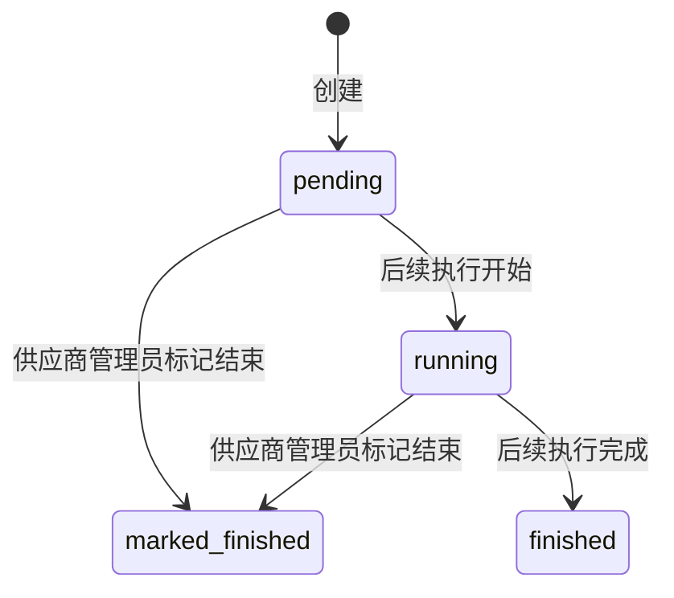
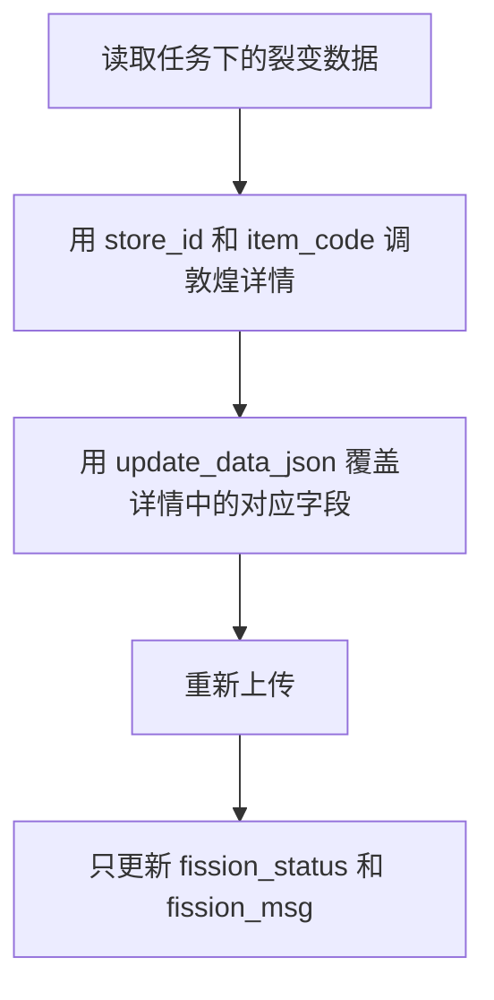

# 商品裂变任务模块开发计划

按现有分层落地，不新开一套目录。后端集中在 mission 这组文件里，选人接口放在现有用户模块。前端路径与后端一致，使用 `mission`。手动选品、Excel 导入、敦煌裂变调用本期只占位。平台角色的菜单和页面本期不做。

## 已定假设

- 任务人员单选，字段为 `missions.worker_id`，外键指向 `users.id`。选项是该供应商下的用户（供应商管理员和员工，含当前登录人）。
- 选人接口属于 `admin:users`，不放在 mission 模块。
- 列表、详情等任务接口只有一套，用 `supplier_id` 区分供应商。供应商身份固定用当前用户的 `supplier_id`。平台身份以后用同一个接口，并传入 `supplier_id`。
- 供应商管理员看本供应商全部任务。供应商员工只看 `worker_id` 为自己的任务。
- 本期只做供应商侧菜单和路由（`supplier_admin`、`supplier_staff`）。平台菜单、平台页面以后再加。
- 任务状态四种都入库。本期能走到的只有：创建后「未开始」，供应商管理员可「标记结束」。「进行中」「已结束」留给后续执行逻辑写入。
- 新建任务用列表页弹窗，不单独做创建页。
- 裂变任务数据不写入 `product_dh`，也不复制 SKU、图片、属性表。单独使用 `mission_data_dh_fission`，只保存种子定位信息和本次要覆盖的 JSON。
- 执行裂变时不读取本地种子正文。用任务数据上的 `store_id`、`item_code` 调敦煌详情拿最新商品，再用 `update_data_json` 覆盖部分字段后重新上传。上传成功或失败都只回写本行的 `fission_status`、`fission_msg`。

## 任务状态

- `pending` 未开始（默认）
- `running` 进行中（本期不写入）
- `finished` 已结束（本期不写入）
- `marked_finished` 标记结束（本期实现）

标记结束后不能再设置数据、不能再执行。

## 数据表

一张 Alembic 迁移，`down_revision` 接当前 HEAD `d4e5f6a7b8c9`。模型写在 [hemu_oversea_fastapi/app/models/mission.py](hemu_oversea_fastapi/app/models/mission.py)，并在 [hemu_oversea_fastapi/app/models/**init**.py](hemu_oversea_fastapi/app/models/__init__.py) 导出。任务表和任务数据表带 `created_at` / `updated_at` / `deleted_at`，查询带 `deleted_at IS NULL`。日志表不软删。

**missions 任务表**

- `id`
- `supplier_id` → `suppliers.id`
- `title`（必填，长度 100）
- `description`（可空文本）
- `status`（四个任务状态，默认 `pending`）
- `worker_id` → `users.id`，必填，`ondelete="RESTRICT"`。创建时校验该用户属于本任务的 `supplier_id`、角色为 `supplier_admin` 或 `supplier_staff`、未删除且在职
- `created_by` → `users.id`
- `created_at` / `updated_at` / `deleted_at`
- 索引：`(supplier_id, status)`、`(supplier_id, worker_id)`

**mission_data_dh_fission 敦煌裂变任务数据**

一行表示某个任务里的一条种子，以及这次准备覆盖上传的内容。不存商品正文。

- `id`
- `mission_id` → `missions.id`
- `supplier_id` → `suppliers.id`，写入时从任务抄一份，与 `missions.supplier_id` 一致
- `seed_product_id` → `product_dh.id`，`ondelete="RESTRICT"`。只作来源定位，执行时不读该行的标题、SKU、图片、属性
- `store_id` → `stores.id`。加入任务时从种子商品抄下，执行时用它定位店铺并调敦煌详情
- `item_code`：加入任务时从种子商品抄下
- `site_id`：加入任务时从种子商品抄下，默认 `EN`。详情接口与现有商品查询一样按站点取
- `fission_status`：`pending` 待裂变（默认）、`success` 成功、`failed` 失败
- `fission_msg`：可空文本。成功或失败时写入敦煌响应里的说明
- `update_data_json`：`JSONB`，默认 `{}`。只放本次要改的字段，键与后续上传报文一致，例如商品标题、类目、运费模板、售后模板、产品分组，以及需要替换的 SKU、图片、属性。没有出现的字段沿用敦煌详情返回的最新值。JSON 里不再重复 `mission_id`、`seed_product_id`、`fission_status`
- `created_by`、`created_at`、`updated_at`、`deleted_at`
- 部分唯一索引：同一任务下同一 `seed_product_id` 在未删除时只能有一条
- 索引：`(mission_id)`、`(supplier_id, mission_id)`

本期不实现手动添加和导入的写入。表先建好，列表接口返回空列表。

**mission_logs 执行日志**（不做软删）

- `id`
- `mission_id`
- `operator_id` → `users.id`
- `started_at`、`ended_at`（可空）
- `success_count`、`fail_count`（默认 0）
- `remark`（可空）
- `created_at`
- 索引：`(mission_id, started_at)`

本期执行接口不插入日志。详情页日志表接真实列表接口，没有记录时为空。

## 裂变执行逻辑

本期接口占位，不调用敦煌。后续实现时按下面的流程，不要把结果写回 `product_dh`。

- 定位商品只用任务数据行上的 `store_id`、`item_code`、`site_id`，调用现有敦煌详情能力拿最新商品。
- 用 `update_data_json` 覆盖详情里的对应部分，未出现的 SKU、图片、属性、模板等保持详情原值。
- 上传成功：该行 `fission_status=success`，`fission_msg` 写入响应说明。
- 上传失败：该行 `fission_status=failed`，`fission_msg` 写入失败原因。
- 不新增、不更新 `product_dh` 及其 SKU、图片、属性表。上传产生的新商品不在这次落库。
- 一次任务执行对应一条 `mission_logs`：开始时间、结束时间、成功条数、失败条数、执行人。成功和失败按每行 `fission_status` 汇总。

## 接口

风格：任务模块对齐供应商，`POST` + JSON body，响应 `ApiResponse` / `PageData`。用户模块保持现有 `GET` + Query。

### `admin:users` 供应商用户列表

加在现有用户模块，不新开 tag：

- [hemu_oversea_fastapi/app/api/admin/users.py](hemu_oversea_fastapi/app/api/admin/users.py)
- [hemu_oversea_fastapi/app/services/users.py](hemu_oversea_fastapi/app/services/users.py)
- [hemu_oversea_fastapi/app/schemas/user.py](hemu_oversea_fastapi/app/schemas/user.py)

`GET /api/v1/admin/users/supplier-list`

- Query：`keyword`（用户名或昵称）、`supplier_id`（仅平台身份使用）
- 依赖 `require_admin_user`
- 供应商身份：忽略入参 `supplier_id`，只用当前用户的 `supplier_id`
- 平台身份：必须传 `supplier_id`，否则 400。本期没有平台页面，接口先可用
- 返回该供应商下未删除、在职、角色为 `supplier_admin` 或 `supplier_staff` 的用户，字段为 `id`、`username`、`nickname`、`role`
- 新建任务弹窗用这个接口做可搜索单选

### `admin:mission`

路由前缀 `/api/v1/admin/missions`，tag `admin:mission`。路由级依赖 `require_admin_user`。具体范围在 service 里按角色收紧。

注册点：

- [hemu_oversea_fastapi/app/api/admin/missions.py](hemu_oversea_fastapi/app/api/admin/missions.py)
- [hemu_oversea_fastapi/app/api/admin/**init**.py](hemu_oversea_fastapi/app/api/admin/__init__.py)
- [hemu_oversea_fastapi/app/main.py](hemu_oversea_fastapi/app/main.py) 的 `openapi_tags`
- schema：[hemu_oversea_fastapi/app/schemas/mission.py](hemu_oversea_fastapi/app/schemas/mission.py)
- service：[hemu_oversea_fastapi/app/services/missions.py](hemu_oversea_fastapi/app/services/missions.py)

可见范围（列表、详情、任务数据、日志、执行共用）：

- `supplier_admin`：`mission.supplier_id == 当前用户.supplier_id` 的全部任务
- `supplier_staff`：同一供应商，且 `mission.worker_id == 当前用户.id`
- `super_admin` / `platform_staff`：使用请求里的 `supplier_id`，看该供应商全部任务。本期前端不暴露入口

本期实现：

- `POST /missions/create`：仅 `supplier_admin`。`title`、`description`、`worker_id`。`supplier_id` 和 `created_by` 取当前用户。状态 `pending`
- `POST /missions/list`：分页，请求体可带 `supplier_id`（供应商身份忽略）。返回标题、描述摘要、状态、创建人、`worker_id` 及指定人展示名、创建时间、`supplier_id`
- `POST /missions/detail`：任务信息含 `worker_id` 及指定人展示名。无可见权限 403
- `POST /missions/mark-finished`：仅该供应商的 `supplier_admin`，仅 `pending` / `running` 可改为 `marked_finished`
- `POST /missions/fission-data/list`：分页返回 `mission_data_dh_fission`。字段含 `seed_product_id`、`store_id`、`item_code`、`site_id`、`fission_status`、`fission_msg`、`update_data_json`。先校验任务可见。本期数据为空
- `POST /missions/logs/list`：执行日志分页，先校验任务可见

占位接口（路由和请求体在，service 返回业务错误「功能待补充」，不写库、不改状态、不调敦煌）：

- `POST /missions/fission-data/add`：预留 `mission_id` 与后续选中的种子商品。真正写入时从 `product_dh` 只抄 `store_id`、`item_code`、`site_id`、`seed_product_id`，并保存 `update_data_json`
- `POST /missions/fission-data/import`：预留 Excel 上传。解析后同样只写入 `mission_data_dh_fission`
- `POST /missions/execute`：预留 `mission_id`。后续按上一节流程调用敦煌，并写裂变状态、裂变信息和执行日志

## 管理端

本期只挂供应商身份的菜单。平台角色不增加 `/mission` 路由。

权限：在 [hemu_oversea_fastapiadmin/src/access.ts](hemu_oversea_fastapiadmin/src/access.ts) 增加 `canSupplier`（`supplier_admin` 或 `supplier_staff`）。菜单用这个键。新建、设置任务数据、标记结束只用现有 `canSupplierAdmin`。补一条 `canSupplier` 单测。

路由加在 [hemu_oversea_fastapiadmin/config/routes.ts](hemu_oversea_fastapiadmin/config/routes.ts)，放在商品管理后面：

- `/mission` 一级「任务管理」，`name: mission`，`access: canSupplier`
- `/mission/fission` 二级「商品裂变」，列表
- `/mission/fission/:id/data` 「设置任务数据」，`hideInMenu`
- `/mission/fission/:id` 详情，`hideInMenu`

中英文文案写在 [hemu_oversea_fastapiadmin/src/locales/zh-CN/pages.ts](hemu_oversea_fastapiadmin/src/locales/zh-CN/pages.ts) 与 [hemu_oversea_fastapiadmin/src/locales/en-US/pages.ts](hemu_oversea_fastapiadmin/src/locales/en-US/pages.ts)：`menu.mission`、`menu.mission.fission`，页面文案用 `pages.mission.`*。

前端接口按现有手写服务，不改 `src/services/ant-design-pro/`：

- 常量加到 [hemu_oversea_fastapiadmin/src/constants/api.ts](hemu_oversea_fastapiadmin/src/constants/api.ts)
- 类型加到 [hemu_oversea_fastapiadmin/src/types/api.ts](hemu_oversea_fastapiadmin/src/types/api.ts)
- 任务请求放 [hemu_oversea_fastapiadmin/src/services/admin/missions.ts](hemu_oversea_fastapiadmin/src/services/admin/missions.ts)
- 供应商用户列表放 [hemu_oversea_fastapiadmin/src/services/admin/users.ts](hemu_oversea_fastapiadmin/src/services/admin/users.ts)

页面目录用 `mission`，与路由一致：

- [hemu_oversea_fastapiadmin/src/pages/mission/fission/index.tsx](hemu_oversea_fastapiadmin/src/pages/mission/fission/index.tsx)：ProTable。供应商管理员工具栏「新建任务」。弹窗字段：标题、描述、任务人员（`ProFormSelect` 单选、可搜索，选项来自 `GET /users/supplier-list`，提交 `worker_id`）。列：标题、状态、创建人、指定人、创建时间。操作：「设置任务数据」（供应商管理员）、「详情」、管理员在未结束时「标记结束」。员工列表里只有 `worker_id` 为自己的任务，没有新建和设置数据。
- [hemu_oversea_fastapiadmin/src/pages/mission/fission/data.tsx](hemu_oversea_fastapiadmin/src/pages/mission/fission/data.tsx)：仅供应商管理员可进，且任务属于自己的供应商。上方 `Collapse` 展示任务信息，下方任务数据 ProTable（接 `fission-data/list`）。列：种子商品 id、店铺、`item_code`、站点、裂变状态、裂变信息。工具栏：
  - 「手动添加」：弹框里放带筛选区的 ProTable 空壳，筛选和确定禁用，文案说明后续从种子商品选择。
  - 「批量导入」：弹框说明将上传指定格式 Excel，上传控件禁用。
- [hemu_oversea_fastapiadmin/src/pages/mission/fission/detail.tsx](hemu_oversea_fastapiadmin/src/pages/mission/fission/detail.tsx)：管理员可进本供应商任务，员工只能进指定给自己的任务。上半任务信息，下半任务数据只读，再加执行日志 ProTable。右上角「执行任务」：未结束时可点，调用 `execute`，把「功能待补充」提示出来；已标记结束则禁用。

任务信息折叠块抽成同目录小组件，设置页和详情页共用。路径常量放 `pages/mission/fission/utils.ts`，跳转用现有 `history.push`。

界面沿用现有 Ant Design / ProComponents。按仓库约定，做完不走浏览器点击验收。

## 实现顺序

1. 模型与迁移：`missions.worker_id`、`mission_data_dh_fission`、`mission_logs`。
2. `admin:users` 的供应商用户列表。
3. `admin:mission` 的创建、按供应商和角色过滤的列表、详情、标记结束，以及裂变数据列表、日志列表和三个占位接口。
4. 前端 `canSupplier`、`/mission` 菜单、服务、列表弹窗、设置页和详情页占位。

