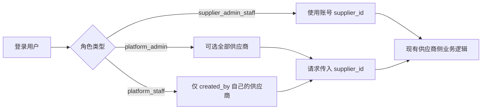

# 平台角色多供应商查询改造计划

## 核心原则

- **供应商角色**：忽略入参 `supplier_id`，强制用 `current_user.supplier_id`（与现网一致）。
- **平台角色**：必须传 `supplier_id`；并校验是否在权限范围内（admin=全部，staff=`Supplier.created_by == actor.id`）。
- **复用现有接口**：同一套 list/detail/create/update API，仅增加/启用 `supplier_id` 参数与返回字段中的供应商名称。
- **未选供应商**：平台端不自动请求业务数据，筛选区展示供应商下拉，选中后再查。

已有可复用样板：[missions.py](hemu_oversea_fastapi/app/services/missions.py) 的 `_scope_supplier_id`、[users.py](hemu_oversea_fastapi/app/services/users.py) 的 `list_supplier_users`。

---

## 一、后端：统一作用域层

### 1. 抽取公共能力（新建）

在 `hemu_oversea_fastapi/app/services/supplier_scope.py`（或 `app/core/supplier_scope.py`）提供：

- `resolve_supplier_id(actor, supplier_id) -> int`：从 mission 现有逻辑提升，并**增加平台员工归属校验**。
- `accessible_supplier_filters(actor)`：admin 无额外过滤；staff 加 `created_by == actor.id`。
- `assert_supplier_accessible(db, actor, supplier_id)`：写操作前校验。

随后让 `missions._scope_supplier_id`、`users.list_supplier_users` 改为调用同一函数，避免两套规则。

### 2. 供应商列表与选项

- [suppliers.py](hemu_oversea_fastapi/app/services/suppliers.py) `list_suppliers`：按角色过滤，`platform_staff` 仅 `created_by=actor.id`，`platform_admin` 全量
- `SupplierPublic`：增加 `created_by_name`（维护管理员反显，来自 users 用户名）
- 新增 `POST /admin/suppliers/options`：轻量下拉 `[{id, name}]`，同样按角色过滤，供各业务页筛选区复用

### 3. 各业务接口统一「可选 supplier_id」

对下列模块的 list（及同作用域的 create/update/delete/detail，保证选中供应商后 CRUD 可用）改为：`sid = resolve_supplier_id(current_user, payload.supplier_id)`，不再直接因 `supplier_id is None` 报「未绑定供应商」。

- **店铺** [stores.py](hemu_oversea_fastapi/app/api/admin/stores.py)：启用 payload.`supplier_id`（现被注释忽略）；create 从 `require_supplier` 放宽为 `require_admin_user` + resolve；列表返回补 `supplier_name`
- **店铺巡检**：已要求传 `supplier_id`，用 resolve 做归属校验，禁止越权
- **商品列表** [products.py](hemu_oversea_fastapi/app/api/admin/products.py)：request schema 增加可选 `supplier_id`；列表项补 `supplier_name`
- **种子分类** [categories.py](hemu_oversea_fastapi/app/api/admin/categories.py) `/dh/seed-list`：request 增加可选 `supplier_id`
- **SKU / 属性模板**：`_require_supplier_id` 改为 resolve；列表补 `supplier_name`
- **任务** [missions.py](hemu_oversea_fastapi/app/services/missions.py)：读加强归属校验；写操作在传入 `supplier_id` 后允许平台角色；列表补 `supplier_name`

商品分类 `/categories/dh/list` 是全局类目，**不按供应商隔离**，本次只做前端 Tab；tiktok 暂无表，不建假接口。

### 4. 权限树

当前 [permission_catalog.py](hemu_oversea_fastapi/app/core/permission_catalog.py) 中 `PLATFORM_TREE_SCOPES = {platform, common}`，store/product/template/mission 为 `scope: supplier`，平台员工角色树里选不到这些菜单。

- 将 `PLATFORM_TREE_SCOPES` 扩展为包含 `supplier`，使平台角色可配置这些权限
- `platform_admin` 仍全放行
- **默认平台员工角色**仍保持现有 supplier+personnel；业务菜单由管理员按需赋权

---

## 二、前端：平台身份交互

### 1. 公共组件与工具

新建 `src/components/SupplierSelectField`（或 `PlatformSupplierFilter`）：

- 仅 `canPlatform` 时渲染；调用 `/suppliers/options`
- 受控：`value` / `onChange`；未选中时业务 ProTable `request` 直接返回空（不调业务 API）
- 工具 `src/utils/portalScope.ts`：`isPlatformRole`、`resolveRequestSupplierId(currentUser, selectedId)`

复用现有 [access.ts](hemu_oversea_fastapiadmin/src/access.ts) 的 `canPlatform`。

### 2. 各页面改动

- **供应商列表** `src/pages/supplier/list`：平台角色增加「维护管理员」列（`created_by_name`）；列表后端已按角色过滤
- **店铺列表** `src/pages/store/list`：平台筛选区首位供应商下拉；列增加「供应商」；请求传 `supplier_id`
- **店铺巡检** `src/pages/store/inspection`：去掉「未绑定供应商」硬阻断；改为供应商下拉后再查
- **商品列表** `src/pages/product/list`：平台供应商下拉 + 供应商列；列表与店铺筛选项均带 `supplier_id`
- **商品分类** `src/pages/product/category`：Tabs `dhgate`（默认，现有树）/ `tiktok`（Empty 占位）；不依赖供应商
- **种子商品分类** `src/pages/product/seed-category`：同上平台 Tabs；平台角色另加供应商下拉，选中后才请求
- **属性模板** `src/pages/template/sku-attr`：平台供应商下拉 + 供应商列
- **商品裂变** `src/pages/mission/fission`：平台供应商下拉 + 供应商列；list/create/人员下拉均传 `supplier_id`

商品编辑、裂变选品等凡读取 `currentUser.supplier_id` 的地方，改为透传「选中供应商」（列表 state / URL query / 轻量 context），避免平台端进详情再次报未绑定。

### 3. 服务层

同步 stores/products/categories/templates/missions/suppliers 的入参与类型，补上 `supplier_id` / `supplier_name` / `created_by_name`。

---

## 三、实施顺序

1. 作用域公共模块 + suppliers list/options + created_by_name
2. stores / inspection / products / seed-categories / sku-templates / missions 接口改造
3. PLATFORM_TREE_SCOPES 扩展
4. 前端 SupplierSelect + 工具函数，再逐页改列表
5. 商品分类 / 种子分类 Tabs（tiktok 占位）
6. 详情/编辑链路透传选中供应商

---

## 四、验收要点

- `platform_admin`：各业务菜单可选任意供应商后正常列表/筛选/增删改；供应商列表显示维护管理员；店铺/商品/模板/任务列表有供应商列
- `platform_staff`：仅本人创建的供应商；对非本人 `supplier_id` 拒绝；被授予对应菜单权限后行为同上
- `supplier_*`：无供应商下拉、无供应商列；行为与改前一致
- 未选供应商时平台端不报「未绑定供应商」，而是引导先选
- 商品分类默认 dhgate；切 tiktok 见占位，不请求不存在的接口

