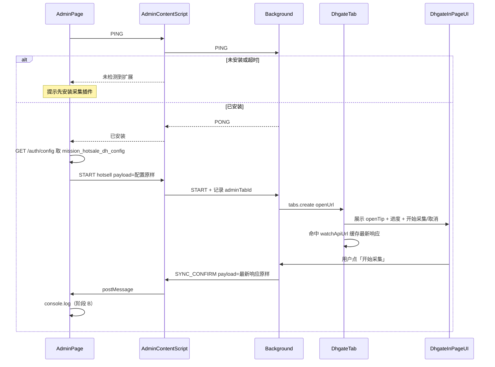
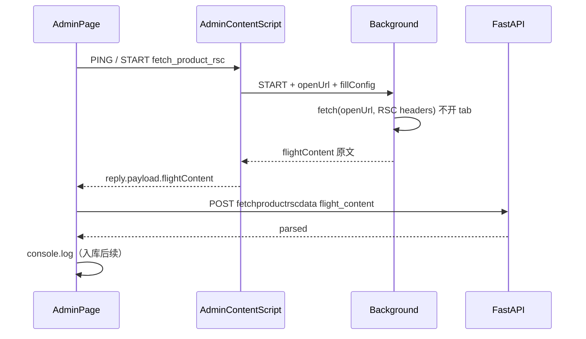

# HeMu 浏览器扩展开发计划（可扩展平台 + 热卖首期）

## 目标与边界

**平台目标**：[`hemu_oversea_browser_extension`](hemu_oversea_browser_extension) 是**纯粹、可扩展的插件工程**，不只服务热卖采集。管理端按 **业务类型（`businessType`）+ 动作（`action`）+ 参数（`payload`）** 发指令，扩展路由到对应 feature 模块执行；采集结果只回传管理端，由已登录管理端调 [`hemu_oversea_fastapi`](hemu_oversea_fastapi) 入库。

**首期业务（`hotsell`）目标**：

1. 管理端「设置任务数据」点击「开始采集」→ 按需 PING → 拉 `mission_hotsale_dh_config` **原样** `START` → 扩展按 `openUrl` **新标签打开**敦煌页。
2. 敦煌页顶部面板：展示配置 `openTip`；按 `watchApiUrl` 监听接口响应并显示进度；按钮「开始采集 / 取消」。点「开始采集」将**最新一次接口响应原样** `SYNC_CONFIRM` 回传管理端；阶段 B 管理端 **console.log**（入库后续）。
3. 用户在管理端**手动**点「单个提取」（阶段 C）→ `START fetch_product_rsc`（商品 `openUrl` + 配置 `fillConfig`）→ 扩展 **background 直拉 RSC Flight（不开新 tab）** 并同步回传原文 → 管理端调 `POST /api/v1/common/utils/dhgate/fetchproductrscdata`（`flight_content`）解析；当前联调打印 `parsed`，入库后续。

**边界**：

- 扩展**不**直连业务库、**不**用扩展侧 JWT 写库。
- 第一期浏览器：**Chrome + Edge（Chromium MV3）**。
- 官方 `dh.wis.*` 是店铺经营数据，与前台热卖采集职责分离。
- 安装引导、商店上架流程本期不细化。

参考：[`hemu_oversea_browser_extension/README.zh.md`](hemu_oversea_browser_extension/README.zh.md)（实现后需改成「通用插件平台」表述）。

---

## 可扩展性设计（核心）

### 设计原则

- **插件 = 运行时 + 消息总线 + feature 插件包**；业务逻辑进 `features/<businessType>/`，不进 background 大杂烩。
- 管理端只依赖**稳定信封协议**；新增业务 = 新 feature 目录 + 注册表一项 + 管理端传新的 `businessType`。
- 站点适配（敦煌 / 未来其它站）与业务解耦：`sites/dhgate` 提供 hook/DOM 能力，feature 只声明「用哪些能力、哪些 URL pattern」。

### 推荐目录（WXT）

```text
hemu_oversea_browser_extension/
  entrypoints/
    background.ts              # 薄：挂载 router，不写业务
    admin.content.ts           # 管理端桥：postMessage ↔ runtime
    dhgate.content.ts          # 敦煌薄入口：转给 sites/features
  src/
    core/
      protocol.ts              # 信封、版本、错误码
      router.ts                # businessType + action → handler
      session.ts               # adminTabId、activeJob、握手
      messaging.ts             # 统一 send/broadcast
    sites/
      dhgate/
        matches.ts
        net-hook.ts            # 主世界 fetch/XHR 注入与转发
        ui-toast.ts            # 敦煌页内确认条/浮层（同步确认）
    features/
      hotsell/                 # 首期业务
        manifest.ts            # 声明 actions、urlPatterns、所需 site
        list-capture.ts        # 列表监听、缓冲、确认同步
        detail-crawl.ts        # 手动详情队列
        map.ts                 # 接口/DOM → 规范化 DTO
      _example/                # 可选：第二业务脚手架模板
        manifest.ts
    shared/
      types.ts
      config.ts                # admin origins、默认外链等
  wxt.config.ts
  README.md / README.zh.md
```

### 统一协议（管理端 ↔ 扩展）

所有消息同一信封，用 `businessType` 区分业务：

```ts
{
  source: 'hemu-browser-ext',   // 固定，防伪造
  version: 1,
  businessType: 'hotsell',      // 后续: 'xxx' | ...
  action:
    | 'PING' | 'PONG'
    | 'START' | 'STOP' | 'STATUS'
    | 'SYNC_CONFIRM'            // 扩展→管理端：用户已确认同步的数据
    | 'ITEM_UPSERT'             // 扩展→管理端：单条详情
    | 'ERROR',
  requestId: string,
  sessionId?: string,           // 一次采集会话，关联管理端 tab
  payload?: unknown,            // 业务参数（外链 URL、字段白名单、队列配置等）
  ts: number
}
```

**路由规则**：`router.handle(msg) => features[msg.businessType][msg.action]`；未知 `businessType` 返回明确错误，便于管理端提示「请升级扩展」。

**START 示例（热卖列表）**：

```ts
{
  businessType: 'hotsell',
  action: 'START',
  payload: {
    mode: 'list_collect',
    collectConfig: {
      openUrl: 'https://seller.dhgate.com/.../toprofileNew.do',
      watchApiUrl: 'https://seller.dhgate.com/.../productrankNew.do',
      alertTip: '请在本页筛选/翻页以加载热卖列表，确认后点击完成采集',
    },
  }
}
```

**START 示例（商品 RSC，手动单条）**：

```ts
{
  businessType: 'hotsell',
  action: 'START',
  payload: {
    mode: 'fetch_product_rsc',
    openUrl: 'https://www.dhgate.com/product/.../1127978371.html',
    fillConfig: { /* 来自 mission_hotsale_dh_config.fillConfig */ },
  }
}
// 回复 payload：{ ok, flightContent, httpStatus, contentType, elapsedMs, ... }
```

后续新业务只需新增 `features/foo` 并文档化其 `action`/`payload`，**不必改管理端桥接层**。

---

## 首期热卖业务流（按你补充的交互）

### 流程 1：列表采集与确认回传（阶段 B，已按补充需求落地）



要点：

- **安装检测**：管理端点击时先 `PING`；失败 = 未安装/未启用。
- **打开热卖页**：由**扩展**按配置 `openUrl` 新标签打开（非管理端 window.open）。
- **页内 UI**：`openTip` 文案 + 基于 `watchApiUrl` 命中次数的进度；「开始采集」回传最新响应，「取消」结束并关采集标签。
- **数据不自动灌管理端**：仅用户在敦煌页确认后 `SYNC_CONFIRM`；阶段 B 管理端只打印。
- **同步目标**：绑定发起 `START` 的 **adminTabId**。

### 流程 2：商品 RSC 取数（`fetch_product_rsc`，单条已联调）



要点：

- **必须用户在管理端手动点「单个提取」**，列表同步后不自动拉详情。
- **不开商品 tab**；不占用 `list_collect` 的 job-store。
- 有 `flight_content` 时后端**不再**向上游发 RSC；仅 `url` 时仍走服务端拉取（兼容旧联调）。
- 批量 / 入库 / `ITEM_UPSERT` 刷新列表：**后续**再接。

---

## 固定技术选型


| 项 | 选择 |
| --- | --- |
| 脚手架 | **WXT** + TypeScript + Vite |
| Manifest | MV3 |
| 业务扩展 | `features/*` + `businessType` 路由 |
| 列表数据 | 敦煌主世界 `fetch`/`XHR` hook |
| 同步确认 UI | 敦煌页 content script 注入轻量条（非管理端） |
| 跨站回传 | Background 总线 → 绑定的 admin tab → `postMessage` |
| 详情 RSC | `START fetch_product_rsc`；background `fetch`（host_permissions + Cookie）；同步回传 `flightContent`；管理端调 `fetchproductrscdata` 解析 |

---

## 分阶段交付

### 阶段 A — 可扩展骨架 + 按需安装检测（已完成扩展侧）

**业务**

- **不在**管理端全局/进站时检测扩展。
- 仅在具体事务场景点击按钮（如热卖「开启采集」）时，由页面主动 `PING`；未响应则视为未安装。
- 协议与目录按多业务设计，热卖只作为第一个 feature 注册占位。

**技术**

1. WXT 初始化：`src/core` + `features/hotsell` 占位 + `entrypoints/background|admin.content`。
2. `admin.content.ts`：只做桥接，**页面加载不主动 PING**。
3. `PING`→`PONG`（`extensionVersion`、`supportedBusinessTypes`、`detectMode: 'on_demand'`）。
4. 对接说明：`docs/ADMIN_BRIDGE.zh.md`（前端页面后续接入）。

**验收**：已装扩展时按钮触发 PING 成功；未装超时失败；刷新管理端其它页无自动检测行为。

---

### 阶段 B — 热卖列表：配置开页、监听、页内确认回传（已落地）

**业务**（按补充需求）

1. 已登录管理端「设置任务数据」点击「开始采集」。
2. 未安装 → 提示安装；已安装 → 拉配置 `mission_hotsale_dh_config` 原样 `START`。
3. 扩展按 `openUrl` 新标签打开；顶部面板展示 `openTip` + `watchApiUrl` 监听进度；按钮「开始采集 / 取消」。
4. 用户点「开始采集」→ 最新接口响应原样回传管理端 → 管理端 `console.log`。

**技术**

1. `features/hotsell/list-capture` + `sites/dhgate/net-hook`（主世界 fetch/XHR）+ `ui-panel`。
2. 缓存「最新一次」响应；确认前不向管理端推送。
3. `SYNC_CONFIRM` → admin content `postMessage` → 管理端订阅打印（入库后续）。
4. 管理端：`pingExtension` + `requestExtension(START)` + `subscribeExtensionMessages`。

**注意点**

- 配置需含 `openUrl` / `watchApiUrl`；建议配置 `openTip`。
- 多管理端 Tab：以发起 `START` 的 tab 为准。
- 「取消」停止任务并尝试关闭采集标签。

**验收**：START 开页 → 触发 watchApiUrl → 页内开始采集 → 管理端控制台看到原样数据。

---

### 阶段 C — 商品 RSC 取数：`fetch_product_rsc`（进行中）

> **已定方案**：不再开商品详情 tab；mode 仅用 `fetch_product_rsc`。由扩展 **background 直拉** 商品页 RSC，Flight 原文随 `START` 回复同步回管理端；解析与入库在管理端 / 后端完成。

**业务（当前联调）**

1. 管理端行内「单个提取」→ 按需 `PING` → 拉 `mission_hotsale_dh_config.fillConfig`。
2. `START`：`{ mode: 'fetch_product_rsc', openUrl: 商品链接, fillConfig }`（嵌套，勿扁平）。
3. 扩展 background：`fetch(openUrl, { headers: { RSC: '1', Accept: 'text/x-component' }, credentials: 'include' })`，**不开新标签**，不占用 `list_collect` 的 job-store。
4. 回复 payload：`{ ok, flightContent, httpStatus, contentType, elapsedMs, ... }`。
5. 管理端调用 `POST /api/v1/common/utils/dhgate/fetchproductrscdata`，传 `flight_content`（可附带 `url` 便于回显）；**有 `flight_content` 时后端不再向上游发 RSC**。
6. 当前：`console.log` 解析结果；**入库 / 写 collect_status 后续再接**。

**后端接口约定**

| 路径 | 说明 |
| --- | --- |
| `POST /api/v1/common/utils/dhgate/fetchproductrscdata` | 原 `product-page` 更名 |
| 请求 `url` | 可选；无 `flight_content` 时必填，服务端自行拉 RSC |
| 请求 `flight_content` | 可选；有则优先解析，不发上游请求 |
| 响应 | 与原联调接口一致：`ok` / `reason` / `parsed` / `raw` / `channel` 等 |

**技术落点**

| 端 | 改动 |
| --- | --- |
| 扩展 `types` / `list-capture` | mode=`fetch_product_rsc`；`fetchProductRscFlight` |
| 扩展 `dhgate.content` | 仅服务 `list_collect`；RSC 路径不注入商品页 |
| 管理端 `HotsaleDataTable` | 单个提取走插件 + `fetchDhgateProductRscData` |
| FastAPI `product_page.fetch_product_page` | 支持 `flight_content=` 优先解析 |

**后续（本阶段未完成）**

- 批量 / 任务提取：串行多次 `fetch_product_rsc` + 间隔，或队列。
- 解析成功后写入 `mission_data_dh_hotsale`（替换或并联现有服务端直拉提取）。
- Flight 过大时的消息体积策略（压缩 / 直传后端）。

**验收（当前）**：单个提取 → 无新 tab → 控制台可见 `parsed`；仅 `url` 调同一接口仍可由服务端拉 RSC。

---

### 阶段 D — 平台打磨与文档

- `wxt zip` 内部分发；README 改为「通用插件 + 热卖 feature」。
- 文档：如何新增 `businessType`（复制 `_example`、注册 router、管理端传参）。
- Popup：版本、当前 `businessType`/任务状态（可选）。
- 安全：payload 大小限制、origin 白名单、日志脱敏。

---

## 三端分工


| 端 | 职责 |
| --- | --- |
| 扩展 | 平台路由、各 feature、站点 hook、页内确认 UI、队列 |
| [`hemu_oversea_fastapiadmin`](hemu_oversea_fastapiadmin) | 安装检测、外链、START/收 SYNC_CONFIRM 与 ITEM_UPSERT、入库、刷新 |
| [`hemu_oversea_fastapi`](hemu_oversea_fastapi) | 热卖列表/详情写入与查询 API（供应商作用域） |

顺序：A → B → C → D。新业务只加 feature，不推翻 A。

---

## 当前实现：单 Job 模型（已落地，后期优化）

> **现状**：`hotsell` 的 **job-store 仅服务 `list_collect`**（开标签 + 页内确认）。`fetch_product_rsc` **不写 job、不开 tab**，与进行中的列表采集互不顶替。  
> **后期优化**（暂不做）：列表采集多 Job / 占线拒绝；RSC 批量队列与节流。

### 行为约定

1. `START list_collect`：
   - 若已有上一采集标签 → **关闭该标签**；
   - 用整份 `HotsellCollectJob` 覆盖内存 Job；
   - `tabs.create` 打开 `collectConfig.openUrl`。
2. `START fetch_product_rsc`：
   - **不**改动 job-store、**不**开关标签；
   - background 直拉商品 RSC，Flight 原文放在本次 `START` 的 reply payload（`flightContent`）。
3. START 的 `payload` 使用**嵌套配置**，避免同名字段串扰：
   - 列表：`{ mode: 'list_collect', collectConfig }`
   - RSC：`{ mode: 'fetch_product_rsc', openUrl, fillConfig }`
4. 列表会话绑定仍以发起 START 的管理端 `adminTabId` 为准；`SYNC_CONFIRM` 只打到该 tab。

### 局限（已知）

| 场景 | 实际效果 |
| --- | --- |
| 列表采集进行中再点「开始采集」 | 旧标签关闭，Job 换成新一轮；未确认的 `latestData` 丢失 |
| 列表采集进行中点「单个提取」 | **不顶替**列表 Job；RSC 在 background 并行完成（注意网络/代理负载） |
| 快速连点多次「单个提取」 | 多次并发 fetch；管理端按钮有 extracting 锁，仍建议后续加队列 |
| 多管理端 Tab 同时开列表采集 | 以**最后一次 list_collect START** 的 adminTabId / Job 为准 |

### 后期优化方向（备注，暂不排期实现）

- **列表占线拒绝**：`getHotsellJob()` 已 `active` 时新 `list_collect` 返回明确错误。
- **RSC 批量队列**：串行 + 间隔；失败重试与风控暂停。
- **未确认数据保护**：列表被新 START 顶替前提示。

---

## 关键风险与对策


| 风险 | 对策 |
| --- | --- |
| 业务堆进 background | 强制 feature 目录 + router，code review 拒绝巨型 background |
| 热卖接口变更 | pattern/字段映射属 hotsell 配置；调试开关列出最近命中 URL |
| 未确认就入库 | 列表数据默认仅缓冲；仅 `SYNC_CONFIRM` 后管理端才写库 |
| 详情误自动跑 | 仅用户点击「单个提取」等手动触发 `fetch_product_rsc` |
| RSC 与列表采集抢带宽 | 当前允许并行；批量时再串行限速 |
| 单 Job 顶替导致中断/丢未回传数据 | **仅 list_collect**；见上文「单 Job 模型」；后期占线拒绝 |
| 云盾/验证码 | 暂停队列 + 管理端/页内提示 |
| 伪造 postMessage | `source`/`version` + admin origin matches |
| 扩展版本不支持新业务 | `PONG.supportedBusinessTypes`；管理端提示升级 |

---

## 里程碑

1. **M1**：可扩展骨架 + PING/PONG + `hotsell` 注册占位。
2. **M2**：列表外链 → 拦截 → 页内确认同步 → 管理端刷新。
3. **M3**：`fetch_product_rsc` 单条联调通过 → 解析入库 → 批量队列。
4. **M4**：分发包 +「如何加新 businessType」文档。

---

## 明确不做（本期）

- Firefox / 商店正式上架流程。
- 安装引导的精细交互（只留检测失败时的占位提示）。
- 扩展直连 DB。
- 列表同步后自动爬详情。
- 一次实现多个非热卖业务（只保证扩展点与示例结构就绪）。
