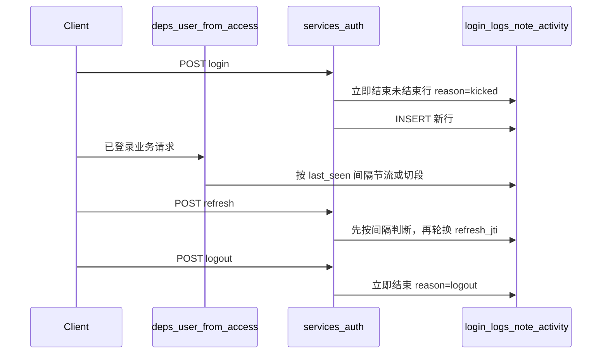

# 登录与操作日志

## 范围

- 操作日志保持现有写法：关键操作另表记录，本期不改切段规则。
- 登录日志从「一次密码登录一直到登出」改为「一段连续活跃一行」。
- 管理端与应用端共用 `app/services/auth.py` 和 `app/services/login_logs.py`，两端都走同一套切段。
- 不增加前端「重新打开页面」标记。重新打开管理端时本来就会拉取当前用户或换票，这两次请求已经能代表用户回来了。
- 不做定时任务。人关掉页面后不再回来时，行保持未结束；列表用当前时间与 `last_seen_at` 的间隔显示「非活跃」。

已完成的基础（表、登录/刷新/登出埋点、操作日志、`admin:logs` 查询、系统日志页面）继续沿用，本文件后面描述的是登录日志要改成的规则。

## 登录日志记什么

一行表示一段时间连续活跃，不是一次 refresh 凭证，也不是一次开关浏览器。

能证明用户还在的请求只有两类，规则相同：

- 已登录业务接口（管理端、应用端、`/common`，都经过 `app/core/deps.py` 的 `_user_from_access`）
- 换票 `refresh_for_audience`

换票只说明 access 到期，不单独当成新的登录。access 默认 30 分钟，人一直在操作时大约每 30 分钟换一次票；只要距离上次活跃没超过空闲阈值，就还是同一行，只轮换 `refresh_jti`。

配置（`.env`，由 `app/core/config.py` 读取）：

- `LOGIN_LOG_TOUCH_MINUTES=5`：距 `last_seen_at` 不足这个分钟数，不写库
- `LOGIN_LOG_IDLE_MINUTES=15`：距 `last_seen_at` 达到或超过这个分钟数，旧行结束，新开一行

判断用这一行当前的 `last_seen_at`，在更新它之前做：

| 间隔 | 动作 |
| --- | --- |
| 小于节流分钟 | 不写库 |
| 达到节流分钟、未到空闲分钟 | 只更新 `last_seen_at`（以及本次请求的 ip / user_agent） |
| 达到空闲分钟 | 旧行改为已结束，再插入新行 |

空闲结束时：

- `last_seen_at` 保持最后一次真正计入的接口时间，不要改成现在
- `active_until = last_seen_at + LOGIN_LOG_IDLE_MINUTES`（变为非活跃的时刻）
- `logout_at` 为这次写入的时刻（用户再次操作或再次打开页面的时刻）
- `logout_reason = idle`
- `idle_minutes` 记下当时采用的阈值，之后改配置不影响这一行的时长
- 新行 `login_at = last_seen_at = 这次请求的时间`

换票的顺序：先按上表判断，再把当前未结束行的 `refresh_jti` 换成新 jti。先改 `last_seen_at` 再判断的话，紧接着的业务请求会以为间隔很短，该切开的一段不会切开。

下面这些不看空闲阈值，立刻结束该用户该 audience 的未结束行，并且不覆盖 `last_seen_at`：

| 事件 | logout_reason | active_until |
| --- | --- | --- |
| 主动退出 | `logout` | 关闭时刻 |
| 全部退出 | `logout_all` | 关闭时刻 |
| 修改密码 | `password_change` | 关闭时刻 |
| 再次输入账号密码登录（管理端会踢掉旧会话） | `kicked` | `min(关闭时刻, last_seen_at + 空闲分钟)` |

主动退出、全部退出、改密码时用户正在操作，截止时间就是关闭时刻。密码登录踢下线时，若旧行已经空闲很久，截止停在「最后请求 + 空闲分钟」，避免把中间几天算进上一段；若还在阈值内，截止就是这次登录的时刻。

全部退出和改密码会先进入 `get_current_admin_user`。这两个路径不要先跑切段，否则会先多出一条几乎为零的新行，再立刻被关掉。主动退出只校验 refresh token，不进这个依赖。

未结束行在列表上的状态（不落库）：

- `logout_at` 为空，且现在距 `last_seen_at` 未超过空闲分钟：活跃中
- `logout_at` 为空，且已经超过：非活跃
- `logout_at` 有值：已结束，并展示原因

活跃时长：已结束用 `active_until - login_at`；未结束用 `last_seen_at - login_at`。不要用当前时间减去登录时间。

一个人在同一 audience 上同时只有一条未结束记录。管理端新的密码登录会作废旧 refresh。

## 示例

阈值按 5 分钟节流、15 分钟空闲。access 30 分钟。

1. **10:00** 输入账号密码。新开第 1 条：`login_at = last_seen_at = 10:00`，未结束。
2. **10:00–10:29** 一直有接口。`last_seen_at` 大约记到 10:05、10:10、10:15、10:20、10:25。10:29 距 10:25 只有 4 分钟，这一下不写库。
3. **10:30** 继续点击，access 过期，先换票。距 `last_seen_at`（10:25）约 5 分钟，未过 15 分钟。仍是第 1 条，只轮换 `refresh_jti`，并把 `last_seen_at` 更新为 10:30。不会因为换票新开一行。
4. **10:40** 最后一次操作后关掉浏览器。没有登出请求。第 1 条仍未结束，`last_seen_at = 10:40`。
5. **10:48** 重新打开页面。间隔 8 分钟，未过 15 分钟。换票或拉取当前用户都还落在第 1 条上。
6. **10:55** 之后没有请求。列表从这一刻显示非活跃（10:40 + 15 分钟）。库里的 `logout_at` 仍为空。
7. **次日 09:00** 再打开页面。间隔已超过 15 分钟。第 1 条变为已结束：`logout_reason = idle`，`active_until = 10:55`，`logout_at = 次日 09:00`，`last_seen_at` 仍是 10:40。活跃时长是 10:00 到 10:55。同时新开第 2 条，`login_at = 09:00`。

若第 5 步不是重新打开，而是退出后再次输入密码：第 1 条立刻结束，原因 `kicked`。10:48 仍在 15 分钟内，`active_until = 10:48`。然后另开一条密码登录的新行。

## 数据流

## 表字段

`user_login_logs` 在现有列上增加：

- `active_until`：可空。空闲结束时为 `last_seen_at + idle_minutes`；立即结束时见上一节的表。未结束为空
- `idle_minutes`：可空。这一行被空闲规则结束时记下的阈值

已有列的含义改为：

- `login_at`：本段开始。密码登录，或空闲后第一次请求（含重新打开页面触发的换票、拉取当前用户）
- `last_seen_at`：最后一次计入的接口时间。关闭时不改
- `logout_at`：写成已结束的时刻。人还没回来之前为空
- `logout_reason`：`logout` / `logout_all` / `kicked` / `password_change` / `idle`
- `refresh_jti`：这一段当前的 refresh jti

`supplier_id`、`username`、`ip`、`user_agent`、`audience` 保持现在的快照用途。

活跃时长仍由接口计算 `online_seconds`，不另存一列。已结束且有 `active_until` 时用它减 `login_at`，否则用 `last_seen_at` 减 `login_at`。

## 改动位置

| 位置 | 改动 |
| --- | --- |
| `app/services/login_logs.py` | 新增 `note_activity`。结束旧行时写 `logout_at`、`active_until`、`idle_minutes`、`logout_reason`，保留 `last_seen_at` |
| `app/services/auth.py` | 密码登录先结束旧行再 `open_session`。换票先 `note_activity`，再只更新 `refresh_jti`。`touch_session` 不再在判断前改 `last_seen_at` |
| `app/core/deps.py` | `_user_from_access` 认证通过后调用 `note_activity`。全部退出、改密码跳过 |
| `app/models/user_login_log.py` 与一条新 Alembic 迁移 | 增加 `active_until`、`idle_minutes`。旧行这两列留空 |
| `app/core/config.py`、`.env.example`、`.env.server.example` | 两个分钟配置 |
| `app/schemas/logs.py`、`app/api/admin/logs.py` | 响应增加 `active_until`；`online_seconds` 按上面的截止时间计算 |
| `hemu_oversea_fastapiadmin/src/types/api.ts`、`src/pages/system/logs/index.tsx` | 展示最后请求、活跃截止、状态和结束原因「空闲后再次操作」 |

前端换票、`getInitialState`、401 拦截器不用改。

## 操作日志

保持现有 `user_operation_logs`：关键操作一条记录，和登录切段无关。查询仍走 `POST /logs/operation/list`。

## 明确不做

- 重新打开页面的专用标记或单独接口。
- 用 access 到期或换票本身新开登录日志。
- 定时任务把长时间未返回的行写成已结束（列表只显示非活跃）。
- 每个接口调用都插入一条登录日志。
- 把「现在 − 登录时间」当作停留时间。
