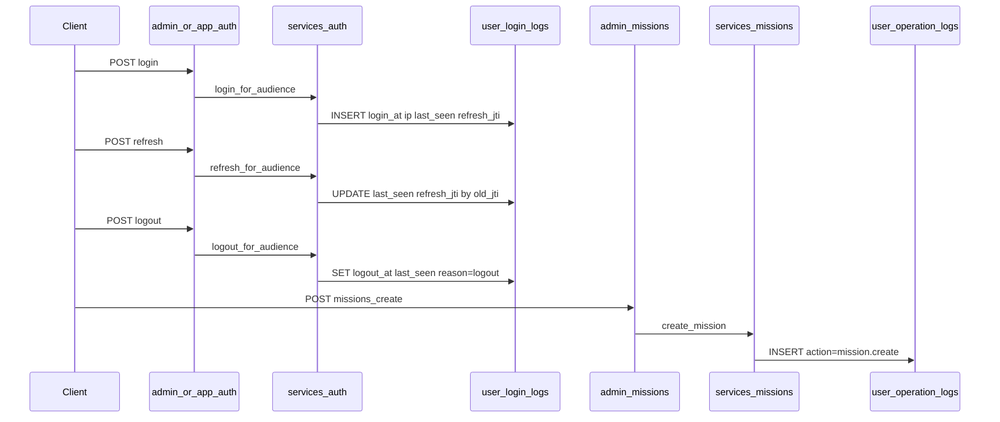

# 登录与操作日志（纯后端）

## 范围与默认决策

- 仅改 [hemu_oversea_fastapi](hemu_oversea_fastapi)：建表、迁移、埋点、admin:logs 查询接口。
- 不改 [hemu_oversea_fastapiadmin](hemu_oversea_fastapiadmin)。
- 登录日志：只记成功登录（失败仍走现有 login_attempts 限流）。
- 操作日志：本期只记 mission.create（新建任务）。
- 查询权限：require_perm("logs.view")（platform_admin 已全局放行）；迁移中种子权限 logs（menu）+ logs.view（button，scope=platform）。
- 在线时长：不落库，接口用 online_seconds = (logout_at or last_seen_at) - login_at 计算。

## 数据流

## 1. 表结构

### user_login_logs

- id PK
- user_id FK users.id ON DELETE SET NULL
- username 冗余快照
- audience：admin / app
- login_at / logout_at（可空）
- logout_reason：logout / logout_all / kicked / expired / password_change（可空）
- last_seen_at：最近活跃，登录时等于 login_at
- ip String(45)、user_agent String(255)
- refresh_jti：当前 refresh jti，用于刷新/登出对账
- created_at server_default now

索引：(user_id, login_at)、(login_at)、(audience, login_at)、refresh_jti。

### user_operation_logs

- id PK
- actor_user_id FK users SET NULL；actor_username / actor_role / org_type / supplier_id 快照
- action：本期固定 mission.create
- resource_type：mission；resource_id：任务 id 字符串
- summary：如「新建任务：{title}」
- detail JSONB 可空（title、worker_id、supplier_id）
- ip / user_agent 可空；status：success；created_at

索引：(actor_user_id, created_at)、(action, created_at)、(resource_type, resource_id)、(created_at)。

不做日汇总表；统计用 date_trunc 实时聚合。

## 2. 迁移

- 新 revision：down_revision = l2f3a4b5c6d7（当前 head）。
- 创建上述两表 + 索引。
- 插入权限：logs（menu, platform）、logs.view（button, platform, parent=logs）。
- 不改前端菜单；权限码供后续前端与 require_perm 使用。

## 3. 埋点（服务层）

### 登录日志 — 改 [app/services/auth.py](hemu_oversea_fastapi/app/services/auth.py)

新增 [app/services/login_logs.py](hemu_oversea_fastapi/app/services/login_logs.py)，由 auth 调用：

- login_for_audience 成功、issue_tokens 之后：INSERT；admin 登录前 _revoke_all 时，把该用户该 audience 未关闭行标 logout_reason=kicked
- refresh_for_audience：按旧 jti 找到行，更新 last_seen_at、refresh_jti=新 jti（必要时更新 ip）
- logout_for_audience：按 jti 关行，logout_at、last_seen_at=now、logout_reason=logout
- logout_all / _revoke_all（改密等）：批量关未结束行，logout_all / password_change
- 不在 refresh 旋转时写 logout，避免误报登出

活跃时间精度：依赖 refresh（access 约 30 分钟）与登出；本期不做全请求心跳，避免写放大。

客户端元信息：在 admin/app auth 抽公共 _client_meta 到 [app/core/request_meta.py](hemu_oversea_fastapi/app/core/request_meta.py)，优先 X-Forwarded-For 首段，否则 request.client.host。

### 操作日志 — 改 [app/services/missions.py](hemu_oversea_fastapi/app/services/missions.py)

[app/services/operation_logs.py](hemu_oversea_fastapi/app/services/operation_logs.py) 提供 record_operation（不单独 commit，跟调用方同事务）。

在 create_mission：db.add(mission) → db.flush() 得 id → record_operation(action=mission.create) → db.commit()。

本期不传 Request（service 无 Request）；ip/user_agent 先空。后续若要补 IP，再在 API 层传入，仍不动前端。

## 4. admin:logs 接口

新文件 [app/api/admin/logs.py](hemu_oversea_fastapi/app/api/admin/logs.py)，tags=[admin:logs]，prefix=/logs，挂到 [app/api/admin/**init**.py](hemu_oversea_fastapi/app/api/admin/__init__.py)。

- POST /logs/login/list — logs.view — 分页；筛 user_id / username / audience / ip / 时间范围
- POST /logs/login/stats — logs.view — grain: day|week|month；返回 bucket、login_count、unique_user_count
- POST /logs/operation/list — logs.view — 分页；筛 actor_user_id / action / resource_type / resource_id / 时间范围

响应约定：

- 登录列表项含 online_seconds（计算字段）、last_seen_at、logout_at 等。
- 沿用 ApiResponse + PageData + POST body 分页（与 missions 一致）。
- Schema 放 [app/schemas/logs.py](hemu_oversea_fastapi/app/schemas/logs.py)；查询逻辑放 login_logs / operation_logs service。

## 5. 模型注册

- 新增 [app/models/user_login_log.py](hemu_oversea_fastapi/app/models/user_login_log.py)、[app/models/user_operation_log.py](hemu_oversea_fastapi/app/models/user_operation_log.py)。
- 更新 [app/models/**init**.py](hemu_oversea_fastapi/app/models/__init__.py)。

## 6. 验证（实现后）

- alembic upgrade head。
- 管理端登录 → user_login_logs 有行；logout → logout_at 有值；refresh → last_seen_at / refresh_jti 更新。
- 新建任务 → user_operation_logs 一条 mission.create。
- 调三个 /api/v1/admin/logs/... 接口（platform_admin）返回正常。

## 明确不做

- 前端页面 / 路由 / openapi 前端 regenerate。
- 失败登录审计表扩展。
- 操作日志中间件（避免全量 HTTP 落库）。
- 登录日汇总表、定时过期关会话任务（可后续用 expired reason 补）。

