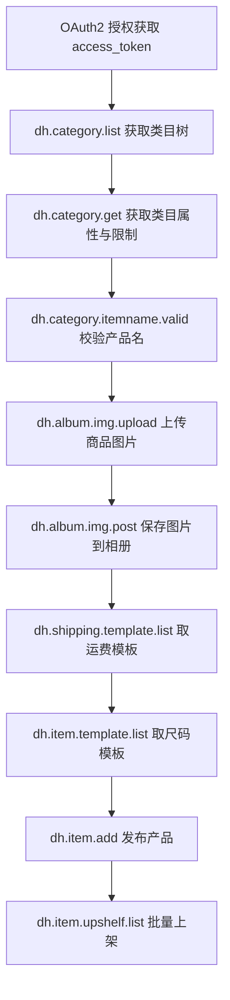
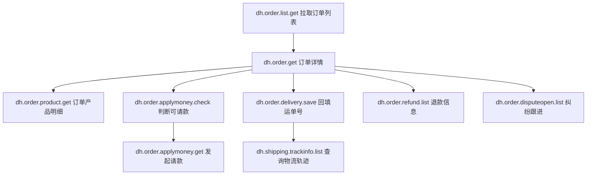
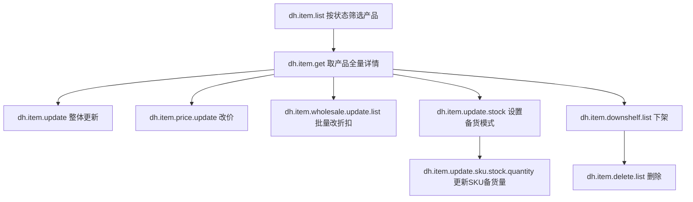

# 敦煌网开放平台 API 手册（卖家 API + 公共 API）

> 本手册基于敦煌网开放平台官方文档（<https://open.dhgate.com/docs/api>）整理，覆盖 **卖家API** 与 **公共API** 两大板块下的全部接口。
> 同一接口同时存在 1.x / 2.x 版本时，**只收录 2.x 版本**；已被 2.0 改名替代的旧接口不再单独展开，仅在对应新接口处标注旧接口名。
> 接口地址、公共参数、授权级别等以官方文档为准，本手册用于开发对照与选型参考。

---

## 目录

- [一、通用说明](#一通用说明)
  - [1.1 接口地址与请求方式](#11-接口地址与请求方式)
  - [1.2 公共参数](#12-公共参数)
  - [1.3 版本与命名规则](#13-版本与命名规则)
  - [1.4 授权级别](#14-授权级别)
  - [1.5 授权与令牌](#15-授权与令牌)
  - [1.6 超时与访问频次](#16-超时与访问频次)
  - [1.7 本手册收录范围与去重规则](#17-本手册收录范围与去重规则)
- [二、卖家 API](#二卖家-api)
  - [2.1 相册 API](#21-相册-api)
  - [2.2 基础 API](#22-基础-api)
  - [2.3 类目 API](#23-类目-api)
  - [2.4 客户评论 API](#24-客户评论-api)
  - [2.5 物流 API](#25-物流-api)
  - [2.6 站内信 API](#26-站内信-api)
  - [2.7 订单 API](#27-订单-api)
  - [2.8 产品 API](#28-产品-api)
  - [2.9 用户 API](#29-用户-api)
  - [2.10 在线发货 API](#210-在线发货-api)
  - [2.11 数据 API](#211-数据-api)
- [三、公共 API](#三公共-api)
  - [3.1 基础 API](#31-基础-api)
- [四、典型业务联动链路](#四典型业务联动链路)
- [五、附录](#五附录)

---

## 一、通用说明

### 1.1 接口地址与请求方式

- 统一入口：`http://api.dhgate.com/dop/router`（生产环境）；沙箱环境使用开放平台提供的测试地址。
- 具体调用哪个接口，由公共参数 `method` + `v` 决定，所有接口共用同一个 URL。
- 幂等查询类接口可用 GET；涉及写入（上传图片、发布/修改产品、发货、请款等）的接口文档明确要求 **仅支持 POST**。实践上建议统一用 POST 以规避长度与编码问题。
- 图片类接口（`dh.album.img.upload`、`dh.item.short.video.upload` 等）以 BASE64 字符串提交，需注意请求体大小。

### 1.2 公共参数

每个请求都必须携带以下公共参数：

| 参数 | 类型 | 必须 | 说明 |
| --- | --- | --- | --- |
| `method` | String | 必须 | API 接口名称，例如 `dh.category.get` |
| `v` | String | 必须 | 接口版本号，例如 `2.0` |
| `timestamp` | String | 必须 | 请求毫秒时间戳（北京时间），服务端容忍误差约 30 分钟 |
| `access_token` | String | 必须 | 请求令牌，需先通过 OAuth2 授权接口获取 |

请求时各接口的「请求参数」与上述公共参数一并提交；`dict` / `list` 类型的入参按敦煌要求做 JSON 序列化后以字符串提交。

### 1.3 版本与命名规则

- 接口名格式为 `dh.<域>.<动作>$<版本>`，例如 `dh.item.add$2.0`。
- 版本从 `1.0` 起步，出现破坏性变更时升大版本（`2.0`）。同一方法名可存在多个版本并存。
- 少数接口存在 `1.1` 这类小版本（如 `dh.album.img.upload$2.1`），通常为能力增强版。
- 文档中 `obsoleted=3` 表示接口处于**可用**状态（非废弃）。

### 1.4 授权级别

按文档标注，接口分为 A / B / C / D 四个级别，含义如下：

| 级别 | 含义 | 典型接口 |
| --- | --- | --- |
| A | 读取类 | 类目查询、订单查询、站内信查询 |
| B | 更新类 | 发布/修改产品、发货、请款、评价操作 |
| C | 计算类 | 运费计算 |
| D | 复合类 | 批量上下架/删除产品、产品图片上传 |

应用（App）侧也按 A~H 划分权限等级（A 测试、B 普通、C 中级、D 高级、E 合作），需在控制台申请对应权限。

### 1.5 授权与令牌

- 采用 OAuth2 授权，先用 App Key / App Secret 换取 `access_token`，再携带 token 调用业务接口。
- token 具有有效期，过期后需用 `refresh_token` 刷新，或重新走授权流程。
- 令牌失效、App Key 非法等会返回授权错误响应；具体错误码见官方「平台错误码」「授权错误响应」页面。

### 1.6 超时与访问频次

- 各接口文档标注了超时时间（秒）。多数查询接口为 15 秒，订单/产品写入类为 20~30 秒，`dh.album.img.*` 图片类可达 60~100 秒，`dh.wis.detail.page` 为 60 秒。
- 部分基础接口超时标注为 `-1`（不限制）。
- 平台按应用等级（A~H）与接口级别（A~D）做频次限制，具体额度见官方「API访问频次」页面；调用方应做限流与重试退避。

### 1.7 本手册收录范围与去重规则

- 收录板块：**卖家API**（相册、基础、类目、客户评论、数据、在线发货、物流、站内信、订单、产品、用户）与 **公共API**（基础）。
- 去重口径：
  - 同一方法名同时存在 `1.x` 与 `2.0`：只写 `2.0`（例：`dh.category.get`、`dh.order.get`、`dh.order.product.get`、`dh.user.seller.get`）。
  - `2.0` 改名后替代的旧接口（例：`dh.categorys.get$1.0` → `dh.category.list$2.0`），正文只在对应新接口下用一句话标注。
  - 仅存在 `1.0/0.0` 且无升级替代的接口（如 `dh.review.*`、`dh.dispute.*`、`dh.online.*`、`dh.seller.ad.*`、`dh.wis.*`）照常收录。
  - 标注为「不对外开放」(`public=0`，如 `dh.seller.crm.*`、`dh.order.contact.get`、`dh.message.sendmsg`) 的接口仍列出，但会明确提示权限限制。

---

## 二、卖家 API

### 2.1 相册 API

**模块说明**：相册相关操作接口，负责卖家相册的查询、图片上传与保存、以及图片去重判断。是发布产品前准备主图/详情图的必经环节。

**接口清单**

| 接口 | 中文名 | 作用 | 级别 |
| --- | --- | --- | --- |
| `dh.album.list$2.0` | 获取卖家相册列表接口 | 查询卖家全部相册窗口 | A |
| `dh.album.get$2.0` | 卖家获取相册详情接口 | 按相册窗口 ID 查询相册详情 | A |
| `dh.album.img.list$2.0` | 获取相册图片列表接口 | 分页查询某相册下的图片 | B |
| `dh.album.img.upload$2.1` | 卖家上传产品图片接口 | BASE64 上传商品图片 | D |
| `dh.album.img.post$2.0` | 卖家批量保存图片到相册接口 | 批量把图片保存进指定相册 | B |
| `dh.album.img.delete$2.0` | 卖家删除相册图片接口 | 删除相册中的图片 | B |
| `dh.album.repeat.get$2.0` | 判断图片文件是否重复上传接口 | 按 MD5 判断图片是否已存在 | A |

#### dh.album.list$2.0 获取卖家相册列表接口

- **作用**：获取当前卖家账号下所有相册窗口（window）列表。
- **主要应用场景**：图片管理页初始化；发布产品前先取到目标相册 ID。
- **关联接口**：拿到相册 ID 后调用 `dh.album.img.list$2.0` 查看图片，或 `dh.album.img.post$2.0` 存图。
- **返回关键字段**：`albWindowList`
- **级别/超时**：A / 15 秒
- **旧接口**：`dh.albums.get$1.0`（获取卖家相册列表）为其旧版，已由本接口替代。

#### dh.album.get$2.0 卖家获取相册详情接口

- **作用**：根据相册窗口 ID 获取单个相册的详情。
- **主要应用场景**：相册详情弹窗、确认相册归属与容量。
- **关联接口**：相册 ID 通常来自 `dh.album.list$2.0`。
- **关键入参**：`albWindowId`（必填）
- **级别/超时**：A / 15 秒

#### dh.album.img.list$2.0 获取相册图片列表接口

- **作用**：分页获取指定相册内的图片列表。
- **主要应用场景**：图片素材库浏览与选择；发布产品时挑选已有图片。
- **关联接口**：入参 `albWindowId` 来自 `dh.album.list$2.0` / `dh.album.get$2.0`；返回的图片 URL/MD5 可作为 `dh.item.add$2.0` 的 `itemImgList` 来源。
- **关键入参**：`albWindowId`、`pageNum`、`pageSize`（均必填）
- **返回关键字段**：`count`、`sumPage`、`imageList`
- **级别/超时**：B / 100 秒
- **注意**：仅支持 POST。

#### dh.album.img.upload$2.1 卖家上传产品图片接口

- **作用**：以 BASE64 字符串上传商品图片，返回图片名、MD5、图片 URL 与尺寸。
- **主要应用场景**：新品发布时上传主图/附图；批量铺货时上传图片素材。
- **关联接口**：上传成功后，用返回的 `imgUrl` / `imgMd5` 填充 `dh.item.add$2.0` 的 `itemImgList`；也可先调用 `dh.album.repeat.get$2.0` 判断是否重复上传。
- **关键入参**：`funType`、`imgName`、`imgBase64`（必填）；`imgBannerName`、`markPosition`（可选）
- **返回关键字段**：`imgName`、`imgMd5`、`imgUrl`、`result`、`imgSize`
- **级别/超时**：D / 60 秒
- **注意**：
  - 仅支持商品图片类型，必须以 POST 提交。
  - 返回的 `imgUrl` 若形如 `f2/albu/g1/...jpg`，访问地址为 `http://image.dhgate.com/100x100/<imgUrl>`；若形如 `albu_841432510_00`，访问地址为 `http://image.dhgate.com/albu_841432510_00/1.0x0.jpg`。
  - 同名的 `dh.album.img.upload$2.0` 为旧版本，已由 `2.1` 替代。

#### dh.album.img.post$2.0 卖家批量保存图片到相册接口

- **作用**：将已上传的图片（URL + MD5）批量保存到指定相册。
- **主要应用场景**：图片归档；把外部上传的图片批量归入店铺相册便于复用。
- **关联接口**：图片通常来自 `dh.album.img.upload$2.1`；保存后可被 `dh.item.add$2.0` 引用。
- **关键入参**：`albWindowId`、`albInfoList`（列表，含 `imgSize`、`imgUrl`、`imgName`、`imgMd5`）
- **返回关键字段**：`isSuccess`
- **级别/超时**：B / 100 秒
- **注意**：仅支持 POST；同名 `$1.1` 为旧版。

#### dh.album.img.delete$2.0 卖家删除相册图片接口

- **作用**：删除相册中指定的图片。
- **主要应用场景**：素材清理；下架/删除产品后回收图片。
- **关联接口**：图片标识来自 `dh.album.img.list$2.0`。
- **关键入参**：`imgId`、`imgMd5`、`imgUrl`（均必填）
- **返回关键字段**：`isSuccess`
- **级别/超时**：B / 100 秒
- **注意**：仅支持 POST。

#### dh.album.repeat.get$2.0 判断图片文件是否重复上传接口

- **作用**：按图片类型与 MD5 判断该图片是否已上传，若已存在则返回其 URL。
- **主要应用场景**：上传前去重，避免重复占用存储、加快发布流程。
- **关联接口**：一般与 `dh.album.img.upload$2.1` 搭配，先查后传。
- **关键入参**：`imgType`、`imgMd5`（均必填）
- **返回关键字段**：`result`、`imgUrl`
- **级别/超时**：A / 15 秒
- **注意**：仅支持 POST。

---

### 2.2 基础 API

**模块说明**：`Basic API, a public basic operation interface`，卖家维度的基础信息查询，当前包含处罚信息的查询。

**接口清单**

| 接口 | 中文名 | 作用 | 级别 |
| --- | --- | --- | --- |
| `dh.punish.list.get$1.0` | 查询卖家处罚信息接口 | 按时间/处罚 ID 查询店铺处罚记录 | A |
| `dh.punish.brand.list.get$1.0` | 查询卖家处罚信息第三方投诉接口 | 按第三方投诉类型查询处罚记录 | A |

#### dh.punish.list.get$1.0 查询卖家处罚信息接口

- **作用**：查询当前卖家的处罚记录，支持按时间范围、处罚 ID、分页过滤。
- **主要应用场景**：店铺合规监控；处罚到期/申诉状态跟踪；把处罚风险同步到自有 ERP 报表。
- **关联接口**：可与 `dh.user.seller.get$2.0`（店铺信息）配合做店铺健康度看板；与 `dh.seller.ad.*` 报表接口一起用于经营分析。
- **关键入参**：`startDate`、`endDate`、`pageNo`、`pageSize`（必填）；`punishId`（可选）
- **返回关键字段**：`punishInfoList`、`pages`、`count`
- **级别/超时**：A / 15 秒

#### dh.punish.brand.list.get$1.0 查询卖家处罚信息第三方投诉接口

- **作用**：按第三方投诉类型查询卖家的处罚信息。
- **主要应用场景**：品牌/知识产权类投诉的跟进与预警。
- **关联接口**：与 `dh.punish.list.get$1.0` 互补，一个查全量处罚、一个聚焦第三方投诉。
- **关键入参**：`thirdType`、`pageNo`、`pageSize`（均必填）
- **返回关键字段**：`pages`、`count`、`punishInfoList`
- **级别/超时**：A / 15 秒

---

### 2.3 类目 API

**模块说明**：`Category API, an operation interface related to category`。类目是发布产品的基础，本模块负责类目树遍历、类目属性/属性值/品牌查询、类目限制校验等，是「选品 → 定类目 → 取属性 → 发布产品」链路的起点。

**接口清单**

| 接口 | 中文名 | 作用 | 级别 |
| --- | --- | --- | --- |
| `dh.category.list$2.0` | 获取类目列表接口 | 按父类目查询子类目（为空返回一级类目） | A |
| `dh.category.get$2.0` | 获取类目详细信息接口 | 取类目属性、属性值、类目限制 | A |
| `dh.category.path.get$2.0` | 获取类目路径接口 | 由子类目反查上级主线类目 | A |
| `dh.category.attrval.list$2.0` | 获取子属性值列表接口 | 按属性/属性值取子属性与子属性值 | A |
| `dh.category.attrval.listBrand$2.0` | 获取子属性值列表接口 | 按品牌取子属性值列表 | A |
| `dh.category.brandList$2.0` | 获取品牌列表属性 | 按品牌名获取品牌列表 | A |
| `dh.category.brands$2.0` | 获取品牌列表属性 | 同上（功能重复） | A |
| `dh.category.is3Ccategory$2.0` | 判断是否为3C类目接口 | 判断/枚举 3C 类目 | A |
| `dh.category.itemname.valid$2.0` | 检查产品名称是否合法接口 | 校验收类目是否允许该产品名 | A |
| `dh.categoryid.list$2.0` | 通过修改时间获取类目Id列表 | 增量同步类目变更 | A |
| `dh.categorys.commissions$1.0` | 获取佣金率列表 | 获取类目佣金率 | A |

#### dh.category.list$2.0 获取类目列表接口

- **作用**：根据父类目 ID 查询其子类目；不传父类目 ID 时返回全部一级类目。
- **主要应用场景**：类目选择器/级联下拉；本地维护类目树并定期同步。
- **关联接口**：返回的类目 ID 是 `dh.category.get$2.0` 和发布产品 `dh.item.add$2.0` 的关键入参。
- **关键入参**：`parentId`（可选，不传返回一级类目）
- **返回关键字段**：`catePubList`
- **级别/超时**：A / 15 秒
- **旧接口**：`dh.categorys.get$1.0`（获取类目列表）为其旧版，已替代。

#### dh.category.get$2.0 获取类目详细信息接口

- **作用**：获取叶子类目的详细信息，包括类目信息、属性信息、属性值信息，以及类目限制数据（价格、必须包含的关键字、不能包含的关键字）。
- **主要应用场景**：发布/修改产品前，按类目动态渲染属性表单并做合规校验（价格区间、关键词限制）。
- **关联接口**：
  - 入参 `catePubId` 来自 `dh.category.list$2.0`；
  - 属性/属性值进一步细化可调 `dh.category.attrval.list$2.0`、`dh.category.attrval.listBrand$2.0`；
  - 校验产品名用 `dh.category.itemname.valid$2.0`；
  - 结果用于 `dh.item.add$2.0` / `dh.item.update$2.0`。
- **关键入参**：`catePubId`（必须是有效的叶子类目 ID）
- **返回关键字段**：`catePubId`、`pubName`、`pubNameCn`、`leaf`、`pareCatePubId`、`categoryPubAttrList`、`categoryPubAttrgroupList`、`excludeKeyWords`、`inlucdeKeyWords`、`remark`
- **级别/超时**：A / 15 秒
- **旧接口**：`dh.category.get$1.0`（获取类目属性）为旧版，官方建议直接使用 2.0。

#### dh.category.path.get$2.0 获取类目路径接口

- **作用**：根据类目 ID 获取该类目路径上的所有主线类目（由子类目向上回溯）。
- **主要应用场景**：类目面包屑展示；把叶子类目还原成完整类目路径用于报表归类。
- **关联接口**：入参类目 ID 来自 `dh.category.list$2.0`。
- **关键入参**：`catePubId`（必填）
- **返回关键字段**：`categoryPublishList`
- **级别/超时**：A / 15 秒

#### dh.category.attrval.list$2.0 获取子属性值列表接口

- **作用**：根据发布类目 ID、属性 ID、属性值 ID 获取子属性与子属性值列表。
- **主要应用场景**：处理带层级的属性（如「领型 → 子样式」），做多级联动选择。
- **关联接口**：属性源来自 `dh.category.get$2.0` 的 `categoryPubAttrList`；结果用于 `dh.item.add$2.0` 的 `itemAttrList`。
- **关键入参**：`catePubId`、`childAtrrId`（必填）；`catePubAttrValId`（可选）
- **返回关键字段**：`categoryPubAttr`、`catePubId`
- **级别/超时**：A / 15 秒

#### dh.category.attrval.listBrand$2.0 获取子属性值列表接口（品牌维度）

- **作用**：根据发布类目 ID、子属性 ID、品牌 ID（发布属性值 ID）获取子属性值列表。
- **主要应用场景**：品牌属性与其它属性联动时的子值查询。
- **关联接口**：品牌 ID 一般来自 `dh.category.brandList$2.0`。
- **关键入参**：`catePubId`、`brandId`、`childAtrrId`（均必填）
- **返回关键字段**：`categoryPubAttr`、`catePubId`
- **级别/超时**：A / 15 秒

#### dh.category.brandList$2.0 获取品牌列表属性

- **作用**：通过品牌名称（可按类目过滤）分页获取品牌列表及品牌授权信息。
- **主要应用场景**：品牌选择器；发布产品时选取合法品牌。
- **关联接口**：结果用于 `dh.item.add$2.0` 的品牌属性填写；子值查询见 `dh.category.attrval.listBrand$2.0`。
- **关键入参**：`pageNum`、`pageSize`（必填）；`catePubId`、`brandName`、`indexCode`（可选）
- **返回关键字段**：`brandsList`、`brandAuthList`、`page`、`pageCount`、`pageSize`
- **级别/超时**：A / 15 秒

#### dh.category.brands$2.0 获取品牌列表属性

- **作用**：与 `dh.category.brandList$2.0` 功能一致，入参与返回结构基本相同。
- **主要应用场景**：同品牌查询；建议统一使用 `dh.category.brandList$2.0`，本接口作为兼容存在。
- **关联接口**：同 `dh.category.brandList$2.0`。
- **关键入参**：`pageNum`、`pageSize`（必填）；`catePubId`、`brandName`、`indexCode`（可选）
- **返回关键字段**：`brandsList`、`brandAuthList`、`page`、`pageCount`、`pageSize`
- **级别/超时**：A / 15 秒

#### dh.category.is3Ccategory$2.0 判断是否为3C类目或获取所有3C类目接口

- **作用**：判断某类目是否为 3C 类目；不传类目 ID 时返回全部 3C 类目（逗号分隔）。
- **主要应用场景**：上传/修改产品时，判断是否需要填写售后模板属性值。
- **关联接口**：与 `dh.item.add$2.0` / `dh.item.update$2.0` 的 `afterSaleTemplateId` 配合；售后模板列表见 `dh.item.aftersale.list$2.0`。
- **关键入参**：`catePubId`（文档标注必填，不传则返回全部 3C 类目）
- **返回关键字段**：`isvalid`、`categoryIdStr`
- **级别/超时**：A / 15 秒

#### dh.category.itemname.valid$2.0 检查产品名称是否合法接口

- **作用**：检查产品名在目标类目下是否被允许。
- **主要应用场景**：发布/更新产品前的名称合规预校验，避免提交后被驳回。
- **关联接口**：类目 ID 通常来自 `dh.category.list$2.0`；校验通过后再调 `dh.item.add$2.0` / `dh.item.update$2.0`。
- **关键入参**：`catePubId`、`itemName`（均必填）
- **返回关键字段**：`isvalid`
- **级别/超时**：A / 15 秒
- **旧接口**：`dh.category.proname.valid$1.0`（检查产品名称是否合法）为旧版，已替代。

#### dh.categoryid.list$2.0 通过类目修改时间获取类目Id列表

- **作用**：按类目修改时间增量获取发生变化（新增/变更）的类目 ID 列表。
- **主要应用场景**：本地类目库的增量同步，避免全量拉取。
- **关联接口**：拿到变更类目 ID 后，用 `dh.category.get$2.0` 拉取详情刷新本地缓存。
- **关键入参**：`updateDate`（必填）；`siteId`（可选）
- **返回关键字段**：`categoryIdList`
- **级别/超时**：A / 15 秒

#### dh.categorys.commissions$1.0 获取佣金率列表

- **作用**：获取类目佣金率列表，用于按佣金公式计算佣金。
- **主要应用场景**：选品定价与利润测算；按类目核算佣金成本。
- **关联接口**：类目来自 `dh.category.list$2.0`；可结合订单接口 `dh.order.get$2.0` 的 `commissionAmount` 交叉核对。
- **返回关键字段**：`list`
- **级别/超时**：A / 15 秒

---

### 2.4 客户评论 API

**模块说明**：`Customer comment API, a general operation interface of comment`，卖家与买家互评的查询、回复、申请修改等操作。当前均为 1.0 版本。

**接口清单**

| 接口 | 中文名 | 作用 | 级别 |
| --- | --- | --- | --- |
| `dh.review.get$1.0` | 获取买家给卖家的评价列表 | 查询买家对店铺的评价 | A |
| `dh.review.send$1.0` | 获取卖家给买家的评价列表 | 查询店铺对买家的评价 | A |
| `dh.review.wait$1.0` | 获取待评价列表 | 查询待卖家评价的记录 | A |
| `dh.review.feedback$1.0` | 卖家对买家的评价 | 提交对买家的评价 | B |
| `dh.review.reply$1.0` | 保存卖家回复内容 | 回复买家评价 | B |
| `dh.review.delete$1.0` | 卖家删除对买家的评价 | 删除己方评价 | B |
| `dh.review.apply$1.0` | 申请修改买家给卖家的评价 | 对买家评价发起修改申请 | B |

#### dh.review.get$1.0 获取买家给卖家的评价列表

- **作用**：分页查询买家对卖家的评价，可按时间周期与评分过滤。
- **主要应用场景**：店铺口碑监控；差评预警与客服跟进。
- **关联接口**：拿到 `reviewid` 后用 `dh.review.reply$1.0` 回复，或用 `dh.review.apply$1.0` 申请修改；评价关联订单见 `dh.order.list.get$2.0`。
- **关键入参**：`pagenum`、`pagesize`、`score`、`datecycle`（均必填）
- **返回关键字段**：`buyerToSellerReviewInfos`、`page`、`pageSize`、`pageCount`
- **级别/超时**：A / 15 秒

#### dh.review.send$1.0 获取卖家给买家的评价列表

- **作用**：分页查询卖家对买家的评价记录。
- **主要应用场景**：核对己方评价是否成功提交；评价运营分析。
- **关联接口**：与 `dh.review.feedback$1.0`（提交评价）配对使用。
- **关键入参**：`pagenum`、`pagesize`、`score`、`datecycle`（均必填）
- **返回关键字段**：`sellerToBuyerReviewInfos`、`page`、`pageSize`、`pageCount`
- **级别/超时**：A / 15 秒

#### dh.review.wait$1.0 获取待评价列表

- **作用**：查询尚未由卖家评价的订单/记录。
- **主要应用场景**：自动化评价补评，提升店铺评价率。
- **关联接口**：拿到 `rfxno` 后用 `dh.review.feedback$1.0` 提交评价。
- **关键入参**：`pagenum`、`pagesize`（均必填）
- **返回关键字段**：`waitingReviewbySellerInfos`、`page`、`pageSize`、`pageCount`
- **级别/超时**：A / 15 秒

#### dh.review.feedback$1.0 卖家对买家的评价

- **作用**：卖家对指定订单/买家提交评价，含评分与评论内容。
- **主要应用场景**：订单完成后自动评价买家。
- **关联接口**：`rfxno` 来自订单或待评价列表 `dh.review.wait$1.0`。
- **关键入参**：`rfxno`、`comments`、`Score`（均必填）
- **返回关键字段**：`rfxno`
- **级别/超时**：B / 15 秒

#### dh.review.reply$1.0 保存卖家回复内容

- **作用**：对买家的评价提交卖家回复。
- **主要应用场景**：差评解释、好评致谢；维护店铺形象。
- **关联接口**：`reviewid` 来自 `dh.review.get$1.0`。
- **关键入参**：`reviewid`、`content`（均必填）
- **返回关键字段**：`responseId`
- **级别/超时**：B / 15 秒

#### dh.review.delete$1.0 卖家删除对买家的评价

- **作用**：删除卖家已提交的对买家的评价。
- **主要应用场景**：误评撤回。
- **关联接口**：`rfxno` 来自 `dh.review.send$1.0`。
- **关键入参**：`rfxno`（必填）
- **返回关键字段**：`rfxno`
- **级别/超时**：B / 15 秒

#### dh.review.apply$1.0 申请修改买家给卖家的评价

- **作用**：对买家给卖家的评价发起修改申请。
- **主要应用场景**：对不实/恶意评价发起申诉。
- **关联接口**：`rfxno` 来自 `dh.review.get$1.0`。
- **关键入参**：`rfxno`（必填）
- **返回关键字段**：`rfxno`
- **级别/超时**：B / 15 秒

---

### 2.5 物流 API

**模块说明**：`Logistics API, an operation interface related to logistics`，覆盖运费模板、运费计算、物流方式与物流轨迹查询。

**接口清单**

| 接口 | 中文名 | 作用 | 级别 |
| --- | --- | --- | --- |
| `dh.shipping.template.list$2.0` | 卖家获取运费模版列表接口 | 查询运费模板基础信息 | A |
| `dh.shipping.template.get$2.0` | 运费模版详情接口 | 查询单个运费模板详情 | A |
| `dh.shipping.typelist$2.0` | 获取回填中物流方式列表接口 | 获取全部物流方式 | A |
| `dh.shipping.trackinfo.list$2.0` | 物流追踪信息接口 | 查询运单物流轨迹 | A |
| `dh.shipping.compute.item$2.0` | 计算指定单个产品运费接口 | 单品指定物流方式算运费 | C |
| `dh.shipping.compute.package$2.0` | 产品运费计算接口 | 按包装信息算运费列表 | C |

#### dh.shipping.template.list$2.0 卖家获取运费模版列表接口

- **作用**：获取卖家的运费模板列表基础信息。
- **主要应用场景**：发布产品选择运费模板；模板管理页初始化。
- **关联接口**：返回的模板 ID 用于 `dh.item.add$2.0` / `dh.item.update$2.0` 的 `shippingModelId`；详情查看 `dh.shipping.template.get$2.0`。
- **返回关键字段**：`shippingModelList`
- **级别/超时**：A / 15 秒
- **旧接口**：`dh.shipping.templates.get$1.0` 为旧版，已替代。

#### dh.shipping.template.get$2.0 运费模版详情接口

- **作用**：按运费模板 ID 获取模板详情（类型、名称、描述、创建时间等）。
- **主要应用场景**：模板详情展示与校验；发布产品前确认模板配置。
- **关联接口**：模板 ID 来自 `dh.shipping.template.list$2.0`。
- **关键入参**：`shippingTempId`（必填）
- **返回关键字段**：`shippingModelType`、`modelType`、`modelName`、`modelDesc`、`createDate`
- **级别/超时**：A / 15 秒
- **旧接口**：`dh.shipping.template.get$1.0` 为旧版，已替代。

#### dh.shipping.typelist$2.0 获取回填中物流方式列表接口

- **作用**：返回系统支持的全部物流方式列表。
- **主要应用场景**：发货时选择物流方式；运费计算填写 `shippingTypeId`。
- **关联接口**：与 `dh.shipping.compute.item$2.0`、`dh.order.delivery.save$2.0`（上传运单号时的 `shippingType`）配合。
- **返回关键字段**：`shippingTypeList`
- **级别/超时**：A / 15 秒
- **旧接口**：`dh.shipping.types.get$1.0`（获取运费模板中物流方式列表）为旧版，已替代。

#### dh.shipping.trackinfo.list$2.0 物流追踪信息接口

- **作用**：按运单号与物流方式查询物流轨迹。
- **主要应用场景**：订单物流状态跟踪；买家催单时查询；异常件预警。
- **关联接口**：`trackNo` 来自发货接口 `dh.order.delivery.save$2.0` 或在线发货 `dh.online.*`；订单维度可用 `dh.order.list.get$2.0` 的 `deliveryNo` 过滤。
- **关键入参**：`trackNo`、`shippingType`（必填）；`language`（可选）
- **返回关键字段**：`trackInfoList`
- **级别/超时**：A / 15 秒
- **旧接口**：`dh.shipping.trackinfo.get$1.0`（获得物流信息）为旧版，已替代。

#### dh.shipping.compute.item$2.0 计算指定单个产品运费接口

- **作用**：计算单个产品、指定唯一物流方式下的运费。
- **主要应用场景**：商品详情页运费展示；下单前运费预估。
- **关联接口**：`itemCode` 来自 `dh.item.list$2.0` / `dh.item.add$2.0`；`shippingTypeId` 来自 `dh.shipping.typelist$2.0`；`country` 可用 `dh.base.countrys.get$1.0` 获取。
- **关键入参**：`itemCode`、`quantity`、`country`、`shippingTypeId`（均必填）
- **返回关键字段**：`shippingCost`、`shippingSetting`、`shippingType`
- **级别/超时**：C / 15 秒

#### dh.shipping.compute.package$2.0 产品运费计算接口

- **作用**：按物流包装信息（重量、体积、数量、目的国、运费模板等）计算可选运费列表。
- **主要应用场景**：自定义包装场景算运费；比价多家物流方式。
- **关联接口**：`shippingTempId` 来自 `dh.shipping.template.list$2.0`；结果可与 `dh.shipping.compute.item$2.0` 交叉验证。
- **关键入参**：`supplierId`、`volume`、`height`、`quantity`、`length`、`shippingTempId`、`grossWeight`、`width`、`country`（必填）；`weigthRangeParam`（可选，含 `baseQuantity`、`stepQuantity`、`stepWeight`）
- **返回关键字段**：`shippingCostList`
- **级别/超时**：C / 15 秒

---

### 2.6 站内信 API

**模块说明**：`inMail API, a general operation interface of inMail`，站内信（平台消息）的统计、列表、详情、发送、回复与状态管理。2.0 版本为当前主用版本。

**接口清单**

| 接口 | 中文名 | 作用 | 级别 |
| --- | --- | --- | --- |
| `dh.message.count$2.0` | 站内信总量接口 | 各类消息数量统计 | A |
| `dh.message.count.list$2.0` | 获取时间段内不同类型站内信数量接口 | 按时间统计消息量 | A |
| `dh.message.list$2.0` | 获取站内信主题列表 | 分页查询消息列表 | A |
| `dh.message.list.recent$2.0` | 获取最近更新站内信主题列表 | 查询最新消息 | A |
| `dh.message.get$2.0` | 获取站内信详情接口 | 查询某条消息及回复 | A |
| `dh.message.send$2.0` | 站内信发送 | 发送消息给买家/用户 | A |
| `dh.message.info.reply$2.0` | 站内信回复 | 回复某条消息 | A |
| `dh.message.status.update$2.0` | 修改站内信状态 | 已读/未读/标记/取消标记 | A |
| `dh.message.delete$2.0` | 删除站内信信息 | 批量删除消息 | A |

#### dh.message.count$2.0 站内信总量接口

- **作用**：获取站内信总数与各类型未读数量（系统消息、买卖消息、平台公告等）。
- **主要应用场景**：工作台消息角标；客服待办统计。
- **关联接口**：配合 `dh.message.list$2.0` 拉取具体消息。
- **返回关键字段**：`msgCount`、`readCount`、`unReadCount`、`unReadSysCount`、`unReadBuyCount`、`unReadPlatCount`
- **级别/超时**：A / 15 秒

#### dh.message.count.list$2.0 获取时间段内不同类型站内信数量接口

- **作用**：按起止时间统计不同类型站内信数量。
- **主要应用场景**：消息趋势报表；客服工作量分析。
- **关联接口**：与 `dh.message.count$2.0`（实时总量）互补。
- **关键入参**：`startDate`、`endDate`（均必填）
- **返回关键字段**：`msgCountList`
- **级别/超时**：A / 15 秒

#### dh.message.list$2.0 获取站内信主题列表

- **作用**：分页查询站内信主题列表，支持按类型、已读状态、标记、搜索词、时间范围等过滤。
- **主要应用场景**：消息中心列表；按订单关联消息筛选。
- **关联接口**：取到 `msgId` 后用 `dh.message.get$2.0` 看详情，`dh.message.info.reply$2.0` 回复，`dh.message.status.update$2.0` 改状态。
- **关键入参**：`msgType`、`pageNo`、`pageSize`、`beforeDay`（必填）；`isRead`、`status`、`isMark`、`searchKey`、`orderField`、`orderType`（可选）
- **返回关键字段**：`msgList`
- **级别/超时**：A / 15 秒
- **旧接口**：`dh.messages.get$1.0`（获取站内信主题列表）为旧版，已替代。

#### dh.message.list.recent$2.0 获取最近更新站内信主题列表

- **作用**：获取最近更新的站内信主题列表（过滤条件与 `dh.message.list$2.0` 类似）。
- **主要应用场景**：消息中心的「最新消息」视图；增量拉取。
- **关联接口**：同 `dh.message.list$2.0`。
- **关键入参**：`msgType`、`pageNo`、`pageSize`、`beforeDay`（必填）；其余可选
- **返回关键字段**：`msgList`
- **级别/超时**：A / 15 秒

#### dh.message.get$2.0 获取站内信详情接口

- **作用**：获取一条站内信的详细内容与全部回复。
- **主要应用场景**：消息详情页；客服会话查看。
- **关联接口**：`msgId` 来自 `dh.message.list$2.0`；回复用 `dh.message.info.reply$2.0`。
- **关键入参**：`msgId`（必填）
- **返回关键字段**：`msgTitle`、`msgType`、`senderNickName`、`msgDetailList`、`msgReplyCount`、`lastReplyTime`、`param`
- **级别/超时**：A / 15 秒
- **旧接口**：`dh.message.detail.get$1.0`（获取站内信内容信息）为旧版，已替代。

#### dh.message.send$2.0 站内信发送

- **作用**：向指定用户（买家/用户 ID）发送站内信，支持标题、正文、附件、模板参数。
- **主要应用场景**：订单通知、物流提醒、营销触达。
- **关联接口**：`reciverId` 可来自订单（`dh.order.get$2.0` 的买家信息）或 CRM；发送后可回查 `dh.message.list$2.0`。
- **关键入参**：`reciverId`、`sendMsgType`、`sendId`、`msgTitle`（必填）；`param`、`content`、`attNames`、`attUrls`（可选）
- **返回关键字段**：`msgId`
- **级别/超时**：A / 15 秒
- **旧接口**：`dh.message.info.send$1.0`、`dh.message.sendforuid$1.0` 为旧版，已由本接口替代。

#### dh.message.info.reply$2.0 站内信回复

- **作用**：对指定站内信进行回复，支持附件。
- **主要应用场景**：客服回复买家消息；纠纷沟通留痕。
- **关联接口**：`msgId`、`receiverId` 来自 `dh.message.get$2.0`。
- **关键入参**：`content`、`receiverId`、`msgId`（必填）；`attNames`、`attUrls`（可选）
- **返回关键字段**：`msgTopicId`
- **级别/超时**：A / 15 秒
- **旧接口**：`dh.message.info.reply$1.0` 为旧版，已替代。

#### dh.message.status.update$2.0 修改站内信状态

- **作用**：批量修改站内信为已读/未读、标记/取消标记。
- **主要应用场景**：消息批量已读；重要消息星标。
- **关联接口**：`msgIds` 来自 `dh.message.list$2.0`。
- **关键入参**：`msgIds`（必填）；`readStatus`、`markStatus`（可选）
- **返回关键字段**：`result`
- **级别/超时**：A / 15 秒
- **旧接口**：`dh.message.readed.update$1.0`（更新已读状态）为旧版，已替代。

#### dh.message.delete$2.0 删除站内信信息

- **作用**：批量删除站内信。
- **主要应用场景**：消息清理。
- **关联接口**：`msgIds` 来自 `dh.message.list$2.0`。
- **关键入参**：`msgIds`（必填）
- **返回关键字段**：`result`
- **级别/超时**：A / 15 秒

> 说明：`dh.message.sendmsg$0.0` 为站内信发送的内部方法（`publicVisit=0`，不对外开放），一般开发者无需也无法直接调用。

---

### 2.7 订单 API

**模块说明**：`Order API, a general operation interface for order`，订单列表/详情/产品、请款、退款、纠纷等订单全生命周期能力，是卖家 ERP 对接的核心模块。

**接口清单**

| 接口 | 中文名 | 作用 | 级别 |
| --- | --- | --- | --- |
| `dh.order.list.get$2.0` | 获取seller订单列表接口 | 分页查询订单列表 | A |
| `dh.order.get$2.0` | 获取订单详情接口 | 查询订单完整详情 | A |
| `dh.order.product.get$2.0` | 获取订单产品信息接口 | 查询订单内产品明细 | A |
| `dh.order.products.list$0.0` | 按买家ID查订单产品信息 | 按买家维度查产品购买记录 | A |
| `dh.order.applymoney.check$2.0` | 判断订单是否可请款接口 | 判断订单能否请款 | A |
| `dh.order.applymoney.get$2.0` | 订单请款接口 | 发起订单请款 | A |
| `dh.order.refund.list$1.1` | 获取订单的退款信息接口 | 查询订单退款记录 | A |
| `dh.order.disputeopen.list$2.0` | 获取seller纠纷开启订单列表 | 查询开启中的纠纷 | A |
| `dh.order.disputeclose.list$2.0` | 获取seller纠纷关闭订单列表 | 查询已关闭的纠纷 | A |
| `dh.dispute.detail.get$1.0` | 获取订单纠纷详情 | 查询单订单纠纷详情 | A |
| `dh.dispute.cancelled.list$1.0` | 获取取消纠纷订单列表 | 查询已取消纠纷 | A |
| `dh.dispute.closed.list$1.0` | 获取关闭纠纷订单列表 | 查询已关闭纠纷 | A |
| `dh.dispute.processing.list$1.0` | 获取进行中纠纷订单列表 | 查询进行中纠纷 | A |

#### dh.order.list.get$2.0 获取seller订单列表接口

- **作用**：分页查询卖家订单列表，支持按时间、订单状态、订单号、产品编码、运单号、买家昵称过滤。
- **主要应用场景**：订单同步到 ERP；发货待办；按状态拉取订单做自动化处理。
- **关联接口**：取到 `orderNo` 后用 `dh.order.get$2.0` 看详情、`dh.order.product.get$2.0` 看明细；发货调 `dh.order.delivery.save$2.0`。
- **关键入参**：`startDate`、`endDate`、`pageNo`、`pageSize`、`querytimeType`（必填）；`orderStatus`、`orderNo`、`itemCode`、`deliveryNo`、`buyerNickName`（可选）
- **返回关键字段**：`orderBaseInfoList`、`count`、`pages`
- **级别/超时**：A / 20 秒
- **注意**：时间跨度不能超过 1 年（365 天）；仅支持 POST。
- **旧接口**：`dh.order.list.get$1.1`、`dh.order.list.get$1.2`、`dh.order.list.get$1.3` 为旧版，已替代。

#### dh.order.get$2.0 获取订单详情接口

- **作用**：查询单个订单的完整详情，含金额、费用、佣金、地址、发货信息、产品与退款等。
- **主要应用场景**：订单详情页；费用核对（佣金、物流费、优惠）；发货信息提取。
- **关联接口**：`orderNo` 来自 `dh.order.list.get$2.0`；发货信息用于 `dh.order.delivery.save$2.0`；佣金可与 `dh.categorys.commissions$1.0` 对照。
- **关键入参**：`orderNo`（必填）
- **返回关键字段**：`orderNo`、`orderStatus`、`orderTotalPrice`、`actualPrice`、`itemTotalPrice`、`shippingCost`、`commissionAmount`、`cpsCommission`、`gatewayFee`、`refundMoney`、`orderContact`、`orderDeliveryList`、`orderMarks`、`buyerRemark`、`payDate`、`deliveryDeadline`、`buyerLevelId` 等
- **级别/超时**：A / 20 秒
- **旧接口**：`dh.order.get$1.0`（入参 `rfxno`）、`dh.order.get$1.1` 为旧版，已替代。

#### dh.order.product.get$2.0 获取订单产品信息接口

- **作用**：查询订单内的产品明细列表（SKU、数量、价格等）。
- **主要应用场景**：订单商品明细展示；备货与采购清单生成；分单发货。
- **关联接口**：`orderNo` 来自 `dh.order.list.get$2.0`；产品编码可关联 `dh.item.sku.list$2.0`。
- **关键入参**：`orderNo`（必填）
- **返回关键字段**：`orderProductList`
- **级别/超时**：A / 20 秒
- **旧接口**：`dh.order.product.get$1.0`（含 `rfxid`）、`dh.order.product.get$1.1` 为旧版，已替代。

#### dh.order.products.list$0.0 根据买家ID查询指定时间的订单的产品信息接口

- **作用**：按买家 ID 与时间范围查询该买家购买的产品信息列表。
- **主要应用场景**：买家画像/复购分析；定向营销选品。
- **关联接口**：买家 ID 可来自 CRM 或订单；与 `dh.order.product.get$2.0` 互补（一个按订单、一个按买家）。
- **关键入参**：`startDate`、`endDate`、`pageNo`、`pageSize`（必填）；`buyerId`、`source`（可选）
- **返回关键字段**：`orderProductInfos`、`count`、`pages`
- **级别/超时**：A / 20 秒
- **注意**：仅支持 POST。

#### dh.order.applymoney.check$2.0 判断订单是否可请款接口

- **作用**：判断某订单当前是否可以发起请款。
- **主要应用场景**：自动化请款前的条件校验，避免无效调用。
- **关联接口**：判断通过后再调 `dh.order.applymoney.get$2.0` 执行请款。
- **关键入参**：`orderNo`（必填）
- **返回关键字段**：`canMoneyApply`
- **级别/超时**：A / 30 秒
- **注意**：仅支持 POST。
- **旧接口**：`dh.order.applymoney.get$1.0`（老版「判断是否可请款」）为旧版，功能已由本接口承接。

#### dh.order.applymoney.get$2.0 订单请款接口

- **作用**：对指定订单发起请款（结算）。
- **主要应用场景**：订单放款/结算自动化。
- **关联接口**：先调 `dh.order.applymoney.check$2.0` 做前置判断。
- **关键入参**：`orderNo`（必填）
- **返回关键字段**：`result`
- **级别/超时**：A / 30 秒
- **注意**：仅支持 POST。
- **旧接口**：`dh.order.money.get$1.0`（入参 `apply`）为旧版请款接口，已替代。

#### dh.order.refund.list$1.1 获取订单的退款信息接口

- **作用**：按订单与退款状态、时间范围分页查询退款信息。
- **主要应用场景**：退款跟进与财务对账；售后统计。
- **关联接口**：可结合纠纷类接口（`dh.dispute.*`）判断退款原因与处理进度。
- **关键入参**：`orderNo`、`refundStatus`、`applyStartDate`、`applyEndDate`、`completeStartDate`、`completeEndDate`、`pageNo`、`pageSize`（均必填）
- **返回关键字段**：`orderRefundList`、`count`、`pages`
- **级别/超时**：A / 20 秒
- **旧接口**：`dh.order.refund.list$1.0` 为旧版，已替代。

#### dh.order.disputeopen.list$2.0 获取seller纠纷开启订单列表接口

- **作用**：分页查询卖家当前「开启中」的纠纷订单。
- **主要应用场景**：纠纷待办；客服优先处理队列；店铺巡检纠纷列表。
- **关联接口**：取到 `orderNo` 后用 `dh.dispute.detail.get$1.0` 看详情。
- **级别/超时**：A / 20 秒
- **注意**：仅支持 POST；无时间范围入参，返回当前仍处于开启状态的纠纷。
- **接口地址**：`http://api.dhgate.com/dop/router`

**系统入参**

| 参数 | 类型 | 必须 | 说明 |
| --- | --- | --- | --- |
| `access_token` | String | 是 | OAuth2 令牌 |
| `method` | String | 是 | `dh.order.disputeopen.list` |
| `v` | String | 是 | `2.0` |
| `timestamp` | String | 是 | 请求时间戳（毫秒，北京时间，允许 ±30 分钟） |

**业务入参**

| 参数 | 类型 | 必须 | 取值说明 | 说明 |
| --- | --- | --- | --- | --- |
| `pageNo` | int | 是 | 示例：10 | 第几页（超过总页数返回最后一页） |
| `pageSize` | int | 是 | 示例：10；范围 1–200 | 每页记录数 |
| `disputeType` | String | 否 | `1` 协议纠纷；`2` 平台纠纷；`3` 售后纠纷；默认全部 | 纠纷类型 |
| `buyerNickName` | String | 否 | 示例：zhangsan | 买家昵称 |
| `orderNo` | String | 否 | 示例：1455953150 | 订单号 |

**响应顶层字段**

| 字段 | 类型 | 说明 |
| --- | --- | --- |
| `pages` | int | 总页数 |
| `count` | int | 总记录数 |
| `orderDisputeOpenInfos` | `OrderDisputeOpenInfo[]` | 纠纷开启订单列表 |

**`orderDisputeOpenInfos` 元素字段**

| 字段 | 类型 | 说明 |
| --- | --- | --- |
| `orderNo` | String | 订单号 |
| `orderTotalPrice` | Double | 订单总金额 |
| `country` | String | 收货国家 |
| `orderStatus` | String | 订单状态（见下方枚举） |
| `disputeStatus` | String | 纠纷处理状态（见下方枚举；空值表示无售后纠纷） |
| `disputeOpenDate` | String | **纠纷开启时间**（文档示例 `yyyy-MM-dd HH:mm:ss`；实际常为 Java `Date.toString`，如 `Tue Sep 29 03:52:33 CST 2026`） |
| `startedDate` | String | **下单日期**（勿与纠纷开启时间混淆） |
| `payDate` | String | 付款时间 |
| `buyerConfirmDate` | String | 买家确认收货时间 |
| `deliveryDeadline` | String | 发货截止时间 |
| `deliveryDate` | String | 发货时间 |
| `cancelDate` | String | 交易取消时间 |
| `inAccountDate` | String | 入账时间 |
| `buyerNickName` | String | 买家别名 |
| `buyerId` | String | 买家 ID |
| `orderRemark` | String | 订单备注 |
| `isWarn` | Boolean | `true` 需特别注意（高风险/售后纠纷等）；`false`/`null` 正常 |
| `warnReason` | String | 警告原因（如高风险订单、售后纠纷、信用卡拒付等） |

**`disputeStatus` 枚举**

| 编码 | 含义 |
| --- | --- |
| `106001` | 协议纠纷-等待协议达成 |
| `106003` | 协议纠纷-协议已达成 |
| `107001` | 平台纠纷开启 |
| `107002` | 平台纠纷-dhgate审核中 |
| `107003` | 平台纠纷-裁决方案执行中 |
| `109001` | 售后纠纷开启 |
| `109002` | 售后纠纷裁决中 |
| （空） | 没有售后纠纷 |

**`orderStatus` 枚举**

| 编码 | 含义 |
| --- | --- |
| `111000` | 订单取消 |
| `101003` | 等待买家付款 |
| `102001` | 买家已付款，等待平台确认 |
| `103001` | 等待发货 |
| `105001` | 买家申请退款，等待协商结果 |
| `105002` | 退款协议已达成 |
| `105003` | 部分退款后，等待发货 |
| `105004` | 买家取消退款申请 |
| `103002` | 已部分发货 |
| `101009` | 等待买家确认收货 |
| `106001` | 退款/退货协商中，等待协议达成 |
| `106002` | 买家投诉到平台 |
| `106003` | 协议已达成，执行中 |
| `102006` | 人工确认收货 |
| `102007` | 超过预定期限，自动确认收货 |
| `102111` | 交易成功 |
| `111111` | 交易关闭 |

**业务错误码**

| 错误码 | 消息 |
| --- | --- |
| `101` | 卖家id不能为空 |
| `102` | 输入页码值不能小于1 |
| `103` | 每页记录数(pageSize)请输入1到200之间的数字 |
| `104` | 请输入正确的纠纷类型: 1、协议纠纷，2、平台纠纷，3、售后纠纷，默认全部纠纷中订单 |
| `105` | 无符合查询条件的订单 |

#### dh.order.disputeclose.list$2.0 获取seller纠纷关闭订单列表接口

- **作用**：分页查询卖家已关闭的纠纷订单，支持时间与订单号过滤。
- **主要应用场景**：纠纷结案记录；纠纷率统计。
- **关联接口**：与 `dh.order.disputeopen.list$2.0` 成对使用。
- **关键入参**：`startDate`、`endDate`、`pageNo`、`pageSize`（必填）；`buyerNickName`、`orderNo`（可选）
- **返回关键字段**：`orderDisputeCloseInfos`、`count`、`pages`
- **级别/超时**：A / 20 秒
- **注意**：仅支持 POST。

#### dh.dispute.detail.get$1.0 获取订单纠纷详情

- **作用**：根据订单号获取该订单的纠纷详情（类型、原因、金额、时限、结果等）。
- **主要应用场景**：纠纷详情展示；按截止时间做处理提醒。
- **关联接口**：`orderNo` 来自 `dh.order.disputeopen.list$2.0` / `dh.dispute.*.list$1.0`。
- **关键入参**：`orderNo`（必填）
- **返回关键字段**：`disputeStatus`、`disputeType`、`firstReasonName`、`secondReasonName`、`disputeSolution`、`disputeResult`、`refundAmount`、`orderAmount`、`openTime`、`firstDeadlineTime`、`productList`
- **级别/超时**：A / 30 秒

#### dh.dispute.cancelled.list$1.0 获取取消纠纷订单列表

- **作用**：分页查询已取消的纠纷订单，支持时间范围过滤。
- **主要应用场景**：纠纷全流程跟踪；状态分类统计。
- **关联接口**：与 `dh.dispute.processing.list$1.0`、`dh.dispute.closed.list$1.0` 组成纠纷状态三视图。
- **关键入参**：`disputeStatus`（必填）；`startTime`、`endTime`、`pageNum`、`pageSize`（可选）
- **返回关键字段**：`disputeList`、`total`、`pageNum`、`pageSize`
- **级别/超时**：A / 30 秒

#### dh.dispute.closed.list$1.0 获取关闭纠纷订单列表

- **作用**：分页查询已关闭的纠纷订单。
- **主要应用场景**：结案纠纷复盘；纠纷率/赔付统计。
- **关联接口**：同纠纷状态三视图。
- **关键入参**：`disputeStatus`（必填）；`startTime`、`endTime`、`pageNum`、`pageSize`（可选）
- **返回关键字段**：`disputeList`、`total`、`pageNum`、`pageSize`
- **级别/超时**：A / 30 秒

#### dh.dispute.processing.list$1.0 获取进行中纠纷订单列表

- **作用**：分页查询进行中的纠纷订单。
- **主要应用场景**：纠纷紧急待办；超时预警。
- **关联接口**：同纠纷状态三视图。
- **关键入参**：`disputeStatus`（必填）；`startTime`、`endTime`、`pageNum`、`pageSize`（可选）
- **返回关键字段**：`disputeList`、`total`、`pageNum`、`pageSize`
- **级别/超时**：A / 30 秒

> 说明：`dh.order.contact.get$1.0`（获取订单联系信息详情）标注为 `publicVisit=0`（不对外开放），仅返回 `telephone`、`orderNo`，无权限的 App 无法调用。

---

### 2.8 产品 API

**模块说明**：`Product API, a product operation interface`，产品全生命周期管理：发布、修改、上下架、删除、SKU/价格/库存/尺码模板、关联产品模板、备货、短视频等。是店铺运营类对接中体量最大的模块。

**接口清单**

| 接口 | 中文名 | 作用 | 级别 |
| --- | --- | --- | --- |
| `dh.item.add$2.0` | 卖家发布产品信息接口 | 发布单个产品 | B |
| `dh.item.update$2.0` | 更新产品信息接口 | 修改产品 | B |
| `dh.item.get$2.0` | 卖家获取产品详情接口 | 查询产品完整详情 | A |
| `dh.item.list$2.0` | 卖家获取产品列表接口 | 分页查询产品简略列表 | A |
| `dh.item.html.get$2.0` | 获取产品长描内容接口 | 查询产品长描述 HTML | A |
| `dh.item.status.get$2.0` | 获取产品状态接口 | 查询产品状态 | A |
| `dh.item.upshelf.list$2.0` | 批量上架产品 | 批量上架 | D |
| `dh.item.downshelf.list$2.0` | 批量下架产品信息 | 批量下架 | D |
| `dh.item.delete.list$2.0` | 批量删除产品信息 | 批量删除 | D |
| `dh.item.price.update$2.0` | 修改产品价格信息 | 修改价格/SKU 价格 | B |
| `dh.item.wholesale.update.list$2.0` | 批量修改折扣接口 | 批量改阶梯折扣 | B |
| `dh.item.leading.update.list$2.0` | 批量修改备货期接口 | 批量改备货期 | B |
| `dh.item.base.update$2.0` | 更新俄语站产品基本信息接口 | 改俄语站基础信息 | B |
| `dh.item.sku.list$2.0` | 获得产品sku列表接口 | 查询 SKU 列表 | A |
| `dh.item.sku.get$2.0` | 获得产品sku信息接口 | 查询单个 SKU | A |
| `dh.item.skuAttrval.get$2.0` | 获得产品sku属性值列表接口 | 查询 SKU 属性值 | A |
| `dh.item.update.stock$1.0` | 更新商品备货信息 | 设置备货模式与数量 | B |
| `dh.item.update.sku.stock.quantity$1.0` | 更新商品sku的备货数量 | 更新指定 SKU 备货量 | B |
| `dh.item.get.stock$1.0` | 获取商品的备货信息 | 查询备货与库存分布 | A |
| `dh.item.group.list$2.0` | 获取产品组列表接口 | 查询产品组 | A |
| `dh.item.template.list$2.0` | 获取尺码模板列表接口 | 查询类目尺码模板 | A |
| `dh.item.cmsz.template.get$2.0` | 查询尺码模板分类详情接口 | 查询尺码表头结构 | A |
| `dh.item.seller.template.get$2.0` | 查询卖家的尺码模板详情接口 | 查询自建尺码模板 | A |
| `dh.item.seller.template.add$2.0` | 新建卖家尺码模板 | 新建尺码模板 | A |
| `dh.item.seller.template.update$2.0` | 编辑卖家尺码模板 | 编辑尺码模板 | A |
| `dh.item.seller.template.copy$2.0` | 复制尺码模版到目标类目 | 跨类目复制模板 | A |
| `dh.item.product.sztemplate.change$2.0` | 修改商品所引用的尺码模板 | 换绑商品尺码模板 | B |
| `dh.item.aftersale.list$2.0` | 获取售后模板列表接口 | 查询售后模板 | A |
| `dh.item.short.video.upload$1.0` | 短视频上传 | 上传商品短视频 | A |
| `dh.item.short.video.uploadQuery$1.0` | 短视频上传查询 | 查询短视频上传状态 | A |
| `dh.relmodel.pageget$2.0` | 获取关联产品模板详细信息 | 查询关联产品模板 | A |
| `dh.relmodel.add$2.0` | 增加关联产品模板信息接口 | 新建关联产品模板 | B |
| `dh.relmodel.modify$2.0` | 修改关联产品模板信息接口 | 修改关联产品模板 | B |
| `dh.relmodel.delete$2.0` | 批量删除关联产品模板接口 | 删除关联产品模板 | B |

#### dh.item.add$2.0 卖家发布产品信息接口

- **作用**：发布单个产品，提交类目、基础信息、属性、图片、SKU、价格、包装、运费模板、售后模板等完整信息。
- **主要应用场景**：铺货/上新品；ERP 一键刊登。
- **关联接口**（文档明确标注入参关联）：
  - 类目：`dh.category.list$2.0` / `dh.category.get$2.0`
  - 图片：`dh.album.img.upload$2.1`
  - 运费模板：`dh.shipping.template.list$2.0`
  - 售后模板（3C 类目）：`dh.item.aftersale.list$2.0`，配合 `dh.category.is3Ccategory$2.0`
  - 产品名合规：`dh.category.itemname.valid$2.0`
  - 尺码模板：`dh.item.template.list$2.0`
- **关键入参**：`catePubId`、`shippingModelId`、`afterSaleTemplateId`、`itemBase`、`itemPackage`、`itemImgList`、`itemSkuList`、`itemAttrList`、`itemAttrGroupList`、`itemWholesaleRangeList`、`itemShiptoSettingList`、`itemCustomTypeInfo`、`itemSaleSetting`、`itemSpecSelfDefList` 等
- **返回关键字段**：`itemCode`、`itemId`
- **级别/超时**：B / 30 秒
- **注意**：仅支持 POST。

#### dh.item.update$2.0 更新产品信息接口

- **作用**：修改已发布产品信息。入参以 `dh.item.get` 返回的详情为底稿，按需改字段后原样提交（不要按 `dh.item.add` 再裁剪一遍）。
- **主要应用场景**：批量改价/改库存/改描述；定期根据市场调整。
- **关联接口**：先 `dh.item.get$2.0` 取全量，再改字段提交；零散修改也可用 `dh.item.price.update$2.0`、`dh.item.wholesale.update.list$2.0`、`dh.item.update.stock$1.0` 等专用接口。
- **关键入参**：`itemCode`、`siteId`、`catePubId`、`itemBase`、`itemImgList`、`itemSkuList`、`itemAttrList`、`itemPackage`、`itemWholesaleRangeList` 等（与详情结构一致；SKU 保留 `skuId`/`skuMD5`）
- **返回关键字段**：`itemCode`、`itemId`
- **级别/超时**：B / 30 秒
- **注意**：仅支持 POST。更新链路：get → 改目标字段 → update，勿复用发布映射。

#### dh.item.get$2.0 卖家获取产品详情接口

- **作用**：获取产品的完整详情（基础信息、属性、图片、SKU、库存、批发区间、运费/尺码/售后模板、发货国设置等）。
- **主要应用场景**：产品编辑页回显；同步产品全量数据到自有系统。
- **关联接口**：与 `dh.item.update$2.0` 搭配（改前先取）；`dh.item.sku.list$2.0`、`dh.item.html.get$2.0` 提供细分数据。
- **关键入参**：`itemCode`（必填）、`siteId`（可选）
- **返回关键字段**：`itemBase`、`itemSkuList`、`itemImgList`、`itemAttrList`、`itemInventory`、`itemPackage`、`itemWholesaleRangeList`、`shippingModelId`、`sizeTemplateId`、`afterSaleTemplateId`、`state`、`expireDate`、`catePubId`、`siteId` 等
- **级别/超时**：A / 30 秒
- **旧接口**：`dh.product.get$1.1`（卖家获取产品详情）为旧版，官方建议使用本接口。

#### dh.item.list$2.0 卖家获取产品列表接口

- **作用**：分页获取产品简略信息列表，支持按状态、操作/上架/下架/过期时间、产品编码集合等过滤。
- **主要应用场景**：产品总览；按状态拉取（在售/下架/过期）做批量操作。
- **关联接口**：取到 `itemCode` 后用 `dh.item.get$2.0` 看详情；批量上下架/删除用 `dh.item.upshelf.list$2.0` 等。
- **关键入参**：`pages`、`pageSize`、`state`、`operateDateStart`（必填）；`itemCodes`、`siteId`、`upDateStart`、`upDateEnd`、`downDateStart`、`downDateEnd`、`expireDateStart`、`expireDateEnd`、`operateDateEnd`、`orderBy`、`orderByAsc`、`notLocalReturn`、`notGoldStall`（可选）
- **返回关键字段**：`itemList`、`total`、`pageTotal`
- **级别/超时**：A / 30 秒
- **旧接口**：`dh.products.get$1.0`（卖家获取产品列表）为旧版，官方建议使用本接口。

#### dh.item.html.get$2.0 获取产品长描内容接口

- **作用**：获取产品长描述（HTML 详情）内容。
- **主要应用场景**：详情页渲染；长描写内容迁移/复用。
- **关联接口**：属于 `dh.item.get$2.0` 的细分补充；`itemCode` 来自产品列表。
- **关键入参**：`itemCode`（必填）、`siteId`（可选）
- **返回关键字段**：`htmlContent`
- **级别/超时**：A / 15 秒
- **旧接口**：`dh.product.html.get$1.0` 为旧版，已替代。

#### dh.item.status.get$2.0 获取产品状态接口

- **作用**：查询单个产品的状态（在售/下架等）。
- **主要应用场景**：轻量状态查询，避免拉全量详情。
- **关联接口**：产品编码来自 `dh.item.list$2.0`。
- **关键入参**：`itemCode`（必填）、`siteId`（可选）
- **返回关键字段**：`itemCode`、`itemId`、`itemName`、`state`、`withDrawalType`
- **级别/超时**：A / 15 秒
- **旧接口**：`dh.item.status.get$0.0`、`dh.product.state.get$1.0` 为旧版，已替代。

#### dh.item.upshelf.list$2.0 批量上架产品

- **作用**：批量将产品上架。
- **主要应用场景**：季节性/活动批量开卖；铺货后统一上架。
- **关联接口**：`itemCodes` 来自 `dh.item.list$2.0`；与下架/删除接口同构。
- **关键入参**：`itemCodes`（必填）、`siteId`（可选）
- **`itemCodes` 格式**：产品编码字符串；多个用英文半角逗号分隔，最多支持 200 个。示例：`211198221,211198222`
- **返回关键字段**：`isSuccess`、`resultList`
- **级别/超时**：D / 30 秒
- **注意**：仅支持 POST。

#### dh.item.downshelf.list$2.0 批量下架产品信息

- **作用**：批量将产品下架。
- **主要应用场景**：缺货/违规产品批量下架。
- **关联接口**：同批量上下架接口族。
- **关键入参**：`itemCodes`（必填）、`siteId`（可选）
- **`itemCodes` 格式**：产品编码字符串；多个用英文半角逗号分隔，最多支持 200 个。示例：`211198221,211198222`
- **返回关键字段**：`isSuccess`、`resultList`
- **级别/超时**：D / 30 秒
- **注意**：仅支持 POST。

#### dh.item.delete.list$2.0 批量删除产品信息

- **作用**：批量删除产品。
- **主要应用场景**：清理无效SKU；批量清库。
- **关联接口**：同批量操作接口族；删除前建议先下架。
- **关键入参**：`itemCodes`（必填）、`siteId`（可选）
- **`itemCodes` 格式**：产品编码字符串；多个用英文半角逗号分隔，最多支持 200 个。示例：`211198221,211198222`
- **返回关键字段**：`isSuccess`、`resultList`
- **级别/超时**：D / 30 秒
- **注意**：仅支持 POST。

#### dh.item.price.update$2.0 修改产品价格信息

- **作用**：修改产品价格，支持整体改价或按 SKU 改价，并可指定折扣类型。
- **主要应用场景**：批量调价；跟卖改价；促销定价。
- **关联接口**：SKU 编码来自 `dh.item.sku.list$2.0`；折扣调整可用 `dh.item.wholesale.update.list$2.0`。
- **关键入参**：`itemCode`、`siteId`、`disCountType`（必填）；`itemPrice`、`skuPriceList`（含 `skuMD5`、`skuPrice`，可选）
- **返回关键字段**：`isSuccess`
- **级别/超时**：B / 30 秒
- **注意**：仅支持 POST。

#### dh.item.wholesale.update.list$2.0 批量修改折扣接口

- **作用**：批量修改产品的阶梯批发折扣。
- **主要应用场景**：批量设置批发价阶梯；活动折扣调整。
- **关联接口**：`itemCode` 与阶梯区间来自 `dh.item.get$2.0` 的 `itemWholesaleRangeList`。
- **关键入参**：`itemList`（含 `itemCode`、`itemWholesaleRangeList`，必填）；`siteId`（可选）
- **返回关键字段**：`isSuccess`、`resultList`
- **级别/超时**：B / 30 秒
- **注意**：仅支持 POST。

#### dh.item.leading.update.list$2.0 批量修改备货期接口

- **作用**：批量修改产品的备货期（lead time）。
- **主要应用场景**：大促前调整备货期；按供应链能力批量同步。
- **关联接口**：备货期亦可在 `dh.item.update$2.0` 中修改；与备货接口 `dh.item.update.stock$1.0` 相关。
- **关键入参**：`itemCodes`、`leadTime`（必填）；`siteId`（可选）
- **返回关键字段**：`isSuccess`、`resultList`
- **级别/超时**：B / 30 秒
- **注意**：仅支持 POST。

#### dh.item.base.update$2.0 更新俄语站产品基本信息接口

- **作用**：更新产品在俄语站的基础信息（名称、关键词、简介、长描、视频等）。
- **主要应用场景**：多站点本地化运营，单独维护俄语站内容。
- **关联接口**：产品编码来自 `dh.item.list$2.0` / `dh.item.get$2.0`（`siteId` 决定站点）。
- **关键入参**：`itemCode`、`htmlContent`（必填）；`itemName`、`keyWord1~3`、`shortDesc`~`shortDesc5`、`videoUrl`、`siteId`（可选）
- **返回关键字段**：`isSuccess`
- **级别/超时**：B / 30 秒
- **注意**：仅支持 POST。

#### dh.item.sku.list$2.0 获得产品sku列表接口

- **作用**：获取产品的全部 SKU 列表及发货国价格设置。
- **主要应用场景**：SKU 管理；跨境多国定价查看。
- **关联接口**：`itemCode` 来自产品列表/详情；单 SKU 详情见 `dh.item.sku.get$2.0`，SKU 属性值见 `dh.item.skuAttrval.get$2.0`。
- **关键入参**：`itemCode`（必填）、`siteId`（可选）
- **返回关键字段**：`itemSkuList`、`itemShiptoSettingList`
- **级别/超时**：A / 15 秒

#### dh.item.sku.get$2.0 获得产品sku信息接口

- **作用**：获取单个 SKU 的详细信息（价格、库存、属性值、发货国价格等）。
- **主要应用场景**：SKU 详情查询；库存/价格核对。
- **关联接口**：`skuId` 通过 `dh.item.sku.list$2.0` 获取。
- **关键入参**：`itemCode`、`skuId`（必填）、`siteId`（可选）
- **返回关键字段**：`skuId`、`skuCode`、`skuMD5`、`inventory`、`retailPrice`、`priceType`、`itemSkuAttrvalList`、`shiptoCountryPriceList`、`supplierId`
- **级别/超时**：A / 15 秒

#### dh.item.skuAttrval.get$2.0 获得产品sku属性值列表接口

- **作用**：获取某 SKU 的属性值列表。
- **主要应用场景**：SKU 规格（颜色/尺码）展示与匹配。
- **关联接口**：`skuMD5` 与 `itemCode` 来自 `dh.item.sku.list$2.0`。
- **关键入参**：`itemCode`、`skuMD5`（必填）、`siteId`（可选）
- **返回关键字段**：`itemSkuAttrvalList`
- **级别/超时**：A / 15 秒

#### dh.item.update.stock$1.0 更新商品备货信息

- **作用**：更新商品的备货模式与备货信息（有备货/无备货、扣减库存类型、运输中等）。
- **主要应用场景**：海外仓/国内仓备货模式切换；批量设置库存策略。
- **关联接口**：查询当前备货信息用 `dh.item.get.stock$1.0`；单 SKU 备货量更新用 `dh.item.update.sku.stock.quantity$1.0`。
- **关键入参**：`itemCode`、`inventoryStatus`、`subtractStockType`、`ifInTransit`、`tobeInventoryInfoJson`、`haveInventoryInfoJson`（含 `leadingTime`、`maxBuyQuantity`、`skuInventoryListJson`）
- **返回关键字段**：`isSuccess`
- **级别/超时**：B / 30 秒
- **注意**：仅当商品备货状态为「有备货」时才能更新备货数量；仅支持 POST。

#### dh.item.update.sku.stock.quantity$1.0 更新商品sku的备货数量

- **作用**：更新指定 SKU 在各备货地的备货数量。
- **主要应用场景**：库存同步（ERP/WMS → 平台）；多仓库存调整。
- **关联接口**：需先通过 `dh.item.update.stock$1.0` 设置为有备货；查询可用 `dh.item.get.stock$1.0`。
- **关键入参**：`itemCode`、`skuInventoryQuantityArrayJson`（含 `skuId`、`location`、`quantity`，必填）
- **返回关键字段**：`isSuccess`
- **级别/超时**：B / 30 秒
- **注意**：仅当商品备货状态为「有备货」时才能更新；仅支持 POST。

#### dh.item.get.stock$1.0 获取商品的备货信息

- **作用**：获取商品是否有备货、备货期、扣减库存类型，以及各 SKU（含不可销售 SKU）在各备货地的库存数量。
- **主要应用场景**：库存看板；缺货预警；多仓库存分布查看。
- **关联接口**：与备货更新接口 `dh.item.update.stock$1.0`、`dh.item.update.sku.stock.quantity$1.0` 配套；产品详情中的 `itemInventory` 为其简版。
- **关键入参**：`itemCode`（必填）
- **返回关键字段**：`itemCode`、`inventoryStatus`、`leadingtime`、`subtractStockType`、`itemSkuInventoryList`
- **级别/超时**：A / 30 秒
- **注意**：仅支持 POST。

#### dh.item.group.list$2.0 获取产品组列表接口

- **作用**：分页获取卖家所有产品组信息，支持按组名过滤、是否含子组。
- **主要应用场景**：产品分组管理；按组批量操作产品。
- **关联接口**：产品组 ID 可作为 `dh.item.add$2.0` / `dh.item.update$2.0` 的 `itemGroupId`。
- **关键入参**：`pageNo`、`pageSize`（必填）；`groupEnName`、`groupCnName`、`parentGroupId`、`containChildGroup`（可选）
- **返回关键字段**：`itemGroupList`、`count`、`pageTotal`
- **级别/超时**：A / 15 秒

#### dh.item.template.list$2.0 获取尺码模板列表接口

- **作用**：按类目获取可用的尺码模板列表。
- **主要应用场景**：发布服装类产品时选择尺码模板。
- **关联接口**：`catePubId` 来自 `dh.category.list$2.0`；模板结构见 `dh.item.cmsz.template.get$2.0`；模板 ID 用于 `dh.item.add$2.0` / `dh.item.update$2.0` 的 `sizeTemplateId`。
- **关键入参**：`catePubId`（必填）
- **返回关键字段**：`templateSzList`、`isRequest`
- **级别/超时**：A / 30 秒

#### dh.item.cmsz.template.get$2.0 查询尺码模板分类详情接口

- **作用**：查询类目对应的尺码模板分类详情（尺码表的行头与列头结构）。返回空表示该类目暂无尺码模板。
- **主要应用场景**：自建尺码模板前，先获取标准表头结构。
- **关联接口**：是 `dh.item.seller.template.add$2.0`、`dh.item.seller.template.copy$2.0`、`dh.item.seller.template.update$2.0` 的前置查询。
- **关键入参**：`catePubId`（必填）
- **返回关键字段**：`templateCmszClassList`
- **级别/超时**：A / 30 秒

#### dh.item.seller.template.get$2.0 查询卖家的尺码模板详情接口

- **作用**：查询卖家自建尺码模板的详情。返回空表示模板 ID 错误或未创建。
- **主要应用场景**：模板编辑回显。
- **关联接口**：`sizeTemplateId` 来自 `dh.item.template.list$2.0`；用于 `dh.item.seller.template.update$2.0`。
- **关键入参**：`sizeTemplateId`（必填）
- **返回关键字段**：`sellerSzTemplate`
- **级别/超时**：A / 30 秒

#### dh.item.seller.template.add$2.0 新建卖家尺码模板

- **作用**：新建卖家自建尺码模板（仅适用新版本尺码模板）。
- **主要应用场景**：自定义尺码表并复用到多个产品。
- **关联接口**（文档明确标注）：
  - `dh.item.cmsz.template.get$2.0`：查看类目对应的尺码表行头/列头；
  - `dh.item.seller.template.get$2.0`：如需复用已有表头，`headId` 取其中的 `cmHeadId`。
- **关键入参**：`classId`、`templateName`、`templateValueList`（必填）；`customRowHeadList`、`errorValueStart`、`errorValueEnd`（可选）
- **返回关键字段**：`sizeTemplateId`、`sizeTemplateName`
- **级别/超时**：A / 30 秒

#### dh.item.seller.template.update$2.0 编辑卖家尺码模板

- **作用**：编辑卖家自建尺码模板（仅适用新版本）。
- **主要应用场景**：修正尺码表数值、调整容差范围。
- **关联接口**：模板 ID 通过 `dh.item.seller.template.get$2.0` 或 `dh.item.template.list$2.0` 查询。
- **关键入参**：`sizeTemplateId`、`templateValueList`（必填）；`templateName`、`customRowHeadList`、`errorValueStart`、`errorValueEnd`（可选）
- **返回关键字段**：`sizeTemplateId`、`sizeTemplateName`
- **级别/超时**：A / 30 秒

#### dh.item.seller.template.copy$2.0 将指定的尺码模版信息复制到目标叶子类目

- **作用**：把已有尺码模板复制到具有相同尺码属性的目标叶子类目下（仅适用新版本）。
- **主要应用场景**：跨类目快速复用尺码模板。
- **关联接口**（文档明确标注）：
  - `dh.item.template.list$2.0`：查询要复制的尺码模板 ID；
  - `dh.item.cmsz.template.get$2.0`：确认目标类目的表头是否与源模板一致。
- **关键入参**：`sizeTemplateId`、`sizeTemplateName`、`targetCatePubId`（均必填）
- **返回关键字段**：`sizeTemplateId`、`sizeTemplateName`
- **级别/超时**：A / 30 秒

#### dh.item.product.sztemplate.change$2.0 修改商品所引用的尺码模板

- **作用**：修改产品绑定的尺码模板（只支持新版本）。
- **主要应用场景**：产品换尺码表；批量纠正错误绑定。
- **关联接口**（文档明确标注）：入参关联 `dh.item.get$2.0`。
- **关键入参**：`itemCode`、`sizeTemplateId`（均必填）
- **返回关键字段**：`itemCode`、`sizeTemplateId`、`message`
- **级别/超时**：B / 30 秒

#### dh.item.aftersale.list$2.0 获取售后模板列表接口

- **作用**：获取可用售后模板列表。
- **主要应用场景**：发布/修改 3C 类产品时选取售后模板。
- **关联接口**：与 `dh.category.is3Ccategory$2.0` 配合判断是否需要售后模板；模板 ID 用于 `dh.item.add$2.0` / `dh.item.update$2.0` 的 `afterSaleTemplateId`。
- **返回关键字段**：`afterSaleList`
- **级别/超时**：A / 30 秒

#### dh.item.short.video.upload$1.0 【商品短视频API】短视频上传

- **作用**：批量上传商品短视频任务（视频 URL、关联产品编码、名称、简介）。
- **主要应用场景**：商品视频化运营，批量补充短视频。
- **关联接口**：上传后用 `dh.item.short.video.uploadQuery$1.0` 查询结果；产品编码来自产品列表。
- **关键入参**：`uploadTaskReqList`（含 `videoUrl`、`itemCode`、`videoName`、`videoIntroduction`，必填）
- **返回关键字段**：`uploadTaskRespList`
- **级别/超时**：A / 15 秒

#### dh.item.short.video.uploadQuery$1.0 【商品短视频API】上传查询

- **作用**：按任务 ID 查询短视频上传结果。
- **主要应用场景**：上传任务结果轮询与纠错。
- **关联接口**：任务 ID 来自 `dh.item.short.video.upload$1.0`。
- **关键入参**：`taskIdList`（必填）
- **返回关键字段**：`uploadTaskQueryRespList`
- **级别/超时**：A / 15 秒

#### dh.relmodel.pageget$2.0 卖家获取关联产品模板详细信息

- **作用**：分页获取关联产品模板详情，包括模板关联的产品。
- **主要应用场景**：关联推荐/搭配销售配置查看。
- **关联接口**：与 `dh.relmodel.add$2.0`、`dh.relmodel.modify$2.0`、`dh.relmodel.delete$2.0` 组成关联产品模板管理闭环。
- **关键入参**：`pageNo`、`pageSize`（必填）
- **返回关键字段**：`relModelList`、`total`、`pageTotal`、`pageNo`、`pageSize`
- **级别/超时**：A / 30 秒

#### dh.relmodel.add$2.0 卖家增加关联产品模板信息接口

- **作用**：新建关联产品模板，把多个产品组合为一个模板。
- **主要应用场景**：搭配套餐配置。
- **关联接口**：产品编码来自产品列表；后续可用 `dh.relmodel.modify$2.0` 调整、`dh.relmodel.pageget$2.0` 查看。
- **关键入参**：`modelName`、`relModelProdList`（含 `itemcode`、`sortNo`，必填）
- **返回关键字段**：`relModel`
- **级别/超时**：B / 30 秒
- **注意**：仅支持 POST。

#### dh.relmodel.modify$2.0 卖家修改关联产品模板信息接口

- **作用**：修改关联产品模板的名称与产品组合。
- **主要应用场景**：套餐内容调整。
- **关联接口**：`relModelId` 来自 `dh.relmodel.pageget$2.0`。
- **关键入参**：`relModelId`、`modelName`、`relModelProdList`（必填）
- **返回关键字段**：`relModel`
- **级别/超时**：B / 30 秒
- **注意**：仅支持 POST。

#### dh.relmodel.delete$2.0 卖家批量删除关联产品模板接口

- **作用**：批量删除关联产品模板。
- **主要应用场景**：套餐下架/清理。
- **关联接口**：模板 ID 来自 `dh.relmodel.pageget$2.0`。
- **关键入参**：`relModelIds`（必填）
- **返回关键字段**：`success`
- **级别/超时**：B / 30 秒
- **注意**：仅支持 POST。

> 说明：
> - `dh.item.price.list$0.0`（获取产品价格接口）文档标注「暂时停用」，请改用 `dh.item.get$2.0` / `dh.item.sku.list$2.0`。
> - `dh.product.get$1.1`、`dh.product.html.get$1.0`、`dh.product.state.get$1.0`、`dh.products.get$1.0` 均为旧版，已分别由 `dh.item.get$2.0`、`dh.item.html.get$2.0`、`dh.item.status.get$2.0`、`dh.item.list$2.0` 替代。

---

### 2.9 用户 API

**模块说明**：`User API`，卖家账号信息、店铺信息、ntalker 客服账号以及 CRM 买家数据查询。CRM 相关接口标注为「不对外开放」。

**接口清单**

| 接口 | 中文名 | 作用 | 级别 |
| --- | --- | --- | --- |
| `dh.user.seller.get$2.0` | 查询卖家用户信息接口 | 查询店铺/卖家信息 | A |
| `dh.user.base.get$1.0` | 查询账号基本信息接口 | 查询账号基础信息 | A |
| `dh.user.seller.isapiseller$1.0` | 查询卖家用户是否api卖家接口 | 判断是否 API 卖家 | A |
| `dh.seller.ntalker.account.get$1.0` | 获取卖家ntalker账号信息接口 | 查询商家客服账号 | A |
| `dh.seller.ntalker.siteid.get$1.0` | 获取卖家的企业ID接口 | 查询客服企业 ID | A |

#### dh.user.seller.get$2.0 查询卖家用户信息接口

- **作用**：查询卖家/店铺信息，包含店铺名称、店铺链接、等级、评分、认证状态等。
- **主要应用场景**：店铺主页信息展示；店铺健康度看板；与处罚、评价数据联动分析。
- **关联接口**：可与 `dh.punish.list.get$1.0`、`dh.review.get$1.0` 组合成店铺综合画像。
- **返回关键字段**：`supplierId`、`supplierName`、`supplierNo`、`storeName`、`storeUrl`、`storeHeadImg`、`grade`、`curLevel`、`sellerScore`、`reviewScore`、`isPowerSeller`、`verify`、`supplierStatusId`、`thirdAuthDate`、`thirdAuthPassDate`
- **级别/超时**：A / 15 秒
- **旧接口**：`dh.user.seller.get$1.1` 为旧版，已替代。

#### dh.user.base.get$1.0 查询账号基本信息接口

- **作用**：查询账号基础信息，买家账号与卖家账号均可查询。
- **主要应用场景**：账号信息校验；登录/绑定后获取账号档案。
- **关联接口**：与 `dh.user.seller.get$2.0` 互补（一个查账号、一个查店铺）。
- **返回关键字段**：`systemuserbase`
- **级别/超时**：A / 15 秒

#### dh.user.seller.isapiseller$1.0 查询卖家用户是否api卖家接口

- **作用**：判断卖家是否为 API 卖家。
- **主要应用场景**：对接前的能力可用性校验；区分自营/非 API 店铺。
- **关联接口**：可作为调用其它卖家接口前的权限前置判断。
- **返回关键字段**：`supplierId`、`isapiseller`
- **级别/超时**：A / 30 秒

#### dh.seller.ntalker.account.get$1.0 获取卖家ntalker账号信息接口

- **作用**：按昵称与供应商 ID 获取卖家的 ntalker 客服账号信息。
- **主要应用场景**：把在线客服（ntalker）账号接入自有客服系统。
- **关联接口**：与 `dh.seller.ntalker.siteid.get$1.0` 配合完成客服账号初始化。
- **关键入参**：`nickname`、`supplierid`（均必填）
- **返回关键字段**：`dhtalSupplier`
- **级别/超时**：A / 15 秒

#### dh.seller.ntalker.siteid.get$1.0 获取卖家的企业ID接口

- **作用**：按昵称获取卖家的 ntalker 企业 ID。
- **主要应用场景**：客服系统企业维度初始化。
- **关联接口**：与 `dh.seller.ntalker.account.get$1.0` 配合。
- **关键入参**：`nickname`（必填）
- **返回关键字段**：`dhtalkSiteId`
- **级别/超时**：A / 15 秒

> 不对外开放（`publicVisit=0`）接口：
> - `dh.seller.crm.buyer.get$0.0` 查询卖家客户（买家）联系信息和店铺会员等级
> - `dh.seller.crm.buyer.page$0.0` 查询卖家店铺的买家行为信息
> - `dh.seller.crm.buyer.profile$0.0` 查询买家画像（访问/下单/加购类目 Top、GMV、纠纷率、拒付率等）
> - `dh.seller.crm.cate.list$0.0` 查询卖家经营类目信息
> - `dh.seller.crm.customer.pub.list$0.0` 查询公海客户
> - `dh.site.group.itemcode.page$0.0` 查询站群 itemcode
>
> 这些接口用于卖家 CRM 与站群场景，需平台单独开通权限，普通开发者一般无法调用。

---

### 2.10 在线发货 API

**模块说明**：`Online delivery API`，敦煌在线发货（在线物流）能力：销售产品（物流渠道）查询、下单取号、运单查询与变更、标签打印、运费估算、物流跟踪，以及平台运单号回填。

**接口清单**

| 接口 | 中文名 | 作用 | 级别 |
| --- | --- | --- | --- |
| `dh.order.delivery.save$2.0` | 上传运单号接口 | 回填订单运单号 | A |
| `dh.online.channel.list$2.0` | 销售产品接口（物流渠道列表） | 获取可用物流渠道 | A |
| `dh.online.order.place$2.0` | 下单接口 | 申请运单号 | B |
| `dh.online.order.get$1.0` | 运单查询接口 | 查询运单详情 | A |
| `dh.online.order.batch$1.0` | 运单批量变更查询接口 | 批量查询变更运单 | A |
| `dh.online.delivery.modify$1.0` | 修改平台运单号接口 | 修改运单号 | A |
| `dh.online.label.get$1.0` | 打印标签接口 | 查询运单标签 | A |
| `dh.online.freight.estimate$1.0` | 运费估算接口 | 估算物流运费 | A |
| `dh.online.trackinfo.list$1.0` | 物流跟踪接口 | 获取运单物流跟踪 | A |

#### dh.order.delivery.save$2.0 上传运单号接口

- **作用**：为已存在的订单上传运单号（快递单号）及物流方式、发货状态。
- **主要应用场景**：卖家自发货后回填单号；ERP 批量发货。
- **关联接口**：调用前必须有订单（`dh.order.list.get$2.0` / `dh.order.get$2.0`）；物流方式可参考 `dh.shipping.typelist$2.0`；回填后用 `dh.shipping.trackinfo.list$2.0` 或 `dh.online.trackinfo.list$1.0` 跟踪。
- **关键入参**：`orderNo`、`deliveryNo`、`shippingType`、`deliveryState`（必填）；`deliveryRemark`（可选）
- **返回关键字段**：`result`
- **级别/超时**：A / 30 秒
- **注意**：仅支持 POST。

#### dh.online.channel.list$2.0 销售产品接口（物流渠道列表）

- **作用**：获取系统支持的在线发货渠道（销售产品）列表。
- **主要应用场景**：下单前选择物流渠道；运费估算选渠道。
- **关联接口**：渠道 ID 用于 `dh.online.order.place$2.0`、`dh.online.freight.estimate$1.0`。
- **关键入参**：`data`（含 `pageNo`、`pageSize`、`time`，必填）
- **返回关键字段**：`data`、`count`、`pages`
- **级别/超时**：A / 15 秒

#### dh.online.order.place$2.0 下单接口

- **作用**：在线发货下单，申请运单号（含收寄件人、包裹尺寸重量、商品信息、税费等）。
- **主要应用场景**：在线物流面单获取；一件代发下单。
- **关联接口**：渠道来自 `dh.online.channel.list$2.0`；下单后可 `dh.online.order.get$1.0` 查询、`dh.online.label.get$1.0` 打印标签。
- **关键入参**：`data`（含 `productCode`、`warehouseCode`、`customerOrderNo`、包裹尺寸重量、收寄件人地址、`items`、`hasBattery`、`collectType`、`taxId` 等，必填）
- **返回关键字段**：`data`（含运单号等信息）
- **级别/超时**：B / 30 秒

#### dh.online.order.get$1.0 运单查询接口

- **作用**：查询单个运单的详情。
- **主要应用场景**：运单状态跟踪；异常运单排查。
- **关联接口**：`trackno` / `billId` 来自下单接口 `dh.online.order.place$2.0`。
- **关键入参**：`data`（含 `trackno`、`billId`、`stype`，必填）
- **返回关键字段**：`data`
- **级别/超时**：A / 15 秒

#### dh.online.order.batch$1.0 运单批量变更查询接口

- **作用**：批量查询已发生状态变更的运单信息。
- **主要应用场景**：增量同步运单状态，减少逐单查询。
- **关联接口**：与 `dh.online.order.get$1.0` 互补（批量 vs 单个）。
- **关键入参**：`data`（含 `time`，必填）
- **返回关键字段**：`data`、`time`
- **级别/超时**：A / 15 秒

#### dh.online.delivery.modify$1.0 修改平台运单号接口

- **作用**：修改敦煌平台上的运单号（含新旧单号、变更原因、发货状态等）。
- **主要应用场景**：单号录错更正；换渠道重发。
- **关联接口**：与 `dh.order.delivery.save$2.0`（首次回填）配套。
- **关键入参**：`data`（含 `orderNo`、`newDeliveryNo`、`oldDeliveryNo`、`newShippingType`、`oldShippingType`、`modifyReason`、`deliveryState`、`deliveryRemark`，必填）
- **返回关键字段**：`data`
- **级别/超时**：A / 15 秒

#### dh.online.label.get$1.0 打印标签接口

- **作用**：查询运单的打印标签。
- **主要应用场景**：面单打印；批量打单。
- **关联接口**：`billIds` / `tracknos` 来自下单接口；标签打印后即可发货。
- **关键入参**：`data`（含 `billIds`、`stype`、`tracknos`，必填）
- **返回关键字段**：`data`
- **级别/超时**：A / 15 秒

#### dh.online.freight.estimate$1.0 运费估算接口

- **作用**：按包裹尺寸重量、目的国、渠道等估算运费。
- **主要应用场景**：在线发货前比价选渠道。
- **关联接口**：渠道来自 `dh.online.channel.list$2.0`；与平台运费接口 `dh.shipping.compute.package$2.0` 场景不同（后者基于平台运费模板）。
- **关键入参**：`data`（含 `channelId`、`country`、`packageWeight`、`packageLength`、`packageWidth`、`packageHeight`、`receivePostcode`，必填）
- **返回关键字段**：`data`
- **级别/超时**：A / 15 秒

#### dh.online.trackinfo.list$1.0 物流跟踪接口

- **作用**：获取在线发货运单的物流跟踪信息。
- **主要应用场景**：物流轨迹展示；签收状态同步。
- **关联接口**：与平台侧 `dh.shipping.trackinfo.list$2.0` 功能对应，针对在线发货运单。
- **关键入参**：`data`（含 `trackno`、`billId`、`stype`，必填）
- **返回关键字段**：`data`
- **级别/超时**：A / 15 秒

---

### 2.11 数据 API

**模块说明**：`Data API`，卖家经营数据、广告消耗与商品分析数据下载。

**接口清单**

| 接口 | 中文名 | 作用 | 级别 |
| --- | --- | --- | --- |
| `dh.wis.core.info$1.0` | “数据概览”页核心指标数据下载 | 下载核心经营指标 | A |
| `dh.wis.detail.page$1.0` | “商品分析-产品详情”页数据下载 | 下载产品维度分析数据 | A |
| `dh.seller.ad.order.report.page$1.0` | 查询卖家广告消耗的列表 | 订单维度广告消耗 | A |
| `dh.seller.ad.prod.report.page$1.0` | 查询卖家广告消耗的列表 | 产品维度广告消耗 | A |

#### dh.wis.core.info$1.0 “数据概览”页，核心指标数据下载

- **作用**：下载「数据概览」页的核心指标数据（按周期、站点、国家、统计日期）。
- **主要应用场景**：经营看板取数；日报/周报自动化。
- **关联接口**：可与 `dh.wis.detail.page$1.0`（产品维度）结合做经营分析；订单明细见 `dh.order.list.get$2.0`。
- **关键入参**：`periodType`、`site`、`endDate`、`countryId`、`statDate`（均必填）
- **返回关键字段**：`list`
- **级别/超时**：A / 30 秒

#### dh.wis.detail.page$1.0 “商品分析-产品详情”页，数据下载

- **作用**：下载「商品分析-产品详情」页的产品维度数据。
- **主要应用场景**：产品表现分析；选品优化。
- **关联接口**：与 `dh.wis.core.info$1.0` 互补；产品基础信息来自 `dh.item.list$2.0`。
- **关键入参**：`endDate`、`statDate`、`site`、`pageNo`、`pageSize`（必填）；`periodType`（可选）
- **返回关键字段**：`list`
- **级别/超时**：A / 60 秒

#### dh.seller.ad.order.report.page$1.0 查询卖家广告消耗的列表（订单维度）

- **作用**：按时间、广告类型、产品编码分页查询订单维度的广告消耗。
- **主要应用场景**：广告投放 ROI 分析；推广费用核算。
- **关联接口**：与产品维度报表 `dh.seller.ad.prod.report.page$1.0` 互补。
- **关键入参**：`adType`、`itemcode`、`datelineFrom`、`datelineTo`、`page`、`limit`（均必填）
- **返回关键字段**：`sellerAdOrderReportList`、`count`、`pages`
- **级别/超时**：A / 15 秒
- **旧接口**：`dh.seller.ad.order.report.page$0.0`（不对外开放）为旧版，本接口为对外版本。

#### dh.seller.ad.prod.report.page$1.0 查询卖家广告消耗的列表（产品维度）

- **作用**：按时间、广告类型、产品编码分页查询产品维度的广告消耗。
- **主要应用场景**：单品推广效果评估。
- **关联接口**：与订单维度报表互补。
- **关键入参**：`adType`、`itemcode`、`datelineFrom`、`datelineTo`、`page`、`limit`（均必填）
- **返回关键字段**：`sellerAdProdReportList`、`count`、`pages`
- **级别/超时**：A / 15 秒
- **旧接口**：`dh.seller.ad.prod.report.page$0.0`（不对外开放）为旧版。

---

## 三、公共 API

### 3.1 基础 API

**模块说明**：`Basic API`，公共基础数据查询：国家、汇率、计量单位，以及分销场景下的币种与展示类目。

**接口清单**

| 接口 | 中文名 | 作用 | 级别 |
| --- | --- | --- | --- |
| `dh.base.countrys.get$1.0` | 获取国家列表接口 | 获取国家列表 | A |
| `dh.base.exchangerate.get$2.0` | 获取汇率信息接口 | 获取两币种汇率 | A |
| `dh.base.measures.get$1.0` | 获取单位列表接口 | 获取计量单位列表 | A |
| `dh.dropshipping.currency.list$1.0` | 【币种API】获取币种列表 | 获取币种列表 | A |
| `dh.dropshipping.dispcategory.list$1.0` | 【类目API】获取展示类目列表接口 | 获取展示类目树 | A |

#### dh.base.countrys.get$1.0 获取国家列表接口

- **作用**：获取平台支持的国家列表。
- **主要应用场景**：运费计算、发货、地址选择的国家下拉；国际地址标准化。
- **关联接口**：国家值用于 `dh.shipping.compute.item$2.0`、`dh.shipping.compute.package$2.0`、`dh.online.freight.estimate$1.0`；与 `dh.base.exchangerate.get$2.0` 配合做多币种/多国展示。
- **返回关键字段**：`countryList`
- **级别/超时**：A / 不限（文档标注 -1）

#### dh.base.exchangerate.get$2.0 获取汇率信息接口

- **作用**：获取指定源币种到目标币种的汇率。
- **主要应用场景**：多币种定价；订单金额换算；跨境财务报表。
- **关联接口**：币种可来自 `dh.dropshipping.currency.list$1.0`；与订单金额（`dh.order.get$2.0`）配合做换算展示。
- **关键入参**：`fromCurrency`、`toCurrency`（均必填）
- **返回关键字段**：`fromCurrency`、`toCurrency`、`exchangeRate`
- **级别/超时**：A / 不限（文档标注 -1）

#### dh.base.measures.get$1.0 获取单位列表接口

- **作用**：获取计量单位列表。
- **主要应用场景**：产品包装重量/尺寸单位选择；单位换算字典初始化。
- **关联接口**：用于 `dh.item.add$2.0` / `dh.item.update$2.0` 的包装信息 `measureId`，以及运费计算 `dh.shipping.compute.package$2.0` 的单位约定。
- **返回关键字段**：`meauserList`
- **级别/超时**：A / 不限（文档标注 -1）

#### dh.dropshipping.currency.list$1.0 【币种API】获取币种列表

- **作用**：获取平台支持的币种列表。
- **主要应用场景**：分销/代发场景的币种选择与展示。
- **关联接口**：与 `dh.base.exchangerate.get$2.0` 配合完成汇率换算。
- **返回关键字段**：`currencyList`
- **级别/超时**：A / 30 秒
- **注意**：文档标注 `publicVisit=0`（不对外开放），主要面向分销 API 场景，需单独开通。

#### dh.dropshipping.dispcategory.list$1.0 【类目API】获取展示类目列表接口

- **作用**：根据展示类目 ID 查询子类目；类目 ID 为空时返回全部一级展示类目。
- **主要应用场景**：分销/代发展示类目导航。
- **关联接口**：展示类目与发布类目不同，发布产品仍需用 `dh.category.list$2.0` / `dh.category.get$2.0`。
- **关键入参**：`parentId`、`cateDispId`（均可选）
- **返回关键字段**：`cateDispList`
- **级别/超时**：A / 15 秒
- **注意**：文档标注 `publicVisit=0`（不对外开放），属分销 API 场景。

---

## 四、典型业务联动链路

### 4.1 选品发布链路（新品上架）

要点：
- 类目相关接口产出的 `catePubId` 贯穿属性查询与产品发布；
- 图片需先上传（`dh.album.img.upload$2.1`）再进 `dh.item.add$2.0` 的 `itemImgList`；
- 3C 类目需额外用 `dh.category.is3Ccategory$2.0` + `dh.item.aftersale.list$2.0` 处理售后模板。

### 4.2 订单履约链路

要点：
- `dh.order.list.get$2.0` 时间跨度上限 1 年，适合按天增量拉单；
- 请款前必须先用 `dh.order.applymoney.check$2.0` 判断；
- 在线发货场景可改用 `dh.online.channel.list$2.0` → `dh.online.order.place$2.0` → `dh.online.label.get$1.0` 的链路取面单。

### 4.3 产品运维链路（改价/改库存/改状态）

要点：
- 备货数量更新必须先满足「有备货」状态（`dh.item.update.stock$1.0`），再用 `dh.item.update.sku.stock.quantity$1.0`；
- 查询备货现状用 `dh.item.get.stock$1.0`。

### 4.4 图片处理链路

`dh.album.repeat.get$2.0`（判重）→ `dh.album.img.upload$2.1`（上传）→ `dh.album.img.post$2.0`（入相册）→ `dh.album.img.list$2.0`（浏览）→ `dh.album.img.delete$2.0`（清理）。

### 4.5 消息与客服链路

`dh.message.count$2.0`（角标）→ `dh.message.list$2.0`（列表）→ `dh.message.get$2.0`（详情）→ `dh.message.info.reply$2.0`（回复）/ `dh.message.send$2.0`（主动发送）→ `dh.message.status.update$2.0`（已读/标记）。

---

## 五、附录

### 5.1 公共参数速查

| 参数 | 说明 |
| --- | --- |
| `method` | 接口方法名，如 `dh.item.add` |
| `v` | 接口版本号，如 `2.0` |
| `timestamp` | 毫秒时间戳（北京时间，误差 30 分钟内） |
| `access_token` | OAuth2 令牌 |

### 5.2 授权级别速查

| 代码 | 含义 |
| --- | --- |
| A | 读取 |
| B | 更新 |
| C | 计算 |
| D | 复合 |

### 5.3 接口超时分布（文档标注）

| 超时 | 典型接口 |
| --- | --- |
| 15 秒 | 类目查询、站内信、评价、物流方式、用户信息 |
| 20~30 秒 | 订单查询与写入、产品发布/更新、请款、发货 |
| 30 秒 | 部分订单/产品/发货接口 |
| 60 秒 | `dh.album.img.upload$2.1`、`dh.wis.detail.page$1.0` |
| 100 秒 | `dh.album.img.list$2.0`、`dh.album.img.post$2.0`、`dh.album.img.delete$2.0` |
| -1 | `dh.base.countrys.get$1.0`、`dh.base.exchangerate.get$2.0`、`dh.base.measures.get$1.0`（不限制） |

### 5.4 不对外开放接口一览

| 接口 | 说明 |
| --- | --- |
| `dh.message.sendmsg$0.0` | 站内信发送内部方法 |
| `dh.order.contact.get$1.0` | 获取订单联系信息详情 |
| `dh.seller.crm.buyer.get$0.0` | 查询买家联系信息与会员等级 |
| `dh.seller.crm.buyer.page$0.0` | 查询买家行为信息 |
| `dh.seller.crm.buyer.profile.get$0.0` | 查询买家画像 |
| `dh.seller.crm.cate.list$0.0` | 查询卖家经营类目信息 |
| `dh.seller.crm.customer.pub.list$0.0` | 查询公海客户 |
| `dh.site.group.itemcode.page$0.0` | 查询站群 itemcode |
| `dh.dropshipping.currency.list$1.0` | 分销币种列表 |
| `dh.dropshipping.dispcategory.list$1.0` | 分销展示类目 |

### 5.5 版本替代对照表（旧 → 新）

| 旧接口 | 新接口 |
| --- | --- |
| `dh.albums.get$1.0` | `dh.album.list$2.0` |
| `dh.categorys.get$1.0` | `dh.category.list$2.0` |
| `dh.category.get$1.0` | `dh.category.get$2.0` |
| `dh.category.proname.valid$1.0` | `dh.category.itemname.valid$2.0` |
| `dh.shipping.templates.get$1.0` | `dh.shipping.template.list$2.0` |
| `dh.shipping.template.get$1.0` | `dh.shipping.template.get$2.0` |
| `dh.shipping.types.get$1.0` | `dh.shipping.typelist$2.0` |
| `dh.shipping.trackinfo.get$1.0` | `dh.shipping.trackinfo.list$2.0` |
| `dh.messages.get$1.0` | `dh.message.list$2.0` |
| `dh.message.detail.get$1.0` | `dh.message.get$2.0` |
| `dh.message.readed.update$1.0` | `dh.message.status.update$2.0` |
| `dh.message.info.send$1.0` / `dh.message.sendforuid$1.0` | `dh.message.send$2.0` |
| `dh.message.info.reply$1.0` | `dh.message.info.reply$2.0` |
| `dh.order.get$1.0` / `$1.1` | `dh.order.get$2.0` |
| `dh.order.list.get$1.1` / `$1.2` / `$1.3` | `dh.order.list.get$2.0` |
| `dh.order.product.get$1.0` / `$1.1` | `dh.order.product.get$2.0` |
| `dh.order.money.get$1.0` | `dh.order.applymoney.get$2.0` |
| `dh.order.applymoney.get$1.0` | `dh.order.applymoney.check$2.0` |
| `dh.order.refund.list$1.0` | `dh.order.refund.list$1.1` |
| `dh.user.seller.get$1.1` | `dh.user.seller.get$2.0` |
| `dh.product.get$1.1` | `dh.item.get$2.0` |
| `dh.product.html.get$1.0` | `dh.item.html.get$2.0` |
| `dh.product.state.get$1.0` / `dh.item.status.get$0.0` | `dh.item.status.get$2.0` |
| `dh.products.get$1.0` | `dh.item.list$2.0` |
| `dh.album.img.post$1.1` | `dh.album.img.post$2.0` |
| `dh.album.img.upload$2.0` | `dh.album.img.upload$2.1` |
| `dh.seller.ad.order.report.page$0.0` | `dh.seller.ad.order.report.page$1.0` |
| `dh.seller.ad.prod.report.page$0.0` | `dh.seller.ad.prod.report.page$1.0` |

### 5.6 已停用接口

| 接口 | 说明 |
| --- | --- |
| `dh.item.price.list$0.0` | 文档标注「暂时停用」，请改用 `dh.item.get$2.0` / `dh.item.sku.list$2.0` |

---

文档来源：敦煌网开放平台 API 文档（<https://open.dhgate.com/docs/api>），整理范围限定「卖家API」与「公共API」两大板块。