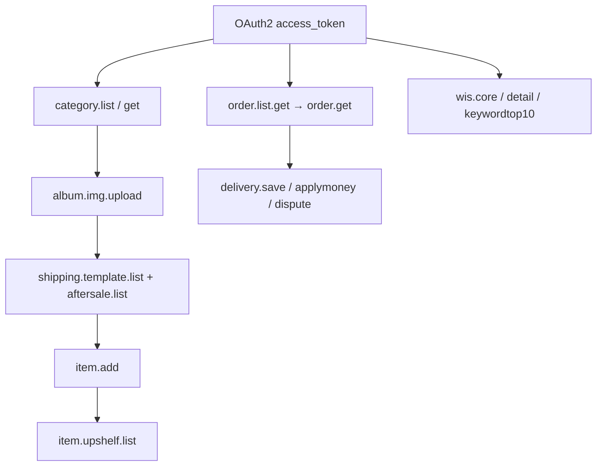
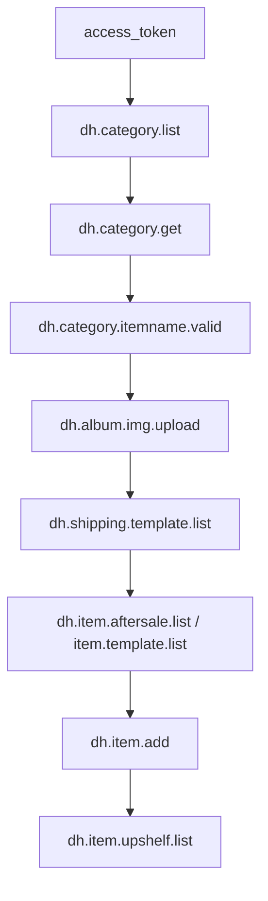
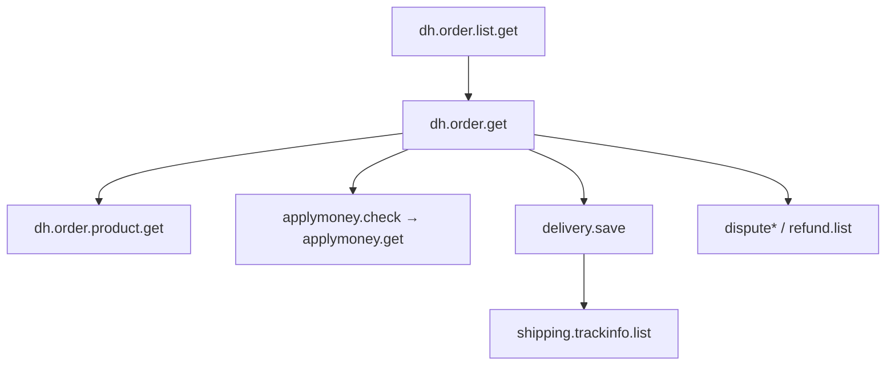

# 敦煌网开放平台 API 手册（AI 联调版）

> 数据来源：官网 [API文档](https://open.dhgate.com/docs/api) 各模块列表页 + 接口详情页（Playwright 抓取）。  
> **用途**：给 AI / 开发者做本仓库 `testAPI/dhgate` 联调对照——接口做什么、关键参数必传什么、可选值、模块间如何串。  
> **版本策略**：同一 `method` 多版本时只展开**最高版本**；旧版见各模块折叠区。  
> **统一入口**：`http://api.dhgate.com/dop/router`；公共参数：`method` / `v` / `timestamp` / `access_token`。

---

## 〇、AI 联调约定（必读）

1. **先 OAuth2**：店铺授权拿到 `access_token`，失效先 refresh，再调业务接口。
2. **本仓库联调路径**：`POST /api/v1/common/testAPI/dhgate/...`（单店）或 `.../dhgate/commerce/...`（多店编排）；底层仍调官网 `method`+`v`。
3. **读说明顺序**：做什么 → 业务必填参数与取值说明 → 返回关键字段 →「关联」链路。
4. **枚举勿编造**：仅使用「取值说明」列或官网详情写明的可选值；不确定就用联调 `raw` 回包校准。
5. **复杂 Object/List**：按 JSON 字符串提交（如 `itemBase`、`itemSkuList`）；发布/更新产品以 `item.get` 结构为底稿。

### 典型链路（优先级）

```text
授权 access_token
  ├─ 类目：category.list → category.get →（可选）itemname.valid / is3Ccategory
  ├─ 素材：album.list → album.img.upload →（可选）album.img.post
  ├─ 模板：shipping.template.list + item.aftersale.list + item.group.list / template.list
  ├─ 发布：item.add → item.upshelf.list
  ├─ 运维：item.list → item.get → item.update / price.update / 备货系列
  ├─ 订单：order.list.get → order.get → delivery.save / applymoney.* / dispute*
  ├─ 数据：wis.core.info / wis.detail.page / wis.keywordtop10.info
  └─ 广告：seller.ad.order.report.page / seller.ad.prod.report.page（增值API）
```



---

## 一、公共参数（所有接口）

| 参数 | 类型 | 必须 | 说明 |
| --- | --- | --- | --- |
| `method` | String | 是 | API 名，如 `dh.item.get`（不含 `$版本`） |
| `v` | String | 是 | 版本号，如 `2.0`（对应文档名 `$` 后一段） |
| `timestamp` | String | 是 | 毫秒时间戳（北京时间，允许 ±30 分钟） |
| `access_token` | String | 是 | OAuth2 令牌 |

- 幂等查询可用 GET，写入/上传建议统一 **POST**。
- 授权级别：A 读 / B 更新 / C 计算 / D 复合；App 另有控制台权限档位。
- 错误响应见官网「平台错误码」「授权错误响应」。

---

## 二、模块与接口详情（对照官网）

1. [相册API](#001001) — [列表](https://open.dhgate.com/docs/api/001001) — preferred **8**
2. [基础API](#001002) — [列表](https://open.dhgate.com/docs/api/001002) — preferred **2**
3. [类目API](#001003) — [列表](https://open.dhgate.com/docs/api/001003) — preferred **13**
4. [客户评论API](#001004) — [列表](https://open.dhgate.com/docs/api/001004) — preferred **7**
5. [物流API](#001005) — [列表](https://open.dhgate.com/docs/api/001005) — preferred **9**
6. [站内信API](#001006) — [列表](https://open.dhgate.com/docs/api/001006) — preferred **15**
7. [订单API](#001007) — [列表](https://open.dhgate.com/docs/api/001007) — preferred **15**
8. [产品API](#001008) — [列表](https://open.dhgate.com/docs/api/001008) — preferred **38**
9. [用户API](#001009) — [列表](https://open.dhgate.com/docs/api/001009) — preferred **11**
10. [在线发货API](#001010) — [列表](https://open.dhgate.com/docs/api/001010) — preferred **9**
11. [数据API(限免)](#001011) — [列表](https://open.dhgate.com/docs/api/001011) — preferred **3**
12. [增值API](#001012) — [列表](https://open.dhgate.com/docs/api/001012) — preferred **2**

### 相册API {#001001}

- **官网列表**：<https://open.dhgate.com/docs/api/001001>
- **模块说明**：相册API，相册相关操作接口
- **模块关联**：素材链路：`dh.album.list` → `dh.album.repeat.get`(可选去重) → `dh.album.img.upload` → `dh.album.img.post`(入相册) → 图片 URL/MD5 填入 `dh.item.add` 的 `itemImgList`。
- **收录**：全量 10 版本条目；下文 preferred 8（最高版本）

| 接口 | method | v | 官网描述 |
| --- | --- | --- | --- |
| [`dh.album.get$2.0`](https://open.dhgate.com/docs/api/detail/98654f7a9af4435e9893c702b0382a69) | `dh.album.get` | `2.0` | 卖家获取相册详情 |
| [`dh.album.img.delete$2.0`](https://open.dhgate.com/docs/api/detail/efa0f2c3b28241a2bfbeaff27b34dfad) | `dh.album.img.delete` | `2.0` | 卖家刪除相册圖片接口,仅支持POST方式提交请求 |
| [`dh.album.img.list$2.0`](https://open.dhgate.com/docs/api/detail/5312f698d3cf4cbf9cceb778d51e4219) | `dh.album.img.list` | `2.0` | 获取相册图片列表接口,仅支持POST方式提交请求 |
| [`dh.album.img.post$2.0`](https://open.dhgate.com/docs/api/detail/74c5b8664567435e84d173232a4af69c) | `dh.album.img.post` | `2.0` | 卖家批量保存图片到相册,仅支持POST方式提交请求 |
| [`dh.album.img.upload$2.1`](https://open.dhgate.com/docs/api/detail/c5d30420d69846c4baa7cba43d2ac03b) | `dh.album.img.upload` | `2.1` | 卖家上传产品图片,仅支持商品图片类型,文件编码为BASE64的字符串,必须以POST方式提交请求,若返回图片url地址类似f2/albu/g1/M00/01/02/rBVaIVPxjnCIBEuBAAB1EDXekqMAAAYbgGJ1EkAAHUo678.jpg，其获取方式为http://image.dhgate.com/100x100/f2/albu/g1/M00/01/02/rBVaIVPxjnCIBEuBAAB1EDXekqMAAAYbgGJ1EkAAHUo678.jpg,若其返回图片url类似albu_841432510_00，则该图片获取路径为http://image.dhgate.com/albu_841432510_00/1.0x0.jpg |
| [`dh.album.list$2.0`](https://open.dhgate.com/docs/api/detail/114771a7ac08429abf742cc3048c1208) | `dh.album.list` | `2.0` | 卖家获取相册列表 |
| [`dh.album.repeat.get$2.0`](https://open.dhgate.com/docs/api/detail/802d535c076e490db3f0d6f41c1d099b) | `dh.album.repeat.get` | `2.0` | 判断图片文件是否重复上传,仅支持POST方式提交请求 |
| [`dh.albums.get$1.0`](https://open.dhgate.com/docs/api/detail/9f6d59dfba7d4e33be14b106c3d19e97) | `dh.albums.get` | `1.0` | 卖家获取相册列表 |

<details><summary>同模块其它版本（联调默认不用）</summary>

- `dh.album.img.post$1.1` — 卖家保存图片到相册,仅支持POST方式提交请求
- `dh.album.img.upload$2.0` — 卖家上传产品图片,文件编码为BASE64的字符串,必须以POST方式提交请求

</details>

#### `dh.album.get$2.0`

- **做什么**：卖家获取相册详情
- **method / v**：`dh.album.get` / `2.0`
- **官网详情**：<https://open.dhgate.com/docs/api/detail/98654f7a9af4435e9893c702b0382a69>
- **超时**：15秒
- **授权级别**：A
- **公网访问**：1 (1 允许,0 不允许)
- **关联**：素材链路：`dh.album.list` → `dh.album.repeat.get`(可选去重) → `dh.album.img.upload` → `dh.album.img.post`(入相册) → 图片 URL/MD5 填入 `dh.item.add` 的 `itemImgList`。

**业务请求参数**

| 参数 | 类型 | 必须 | 取值说明 | 说明 |
| --- | --- | --- | --- | --- |
| `albWindowId` | String | 必须 | 该参数可通过调用dh.albums.get接口中返回值获得；示例值：ff8080812cbf8102012cbf81a18a0003 | 相册窗口ID |

*响应关键字段：官网详情页未解析到表格；联调时打开下方「官网详情」核对，或看兜底说明。*


#### `dh.album.img.delete$2.0`

- **做什么**：卖家刪除相册圖片接口,仅支持POST方式提交请求
- **method / v**：`dh.album.img.delete` / `2.0`
- **官网详情**：<https://open.dhgate.com/docs/api/detail/efa0f2c3b28241a2bfbeaff27b34dfad>
- **超时**：100秒
- **授权级别**：B
- **公网访问**：1 (1 允许,0 不允许)
- **关联**：素材链路：`dh.album.list` → `dh.album.repeat.get`(可选去重) → `dh.album.img.upload` → `dh.album.img.post`(入相册) → 图片 URL/MD5 填入 `dh.item.add` 的 `itemImgList`。

**业务请求参数**

| 参数 | 类型 | 必须 | 取值说明 | 说明 |
| --- | --- | --- | --- | --- |
| `imgId` | String | 必须 | 圖片的id值；示例值：ff8080812cbf8102012cbf81a18a0003 | 图片ID |
| `imgMd5` | String | 必须 | 示例值：b6ed58bc0a25dceda47636ec336e0402 | 图片MD5信息 |
| `imgUrl` | String | 必须 | 示例值：f2/albu/g1/M00/01/02/rBVaIVPxjnCIBEuBAAB1EDXekqMAAAYbgGJ1EkAAHUo678.jpg | 图片url地址 |

**响应关键字段**

| 参数 | 类型 | 必须 | 取值说明 | 说明 |
| --- | --- | --- | --- | --- |
| `isSuccess` | Boolean | 必须 | true=成功；false=失败； | 是否刪除上傳成功 |


#### `dh.album.img.list$2.0`

- **做什么**：获取相册图片列表接口,仅支持POST方式提交请求
- **method / v**：`dh.album.img.list` / `2.0`
- **官网详情**：<https://open.dhgate.com/docs/api/detail/5312f698d3cf4cbf9cceb778d51e4219>
- **超时**：100秒
- **授权级别**：B
- **公网访问**：1 (1 允许,0 不允许)
- **关联**：素材链路：`dh.album.list` → `dh.album.repeat.get`(可选去重) → `dh.album.img.upload` → `dh.album.img.post`(入相册) → 图片 URL/MD5 填入 `dh.item.add` 的 `itemImgList`。

**业务请求参数**

| 参数 | 类型 | 必须 | 取值说明 | 说明 |
| --- | --- | --- | --- | --- |
| `pageSize` | String | 必须 | 示例值：20 | 每页记录数 |
| `albWindowId` | String | 必须 | 该参数可通过调用dh.album.list接口中返回值获得；示例：ff8080812cbf8102012cbf81a18a0003 | 相册窗口ID |
| `pageNum` | String | 必须 | 示例值：1 | 页码 |

**响应关键字段**

| 参数 | 类型 | 必须 | 取值说明 | 说明 |
| --- | --- | --- | --- | --- |
| `count` | long | 必须 |  | 总记录数 |
| `sumPage` | int | 必须 |  | 总页数 |
| `imageList` | ImageList[] | 必须 | 圖片信息列表 | 圖片信息列表 |


#### `dh.album.img.post$2.0`

- **做什么**：卖家批量保存图片到相册,仅支持POST方式提交请求
- **method / v**：`dh.album.img.post` / `2.0`
- **官网详情**：<https://open.dhgate.com/docs/api/detail/74c5b8664567435e84d173232a4af69c>
- **超时**：100秒
- **授权级别**：B
- **公网访问**：1 (1 允许,0 不允许)
- **关联**：素材链路：`dh.album.list` → `dh.album.repeat.get`(可选去重) → `dh.album.img.upload` → `dh.album.img.post`(入相册) → 图片 URL/MD5 填入 `dh.item.add` 的 `itemImgList`。 入参图片一般来自 `dh.album.img.upload`；相册 ID 来自 `dh.album.list`。

**业务请求参数**

| 参数 | 类型 | 必须 | 取值说明 | 说明 |
| --- | --- | --- | --- | --- |
| `albInfoList` | AlbumInfo[] | 必须 | 相册图片列表 | 相册图片列表 |
| `albWindowId` | String | 必须 | 该参数可通过调用dh.albums.get接口中返回值获得；示例：ff8080812cbf8102012cbf81a18a0003 | 相册窗口ID |

**响应关键字段**

| 参数 | 类型 | 必须 | 取值说明 | 说明 |
| --- | --- | --- | --- | --- |
| `isSuccess` | Boolean | 必须 | true=成功；false=失败； | 是否批量上傳成功 |


#### `dh.album.img.upload$2.1`

- **做什么**：卖家上传产品图片,仅支持商品图片类型,文件编码为BASE64的字符串,必须以POST方式提交请求,若返回图片url地址类似f2/albu/g1/M00/01/02/rBVaIVPxjnCIBEuBAAB1EDXekqMAAAYbgGJ1EkAAHUo678.jpg，其获取方式为http://image.dhgate.com/100x100/f2/albu/g1/M00/01/02/rBVaIVPxjnCIBEuBAAB1EDXekqMAAAYbgGJ1EkAAHUo678.jpg,若其返回图片url类似albu_841432510_00，则该图片获取路径为http://image.dhgate.com/albu_841432510_00/1.0x0.jpg
- **method / v**：`dh.album.img.upload` / `2.1`
- **官网详情**：<https://open.dhgate.com/docs/api/detail/c5d30420d69846c4baa7cba43d2ac03b>
- **超时**：60秒
- **授权级别**：D
- **公网访问**：1 (1 允许,0 不允许)
- **关联**：素材链路：`dh.album.list` → `dh.album.repeat.get`(可选去重) → `dh.album.img.upload` → `dh.album.img.post`(入相册) → 图片 URL/MD5 填入 `dh.item.add` 的 `itemImgList`。 上传后：返回 `imgUrl`/`imgMd5` → `item.add.itemImgList` 或 `album.img.post`。

**业务请求参数**

| 参数 | 类型 | 必须 | 取值说明 | 说明 |
| --- | --- | --- | --- | --- |
| `funType` | String | 必须 | 仅支持albu类型;albu为商品相册图片,默认值albu. | 图片类型 |
| `imgName` | String | 必须 | 图片需要保存的文件名 | 图片名称 |
| `imgBannerName` | String | 否 | 水印名称, 如果不传imgBannerName表示不打水印。 | 水印名称 |
| `markPosition` | String | 否 | 在需要打水印的情况下这个参数才起作用(该参数为空默认打右下角)。 1 ：左上 ， 2：右上 ， 3： 中间 ， 4：左下 ， 5 ， 右下 | 水印位置 |
| `imgBase64` | String | 必须 | 图片base64编码,图片最限制为2M | 图片base64信息 |

**响应关键字段**

| 参数 | 类型 | 必须 | 取值说明 | 说明 |
| --- | --- | --- | --- | --- |
| `imgName` | String | 必须 | 该出参参数可用于保存 图片到相册接口（dh.album.img.post）的入参参数；示例值：monkey | 上传图片的图片名称 |
| `imgMd5` | String | 必须 | 示例值：b6ed58bc0a25dceda47636ec336e0402 | 图片MD5信息 |
| `imgUrl` | String | 必须 | 若返回图片url地址类似f2/albu/g1/M00/01/02/rBVaIVPxjnCIBEuBAAB1EDXekqMAAAYbgGJ1EkAAHUo678.jpg,其获取方式为原图:http://image.dhgate.com/100x100/f2/albu/g1/M00/01/02/rBVaIVPxjnCIBEuBAAB1EDXekqMAAAYbgGJ1EkAAHUo678.jpg;若其返回图片url类似albu_841432510_00,则该图片获取路径为原图:http://image.dhgate.com/albu_841432510_00/1.0x0.jpg | 图片url地址 |
| `result` | String | 必须 | 示例值：1 | 上传图片结果: 0失败, 1成功, 2重复上传 |
| `imgSize` | String | 必须 | 示例值：65421 | 图片字节大小 |


#### `dh.album.list$2.0`

- **做什么**：卖家获取相册列表
- **method / v**：`dh.album.list` / `2.0`
- **官网详情**：<https://open.dhgate.com/docs/api/detail/114771a7ac08429abf742cc3048c1208>
- **超时**：15秒
- **授权级别**：A
- **公网访问**：1 (1 允许,0 不允许)
- **关联**：素材链路：`dh.album.list` → `dh.album.repeat.get`(可选去重) → `dh.album.img.upload` → `dh.album.img.post`(入相册) → 图片 URL/MD5 填入 `dh.item.add` 的 `itemImgList`。

**业务请求参数**

| 参数 | 类型 | 必须 | 取值说明 | 说明 |
| --- | --- | --- | --- | --- |
| `albWindowList` | AlbWindow[] | 必须 | 返回相册窗口列表信息 | 相册窗口列表信息 |

*响应关键字段：官网详情页未解析到表格；联调时打开下方「官网详情」核对，或看兜底说明。*


#### `dh.album.repeat.get$2.0`

- **做什么**：判断图片文件是否重复上传,仅支持POST方式提交请求
- **method / v**：`dh.album.repeat.get` / `2.0`
- **官网详情**：<https://open.dhgate.com/docs/api/detail/802d535c076e490db3f0d6f41c1d099b>
- **超时**：15秒
- **授权级别**：A
- **公网访问**：1 (1 允许,0 不允许)
- **关联**：素材链路：`dh.album.list` → `dh.album.repeat.get`(可选去重) → `dh.album.img.upload` → `dh.album.img.post`(入相册) → 图片 URL/MD5 填入 `dh.item.add` 的 `itemImgList`。 上传前去重；已存在则直接复用返回的 `imgUrl`。

**业务请求参数**

| 参数 | 类型 | 必须 | 取值说明 | 说明 |
| --- | --- | --- | --- | --- |
| `imgType` | String | 必须 | 可输入值：albu:商品相册图片，avim:商品自定义属性图片 | 图片类型 |
| `imgMd5` | String | 必须 | 通过上传图片获得图片Md5 | 图片Md5 |

**响应关键字段**

| 参数 | 类型 | 必须 | 取值说明 | 说明 |
| --- | --- | --- | --- | --- |
| `result` | boolean | 必须 |  | 是否存在 |
| `imgUrl` | String | 必须 |  | 图片地址 |


#### `dh.albums.get$1.0`

- **做什么**：卖家获取相册列表
- **method / v**：`dh.albums.get` / `1.0`
- **官网详情**：<https://open.dhgate.com/docs/api/detail/9f6d59dfba7d4e33be14b106c3d19e97>
- **超时**：15秒
- **授权级别**：A
- **公网访问**：1 (1 允许,0 不允许)
- **关联**：素材链路：`dh.album.list` → `dh.album.repeat.get`(可选去重) → `dh.album.img.upload` → `dh.album.img.post`(入相册) → 图片 URL/MD5 填入 `dh.item.add` 的 `itemImgList`。

**业务请求参数**

| 参数 | 类型 | 必须 | 取值说明 | 说明 |
| --- | --- | --- | --- | --- |
| `albumsWindowList` | AlbumsWindowVO[] | 必须 | 返回相册窗口列表信息 | 相册窗口列表信息 |

*响应关键字段：官网详情页未解析到表格；联调时打开下方「官网详情」核对，或看兜底说明。*


### 基础API {#001002}

- **官网列表**：<https://open.dhgate.com/docs/api/001002>
- **模块说明**：基础API，公共基础操作接口
- **模块关联**：合规看板：处罚查询可与 `dh.user.seller.get`、经营数据 `dh.wis.*` 并列展示。
- **收录**：全量 2 版本条目；下文 preferred 2（最高版本）

| 接口 | method | v | 官网描述 |
| --- | --- | --- | --- |
| [`dh.punish.brand.list.get$1.0`](https://open.dhgate.com/docs/api/detail/c1c574147e4d4eb7a3161a0789bb5cfb) | `dh.punish.brand.list.get` | `1.0` | 查询卖家处罚信息第三方投诉接口 |
| [`dh.punish.list.get$1.0`](https://open.dhgate.com/docs/api/detail/72365c7a36db439c85f9265dcff8c65d) | `dh.punish.list.get` | `1.0` | 查询卖家处罚信息接口 |

#### `dh.punish.brand.list.get$1.0`

- **做什么**：查询卖家处罚信息第三方投诉接口
- **method / v**：`dh.punish.brand.list.get` / `1.0`
- **官网详情**：<https://open.dhgate.com/docs/api/detail/c1c574147e4d4eb7a3161a0789bb5cfb>
- **超时**：15秒
- **授权级别**：A
- **公网访问**：1 (1 允许,0 不允许)
- **关联**：合规看板：处罚查询可与 `dh.user.seller.get`、经营数据 `dh.wis.*` 并列展示。

**业务请求参数**

| 参数 | 类型 | 必须 | 取值说明 | 说明 |
| --- | --- | --- | --- | --- |
| `thirdType` | String | 必须 | 类型：brand，品牌商投诉；other，其他第三方投诉。示例值：brand | 类型 |
| `pageSize` | int | 必须 | 示例值：100,表示每页100条记录 | 每页记录数 |
| `pageNo` | int | 必须 | 示例值：1,表示第1页（返回值中pages为总页数，若超过总页数，则返回最后一页数据。） | 第几页 |

**响应关键字段**

| 参数 | 类型 | 必须 | 取值说明 | 说明 |
| --- | --- | --- | --- | --- |
| `pages` | int | 必须 | 20,表示总共20页 | 总页数 |
| `count` | int | 必须 | 1000,表示总记录数为1000 | 总记录数 |
| `punishInfoList` | PunishInfo[] | 必须 | 处罚信息列表 | 处罚信息列表 |


#### `dh.punish.list.get$1.0`

- **做什么**：查询卖家处罚信息接口
- **method / v**：`dh.punish.list.get` / `1.0`
- **官网详情**：<https://open.dhgate.com/docs/api/detail/72365c7a36db439c85f9265dcff8c65d>
- **超时**：15秒
- **授权级别**：A
- **公网访问**：1 (1 允许,0 不允许)
- **关联**：合规看板：处罚查询可与 `dh.user.seller.get`、经营数据 `dh.wis.*` 并列展示。

**业务请求参数**

| 参数 | 类型 | 必须 | 取值说明 | 说明 |
| --- | --- | --- | --- | --- |
| `startDate` | String | 必须 | 日期格式：yyyy-MM-dd；示例值：2022-01-12 | 开始时间 |
| `punishId` | String | 否 | 处罚编号,可选；示例值：10026575 | 处罚编号 |
| `endDate` | String | 必须 | 日期格式：yyyy-MM-dd；示例值：2022-05-12 | 结束时间 |
| `pageSize` | int | 必须 | 示例值：100,表示每页100条记录 | 每页记录数 |
| `pageNo` | int | 必须 | 示例值：1,表示第1页（返回值中pages为总页数，若超过总页数，则返回最后一页数据。） | 第几页 |

**响应关键字段**

| 参数 | 类型 | 必须 | 取值说明 | 说明 |
| --- | --- | --- | --- | --- |
| `punishInfoList` | PunishInfo[] | 必须 | 处罚信息列表 | 处罚信息列表 |
| `pages` | int | 必须 | 20,表示总共20页 | 总页数 |
| `count` | int | 必须 | 1000,表示总记录数为1000 | 总记录数 |


### 类目API {#001003}

- **官网列表**：<https://open.dhgate.com/docs/api/001003>
- **模块说明**：类目API，类目相关操作接口
- **模块关联**：发布前置：`dh.category.list`(树) → `dh.category.get`(属性/限制) → `dh.category.itemname.valid` / `dh.category.is3Ccategory` → 再 `dh.item.add`。变更同步用 `dh.categoryid.list` 增量拉 ID 后再 get。
- **收录**：全量 14 版本条目；下文 preferred 13（最高版本）

| 接口 | method | v | 官网描述 |
| --- | --- | --- | --- |
| [`dh.category.attrval.list$2.0`](https://open.dhgate.com/docs/api/detail/13bda4d491b44ea9811da9602ae15aef) | `dh.category.attrval.list` | `2.0` | 根据发布类目id、属性id、属性值id获取子属性、子属性值列表信息。 |
| [`dh.category.attrval.listBrand$2.0`](https://open.dhgate.com/docs/api/detail/6e03a743b995467bab9231f62abe4824) | `dh.category.attrval.listBrand` | `2.0` | 根据发布类目id,子属性id,发布属性值id获取子属性值列表 |
| [`dh.category.brandList$2.0`](https://open.dhgate.com/docs/api/detail/46780095a737436bae5f4a5a00111f78) | `dh.category.brandList` | `2.0` | 通过品牌名称获取品牌列表属性 |
| [`dh.category.brands$2.0`](https://open.dhgate.com/docs/api/detail/dbfb7746145641919ec018a0e3f93115) | `dh.category.brands` | `2.0` | 通过品牌名称获取品牌列表属性 |
| [`dh.category.get$2.0`](https://open.dhgate.com/docs/api/detail/0c39f5a828134110901bbf78356ef1ec) | `dh.category.get` | `2.0` | 获取类目详细信息，包括类目信息、属性信息、属性值信息、和类目限制数据(价格、必须包含的关键字、不能包含的关键字)。入参来源：获取类目列表接口(dh.category.list)。注意传入有效的叶子类目ID。 |
| [`dh.category.is3Ccategory$2.0`](https://open.dhgate.com/docs/api/detail/d63ce88bdf4d49699609795d3f094b64) | `dh.category.is3Ccategory` | `2.0` | 判断是否为3C类目或获取所有3C类目，入参不传为获取全部3C类目值，以逗号分隔；用于上传,修改产品时，判断是否需要填写售后模板属性值 |
| [`dh.category.itemname.valid$2.0`](https://open.dhgate.com/docs/api/detail/61b58c6034cd489398a3896175fc2eaf) | `dh.category.itemname.valid` | `2.0` | 检查产品所在的类目是否容许对应的产品名；入参来源：获取类目列表接口(dh.categorys.get)返回的类目ID参数入参参数 |
| [`dh.category.list$2.0`](https://open.dhgate.com/docs/api/detail/79dff528fce6490c829476e6063651c5) | `dh.category.list` | `2.0` | 根据类目ID查询子类目信息,如果类目ID为空返回所有的一级类目, 所返回的信息可作为获取类目属性接口(dh.category.get)和商品上传（dh.product.add）的入参参数。 |
| [`dh.category.path.get$2.0`](https://open.dhgate.com/docs/api/detail/caf3c526acf54886b29fe82da245248b) | `dh.category.path.get` | `2.0` | 根据类目ID获取该类目路径上的所有主线类目,即通过子类目获取其以上主线类目 |
| [`dh.category.proname.valid$1.0`](https://open.dhgate.com/docs/api/detail/4cc82ed528954d8d94d19e040340b72d) | `dh.category.proname.valid` | `1.0` | 检查产品所在的类目是否容许对应的产品名 |
| [`dh.categoryid.list$2.0`](https://open.dhgate.com/docs/api/detail/4872e78092e94e509a1cf120b85bfc1a) | `dh.categoryid.list` | `2.0` | 通过类目修改时间获取类目Id列表 |
| [`dh.categorys.commissions$1.0`](https://open.dhgate.com/docs/api/detail/478a854210b94bbe9dc5c5382ce2946f) | `dh.categorys.commissions` | `1.0` | 获取佣金率列表,根据佣金公式计算佣金率 |
| [`dh.categorys.get$1.0`](https://open.dhgate.com/docs/api/detail/2797047a86b74140ba935ad9d3f1d4e1) | `dh.categorys.get` | `1.0` | 获取类目列表,根据类目ID查询子类目信息 |

<details><summary>同模块其它版本（联调默认不用）</summary>

- `dh.category.get$1.0` — 获取类目属性,根据叶子发布类目ID获取类目属性列表（包含属性值）和类目限制数据（价格）。传入有效的叶子类目ID。建议后期更换使用dh.category.get 2.0接口。

</details>

#### `dh.category.attrval.list$2.0`

- **做什么**：根据发布类目id、属性id、属性值id获取子属性、子属性值列表信息。
- **method / v**：`dh.category.attrval.list` / `2.0`
- **官网详情**：<https://open.dhgate.com/docs/api/detail/13bda4d491b44ea9811da9602ae15aef>
- **超时**：15秒
- **授权级别**：A
- **公网访问**：1 (1 允许,0 不允许)
- **关联**：发布前置：`dh.category.list`(树) → `dh.category.get`(属性/限制) → `dh.category.itemname.valid` / `dh.category.is3Ccategory` → 再 `dh.item.add`。变更同步用 `dh.categoryid.list` 增量拉 ID 后再 get。

**业务请求参数**

| 参数 | 类型 | 必须 | 取值说明 | 说明 |
| --- | --- | --- | --- | --- |
| `catePubId` | String | 必须 | 发布类目叶子类目ID。通过调用dh.category.get2.0接口获取发布类目信息，类目信息中字段leaf为1的是叶子类目。示例值：195001002 | 发布类目ID。必须是发布类目叶子类目，只有叶子类目才有可能有子属性。 |
| `childAtrrId` | String | 必须 | 通过调用dh.category.get2.0接口获取属性的发布类目信息。,示例值：1110699 | 属性ID，为参数catePubId对应的发布类目的属性ID |
| `catePubAttrValId` | String | 否 | 通过调用dh.category.get2.0接口获取属性的发布类目信息。示例值：11106880 | 发布类目属性值ID。对应的属性ID为入参childAtrrId值，对应的类目为入参catePubId值。如果获取自定义属性，值传入0即可。 |

**响应关键字段**

| 参数 | 类型 | 必须 | 取值说明 | 说明 |
| --- | --- | --- | --- | --- |
| `categoryPubAttr` | CategoryPubAttr | 必须 |  | 发布类目属性.该属性为入参childAtrrId的子属性。子属性中的字段categoryPubAttrValList为入参catePubAttrValId对应的属性值列表，该列表有可为空。 |
| `catePubId` | String | 必须 | 示例值：014024 | 发布类目id，为入参对应的catePubId |


#### `dh.category.attrval.listBrand$2.0`

- **做什么**：根据发布类目id,子属性id,发布属性值id获取子属性值列表
- **method / v**：`dh.category.attrval.listBrand` / `2.0`
- **官网详情**：<https://open.dhgate.com/docs/api/detail/6e03a743b995467bab9231f62abe4824>
- **超时**：15秒
- **授权级别**：A
- **公网访问**：1 (1 允许,0 不允许)
- **关联**：发布前置：`dh.category.list`(树) → `dh.category.get`(属性/限制) → `dh.category.itemname.valid` / `dh.category.is3Ccategory` → 再 `dh.item.add`。变更同步用 `dh.categoryid.list` 增量拉 ID 后再 get。

**业务请求参数**

| 参数 | 类型 | 必须 | 取值说明 | 说明 |
| --- | --- | --- | --- | --- |
| `catePubId` | String | 必须 | 发布类目叶子类目ID。通过调用dh.category.get2.0接口获取发布类目信息，类目信息中字段leaf为1的是叶子类目。示例值：195001002 | 发布类目ID。必须是发布类目叶子类目，只有叶子类目才有可能有子属性。 |
| `brandId` | String | 必须 | 通过dh.category.brandList$2.0 可获取到品牌信息 | 品牌id。 |
| `childAtrrId` | String | 必须 | 通过调用dh.category.get2.0接口获取属性的发布类目信息。,示例值：1110699 | 属性ID，为参数catePubId对应的发布类目的属性ID |

**响应关键字段**

| 参数 | 类型 | 必须 | 取值说明 | 说明 |
| --- | --- | --- | --- | --- |
| `categoryPubAttr` | CategoryPubAttr | 必须 |  | 发布类目属性.该属性为入参childAtrrId的子属性。子属性中的字段categoryPubAttrValList为入参brandId对应的子属性值列表，该列表有可为空。 |
| `catePubId` | String | 必须 | 示例值：014024 | 发布类目id，为入参对应的catePubId |


#### `dh.category.brandList$2.0`

- **做什么**：通过品牌名称获取品牌列表属性
- **method / v**：`dh.category.brandList` / `2.0`
- **官网详情**：<https://open.dhgate.com/docs/api/detail/46780095a737436bae5f4a5a00111f78>
- **超时**：15秒
- **授权级别**：A
- **公网访问**：1 (1 允许,0 不允许)
- **关联**：发布前置：`dh.category.list`(树) → `dh.category.get`(属性/限制) → `dh.category.itemname.valid` / `dh.category.is3Ccategory` → 再 `dh.item.add`。变更同步用 `dh.categoryid.list` 增量拉 ID 后再 get。

**业务请求参数**

| 参数 | 类型 | 必须 | 取值说明 | 说明 |
| --- | --- | --- | --- | --- |
| `catePubId` | String | 否 | 需校验品牌资质时不可为空 | 选择产品类目，校验品牌资质使用，如果没有则不判断资质 |
| `pageNum` | int | 必须 | 示例值：1 | 获取页码 |
| `indexCode` | String | 否 | 可传空；示例值：W | 品牌名英文字母索引(A-Z) |
| `brandName` | String | 否 | 若不清楚可传空；示例值：WAGG | 品牌名称 |
| `pageSize` | int | 必须 | 示例值：20 | 获取页面的记录数 |

**响应关键字段**

| 参数 | 类型 | 必须 | 取值说明 | 说明 |
| --- | --- | --- | --- | --- |
| `pageCount` | int | 必须 | 示例值：50 | 记录总条数 |
| `pageSize` | int | 必须 | 示例值：20 | 当前页显示记录条数 |
| `brandAuthList` | BrandAuth[] | 必须 | 资质品牌列表信息 | 资质品牌列表信息 |
| `page` | int | 必须 | 示例值：1 | 当前页 |
| `brandsList` | Brands[] | 必须 | 品牌列表信息 | 品牌列表信息 |


#### `dh.category.brands$2.0`

- **做什么**：通过品牌名称获取品牌列表属性
- **method / v**：`dh.category.brands` / `2.0`
- **官网详情**：<https://open.dhgate.com/docs/api/detail/dbfb7746145641919ec018a0e3f93115>
- **超时**：15秒
- **授权级别**：A
- **公网访问**：1 (1 允许,0 不允许)
- **关联**：发布前置：`dh.category.list`(树) → `dh.category.get`(属性/限制) → `dh.category.itemname.valid` / `dh.category.is3Ccategory` → 再 `dh.item.add`。变更同步用 `dh.categoryid.list` 增量拉 ID 后再 get。

**业务请求参数**

| 参数 | 类型 | 必须 | 取值说明 | 说明 |
| --- | --- | --- | --- | --- |
| `pageSize` | int | 必须 | 示例值：20 | 获取页面的记录数 |
| `indexCode` | String | 否 | 可传空；示例值：W | 品牌名英文字母索引(A-Z) |
| `pageNum` | int | 必须 | 示例值：1 | 获取页码 |
| `catePubId` | String | 否 | 需校验品牌资质时不可为空 | 选择产品类目，校验品牌资质使用，如果没有则不判断资质 |
| `brandName` | String | 否 | 若不清楚可传空；示例值：WAGG | 品牌名称 |

**响应关键字段**

| 参数 | 类型 | 必须 | 取值说明 | 说明 |
| --- | --- | --- | --- | --- |
| `page` | int | 必须 | 示例值：1 | 当前页 |
| `pageCount` | int | 必须 | 示例值：50 | 记录总条数 |
| `brandsList` | Brands[] | 必须 | 品牌列表信息 | 品牌列表信息 |
| `brandAuthList` | BrandAuth[] | 必须 | 资质品牌列表信息 | 资质品牌列表信息 |
| `pageSize` | int | 必须 | 示例值：20 | 当前页显示记录条数 |


#### `dh.category.get$2.0`

- **做什么**：获取类目详细信息，包括类目信息、属性信息、属性值信息、和类目限制数据(价格、必须包含的关键字、不能包含的关键字)。入参来源：获取类目列表接口(dh.category.list)。注意传入有效的叶子类目ID。
- **method / v**：`dh.category.get` / `2.0`
- **官网详情**：<https://open.dhgate.com/docs/api/detail/0c39f5a828134110901bbf78356ef1ec>
- **超时**：15秒
- **授权级别**：A
- **公网访问**：1 (1 允许,0 不允许)
- **关联**：发布前置：`dh.category.list`(树) → `dh.category.get`(属性/限制) → `dh.category.itemname.valid` / `dh.category.is3Ccategory` → 再 `dh.item.add`。变更同步用 `dh.categoryid.list` 增量拉 ID 后再 get。 产出属性与限制 → 填 `item.add` 的 `itemAttrList` 等。

**业务请求参数**

| 参数 | 类型 | 必须 | 取值说明 | 说明 |
| --- | --- | --- | --- | --- |
| `catePubId` | String | 必须 | 必须为有效的叶子类目ID，该入参参数可通过dh.category.list接口获得；示例值：019024004002 | 发布类目ID |

**响应关键字段**

| 参数 | 类型 | 必须 | 取值说明 | 说明 |
| --- | --- | --- | --- | --- |
| `categoryPubAttrgroupList` | CategoryPubAttrGroup[] | 必须 |  | 兼容性属性 |
| `remark` | String | 必须 | 示例值：this cloth | 类目备注说明 |
| `catePubId` | String | 必须 | 物理父级类目id + 自身id 每段为3位，共6位；示例值：014024 | 发布类目id |
| `excludeKeyWords` | String | 必须 | 不是所有类目有该值， 如没有则为null, 关键词之间用逗号隔开。示例值：jean,jeans,shorts | 该类目不能包含的关键词 |
| `pareCatePubId` | String | 必须 | 物理父级类目;示例值：014 | 该类目的父级发布类目 |
| `pubNameCn` | String | 必须 | 示例值：服装面料 | 中文名称 |
| `inlucdeKeyWords` | String | 必须 | 不是所有类目有该值， 如没有则为null, 关键词之间用逗号隔开。示例值：skirt,skirts | 该类目必须包含的该关键词 |
| `categoryPubAttrList` | CategoryPubAttr[] | 必须 |  | 发布类目属性 |
| `leaf` | String | 必须 | 1：是， 0：不是;示例值：1 | 该类目是否为叶子类目 |
| `pubName` | String | 必须 | 示例值：Clothing Fabric | 英文名称 |


#### `dh.category.is3Ccategory$2.0`

- **做什么**：判断是否为3C类目或获取所有3C类目，入参不传为获取全部3C类目值，以逗号分隔；用于上传,修改产品时，判断是否需要填写售后模板属性值
- **method / v**：`dh.category.is3Ccategory` / `2.0`
- **官网详情**：<https://open.dhgate.com/docs/api/detail/d63ce88bdf4d49699609795d3f094b64>
- **超时**：15秒
- **授权级别**：A
- **公网访问**：1 (1 允许,0 不允许)
- **关联**：发布前置：`dh.category.list`(树) → `dh.category.get`(属性/限制) → `dh.category.itemname.valid` / `dh.category.is3Ccategory` → 再 `dh.item.add`。变更同步用 `dh.categoryid.list` 增量拉 ID 后再 get。 3C 时必须配 `dh.item.aftersale.list` 的售后模板 ID。

**业务请求参数**

| 参数 | 类型 | 必须 | 取值说明 | 说明 |
| --- | --- | --- | --- | --- |
| `catePubId` | String | 必须 | 必须为有效的叶子类目ID，该入参参数可通过dh.category.list接口获得；示例值：019024004002 | 发布类目ID |

**响应关键字段**

| 参数 | 类型 | 必须 | 取值说明 | 说明 |
| --- | --- | --- | --- | --- |
| `isvalid` | String | 必须 | 1:是，0:否 | 类目是否为3C类目 |
| `categoryIdStr` | String | 必须 | 以英文状态下逗号分隔；所有3C类目父类目，以其开头的子类目均为3C类目 | 所有3C类目父类目，以其开头的子类目均为3C类目 |


#### `dh.category.itemname.valid$2.0`

- **做什么**：检查产品所在的类目是否容许对应的产品名；入参来源：获取类目列表接口(dh.categorys.get)返回的类目ID参数入参参数
- **method / v**：`dh.category.itemname.valid` / `2.0`
- **官网详情**：<https://open.dhgate.com/docs/api/detail/61b58c6034cd489398a3896175fc2eaf>
- **超时**：15秒
- **授权级别**：A
- **公网访问**：1 (1 允许,0 不允许)
- **关联**：发布前置：`dh.category.list`(树) → `dh.category.get`(属性/限制) → `dh.category.itemname.valid` / `dh.category.is3Ccategory` → 再 `dh.item.add`。变更同步用 `dh.categoryid.list` 增量拉 ID 后再 get。

**业务请求参数**

| 参数 | 类型 | 必须 | 取值说明 | 说明 |
| --- | --- | --- | --- | --- |
| `catePubId` | String | 必须 | 该入参参数可通过获取类目列表接口(dh.categorys.get)获得；示例值：019034023; | 发布类目ID |
| `itemName` | String | 必须 | 多个以逗号分隔；示例值：160,Gold,Chair,Gift | 发布产品名称 |

**响应关键字段**

| 参数 | 类型 | 必须 | 取值说明 | 说明 |
| --- | --- | --- | --- | --- |
| `isvalid` | boolean | 必须 | true:合法，false:不合法 | 产品名称是否合法 |


#### `dh.category.list$2.0`

- **做什么**：根据类目ID查询子类目信息,如果类目ID为空返回所有的一级类目, 所返回的信息可作为获取类目属性接口(dh.category.get)和商品上传（dh.product.add）的入参参数。
- **method / v**：`dh.category.list` / `2.0`
- **官网详情**：<https://open.dhgate.com/docs/api/detail/79dff528fce6490c829476e6063651c5>
- **超时**：15秒
- **授权级别**：A
- **公网访问**：1 (1 允许,0 不允许)
- **关联**：发布前置：`dh.category.list`(树) → `dh.category.get`(属性/限制) → `dh.category.itemname.valid` / `dh.category.is3Ccategory` → 再 `dh.item.add`。变更同步用 `dh.categoryid.list` 增量拉 ID 后再 get。 返回 `catePubId` → `category.get` / `item.add`。

**业务请求参数**

| 参数 | 类型 | 必须 | 取值说明 | 说明 |
| --- | --- | --- | --- | --- |
| `parentId` | String | 否 | 传空则默认为根类目ID；若不知道父类目ID，则传空值可获取所有根类目列表，然后将根类目列表返回的类目ID值作为父类目ID查询,可以此循环查找更细粒度的类目列表；例如：014; | 父类目ID |

**响应关键字段**

| 参数 | 类型 | 必须 | 取值说明 | 说明 |
| --- | --- | --- | --- | --- |
| `catePubList` | CategoryPublish[] | 必须 |  | 类目列表 |


#### `dh.category.path.get$2.0`

- **做什么**：根据类目ID获取该类目路径上的所有主线类目,即通过子类目获取其以上主线类目
- **method / v**：`dh.category.path.get` / `2.0`
- **官网详情**：<https://open.dhgate.com/docs/api/detail/caf3c526acf54886b29fe82da245248b>
- **超时**：15秒
- **授权级别**：A
- **公网访问**：1 (1 允许,0 不允许)
- **关联**：发布前置：`dh.category.list`(树) → `dh.category.get`(属性/限制) → `dh.category.itemname.valid` / `dh.category.is3Ccategory` → 再 `dh.item.add`。变更同步用 `dh.categoryid.list` 增量拉 ID 后再 get。

**业务请求参数**

| 参数 | 类型 | 必须 | 取值说明 | 说明 |
| --- | --- | --- | --- | --- |
| `catePubId` | String | 必须 | 必须为有效的叶子类目ID,物理父级类目id + 自身id 每段为3位，共6位；示例值：014024 | 发布类目ID |

**响应关键字段**

| 参数 | 类型 | 必须 | 取值说明 | 说明 |
| --- | --- | --- | --- | --- |
| `categoryPublishList` | CategoryPublish[] | 必须 |  | 类目列表 |


#### `dh.category.proname.valid$1.0`

- **做什么**：检查产品所在的类目是否容许对应的产品名
- **method / v**：`dh.category.proname.valid` / `1.0`
- **官网详情**：<https://open.dhgate.com/docs/api/detail/4cc82ed528954d8d94d19e040340b72d>
- **超时**：15秒
- **授权级别**：A
- **公网访问**：1 (1 允许,0 不允许)
- **关联**：发布前置：`dh.category.list`(树) → `dh.category.get`(属性/限制) → `dh.category.itemname.valid` / `dh.category.is3Ccategory` → 再 `dh.item.add`。变更同步用 `dh.categoryid.list` 增量拉 ID 后再 get。

**业务请求参数**

| 参数 | 类型 | 必须 | 取值说明 | 说明 |
| --- | --- | --- | --- | --- |
| `productName` | String | 必须 |  | 发布产品名称 |
| `catePubId` | String | 必须 |  | 发布类目ID |

**响应关键字段**

| 参数 | 类型 | 必须 | 取值说明 | 说明 |
| --- | --- | --- | --- | --- |
| `isvalid` | boolean | 必须 |  | 是否合法 |


#### `dh.categoryid.list$2.0`

- **做什么**：通过类目修改时间获取类目Id列表
- **method / v**：`dh.categoryid.list` / `2.0`
- **官网详情**：<https://open.dhgate.com/docs/api/detail/4872e78092e94e509a1cf120b85bfc1a>
- **超时**：15秒
- **授权级别**：A
- **公网访问**：1 (1 允许,0 不允许)
- **关联**：发布前置：`dh.category.list`(树) → `dh.category.get`(属性/限制) → `dh.category.itemname.valid` / `dh.category.is3Ccategory` → 再 `dh.item.add`。变更同步用 `dh.categoryid.list` 增量拉 ID 后再 get。

**业务请求参数**

| 参数 | 类型 | 必须 | 取值说明 | 说明 |
| --- | --- | --- | --- | --- |
| `siteId` | String | 否 | 默认为英文站点,参数值为：EN英文站点,RU俄语站点;示例值：EN | 产品所属语言站点 |
| `updateDate` | String | 必须 | 日期格式：yyyy-MM-dd HH:mm:ss,精确到秒；示例值：2014-01-12 18:20:21 | 过期时间 |

**响应关键字段**

| 参数 | 类型 | 必须 | 取值说明 | 说明 |
| --- | --- | --- | --- | --- |
| `categoryIdList` | String[] | 必须 |  | 类目列表Id |


#### `dh.categorys.commissions$1.0`

- **做什么**：获取佣金率列表,根据佣金公式计算佣金率
- **method / v**：`dh.categorys.commissions` / `1.0`
- **官网详情**：<https://open.dhgate.com/docs/api/detail/478a854210b94bbe9dc5c5382ce2946f>
- **超时**：15秒
- **授权级别**：A
- **公网访问**：1 (1 允许,0 不允许)
- **关联**：发布前置：`dh.category.list`(树) → `dh.category.get`(属性/限制) → `dh.category.itemname.valid` / `dh.category.is3Ccategory` → 再 `dh.item.add`。变更同步用 `dh.categoryid.list` 增量拉 ID 后再 get。

**业务请求参数**

| 参数 | 类型 | 必须 | 取值说明 | 说明 |
| --- | --- | --- | --- | --- |
| `list` | LadderCommissionRateVO[] | 必须 |  | 佣金率列表 |

*响应关键字段：官网详情页未解析到表格；联调时打开下方「官网详情」核对，或看兜底说明。*


#### `dh.categorys.get$1.0`

- **做什么**：获取类目列表,根据类目ID查询子类目信息
- **method / v**：`dh.categorys.get` / `1.0`
- **官网详情**：<https://open.dhgate.com/docs/api/detail/2797047a86b74140ba935ad9d3f1d4e1>
- **超时**：15秒
- **授权级别**：A
- **公网访问**：1 (1 允许,0 不允许)
- **关联**：发布前置：`dh.category.list`(树) → `dh.category.get`(属性/限制) → `dh.category.itemname.valid` / `dh.category.is3Ccategory` → 再 `dh.item.add`。变更同步用 `dh.categoryid.list` 增量拉 ID 后再 get。

**业务请求参数**

| 参数 | 类型 | 必须 | 取值说明 | 说明 |
| --- | --- | --- | --- | --- |
| `parentid` | String | 必须 |  | 父类目ID,可选,传空则默认为根类目ID |

**响应关键字段**

| 参数 | 类型 | 必须 | 取值说明 | 说明 |
| --- | --- | --- | --- | --- |
| `categoryPublishList` | CategoryPublishVO[] | 必须 |  | 类目列表 |


### 客户评论API {#001004}

- **官网列表**：<https://open.dhgate.com/docs/api/001004>
- **模块说明**：客户评论API，评论一般操作接口
- **模块关联**：评价列表/详情与订单 `orderNo` / 产品 `itemCode` 关联；回复后可用列表复核状态。
- **收录**：全量 7 版本条目；下文 preferred 7（最高版本）

| 接口 | method | v | 官网描述 |
| --- | --- | --- | --- |
| [`dh.review.apply$1.0`](https://open.dhgate.com/docs/api/detail/f16a7eb57eb84264b404efeae39e1de5) | `dh.review.apply` | `1.0` | 申请修改买家给卖价的评价 |
| [`dh.review.delete$1.0`](https://open.dhgate.com/docs/api/detail/7e4a890b07ad46038b19d44c79632ec4) | `dh.review.delete` | `1.0` | 卖家删除对买家的评价 |
| [`dh.review.feedback$1.0`](https://open.dhgate.com/docs/api/detail/4f9e80e8827a4849906ea11cc8df24ff) | `dh.review.feedback` | `1.0` | 卖家对买家的评价 |
| [`dh.review.get$1.0`](https://open.dhgate.com/docs/api/detail/e9545d494eb94d09b5bf5a0971874ad1) | `dh.review.get` | `1.0` | 获取买家给卖家的评价列表 |
| [`dh.review.reply$1.0`](https://open.dhgate.com/docs/api/detail/deffbdc8f5ba4791b34aa59bdf73329b) | `dh.review.reply` | `1.0` | 保存卖家回复内容 |
| [`dh.review.send$1.0`](https://open.dhgate.com/docs/api/detail/cf60c9f0e07442a7ac1c5e3b9275c7f1) | `dh.review.send` | `1.0` | 获取卖家给买家的评价列表 |
| [`dh.review.wait$1.0`](https://open.dhgate.com/docs/api/detail/d76b5c0840aa4279bf0801763a7481c6) | `dh.review.wait` | `1.0` | 获取卖家给买家的评价列表 |

#### `dh.review.apply$1.0`

- **做什么**：申请修改买家给卖价的评价
- **method / v**：`dh.review.apply` / `1.0`
- **官网详情**：<https://open.dhgate.com/docs/api/detail/f16a7eb57eb84264b404efeae39e1de5>
- **超时**：15秒
- **授权级别**：B
- **公网访问**：1 (1 允许,0 不允许)
- **关联**：评价列表/详情与订单 `orderNo` / 产品 `itemCode` 关联；回复后可用列表复核状态。

**业务请求参数**

| 参数 | 类型 | 必须 | 取值说明 | 说明 |
| --- | --- | --- | --- | --- |
| `rfxno` | String | 必须 | 订单号 | 订单号 |

**响应关键字段**

| 参数 | 类型 | 必须 | 取值说明 | 说明 |
| --- | --- | --- | --- | --- |
| `rfxno` | String | 必须 | 订单id | 订单id |


#### `dh.review.delete$1.0`

- **做什么**：卖家删除对买家的评价
- **method / v**：`dh.review.delete` / `1.0`
- **官网详情**：<https://open.dhgate.com/docs/api/detail/7e4a890b07ad46038b19d44c79632ec4>
- **超时**：15秒
- **授权级别**：B
- **公网访问**：1 (1 允许,0 不允许)
- **关联**：评价列表/详情与订单 `orderNo` / 产品 `itemCode` 关联；回复后可用列表复核状态。

**业务请求参数**

| 参数 | 类型 | 必须 | 取值说明 | 说明 |
| --- | --- | --- | --- | --- |
| `rfxno` | String | 必须 | 订单号 | 订单号 |

**响应关键字段**

| 参数 | 类型 | 必须 | 取值说明 | 说明 |
| --- | --- | --- | --- | --- |
| `rfxno` | String | 必须 | 订单id | 订单id |


#### `dh.review.feedback$1.0`

- **做什么**：卖家对买家的评价
- **method / v**：`dh.review.feedback` / `1.0`
- **官网详情**：<https://open.dhgate.com/docs/api/detail/4f9e80e8827a4849906ea11cc8df24ff>
- **超时**：15秒
- **授权级别**：B
- **公网访问**：1 (1 允许,0 不允许)
- **关联**：评价列表/详情与订单 `orderNo` / 产品 `itemCode` 关联；回复后可用列表复核状态。

**业务请求参数**

| 参数 | 类型 | 必须 | 取值说明 | 说明 |
| --- | --- | --- | --- | --- |
| `rfxno` | String | 必须 | 订单号 | 订单号 |
| `comments` | String | 必须 | 评价内容 | 评价内容 |
| `Score` | String | 必须 | 评分-1(好评),0（中评），-1（差评） | 评分 |

**响应关键字段**

| 参数 | 类型 | 必须 | 取值说明 | 说明 |
| --- | --- | --- | --- | --- |
| `rfxno` | String | 必须 |  | 订单号 |


#### `dh.review.get$1.0`

- **做什么**：获取买家给卖家的评价列表
- **method / v**：`dh.review.get` / `1.0`
- **官网详情**：<https://open.dhgate.com/docs/api/detail/e9545d494eb94d09b5bf5a0971874ad1>
- **超时**：15秒
- **授权级别**：A
- **公网访问**：1 (1 允许,0 不允许)
- **关联**：评价列表/详情与订单 `orderNo` / 产品 `itemCode` 关联；回复后可用列表复核状态。

**业务请求参数**

| 参数 | 类型 | 必须 | 取值说明 | 说明 |
| --- | --- | --- | --- | --- |
| `pagenum` | int | 必须 | 获取当前数据的页码：实例：1 | 页码 |
| `datecycle` | String | 必须 | 每页显示的条数：实例：30,60,90,180,365-1（全部） | 获取数据的天数 |
| `pagesize` | int | 必须 | 每页显示的条数：实例：10 | 条数 |
| `score` | String | 必须 | 获取的评价类型：实例：-2(全部),1(好评),0（中评），-1（差评） | 评价类型 |

**响应关键字段**

| 参数 | 类型 | 必须 | 取值说明 | 说明 |
| --- | --- | --- | --- | --- |
| `pageCount` | Long | 必须 |  | 记录总条数 |
| `pageSize` | int | 必须 |  | 当前页显示记录条数 |
| `page` | int | 必须 |  | 当前页 |
| `buyerToSellerReviewInfos` | BuyerToSellerReviewInfo[] | 必须 | 订单列表信息 | 订单列表信息 |


#### `dh.review.reply$1.0`

- **做什么**：保存卖家回复内容
- **method / v**：`dh.review.reply` / `1.0`
- **官网详情**：<https://open.dhgate.com/docs/api/detail/deffbdc8f5ba4791b34aa59bdf73329b>
- **超时**：15秒
- **授权级别**：B
- **公网访问**：1 (1 允许,0 不允许)
- **关联**：评价列表/详情与订单 `orderNo` / 产品 `itemCode` 关联；回复后可用列表复核状态。

**业务请求参数**

| 参数 | 类型 | 必须 | 取值说明 | 说明 |
| --- | --- | --- | --- | --- |
| `reviewid` | Long | 必须 | 评价id | 评价id |
| `content` | String | 必须 | 评价内容 | 评价内容 |

**响应关键字段**

| 参数 | 类型 | 必须 | 取值说明 | 说明 |
| --- | --- | --- | --- | --- |
| `responseId` | String | 必须 |  | 评论后响应ID |


#### `dh.review.send$1.0`

- **做什么**：获取卖家给买家的评价列表
- **method / v**：`dh.review.send` / `1.0`
- **官网详情**：<https://open.dhgate.com/docs/api/detail/cf60c9f0e07442a7ac1c5e3b9275c7f1>
- **超时**：15秒
- **授权级别**：A
- **公网访问**：1 (1 允许,0 不允许)
- **关联**：评价列表/详情与订单 `orderNo` / 产品 `itemCode` 关联；回复后可用列表复核状态。

**业务请求参数**

| 参数 | 类型 | 必须 | 取值说明 | 说明 |
| --- | --- | --- | --- | --- |
| `pagesize` | int | 必须 | 每页显示的条数：实例：10 | 条数 |
| `score` | String | 必须 | 获取的评价类型：实例：-2(全部),1(好评),0（中评），-1（差评） | 评价类型 |
| `pagenum` | int | 必须 | 获取当前数据的页码：实例：1 | 页码 |
| `datecycle` | String | 必须 | 每页显示的条数：实例：30,60,90,180,365-1（全部） | 获取数据的天数 |

**响应关键字段**

| 参数 | 类型 | 必须 | 取值说明 | 说明 |
| --- | --- | --- | --- | --- |
| `pageCount` | Long | 必须 |  | 记录总条数 |
| `page` | int | 必须 |  | 当前页 |
| `pageSize` | int | 必须 |  | 当前页显示记录条数 |
| `sellerToBuyerReviewInfos` | SellerToBuyerReviewInfo[] | 必须 | 订单列表信息 | 订单列表信息 |


#### `dh.review.wait$1.0`

- **做什么**：获取卖家给买家的评价列表
- **method / v**：`dh.review.wait` / `1.0`
- **官网详情**：<https://open.dhgate.com/docs/api/detail/d76b5c0840aa4279bf0801763a7481c6>
- **超时**：15秒
- **授权级别**：A
- **公网访问**：1 (1 允许,0 不允许)
- **关联**：评价列表/详情与订单 `orderNo` / 产品 `itemCode` 关联；回复后可用列表复核状态。

**业务请求参数**

| 参数 | 类型 | 必须 | 取值说明 | 说明 |
| --- | --- | --- | --- | --- |
| `pagenum` | int | 必须 | 获取当前数据的页码：实例：1 | 页码 |
| `pagesize` | int | 必须 | 每页显示的条数：实例：10 | 条数 |

**响应关键字段**

| 参数 | 类型 | 必须 | 取值说明 | 说明 |
| --- | --- | --- | --- | --- |
| `waitingReviewbySellerInfos` | SellerToBuyerReviewInfo[] | 必须 | 待评价的订单列表信息 | 待评价的订单列表信息 |
| `pageSize` | int | 必须 |  | 当前页显示记录条数 |
| `page` | int | 必须 |  | 当前页 |
| `pageCount` | Long | 必须 |  | 记录总条数 |


### 物流API {#001005}

- **官网列表**：<https://open.dhgate.com/docs/api/001005>
- **模块说明**：物流API，物流相关操作接口
- **模块关联**：发布取 `dh.shipping.template.list` → `shippingModelId`；发货取 `dh.shipping.typelist` + `dh.order.delivery.save`；轨迹 `dh.shipping.trackinfo.list`。算运费：`dh.shipping.compute.item` / `package`（国家可用公共 `dh.base.countrys.get`）。
- **收录**：全量 10 版本条目；下文 preferred 9（最高版本）

| 接口 | method | v | 官网描述 |
| --- | --- | --- | --- |
| [`dh.shipping.compute.item$2.0`](https://open.dhgate.com/docs/api/detail/919beb22f428495ba8777bb0a4fa4aa1) | `dh.shipping.compute.item` | `2.0` | 计算单个产品，且指定唯一物流方式，所得到的运费接口 |
| [`dh.shipping.compute.package$2.0`](https://open.dhgate.com/docs/api/detail/703b51f5f08e470ab04d234ba483c860) | `dh.shipping.compute.package` | `2.0` | 产品运费计算通用接口，直接通过物流包装信息、产品数量、运达国家等信息计算运费列表信息 |
| [`dh.shipping.template.get$2.0`](https://open.dhgate.com/docs/api/detail/d26d4d3754334bc79e131cd9ca6aae0b) | `dh.shipping.template.get` | `2.0` | 运费模版详情接口 |
| [`dh.shipping.template.list$2.0`](https://open.dhgate.com/docs/api/detail/f0327a8a79684b138d324b30f39b6777) | `dh.shipping.template.list` | `2.0` | 卖家获取运费模版列表基础信息接口，此接口提供运费模板基本信息。获取运费模板详情请调用接口dh.shipping.template.get |
| [`dh.shipping.templates.get$1.0`](https://open.dhgate.com/docs/api/detail/653ca327af7145308ee308faecded30c) | `dh.shipping.templates.get` | `1.0` | 卖家获取运费模版列表 |
| [`dh.shipping.trackinfo.get$1.0`](https://open.dhgate.com/docs/api/detail/98e5e590826f464bb6ce043bfd2aa8ac) | `dh.shipping.trackinfo.get` | `1.0` | 获得物流信息 |
| [`dh.shipping.trackinfo.list$2.0`](https://open.dhgate.com/docs/api/detail/45b10527acd34e559bfb3739aa369db0) | `dh.shipping.trackinfo.list` | `2.0` | 物流追踪信息接口 |
| [`dh.shipping.typelist$2.0`](https://open.dhgate.com/docs/api/detail/7f56688191184d6792766604fc194dce) | `dh.shipping.typelist` | `2.0` | 获取回填中物流方式列表信息，返回所有物流方式 |
| [`dh.shipping.types.get$1.0`](https://open.dhgate.com/docs/api/detail/2871d14e00fa4d009038e32a96f4f05e) | `dh.shipping.types.get` | `1.0` | 获取运费模板中物流方式列表信息 |

<details><summary>同模块其它版本（联调默认不用）</summary>

- `dh.shipping.template.get$1.0` — 卖家获取运费模版

</details>

#### `dh.shipping.compute.item$2.0`

- **做什么**：计算单个产品，且指定唯一物流方式，所得到的运费接口
- **method / v**：`dh.shipping.compute.item` / `2.0`
- **官网详情**：<https://open.dhgate.com/docs/api/detail/919beb22f428495ba8777bb0a4fa4aa1>
- **超时**：15秒
- **授权级别**：C
- **公网访问**：1 (1 允许,0 不允许)
- **关联**：发布取 `dh.shipping.template.list` → `shippingModelId`；发货取 `dh.shipping.typelist` + `dh.order.delivery.save`；轨迹 `dh.shipping.trackinfo.list`。算运费：`dh.shipping.compute.item` / `package`（国家可用公共 `dh.base.countrys.get`）。

**业务请求参数**

| 参数 | 类型 | 必须 | 取值说明 | 说明 |
| --- | --- | --- | --- | --- |
| `itemCode` | String | 必须 | 产品编码；示例值：154002234 | 产品编码itemCode |
| `quantity` | int | 必须 | 示例值：15 | 产品数量 |
| `country` | String | 必须 | 国家的二字码，可通过dh.base.country.list获取；示例值：US，表示美国 | 国家编号 |
| `shippingTypeId` | String | 必须 | 物流方式ID；示例值：ePacket | 物流方式ID |

**响应关键字段**

| 参数 | 类型 | 必须 | 取值说明 | 说明 |
| --- | --- | --- | --- | --- |
| `shippingCost` | Double | 必须 | 示例值：12.30 | 运费价格 |
| `shippingSetting` | String | 必须 | 0免运费,1标准运费,2自定义运费,3合作物流,4仓库发货,5不发货 | 运费设置 |
| `shippingType` | String | 必须 | 物流方式，对应dh.shipping.type.list接口中的shippingType字段；示例值：e-ulink | 运输方式 |


#### `dh.shipping.compute.package$2.0`

- **做什么**：产品运费计算通用接口，直接通过物流包装信息、产品数量、运达国家等信息计算运费列表信息
- **method / v**：`dh.shipping.compute.package` / `2.0`
- **官网详情**：<https://open.dhgate.com/docs/api/detail/703b51f5f08e470ab04d234ba483c860>
- **超时**：15秒
- **授权级别**：C
- **公网访问**：1 (1 允许,0 不允许)
- **关联**：发布取 `dh.shipping.template.list` → `shippingModelId`；发货取 `dh.shipping.typelist` + `dh.order.delivery.save`；轨迹 `dh.shipping.trackinfo.list`。算运费：`dh.shipping.compute.item` / `package`（国家可用公共 `dh.base.countrys.get`）。

**业务请求参数**

| 参数 | 类型 | 必须 | 取值说明 | 说明 |
| --- | --- | --- | --- | --- |
| `supplierId` | String | 必须 | 忽略该字段，不用传 | 卖家ID |
| `volume` | double | 必须 | 长*宽*高得到的结果，单位立方厘米；示例值：1000.00 | 产品体积 |
| `weigthRangeParam` | WeigthRangeParam[] | 否 | 示例值：数量达到五件以后，每增加1件,重量加2千克 | 自定义重量范围 |
| `height` | double | 必须 | 单位厘米cm；示例值：10.00 | 高度 |
| `quantity` | int | 必须 | 示例值：15 | 产品数量 |
| `length` | double | 必须 | 单位厘米cm；示例值：10.00 | 长度 |
| `shippingTempId` | String | 必须 | 示例值：ff8080811c50e872011c692ea803702b | 运费模板ID |
| `grossWeight` | double | 必须 | 卖家上传产品时输入的包装后重量，单位千克；示例值：100.00 | 毛重 |
| `width` | double | 必须 | 单位厘米cm；示例值：10.00 | 宽度 |
| `country` | String | 必须 | 国家的二字码；示例值：US，表示美国 | 国家编号 |

**响应关键字段**

| 参数 | 类型 | 必须 | 取值说明 | 说明 |
| --- | --- | --- | --- | --- |
| `shippingCostList` | ShippingCost[] | 必须 | 运费计算结果，包括物流方式，送达国家，运费设置，运费计算价格等列表信息 | 运费计算结果列表信息 |


#### `dh.shipping.template.get$2.0`

- **做什么**：运费模版详情接口
- **method / v**：`dh.shipping.template.get` / `2.0`
- **官网详情**：<https://open.dhgate.com/docs/api/detail/d26d4d3754334bc79e131cd9ca6aae0b>
- **超时**：15秒
- **授权级别**：A
- **公网访问**：1 (1 允许,0 不允许)
- **关联**：发布取 `dh.shipping.template.list` → `shippingModelId`；发货取 `dh.shipping.typelist` + `dh.order.delivery.save`；轨迹 `dh.shipping.trackinfo.list`。算运费：`dh.shipping.compute.item` / `package`（国家可用公共 `dh.base.countrys.get`）。

**业务请求参数**

| 参数 | 类型 | 必须 | 取值说明 | 说明 |
| --- | --- | --- | --- | --- |
| `shippingTempId` | String | 必须 | 32位无规则字符串，通过接口dh.shipping.template.list获取；示例值：ff8080811b87a915011b890f3aa857d6 | 运输模板ID |

**响应关键字段**

| 参数 | 类型 | 必须 | 取值说明 | 说明 |
| --- | --- | --- | --- | --- |
| `modelType` | String | 必须 | 00=新手运费模板, 01=用户模板 | 模板类型 |
| `createDate` | String | 必须 | 日期格式：yyyy-MM-dd HH:mm:ss,精确到秒；示例值：2014-01-12 18:20:21 | 创建时间 |
| `shippingModelType` | ShippingModelType[] | 必须 | 运费模板类型 | 运费模板类型 |
| `modelName` | String | 必须 | 卖家创建模板的时候，手动输入的名称；示例值：欧洲标准运费模板 | 模版名称 |
| `modelDesc` | String | 必须 | 模版概要描述 | 模版描述 |


#### `dh.shipping.template.list$2.0`

- **做什么**：卖家获取运费模版列表基础信息接口，此接口提供运费模板基本信息。获取运费模板详情请调用接口dh.shipping.template.get
- **method / v**：`dh.shipping.template.list` / `2.0`
- **官网详情**：<https://open.dhgate.com/docs/api/detail/f0327a8a79684b138d324b30f39b6777>
- **超时**：15秒
- **授权级别**：A
- **公网访问**：1 (1 允许,0 不允许)
- **关联**：发布取 `dh.shipping.template.list` → `shippingModelId`；发货取 `dh.shipping.typelist` + `dh.order.delivery.save`；轨迹 `dh.shipping.trackinfo.list`。算运费：`dh.shipping.compute.item` / `package`（国家可用公共 `dh.base.countrys.get`）。

**业务请求参数**

| 参数 | 类型 | 必须 | 取值说明 | 说明 |
| --- | --- | --- | --- | --- |
| `shippingModelList` | ShippingModelList[] | 必须 | 卖家获取运费模版列表基础信息 | 运费模板列表 |

*响应关键字段：官网详情页未解析到表格；联调时打开下方「官网详情」核对，或看兜底说明。*


#### `dh.shipping.templates.get$1.0`

- **做什么**：卖家获取运费模版列表
- **method / v**：`dh.shipping.templates.get` / `1.0`
- **官网详情**：<https://open.dhgate.com/docs/api/detail/653ca327af7145308ee308faecded30c>
- **超时**：15秒
- **授权级别**：A
- **公网访问**：1 (1 允许,0 不允许)
- **关联**：发布取 `dh.shipping.template.list` → `shippingModelId`；发货取 `dh.shipping.typelist` + `dh.order.delivery.save`；轨迹 `dh.shipping.trackinfo.list`。算运费：`dh.shipping.compute.item` / `package`（国家可用公共 `dh.base.countrys.get`）。

**业务请求参数**

| 参数 | 类型 | 必须 | 取值说明 | 说明 |
| --- | --- | --- | --- | --- |
| `shippingModelList` | SupplierShippingmodelVO[] | 必须 |  | 运费模板列表 |

*响应关键字段：官网详情页未解析到表格；联调时打开下方「官网详情」核对，或看兜底说明。*


#### `dh.shipping.trackinfo.get$1.0`

- **做什么**：获得物流信息
- **method / v**：`dh.shipping.trackinfo.get` / `1.0`
- **官网详情**：<https://open.dhgate.com/docs/api/detail/98e5e590826f464bb6ce043bfd2aa8ac>
- **超时**：15秒
- **授权级别**：A
- **公网访问**：1 (1 允许,0 不允许)
- **关联**：发布取 `dh.shipping.template.list` → `shippingModelId`；发货取 `dh.shipping.typelist` + `dh.order.delivery.save`；轨迹 `dh.shipping.trackinfo.list`。算运费：`dh.shipping.compute.item` / `package`（国家可用公共 `dh.base.countrys.get`）。

**业务请求参数**

| 参数 | 类型 | 必须 | 取值说明 | 说明 |
| --- | --- | --- | --- | --- |
| `shippingtype` | String | 必须 |  | 物流方式，如e-ulink等 |
| `language` | String | 必须 |  | 语言，只能是EN或CN |
| `trackno` | String | 必须 |  | 运单号 |

**响应关键字段**

| 参数 | 类型 | 必须 | 取值说明 | 说明 |
| --- | --- | --- | --- | --- |
| `frtTrackInfoList` | FrtTrackinfoVO[] | 必须 |  | 物流信息列表 |


#### `dh.shipping.trackinfo.list$2.0`

- **做什么**：物流追踪信息接口
- **method / v**：`dh.shipping.trackinfo.list` / `2.0`
- **官网详情**：<https://open.dhgate.com/docs/api/detail/45b10527acd34e559bfb3739aa369db0>
- **超时**：15秒
- **授权级别**：A
- **公网访问**：1 (1 允许,0 不允许)
- **关联**：发布取 `dh.shipping.template.list` → `shippingModelId`；发货取 `dh.shipping.typelist` + `dh.order.delivery.save`；轨迹 `dh.shipping.trackinfo.list`。算运费：`dh.shipping.compute.item` / `package`（国家可用公共 `dh.base.countrys.get`）。

**业务请求参数**

| 参数 | 类型 | 必须 | 取值说明 | 说明 |
| --- | --- | --- | --- | --- |
| `trackNo` | String | 必须 | 例如ePacket的国际运单号；示例值：LN070608067CN | 运单号 |
| `language` | String | 否 | 默认为英文： EN=英文，CN=中文；示例值：EN | 物流语言 |
| `shippingType` | String | 必须 | 可通过物流方式列表获取，如e-ulink等 | 物流方式 |

**响应关键字段**

| 参数 | 类型 | 必须 | 取值说明 | 说明 |
| --- | --- | --- | --- | --- |
| `trackInfoList` | TrackInfo[] | 必须 | 物流追踪信息对象列表 | 物流追踪信息列表 |


#### `dh.shipping.typelist$2.0`

- **做什么**：获取回填中物流方式列表信息，返回所有物流方式
- **method / v**：`dh.shipping.typelist` / `2.0`
- **官网详情**：<https://open.dhgate.com/docs/api/detail/7f56688191184d6792766604fc194dce>
- **超时**：15秒
- **授权级别**：A
- **公网访问**：1 (1 允许,0 不允许)
- **关联**：发布取 `dh.shipping.template.list` → `shippingModelId`；发货取 `dh.shipping.typelist` + `dh.order.delivery.save`；轨迹 `dh.shipping.trackinfo.list`。算运费：`dh.shipping.compute.item` / `package`（国家可用公共 `dh.base.countrys.get`）。

**业务请求参数**

| 参数 | 类型 | 必须 | 取值说明 | 说明 |
| --- | --- | --- | --- | --- |
| `shippingTypeList` | ShippingTypeList[] | 必须 |  | 物流全部运输方式列表 |

*响应关键字段：官网详情页未解析到表格；联调时打开下方「官网详情」核对，或看兜底说明。*


#### `dh.shipping.types.get$1.0`

- **做什么**：获取运费模板中物流方式列表信息
- **method / v**：`dh.shipping.types.get` / `1.0`
- **官网详情**：<https://open.dhgate.com/docs/api/detail/2871d14e00fa4d009038e32a96f4f05e>
- **超时**：15秒
- **授权级别**：A
- **公网访问**：1 (1 允许,0 不允许)
- **关联**：发布取 `dh.shipping.template.list` → `shippingModelId`；发货取 `dh.shipping.typelist` + `dh.order.delivery.save`；轨迹 `dh.shipping.trackinfo.list`。算运费：`dh.shipping.compute.item` / `package`（国家可用公共 `dh.base.countrys.get`）。

**业务请求参数**

| 参数 | 类型 | 必须 | 取值说明 | 说明 |
| --- | --- | --- | --- | --- |
| `shippingtypeList` | ShippingtypeVO[] | 必须 |  | 物流全部运输方式列表 |

*响应关键字段：官网详情页未解析到表格；联调时打开下方「官网详情」核对，或看兜底说明。*


### 站内信API {#001006}

- **官网列表**：<https://open.dhgate.com/docs/api/001006>
- **模块说明**：站内信API，站内信一般操作接口
- **模块关联**：`dh.message.count` → `dh.message.list` → `dh.message.get` → `dh.message.info.reply` / `dh.message.send` → `dh.message.status.update`。
- **收录**：全量 16 版本条目；下文 preferred 15（最高版本）

| 接口 | method | v | 官网描述 |
| --- | --- | --- | --- |
| [`dh.message.count$2.0`](https://open.dhgate.com/docs/api/detail/87eac7af7af44323818c498bf08f3d2d) | `dh.message.count` | `2.0` | 获取站内信总数、未读数量、已读数量、未读系统消息量、未读买卖消息量、未读平台公告消息量 |
| [`dh.message.count.list$2.0`](https://open.dhgate.com/docs/api/detail/3f40b386561e4b5191dcdf652506e50d) | `dh.message.count.list` | `2.0` | 获取时间段内不同类型站内信数量接口 |
| [`dh.message.delete$2.0`](https://open.dhgate.com/docs/api/detail/4ba97b1e06094936bb01a38a3c353900) | `dh.message.delete` | `2.0` | 删除站内信信息 |
| [`dh.message.detail.get$1.0`](https://open.dhgate.com/docs/api/detail/7ec5eb733ca74db29a5112dabe62d826) | `dh.message.detail.get` | `1.0` | 获取站内信内容信息 |
| [`dh.message.get$2.0`](https://open.dhgate.com/docs/api/detail/7586994760a4477aafae127a5e35fc71) | `dh.message.get` | `2.0` | 获取一条站内信的详细回复内容信息 |
| [`dh.message.info.reply$2.0`](https://open.dhgate.com/docs/api/detail/7428a046524243dba209e195936bee69) | `dh.message.info.reply` | `2.0` | 站内信回复 |
| [`dh.message.info.send$1.0`](https://open.dhgate.com/docs/api/detail/a303b89b1a7c45079014f14fe5fe087d) | `dh.message.info.send` | `1.0` | 站内信发送 |
| [`dh.message.list$2.0`](https://open.dhgate.com/docs/api/detail/fcc3a304f2214ffb9e40abfe9a0ea480) | `dh.message.list` | `2.0` | 获取站内信主题列表 |
| [`dh.message.list.recent$2.0`](https://open.dhgate.com/docs/api/detail/a47f8b7157d64db1bd897ba20fd481b6) | `dh.message.list.recent` | `2.0` | 获取最近更新站内信主题列表 |
| [`dh.message.readed.update$1.0`](https://open.dhgate.com/docs/api/detail/711f248bf8164e6c8eef857ec6ffa253) | `dh.message.readed.update` | `1.0` | 更新站内信状态为已读 |
| [`dh.message.send$2.0`](https://open.dhgate.com/docs/api/detail/2c10d1d2bdd548688c16cba3bf01f678) | `dh.message.send` | `2.0` | 站内信发送 |
| [`dh.message.sendforuid$1.0`](https://open.dhgate.com/docs/api/detail/efdbebc442884b99ac81c83dc1ddd70d) | `dh.message.sendforuid` | `1.0` | 站内信发送 |
| [`dh.message.sendmsg$0.0`](https://open.dhgate.com/docs/api/detail/923b28eec0394be6969a1ff90bb9ee16) | `dh.message.sendmsg` | `0.0` | 站内信发送(内部方法) |
| [`dh.message.status.update$2.0`](https://open.dhgate.com/docs/api/detail/dfb5505f89ee4c509b2a563f68f915ae) | `dh.message.status.update` | `2.0` | 修改站内信为已读、未读、标记、未标记状态 |
| [`dh.messages.get$1.0`](https://open.dhgate.com/docs/api/detail/ef882b3f2c794de2b174be4badffff74) | `dh.messages.get` | `1.0` | 获取站内信主题列表信息 |

<details><summary>同模块其它版本（联调默认不用）</summary>

- `dh.message.info.reply$1.0` — 站内信回复

</details>

#### `dh.message.count$2.0`

- **做什么**：获取站内信总数、未读数量、已读数量、未读系统消息量、未读买卖消息量、未读平台公告消息量
- **method / v**：`dh.message.count` / `2.0`
- **官网详情**：<https://open.dhgate.com/docs/api/detail/87eac7af7af44323818c498bf08f3d2d>
- **超时**：15秒
- **授权级别**：A
- **公网访问**：1 (1 允许,0 不允许)
- **关联**：`dh.message.count` → `dh.message.list` → `dh.message.get` → `dh.message.info.reply` / `dh.message.send` → `dh.message.status.update`。

**业务请求参数**

| 参数 | 类型 | 必须 | 取值说明 | 说明 |
| --- | --- | --- | --- | --- |
| `msgCount` | Integer | 必须 | 示例值：100 | 站内信总量接口 |
| `unReadPlatCount` | Integer | 必须 | 示例值：10 | 未读平台公告消息量 |
| `readCount` | Integer | 必须 | 示例值：20 | 已读消息量 |
| `unReadBuyCount` | Integer | 必须 | 示例值：10 | 未读买卖消息量 |
| `unReadSysCount` | Integer | 必须 | 示例值：60 | 未读系统消息量 |
| `unReadCount` | Integer | 必须 | 示例值：80 | 站内信总量接口 |

*响应关键字段：官网详情页未解析到表格；联调时打开下方「官网详情」核对，或看兜底说明。*


#### `dh.message.count.list$2.0`

- **做什么**：获取时间段内不同类型站内信数量接口
- **method / v**：`dh.message.count.list` / `2.0`
- **官网详情**：<https://open.dhgate.com/docs/api/detail/3f40b386561e4b5191dcdf652506e50d>
- **超时**：15秒
- **授权级别**：A
- **公网访问**：1 (1 允许,0 不允许)
- **关联**：`dh.message.count` → `dh.message.list` → `dh.message.get` → `dh.message.info.reply` / `dh.message.send` → `dh.message.status.update`。

**业务请求参数**

| 参数 | 类型 | 必须 | 取值说明 | 说明 |
| --- | --- | --- | --- | --- |
| `endDate` | String | 必须 | 站内信最后回复时间开始时间。例：2014-9-15 16:59:15 | 站内信最后回复时间 |
| `startDate` | String | 必须 | 站内信最开始回复时间开始时间。 例：2014-9-15 16:59:15 | 站内信最开始回复时间 |

**响应关键字段**

| 参数 | 类型 | 必须 | 取值说明 | 说明 |
| --- | --- | --- | --- | --- |
| `msgCountList` | MsgCount[] | 必须 | 包含不同类型的消息数量列表信息 | 消息数量统计列表 |


#### `dh.message.delete$2.0`

- **做什么**：删除站内信信息
- **method / v**：`dh.message.delete` / `2.0`
- **官网详情**：<https://open.dhgate.com/docs/api/detail/4ba97b1e06094936bb01a38a3c353900>
- **超时**：15秒
- **授权级别**：A
- **公网访问**：1 (1 允许,0 不允许)
- **关联**：`dh.message.count` → `dh.message.list` → `dh.message.get` → `dh.message.info.reply` / `dh.message.send` → `dh.message.status.update`。

**业务请求参数**

| 参数 | 类型 | 必须 | 取值说明 | 说明 |
| --- | --- | --- | --- | --- |
| `msgIds` | String | 必须 | 多个主题ID用英文半角逗号隔开，示例：104943745,104943364 | 站内信ID信息 |

**响应关键字段**

| 参数 | 类型 | 必须 | 取值说明 | 说明 |
| --- | --- | --- | --- | --- |
| `result` | boolean | 必须 | true或者false | 操作结果 |


#### `dh.message.detail.get$1.0`

- **做什么**：获取站内信内容信息
- **method / v**：`dh.message.detail.get` / `1.0`
- **官网详情**：<https://open.dhgate.com/docs/api/detail/7ec5eb733ca74db29a5112dabe62d826>
- **超时**：15秒
- **授权级别**：A
- **公网访问**：1 (1 允许,0 不允许)
- **关联**：`dh.message.count` → `dh.message.list` → `dh.message.get` → `dh.message.info.reply` / `dh.message.send` → `dh.message.status.update`。

**业务请求参数**

| 参数 | 类型 | 必须 | 取值说明 | 说明 |
| --- | --- | --- | --- | --- |
| `appid` | String | 否 |  | 平台ID |
| `messageTopicId` | Long | 必须 |  | 站内信主题ID |

**响应关键字段**

| 参数 | 类型 | 必须 | 取值说明 | 说明 |
| --- | --- | --- | --- | --- |
| `message` | MessageVO | 必须 |  | 站内信信息 |


#### `dh.message.get$2.0`

- **做什么**：获取一条站内信的详细回复内容信息
- **method / v**：`dh.message.get` / `2.0`
- **官网详情**：<https://open.dhgate.com/docs/api/detail/7586994760a4477aafae127a5e35fc71>
- **超时**：15秒
- **授权级别**：A
- **公网访问**：1 (1 允许,0 不允许)
- **关联**：`dh.message.count` → `dh.message.list` → `dh.message.get` → `dh.message.info.reply` / `dh.message.send` → `dh.message.status.update`。

**业务请求参数**

| 参数 | 类型 | 必须 | 取值说明 | 说明 |
| --- | --- | --- | --- | --- |
| `msgId` | Long | 必须 | 每条站内信都有且仅有一个ID，这里指这个站内信的ID | 站内信ID |

**响应关键字段**

| 参数 | 类型 | 必须 | 取值说明 | 说明 |
| --- | --- | --- | --- | --- |
| `lastReplyTime` | String | 必须 | 日期格式：yyyy-MM-dd HH:mm:ss,精确到秒；示例值：2014-01-12 18:20:21 | 最后回复时间 |
| `msgTitle` | String | 必须 | 消息主题 | 消息主题 |
| `msgType` | String | 必须 | 001=买卖家消息-询盘,002=买卖家消息-订单,003=买卖家消息-其它,004=系统消息-订单,005=系统消息-产品,006=系统消息-付款/退款,007=系统消息-促销,008=系统消息-账户,009=系统消息-其它,010=平台公告-活动宣传,011=平台公告-政策通知,012=平台公告-商品营销,013=平台公告-其它 | 消息类型 |
| `param` | String | 否 | 当msgType=001时，此值为产品编码（即itemCode），当msgType =002时此值为订单号，其余为空值 | 附加参数 |
| `msgDetailList` | MsgDetail[] | 必须 | MsgDetail站内信会话信息，包含detailId=记录ID，content=回复内容，createTime=创建时间，receiverNickName=收信人昵称，receiverId=收件人ID，senderNickName=发信人昵称，senderId=发信人ID…… | 消息回复内容列表信息 |
| `msgReplyCount` | Long | 必须 | 回复消息总数 | 消息总数 |
| `senderNickName` | String | 必须 | 消息联系人昵称 | 发送者昵称 |


#### `dh.message.info.reply$2.0`

- **做什么**：站内信回复
- **method / v**：`dh.message.info.reply` / `2.0`
- **官网详情**：<https://open.dhgate.com/docs/api/detail/7428a046524243dba209e195936bee69>
- **超时**：15秒
- **授权级别**：A
- **公网访问**：1 (1 允许,0 不允许)
- **关联**：`dh.message.count` → `dh.message.list` → `dh.message.get` → `dh.message.info.reply` / `dh.message.send` → `dh.message.status.update`。

**业务请求参数**

| 参数 | 类型 | 必须 | 取值说明 | 说明 |
| --- | --- | --- | --- | --- |
| `content` | String | 必须 | 回复的文字内容,建议采用英文 | 回复内容 |
| `attNames` | String | 否 | 附件真实名称。多个文件名以逗号分隔 | 附件名称列表 |
| `receiverId` | String | 必须 | 收信人的位置ID标识 | 收信人ID |
| `attUrls` | String | 否 | 附件在文件服务器上的URL相对地址。多个地址以逗号分隔 | 附件URL |
| `msgId` | Long | 必须 | 站内信主题ID，每个站内信拥有唯一的一个主题ID标识 | 站内信ID |

**响应关键字段**

| 参数 | 类型 | 必须 | 取值说明 | 说明 |
| --- | --- | --- | --- | --- |
| `msgTopicId` | String | 必须 | 示例值：274576550 | 站内信主题ID |


#### `dh.message.info.send$1.0`

- **做什么**：站内信发送
- **method / v**：`dh.message.info.send` / `1.0`
- **官网详情**：<https://open.dhgate.com/docs/api/detail/a303b89b1a7c45079014f14fe5fe087d>
- **超时**：15秒
- **授权级别**：A
- **公网访问**：1 (1 允许,0 不允许)
- **关联**：`dh.message.count` → `dh.message.list` → `dh.message.get` → `dh.message.info.reply` / `dh.message.send` → `dh.message.status.update`。

**业务请求参数**

| 参数 | 类型 | 必须 | 取值说明 | 说明 |
| --- | --- | --- | --- | --- |
| `senderid` | String | 必须 | 系统发送则为固定值SYSTEM;从获取站内信主题列表接口中获得该值,该值不是卖家/买家id值 | 发件人id |
| `msgtype` | String | 必须 | 1系统,2订单,3产品,4seller,6纠纷,7后台付款,8后台促销,9sellerEDM,10后台订单,11后台产品,12账户信息,13卖家店铺,14乐语接口,15活动宣传,16政策通知,17商品营销,18其它 | 站内信发送类型 |
| `appid` | String | 否 | 默认为:dh | 平台ID |
| `tdMessageTemplatesId` | String | 否 | 站内信模板id | 模板ID |
| `content` | String | 必须 | 站内信发送内容 | 发送内容 |
| `title` | String | 必须 | 从获取站内信主题列表或详情接口中获得该值 | 站内信主题 |
| `attatchmenturl` | String | 否 | *此字段被舍弃，无作用；上传文件URL列表 | 上传文件URL列表 |
| `parm` | String | 否 | 订单号,产品号,或后台用户ID | 订单号,产品号,或后台用户ID |
| `toSysuserbaseid` | String | 必须 | 从获取站内信主题列表或详情接口中获得该值,该值不是卖家/买家id值 | 收件人id |

**响应关键字段**

| 参数 | 类型 | 必须 | 取值说明 | 说明 |
| --- | --- | --- | --- | --- |
| `messageTopicId` | String | 必须 |  | 站内信主题ID |


#### `dh.message.list$2.0`

- **做什么**：获取站内信主题列表
- **method / v**：`dh.message.list` / `2.0`
- **官网详情**：<https://open.dhgate.com/docs/api/detail/fcc3a304f2214ffb9e40abfe9a0ea480>
- **超时**：15秒
- **授权级别**：A
- **公网访问**：1 (1 允许,0 不允许)
- **关联**：`dh.message.count` → `dh.message.list` → `dh.message.get` → `dh.message.info.reply` / `dh.message.send` → `dh.message.status.update`。

**业务请求参数**

| 参数 | 类型 | 必须 | 取值说明 | 说明 |
| --- | --- | --- | --- | --- |
| `isRead` | String | 否 | 0:未读,1:已读,-1:全部。默认：全部 | 是否已读 |
| `msgType` | String | 必须 | 001:买卖家消息-询盘,002:买卖家消息-订单,003:买卖家消息-其它,004:系统消息-订单,005:系统消息-产品,006:系统消息-付款/退款,007:系统消息-促销,008:系统消息-账户,009:系统消息-其它,010:平台公告-活动宣传,011:平台公告-政策通知,012:平台公告-商品营销,013:平台公告-其它。该参数支持传入多个展现类型值，以逗号分隔，如：001,002,003 | 站内信展现类型 |
| `status` | String | 否 | 0:正常,1:垃圾箱,-1:全部。默认：全部 | 显示状态 |
| `orderType` | String | 否 | 支持两种排序：asc:升序;desc:降序。默认：降序 | 排序类型 |
| `orderField` | String | 否 | 支持两个字段:msgreplycount:站内信回复数量；lastreplytime：最后回复时间。默认为：最后回复时间 | 查询结果的排序字段 |
| `pageSize` | int | 必须 | 分页参数,表示每个页的记录条数 | 页面大小 |
| `isMark` | String | 否 | 0:未标记,1:已标记,-1:全部。默认：全部 | 是否标记 |
| `searchKey` | String | 否 | 暂时只支持订单号；示例值：1Z68A9X70467731838 | 输入的搜索关键字 |
| `pageNo` | int | 必须 | 分页参数,表示查询的第几页 | 当前页号 |
| `beforeDay` | int | 必须 | 当前日期的前几天,单位为天数,取值必须在1到366之间 | 查询的时间范围 |

**响应关键字段**

| 参数 | 类型 | 必须 | 取值说明 | 说明 |
| --- | --- | --- | --- | --- |
| `msgList` | MessageTopic[] | 必须 | Message对象列表信息，包含msgId=站内信ID，msgTitle=主题标题，lastReplyTime=最后回复时间，msgRepyCount=回复消息数量，msgType=消息类型 | 站内信主题列表 |


#### `dh.message.list.recent$2.0`

- **做什么**：获取最近更新站内信主题列表
- **method / v**：`dh.message.list.recent` / `2.0`
- **官网详情**：<https://open.dhgate.com/docs/api/detail/a47f8b7157d64db1bd897ba20fd481b6>
- **超时**：15秒
- **授权级别**：A
- **公网访问**：1 (1 允许,0 不允许)
- **关联**：`dh.message.count` → `dh.message.list` → `dh.message.get` → `dh.message.info.reply` / `dh.message.send` → `dh.message.status.update`。

**业务请求参数**

| 参数 | 类型 | 必须 | 取值说明 | 说明 |
| --- | --- | --- | --- | --- |
| `searchKey` | String | 否 | 暂时只支持订单号；示例值：1Z68A9X70467731838 | 输入的搜索关键字 |
| `msgType` | String | 必须 | 001:买卖家消息-询盘,002:买卖家消息-订单,003:买卖家消息-其它,004:系统消息-订单,005:系统消息-产品,006:系统消息-付款/退款,007:系统消息-促销,008:系统消息-账户,009:系统消息-其它,010:平台公告-活动宣传,011:平台公告-政策通知,012:平台公告-商品营销,013:平台公告-其它。该参数支持传入多个展现类型值，以逗号分隔，如：001,002,003 | 站内信展现类型 |
| `pageNo` | int | 必须 | 分页参数,表示查询的第几页 | 当前页号 |
| `status` | String | 否 | 0:正常,1:垃圾箱,-1:全部。默认：全部 | 显示状态 |
| `isRead` | String | 否 | 0:未读,1:已读,-1:全部。默认：全部 | 是否已读 |
| `orderType` | String | 否 | 支持两种排序：asc:升序;desc:降序。默认：降序 | 排序类型 |
| `isMark` | String | 否 | 0:未标记,1:已标记,-1:全部。默认：全部 | 是否标记 |
| `beforeDay` | int | 必须 | 当前日期的前几天,单位为天数,取值必须在1到366之间 | 查询的时间范围 |
| `orderField` | String | 否 | 支持两个字段:msgreplycount:站内信回复数量；lastreplytime：最后回复时间。默认为：最后回复时间 | 查询结果的排序字段 |
| `pageSize` | int | 必须 | 分页参数,表示每个页的记录条数 | 页面大小 |

**响应关键字段**

| 参数 | 类型 | 必须 | 取值说明 | 说明 |
| --- | --- | --- | --- | --- |
| `msgList` | MessageTopic[] | 必须 | Message对象列表信息，包含msgId=站内信ID，msgTitle=主题标题，lastReplyTime=最后回复时间，msgRepyCount=回复消息数量，msgType=消息类型 | 站内信主题列表 |


#### `dh.message.readed.update$1.0`

- **做什么**：更新站内信状态为已读
- **method / v**：`dh.message.readed.update` / `1.0`
- **官网详情**：<https://open.dhgate.com/docs/api/detail/711f248bf8164e6c8eef857ec6ffa253>
- **超时**：15秒
- **授权级别**：A
- **公网访问**：1 (1 允许,0 不允许)
- **关联**：`dh.message.count` → `dh.message.list` → `dh.message.get` → `dh.message.info.reply` / `dh.message.send` → `dh.message.status.update`。

**业务请求参数**

| 参数 | 类型 | 必须 | 取值说明 | 说明 |
| --- | --- | --- | --- | --- |
| `messageTopicIdList` | String | 必须 | 多个ID用英文逗号隔开，如104943745,104943364 | 站内信主题ID列表 |

*响应关键字段：官网详情页未解析到表格；联调时打开下方「官网详情」核对，或看兜底说明。*


#### `dh.message.send$2.0`

- **做什么**：站内信发送
- **method / v**：`dh.message.send` / `2.0`
- **官网详情**：<https://open.dhgate.com/docs/api/detail/2c10d1d2bdd548688c16cba3bf01f678>
- **超时**：15秒
- **授权级别**：A
- **公网访问**：1 (1 允许,0 不允许)
- **关联**：`dh.message.count` → `dh.message.list` → `dh.message.get` → `dh.message.info.reply` / `dh.message.send` → `dh.message.status.update`。

**业务请求参数**

| 参数 | 类型 | 必须 | 取值说明 | 说明 |
| --- | --- | --- | --- | --- |
| `reciverId` | String | 必须 | 收信人的唯一ID标识 | 收信人ID |
| `param` | String | 否 | 仅仅当sendMsgType=2或者3时，为必填参数，sendMsgType=2订单类型时，这里必须传入订单号；sendMsgType =3询盘类型时,这里必须传入产品的编码（即itemCode） | 附加参数 |
| `content` | String | 否 | 发送的文字内容,建议采用英文 | 站内信内容 |
| `sendMsgType` | String | 必须 | 可选值：1=系统其他，2=订单，3=询盘，4=我的买家，13=卖家店铺；示例值：2(注:卖家站内信类型允许范围类型{1\|2\|4};买家站内信允许类型{1\|2\|3\|13}) | 站内信发送类型 |
| `sendId` | String | 必须 | 发信人的唯一ID标识 | 发信人ID |
| `msgTitle` | String | 必须 | 一条站内信有且仅有一个主题，且一旦生成不可修改。（当发订单类型站内信时，主题格式为PO#+订单号;当发询盘站内信时，主题为产品名称） | 消息主题 |
| `attNames` | String | 否 | 附件真实名称。多个文件名以逗号分隔，文件保存的真实名称 | 附件名称列表 |
| `attUrls` | String | 否 | 附件在文件服务器上的URL相对地址。多个地址以逗号分隔，如果存在附件，则需要调用上传接口，上传文件到文件服务器，得到返回信息 | 附件URL列表 |

**响应关键字段**

| 参数 | 类型 | 必须 | 取值说明 | 说明 |
| --- | --- | --- | --- | --- |
| `msgId` | String | 必须 | 示例值：274576550 | 站内信ID |


#### `dh.message.sendforuid$1.0`

- **做什么**：站内信发送
- **method / v**：`dh.message.sendforuid` / `1.0`
- **官网详情**：<https://open.dhgate.com/docs/api/detail/efdbebc442884b99ac81c83dc1ddd70d>
- **超时**：15秒
- **授权级别**：A
- **公网访问**：1 (1 允许,0 不允许)
- **关联**：`dh.message.count` → `dh.message.list` → `dh.message.get` → `dh.message.info.reply` / `dh.message.send` → `dh.message.status.update`。

**业务请求参数**

| 参数 | 类型 | 必须 | 取值说明 | 说明 |
| --- | --- | --- | --- | --- |
| `param` | String | 否 | 仅仅当sendMsgType=2或者3时，为必填参数，sendMsgType=2订单类型时，这里必须传入订单号；sendMsgType =3询盘类型时,这里必须传入产品的编码（即itemCode） | 附加参数 |
| `sendId` | String | 必须 | 发信人的唯一ID标识 | 发信人ID |
| `msgTitle` | String | 必须 | 一条站内信有且仅有一个主题，且一旦生成不可修改。（当发订单类型站内信时，主题格式为PO#+订单号;当发询盘站内信时，主题为产品名称） | 消息主题 |
| `reciverId` | String | 必须 | 收信人的唯一ID标识 | 收信人ID |
| `sendMsgType` | String | 必须 | 可选值：1=系统其他，2=订单，3=询盘，4=我的买家，13=卖家店铺；示例值：2(注:卖家站内信类型允许范围类型{1\|2\|4};买家站内信允许类型{1\|2\|3\|13}) | 站内信发送类型 |
| `content` | String | 否 | 发送的文字内容,建议采用英文 | 站内信内容 |
| `attNames` | String | 否 | 附件真实名称。多个文件名以逗号分隔，文件保存的真实名称 | 附件名称列表 |
| `attUrls` | String | 否 | 附件在文件服务器上的URL相对地址。多个地址以逗号分隔，如果存在附件，则需要调用上传接口，上传文件到文件服务器，得到返回信息 | 附件URL列表 |

**响应关键字段**

| 参数 | 类型 | 必须 | 取值说明 | 说明 |
| --- | --- | --- | --- | --- |
| `msgId` | String | 必须 | 示例值：274576550 | 站内信ID |


#### `dh.message.sendmsg$0.0`

- **做什么**：站内信发送(内部方法)
- **method / v**：`dh.message.sendmsg` / `0.0`
- **官网详情**：<https://open.dhgate.com/docs/api/detail/923b28eec0394be6969a1ff90bb9ee16>
- **超时**：15秒
- **授权级别**：A
- **公网访问**：0 (1 允许,0 不允许)
- **关联**：`dh.message.count` → `dh.message.list` → `dh.message.get` → `dh.message.info.reply` / `dh.message.send` → `dh.message.status.update`。

**业务请求参数**

| 参数 | 类型 | 必须 | 取值说明 | 说明 |
| --- | --- | --- | --- | --- |
| `attUrls` | String | 否 | 附件在文件服务器上的URL相对地址。多个地址以逗号分隔，如果存在附件，则需要调用上传接口，上传文件到文件服务器，得到返回信息 | 附件URL列表 |
| `attNames` | String | 否 | 附件真实名称。多个文件名以逗号分隔，文件保存的真实名称 | 附件名称列表 |
| `msgTitle` | String | 必须 | 一条站内信有且仅有一个主题，且一旦生成不可修改。（当发订单类型站内信时，主题格式为PO#+订单号;当发询盘站内信时，主题为产品名称） | 消息主题 |
| `sendId` | String | 必须 | 发信人的唯一ID标识 | 发信人ID |
| `content` | String | 否 | 发送的文字内容,建议采用英文 | 站内信内容 |
| `reciverId` | String | 必须 | 收信人的唯一ID标识 | 收信人ID |
| `param` | String | 否 | 仅仅当sendMsgType=2或者3时，为必填参数，sendMsgType=2订单类型时，这里必须传入订单号；sendMsgType =3询盘类型时,这里必须传入产品的编码（即itemCode） | 附加参数 |
| `sendMsgType` | String | 必须 | 可选值：1=系统其他，2=订单，3=询盘，4=我的买家，13=卖家店铺；示例值：2(注:卖家站内信类型允许范围类型{1\|2\|4};买家站内信允许类型{1\|2\|3\|13}) | 站内信发送类型 |

**响应关键字段**

| 参数 | 类型 | 必须 | 取值说明 | 说明 |
| --- | --- | --- | --- | --- |
| `msgId` | String | 必须 | 示例值：274576550 | 站内信ID |


#### `dh.message.status.update$2.0`

- **做什么**：修改站内信为已读、未读、标记、未标记状态
- **method / v**：`dh.message.status.update` / `2.0`
- **官网详情**：<https://open.dhgate.com/docs/api/detail/dfb5505f89ee4c509b2a563f68f915ae>
- **超时**：15秒
- **授权级别**：A
- **公网访问**：1 (1 允许,0 不允许)
- **关联**：`dh.message.count` → `dh.message.list` → `dh.message.get` → `dh.message.info.reply` / `dh.message.send` → `dh.message.status.update`。

**业务请求参数**

| 参数 | 类型 | 必须 | 取值说明 | 说明 |
| --- | --- | --- | --- | --- |
| `markStatus` | String | 否 | 0:未标记;1:已标记 | 标记状态值 |
| `readStatus` | String | 否 | 0:未读;1:已读 | 已读未读状态值 |
| `msgIds` | String | 必须 | 多个主题ID用逗号隔开，如:104943745,104943364 | 站内信主题ID列表 |

**响应关键字段**

| 参数 | 类型 | 必须 | 取值说明 | 说明 |
| --- | --- | --- | --- | --- |
| `result` | boolean | 必须 | true或者false | 操作结果 |


#### `dh.messages.get$1.0`

- **做什么**：获取站内信主题列表信息
- **method / v**：`dh.messages.get` / `1.0`
- **官网详情**：<https://open.dhgate.com/docs/api/detail/ef882b3f2c794de2b174be4badffff74>
- **超时**：15秒
- **授权级别**：A
- **公网访问**：1 (1 允许,0 不允许)
- **关联**：`dh.message.count` → `dh.message.list` → `dh.message.get` → `dh.message.info.reply` / `dh.message.send` → `dh.message.status.update`。

**业务请求参数**

| 参数 | 类型 | 必须 | 取值说明 | 说明 |
| --- | --- | --- | --- | --- |
| `pagesize` | int | 必须 |  | 每页返回数量 |
| `systemuserid` | String | 否 | 用户ID,废弃不填写 | 用户ID |
| `pagenum` | int | 必须 |  | 页码 |
| `searchContent` | String | 必须 | 例如：买家或者卖家昵称或者ID号 | 搜索内容 |
| `msgtype` | String | 必须 | 支持多个用英文逗号分隔:001询盘,002订单,003其它,004订单,005产品,006付款,007促销,008账户,009其它,010活动宣传,011政策通知,012商品营销,013其它 | 站内信类型 |
| `beforeday` | int | 必须 | 示例值：3 | 前几天 |
| `appid` | String | 必须 |  | 应用ID，默认值为dh |
| `orderField` | String | 必须 | 例如：msgrelplycount | 排序字段 |
| `orderType` | String | 必须 | 例如：asc | 排序类型 |
| `recivereaded` | String | 必须 | 0已读,1未读 | 是否已读 |
| `marked` | String | 必须 |  | 是否标记为星号状态 |
| `state` | String | 必须 | 0 正常 1 垃圾箱 2 隐藏 | 状态 |

**响应关键字段**

| 参数 | 类型 | 必须 | 取值说明 | 说明 |
| --- | --- | --- | --- | --- |
| `messageTopicList` | MessageTopicVO[] | 必须 |  | 站内信主题列表 |


### 订单API {#001007}

- **官网列表**：<https://open.dhgate.com/docs/api/001007>
- **模块说明**：订单API，对订单一般操作接口
- **模块关联**：`dh.order.list.get` → `dh.order.get` / `dh.order.product.get` → 请款 `applymoney.check`→`applymoney.get`；发货 `delivery.save`；纠纷 `dispute*.list`→`dispute.detail.get`。
- **收录**：全量 24 版本条目；下文 preferred 15（最高版本）

| 接口 | method | v | 官网描述 |
| --- | --- | --- | --- |
| [`dh.dispute.cancelled.list$1.0`](https://open.dhgate.com/docs/api/detail/fd8918f4b11345f8ad7da1b3c19eb6cd) | `dh.dispute.cancelled.list` | `1.0` | 获取当前商家所有取消的纠纷订单列表数据,支持按时间范围查询,分页返回 |
| [`dh.dispute.closed.list$1.0`](https://open.dhgate.com/docs/api/detail/4deaa9f0ada945fb8c86fd49b80eb067) | `dh.dispute.closed.list` | `1.0` | 获取当前商家所有关闭的纠纷订单列表数据,支持按时间范围查询,分页返回 |
| [`dh.dispute.detail.get$1.0`](https://open.dhgate.com/docs/api/detail/49374197ef7e457aae17869c39c2b3fa) | `dh.dispute.detail.get` | `1.0` | 根据订单号获取当前商家订单的纠纷详情信息 |
| [`dh.dispute.processing.list$1.0`](https://open.dhgate.com/docs/api/detail/bfc3da73573343f780df2007d7ee1bef) | `dh.dispute.processing.list` | `1.0` | 获取当前商家所有进行中的纠纷订单列表数据,支持按时间范围查询,分页返回 |
| [`dh.order.applymoney.check$2.0`](https://open.dhgate.com/docs/api/detail/c4c00d38fee4450c99f9752c3b75aa52) | `dh.order.applymoney.check` | `2.0` | 判断订单是否可以请款,仅支持POST方式提交请求 |
| [`dh.order.applymoney.get$2.0`](https://open.dhgate.com/docs/api/detail/b7dd3a6211664b04b515de2b9a055043) | `dh.order.applymoney.get` | `2.0` | 订单请款接口,仅支持POST方式提交请求 |
| [`dh.order.contact.get$1.0`](https://open.dhgate.com/docs/api/detail/bb3814f6a10645f1993dd2541e5c993b) | `dh.order.contact.get` | `1.0` | 订单联系信息详情接口 |
| [`dh.order.disputeclose.list$2.0`](https://open.dhgate.com/docs/api/detail/7acb128a602c4e718ec272fb61a7d6dd) | `dh.order.disputeclose.list` | `2.0` | 获取seller纠纷关闭订单列表,仅支持POST方式提交请求 |
| [`dh.order.disputeopen.list$2.0`](https://open.dhgate.com/docs/api/detail/494a40f88ee84c8f94a575fd218a09b4) | `dh.order.disputeopen.list` | `2.0` | 获取seller纠纷开启订单列表,仅支持POST方式提交请求 |
| [`dh.order.get$2.0`](https://open.dhgate.com/docs/api/detail/060e78aa7f3d4fc2b13909626054f85a) | `dh.order.get` | `2.0` | 订单详情接口 |
| [`dh.order.list.get$2.0`](https://open.dhgate.com/docs/api/detail/8daeabcc08a34ad584227a2eead12ad4) | `dh.order.list.get` | `2.0` | 获取seller订单列表,仅支持POST方式提交请求,时间跨度不能超过1年（365天） |
| [`dh.order.money.get$1.0`](https://open.dhgate.com/docs/api/detail/796e49c8fe124c84aed883a14edaca06) | `dh.order.money.get` | `1.0` | 订单请款接口,仅支持POST方式提交请求 |
| [`dh.order.product.get$2.0`](https://open.dhgate.com/docs/api/detail/a8aab6dbcd244f2dbbb6069fe04b3c7a) | `dh.order.product.get` | `2.0` | 订单产品信息接口 |
| [`dh.order.products.list$0.0`](https://open.dhgate.com/docs/api/detail/a3bd7163cd494abc8069964922a1fc28) | `dh.order.products.list` | `0.0` | 根据买家ID查询指定时间的订单的产品信息列表,仅支持POST方式提交请求 |
| [`dh.order.refund.list$1.1`](https://open.dhgate.com/docs/api/detail/7b451ea5552346a59bd701f25ba5a73f) | `dh.order.refund.list` | `1.1` | 获取订单的退款信息接口 |

<details><summary>同模块其它版本（联调默认不用）</summary>

- `dh.order.applymoney.get$1.0` — 判断订单是否可以请款,仅支持POST方式提交请求
- `dh.order.get$1.0` — 订单详情接口
- `dh.order.get$1.1` — 订单详情接口
- `dh.order.list.get$1.1` — 获取seller订单列表,仅支持POST方式提交请求
- `dh.order.list.get$1.2` — 获取seller订单列表,仅支持POST方式提交请求,时间跨度不能超过1年（365天）
- `dh.order.list.get$1.3` — 获取seller订单列表,仅支持POST方式提交请求,时间跨度不能超过1年（365天）
- `dh.order.product.get$1.0` — 订单产品信息接口
- `dh.order.product.get$1.1` — 订单产品信息接口
- `dh.order.refund.list$1.0` — 获取订单的退款信息接口

</details>

#### `dh.dispute.cancelled.list$1.0`

- **做什么**：获取当前商家所有取消的纠纷订单列表数据,支持按时间范围查询,分页返回
- **method / v**：`dh.dispute.cancelled.list` / `1.0`
- **官网详情**：<https://open.dhgate.com/docs/api/detail/fd8918f4b11345f8ad7da1b3c19eb6cd>
- **超时**：30秒
- **授权级别**：A
- **公网访问**：1 (1 允许,0 不允许)
- **关联**：`dh.order.list.get` → `dh.order.get` / `dh.order.product.get` → 请款 `applymoney.check`→`applymoney.get`；发货 `delivery.save`；纠纷 `dispute*.list`→`dispute.detail.get`。

**业务请求参数**

| 参数 | 类型 | 必须 | 取值说明 | 说明 |
| --- | --- | --- | --- | --- |
| `endTime` | String | 否 | 格式：yyyy-MM-dd HH:mm:ss，示例：2024-01-31 23:59:59 | 结束时间 |
| `disputeStatus` | String | 必须 | PROCESSING-进行中/CLOSED-已关闭/CANCELLED-已取消 | 纠纷状态 |
| `pageNum` | Integer | 否 | 默认值：1 | 页码 |
| `startTime` | String | 否 | 格式：yyyy-MM-dd HH:mm:ss，示例：2024-01-01 00:00:00 | 开始时间 |
| `pageSize` | Integer | 否 | 默认值：20，最大值：100 | 每页数量 |

**响应关键字段**

| 参数 | 类型 | 必须 | 取值说明 | 说明 |
| --- | --- | --- | --- | --- |
| `pageSize` | Integer | 必须 | 示例值：20 | 每页数量 |
| `disputeList` | DisputeOrderInfo[] | 必须 | 纠纷列表信息 | 纠纷订单列表 |
| `total` | Integer | 必须 | 示例值：100 | 总记录数 |
| `pageNum` | Integer | 必须 | 示例值：1 | 当前页码 |


#### `dh.dispute.closed.list$1.0`

- **做什么**：获取当前商家所有关闭的纠纷订单列表数据,支持按时间范围查询,分页返回
- **method / v**：`dh.dispute.closed.list` / `1.0`
- **官网详情**：<https://open.dhgate.com/docs/api/detail/4deaa9f0ada945fb8c86fd49b80eb067>
- **超时**：30秒
- **授权级别**：A
- **公网访问**：1 (1 允许,0 不允许)
- **关联**：`dh.order.list.get` → `dh.order.get` / `dh.order.product.get` → 请款 `applymoney.check`→`applymoney.get`；发货 `delivery.save`；纠纷 `dispute*.list`→`dispute.detail.get`。

**业务请求参数**

| 参数 | 类型 | 必须 | 取值说明 | 说明 |
| --- | --- | --- | --- | --- |
| `disputeStatus` | String | 必须 | PROCESSING-进行中/CLOSED-已关闭/CANCELLED-已取消 | 纠纷状态 |
| `pageNum` | Integer | 否 | 默认值：1 | 页码 |
| `pageSize` | Integer | 否 | 默认值：20，最大值：100 | 每页数量 |
| `startTime` | String | 否 | 格式：yyyy-MM-dd HH:mm:ss，示例：2024-01-01 00:00:00 | 开始时间 |
| `endTime` | String | 否 | 格式：yyyy-MM-dd HH:mm:ss，示例：2024-01-31 23:59:59 | 结束时间 |

**响应关键字段**

| 参数 | 类型 | 必须 | 取值说明 | 说明 |
| --- | --- | --- | --- | --- |
| `pageNum` | Integer | 必须 | 示例值：1 | 当前页码 |
| `disputeList` | DisputeOrderInfo[] | 必须 | 纠纷列表信息 | 纠纷订单列表 |
| `total` | Integer | 必须 | 示例值：100 | 总记录数 |
| `pageSize` | Integer | 必须 | 示例值：20 | 每页数量 |


#### `dh.dispute.detail.get$1.0`

- **做什么**：根据订单号获取当前商家订单的纠纷详情信息
- **method / v**：`dh.dispute.detail.get` / `1.0`
- **官网详情**：<https://open.dhgate.com/docs/api/detail/49374197ef7e457aae17869c39c2b3fa>
- **超时**：30秒
- **授权级别**：A
- **公网访问**：1 (1 允许,0 不允许)
- **关联**：`dh.order.list.get` → `dh.order.get` / `dh.order.product.get` → 请款 `applymoney.check`→`applymoney.get`；发货 `delivery.save`；纠纷 `dispute*.list`→`dispute.detail.get`。

**业务请求参数**

| 参数 | 类型 | 必须 | 取值说明 | 说明 |
| --- | --- | --- | --- | --- |
| `orderNo` | String | 必须 | 示例：20240101123456 | 订单号 |

**响应关键字段**

| 参数 | 类型 | 必须 | 取值说明 | 说明 |
| --- | --- | --- | --- | --- |
| `disputeStatus` | String | 必须 | 示例值：协商达成一致 | 纠纷状态 |
| `firstDeadlineTime` | String | 必须 | 示例值：2024-01-15 18:00:00 | 首次截至响应时间 |
| `disputeResult` | String | 必须 | 示例值：等待卖家确认 | 纠纷子状态 |
| `refundAmount` | String | 必须 | 示例值：50.25 | 退款金额 |
| `secondReasonName` | String | 必须 | 示例值：商品破损 | 纠纷开启二级原因 |
| `orderNo` | String | 必须 | 示例值：20240101123456 | 订单号 |
| `openTime` | String | 必须 | 示例值：2024-01-10 10:30:00 | 开启时间 |
| `orderAmount` | String | 必须 | 示例值：100.50 | 订单金额 |
| `productList` | ProductInfo[] | 必须 | 产品信息列表 | 产品信息列表 |
| `disputeType` | String | 必须 | 示例值：协议纠纷/平台纠纷 | 纠纷类型 |
| `disputeSolution` | String | 必须 | 示例值：退货退款 | 纠纷方案 |
| `firstReasonName` | String | 必须 | 示例值：商品质量问题 | 纠纷开启一级原因 |


#### `dh.dispute.processing.list$1.0`

- **做什么**：获取当前商家所有进行中的纠纷订单列表数据,支持按时间范围查询,分页返回
- **method / v**：`dh.dispute.processing.list` / `1.0`
- **官网详情**：<https://open.dhgate.com/docs/api/detail/bfc3da73573343f780df2007d7ee1bef>
- **超时**：30秒
- **授权级别**：A
- **公网访问**：1 (1 允许,0 不允许)
- **关联**：`dh.order.list.get` → `dh.order.get` / `dh.order.product.get` → 请款 `applymoney.check`→`applymoney.get`；发货 `delivery.save`；纠纷 `dispute*.list`→`dispute.detail.get`。

**业务请求参数**

| 参数 | 类型 | 必须 | 取值说明 | 说明 |
| --- | --- | --- | --- | --- |
| `endTime` | String | 否 | 格式：yyyy-MM-dd HH:mm:ss，示例：2024-01-31 23:59:59 | 结束时间 |
| `disputeStatus` | String | 必须 | PROCESSING-进行中/CLOSED-已关闭/CANCELLED-已取消 | 纠纷状态 |
| `pageSize` | Integer | 否 | 默认值：20，最大值：100 | 每页数量 |
| `pageNum` | Integer | 否 | 默认值：1 | 页码 |
| `startTime` | String | 否 | 格式：yyyy-MM-dd HH:mm:ss，示例：2024-01-01 00:00:00 | 开始时间 |

**响应关键字段**

| 参数 | 类型 | 必须 | 取值说明 | 说明 |
| --- | --- | --- | --- | --- |
| `total` | Integer | 必须 | 示例值：100 | 总记录数 |
| `disputeList` | DisputeOrderInfo[] | 必须 | 纠纷列表信息 | 纠纷订单列表 |
| `pageNum` | Integer | 必须 | 示例值：1 | 当前页码 |
| `pageSize` | Integer | 必须 | 示例值：20 | 每页数量 |


#### `dh.order.applymoney.check$2.0`

- **做什么**：判断订单是否可以请款,仅支持POST方式提交请求
- **method / v**：`dh.order.applymoney.check` / `2.0`
- **官网详情**：<https://open.dhgate.com/docs/api/detail/c4c00d38fee4450c99f9752c3b75aa52>
- **超时**：30秒
- **授权级别**：A
- **公网访问**：1 (1 允许,0 不允许)
- **关联**：`dh.order.list.get` → `dh.order.get` / `dh.order.product.get` → 请款 `applymoney.check`→`applymoney.get`；发货 `delivery.save`；纠纷 `dispute*.list`→`dispute.detail.get`。 请款前必调；通过后再 `order.applymoney.get`。

**业务请求参数**

| 参数 | 类型 | 必须 | 取值说明 | 说明 |
| --- | --- | --- | --- | --- |
| `orderNo` | String | 必须 | 卖家后台登录能看到成交的订单号；示例值：1330312162 | 订单号 |

**响应关键字段**

| 参数 | 类型 | 必须 | 取值说明 | 说明 |
| --- | --- | --- | --- | --- |
| `canMoneyApply` | boolean | 必须 | true-可以请款，false-不能请款 | 是否能请款 |


#### `dh.order.applymoney.get$2.0`

- **做什么**：订单请款接口,仅支持POST方式提交请求
- **method / v**：`dh.order.applymoney.get` / `2.0`
- **官网详情**：<https://open.dhgate.com/docs/api/detail/b7dd3a6211664b04b515de2b9a055043>
- **超时**：30秒
- **授权级别**：A
- **公网访问**：1 (1 允许,0 不允许)
- **关联**：`dh.order.list.get` → `dh.order.get` / `dh.order.product.get` → 请款 `applymoney.check`→`applymoney.get`；发货 `delivery.save`；纠纷 `dispute*.list`→`dispute.detail.get`。

**业务请求参数**

| 参数 | 类型 | 必须 | 取值说明 | 说明 |
| --- | --- | --- | --- | --- |
| `orderNo` | String | 必须 | 卖家后台登录能看到成交的订单号;示例值:1330312162 | 订单号 |

**响应关键字段**

| 参数 | 类型 | 必须 | 取值说明 | 说明 |
| --- | --- | --- | --- | --- |
| `result` | Boolean | 必须 | true-请款成功，false-请款失败 | 请款结果 |


#### `dh.order.contact.get$1.0`

- **做什么**：订单联系信息详情接口
- **method / v**：`dh.order.contact.get` / `1.0`
- **官网详情**：<https://open.dhgate.com/docs/api/detail/bb3814f6a10645f1993dd2541e5c993b>
- **超时**：20秒
- **授权级别**：A
- **公网访问**：0 (1 允许,0 不允许)
- **关联**：`dh.order.list.get` → `dh.order.get` / `dh.order.product.get` → 请款 `applymoney.check`→`applymoney.get`；发货 `delivery.save`；纠纷 `dispute*.list`→`dispute.detail.get`。

**业务请求参数**

| 参数 | 类型 | 必须 | 取值说明 | 说明 |
| --- | --- | --- | --- | --- |
| `orderNo` | String | 必须 | 卖家后台登录能看到成交的订单号；示例值：1330312162 | 订单号 |

**响应关键字段**

| 参数 | 类型 | 必须 | 取值说明 | 说明 |
| --- | --- | --- | --- | --- |
| `telephone` | String | 必须 | 示例值：1380000000 | 电话(发货信息) |
| `orderNo` | String | 必须 | 卖家后台登录能看到成交的订单号；示例值：1330312162 | 订单编号 |


#### `dh.order.disputeclose.list$2.0`

- **做什么**：获取seller纠纷关闭订单列表,仅支持POST方式提交请求
- **method / v**：`dh.order.disputeclose.list` / `2.0`
- **官网详情**：<https://open.dhgate.com/docs/api/detail/7acb128a602c4e718ec272fb61a7d6dd>
- **超时**：20秒
- **授权级别**：A
- **公网访问**：1 (1 允许,0 不允许)
- **关联**：`dh.order.list.get` → `dh.order.get` / `dh.order.product.get` → 请款 `applymoney.check`→`applymoney.get`；发货 `delivery.save`；纠纷 `dispute*.list`→`dispute.detail.get`。

**业务请求参数**

| 参数 | 类型 | 必须 | 取值说明 | 说明 |
| --- | --- | --- | --- | --- |
| `endDate` | String | 必须 | 日期格式：yyyy-MM-dd HH:mm:ss,精确到秒；示例值：2014-01-12 18:20:21 | 纠纷关闭结束时间 |
| `pageNo` | int | 必须 | 示例值：10,表示第10页（返回值中pages为总页数，若超过总页数，则返回最后一页数据。） | 第几页 |
| `buyerNickName` | String | 否 | 示例值：zhangsan | 买家昵称 |
| `orderNo` | String | 否 | 卖家后台能查看；示例值：1455953150 | 订单号 |
| `startDate` | String | 必须 | 日期格式：yyyy-MM-dd HH:mm:ss,精确到秒；示例值：2014-01-12 18:20:21 | 纠纷关闭开始时间 |
| `pageSize` | int | 必须 | 示例值：10,表示每页10条记录 | 每页记录数 |

**响应关键字段**

| 参数 | 类型 | 必须 | 取值说明 | 说明 |
| --- | --- | --- | --- | --- |
| `count` | int | 必须 | 1000,表示总记录数为1000 | 总记录数 |
| `orderDisputeCloseInfos` | OrderDisputeCloseInfo[] | 必须 | 纠纷关闭订单基础信息列表 | 纠纷关闭订单基础信息列表 |
| `pages` | int | 必须 | 20,表示总共20页 | 总页数 |


#### `dh.order.disputeopen.list$2.0`

- **做什么**：获取seller纠纷开启订单列表,仅支持POST方式提交请求
- **method / v**：`dh.order.disputeopen.list` / `2.0`
- **官网详情**：<https://open.dhgate.com/docs/api/detail/494a40f88ee84c8f94a575fd218a09b4>
- **超时**：20秒
- **授权级别**：A
- **公网访问**：1 (1 允许,0 不允许)
- **关联**：`dh.order.list.get` → `dh.order.get` / `dh.order.product.get` → 请款 `applymoney.check`→`applymoney.get`；发货 `delivery.save`；纠纷 `dispute*.list`→`dispute.detail.get`。

**业务请求参数**

| 参数 | 类型 | 必须 | 取值说明 | 说明 |
| --- | --- | --- | --- | --- |
| `disputeType` | String | 否 | 1、协议纠纷，2、平台纠纷，3、售后纠纷，默认全部纠纷中订单 | 纠纷类型 |
| `pageNo` | int | 必须 | 示例值：10,表示第10页（返回值中pages为总页数，若超过总页数，则返回最后一页数据。） | 第几页 |
| `pageSize` | int | 必须 | 示例值：10,表示每页10条记录 | 每页记录数 |
| `buyerNickName` | String | 否 | 示例值：zhangsan | 买家昵称 |
| `orderNo` | String | 否 | 卖家后台能查看；示例值：1455953150 | 订单号 |

**响应关键字段**

| 参数 | 类型 | 必须 | 取值说明 | 说明 |
| --- | --- | --- | --- | --- |
| `pages` | int | 必须 | 20,表示总共20页 | 总页数 |
| `orderDisputeOpenInfos` | OrderDisputeOpenInfo[] | 必须 | 纠纷开启订单列表 | 纠纷开启订单列表 |
| `count` | int | 必须 | 1000,表示总记录数为1000 | 总记录数 |


#### `dh.order.get$2.0`

- **做什么**：订单详情接口
- **method / v**：`dh.order.get` / `2.0`
- **官网详情**：<https://open.dhgate.com/docs/api/detail/060e78aa7f3d4fc2b13909626054f85a>
- **超时**：20秒
- **授权级别**：A
- **公网访问**：1 (1 允许,0 不允许)
- **关联**：`dh.order.list.get` → `dh.order.get` / `dh.order.product.get` → 请款 `applymoney.check`→`applymoney.get`；发货 `delivery.save`；纠纷 `dispute*.list`→`dispute.detail.get`。

**业务请求参数**

| 参数 | 类型 | 必须 | 取值说明 | 说明 |
| --- | --- | --- | --- | --- |
| `orderNo` | String | 必须 | 卖家后台登录能看到成交的订单号；示例值：1330312162 | 订单号 |

**响应关键字段**

| 参数 | 类型 | 必须 | 取值说明 | 说明 |
| --- | --- | --- | --- | --- |
| `cpsCommission` | Double | 必须 | 订单联盟佣金 | 订单联盟佣金 |
| `gatewayFee` | Double | 必须 | 示例值:100.00 | 网关手续费 |
| `shippingType` | String | 必须 | 示例值：UPS,D-LINK等 | 买家选择物流方式 |
| `risePrice` | Double | 必须 | 示例值:100.00 | 订单涨价金额 |
| `fillingMoney` | Double | 必须 | 示例值:100.00 | 订单补款金额 |
| `actualPrice` | Double | 必须 | 示例值:100.00 | 实收金额 |
| `startedDate` | String | 必须 | 日期格式：yyyy-MM-dd HH:mm:ss,精确到秒；示例值：2014-01-12 18:20:21 | 下单日期 |
| `orderMarks` | String[] | 必须 | 订单标记枚举列表 | 订单标记 |
| `reducePrice` | Double | 必须 | 示例值:100.00 | 订单降价金额 |
| `shippingCost` | Double | 必须 | 示例值:100.00 | 运费 |
| `deliveryDate` | String | 必须 | 日期格式：yyyy-MM-dd HH:mm:ss,精确到秒；示例值：2014-01-12 18:20:21 | 发货时间 |
| `orderTotalPrice` | Double | 必须 | 示例值:100.00 | 订单总额 |
| `buyerRemark` | String | 必须 | 买家下单备注 | 买家下单备注 |
| `orderContact` | OrderContact | 必须 | 订单基本信息 | 收货人基本信息 |
| `commissionAmount` | Double | 必须 | 示例值:100.00 | 佣金金额 |
| `orderDeliveryList` | OrderDeliveryInfo[] | 必须 | 订单处理信息 | 订单处理信息 |
| `orderNo` | String | 必须 | 卖家后台登录能看到成交的订单号；示例值：1330312162 | 订单编号 |
| `orderRemark` | String | 否 | 蓝色要10个，加急，圣诞前要用到等等备注信息 | 订单备注 |
| `isDPC` | String | 必须 | 订单是否合包，Y可合包，N为空或合包取消 | 订单是否合包 |
| `euWarehouseStock` | boolean | 必须 | 是否欧洲海外仓 | 是否欧洲海外仓 |
| `cpsSpecialCommission` | Double | 必须 | 订单联盟补贴佣金 | 订单联盟补贴佣金 |
| `preferOrder` | String | 必须 | 0:否, 1:是 | 是否敦煌优选订单 |
| `payDate` | String | 必须 | 日期格式：yyyy-MM-dd HH:mm:ss,精确到秒；示例值：2014-01-12 18:20:21 | 付款时间 |
| `deliveryDeadline` | String | 必须 | 日期格式：yyyy-MM-dd HH:mm:ss,精确到秒；示例值：2014-01-12 18:20:21 | 发货截止时间 |
| `buyerLevelId` | String | 必须 | 示例值：V1,V3等 | 买家级别 |
| `orderStatus` | String | 必须 | 111000,订单取消;101003,等待买家付款;102001,买家已付款，等待平台确认;103001,等待发货;105001,买家申请退款，等待协商结果;105002,退款协议已达成;105003,部分退款后，等待发货;105004,买家取消退款申请;103002,已部分发货;101009,等待买家确认收货;106001,退款/退货协商中，等待协议达成;106002,买家投诉到平台;106003,协议已达成，执行中;102006,人工确认收货;102007,超过预定期限，自动确认收货;102111,交易成功;111111,交易关闭 | 订单状态 |
| `sellerCouponPrice` | Double | 必须 | 示例值:100.00 | seller优惠券 |
| `refundMoney` | Double | 必须 | 示例值:100.00 | 订单退款金额 |
| `itemTotalPrice` | Double | 必须 | 示例值:100.00 | 产品总计 |


#### `dh.order.list.get$2.0`

- **做什么**：获取seller订单列表,仅支持POST方式提交请求,时间跨度不能超过1年（365天）
- **method / v**：`dh.order.list.get` / `2.0`
- **官网详情**：<https://open.dhgate.com/docs/api/detail/8daeabcc08a34ad584227a2eead12ad4>
- **超时**：20秒
- **授权级别**：A
- **公网访问**：1 (1 允许,0 不允许)
- **关联**：`dh.order.list.get` → `dh.order.get` / `dh.order.product.get` → 请款 `applymoney.check`→`applymoney.get`；发货 `delivery.save`；纠纷 `dispute*.list`→`dispute.detail.get`。 时间跨度注意文档上限；拿到 `orderNo` 再 get/发货/纠纷。

**业务请求参数**

| 参数 | 类型 | 必须 | 取值说明 | 说明 |
| --- | --- | --- | --- | --- |
| `endDate` | String | 必须 | 日期格式：yyyy-MM-dd HH:mm:ss,精确到秒；示例值：2014-01-12 18:20:21 | 结束时间 |
| `deliveryNo` | String | 否 | 示例值：1Z68A9X70467731838 | 运单号 |
| `orderStatus` | String | 否 | 111000,订单取消;101003,等待买家付款;102001,买家已付款，等待平台确认;103001,等待发货;105001,买家申请退款，等待协商结果;105002,退款协议已达成;105003,部分退款后，等待发货;105004,买家取消退款申请;103002,已部分发货;101009,等待买家确认收货;106001,退款/退货协商中，等待协议达成;106002,买家投诉到平台;106003,协议已达成，执行中;102006,人工确认收货;102007,超过预定期限，自动确认收货;102111,交易成功;111111,交易关闭；示例值：101009,101003,多种状态时用英文逗号分隔，默认为空，查询所有订单 | 订单状态列表 |
| `pageNo` | int | 必须 | 示例值：10,表示第10页（返回值中pages为总页数，若超过总页数，则返回最后一页数据。） | 第几页 |
| `itemCode` | String | 否 | 产品号在页面详情的URL中即可查看到；示例值：180366586 | 产品编号 |
| `buyerNickName` | String | 否 | 示例值：zhangsan | 买家昵称 |
| `orderNo` | String | 否 | 卖家后台能查看；示例值：1455953150 | 订单号 |
| `querytimeType` | String | 必须 | 按哪种时间类型查询订单列表，值：1、下单时间 ,2、付款时间,3、更新时间 仅支持此三种时间类型查询 | 查询时间类型 |
| `pageSize` | int | 必须 | 示例值：10,表示每页10条记录 | 每页记录数 |
| `startDate` | String | 必须 | 日期格式：yyyy-MM-dd HH:mm:ss,精确到秒；示例值：2014-01-12 18:20:21 | 开始时间 |

**响应关键字段**

| 参数 | 类型 | 必须 | 取值说明 | 说明 |
| --- | --- | --- | --- | --- |
| `orderBaseInfoList` | OrderBaseInfo[] | 必须 | 订单基础信息列表 | 订单基础信息列表 |
| `count` | int | 必须 | 1000,表示总记录数为1000 | 总记录数 |
| `pages` | int | 必须 | 20,表示总共20页 | 总页数 |


#### `dh.order.money.get$1.0`

- **做什么**：订单请款接口,仅支持POST方式提交请求
- **method / v**：`dh.order.money.get` / `1.0`
- **官网详情**：<https://open.dhgate.com/docs/api/detail/796e49c8fe124c84aed883a14edaca06>
- **超时**：100秒
- **授权级别**：A
- **公网访问**：1 (1 允许,0 不允许)
- **关联**：`dh.order.list.get` → `dh.order.get` / `dh.order.product.get` → 请款 `applymoney.check`→`applymoney.get`；发货 `delivery.save`；纠纷 `dispute*.list`→`dispute.detail.get`。

**业务请求参数**

| 参数 | 类型 | 必须 | 取值说明 | 说明 |
| --- | --- | --- | --- | --- |
| `apply` | Apply | 必须 | Apply的JSON字符串 | seller 虚拟账户输出 |

**响应关键字段**

| 参数 | 类型 | 必须 | 取值说明 | 说明 |
| --- | --- | --- | --- | --- |
| `result` | String | 必须 |  | 结果 |


#### `dh.order.product.get$2.0`

- **做什么**：订单产品信息接口
- **method / v**：`dh.order.product.get` / `2.0`
- **官网详情**：<https://open.dhgate.com/docs/api/detail/a8aab6dbcd244f2dbbb6069fe04b3c7a>
- **超时**：20秒
- **授权级别**：A
- **公网访问**：1 (1 允许,0 不允许)
- **关联**：`dh.order.list.get` → `dh.order.get` / `dh.order.product.get` → 请款 `applymoney.check`→`applymoney.get`；发货 `delivery.save`；纠纷 `dispute*.list`→`dispute.detail.get`。

**业务请求参数**

| 参数 | 类型 | 必须 | 取值说明 | 说明 |
| --- | --- | --- | --- | --- |
| `orderNo` | String | 必须 | 卖家后台登录能看到成交的订单号；示例值：1330312162 | 订单号 |

**响应关键字段**

| 参数 | 类型 | 必须 | 取值说明 | 说明 |
| --- | --- | --- | --- | --- |
| `orderProductList` | OrderProduct[] | 必须 | 订单产品信息 | 订单产品信息 |


#### `dh.order.products.list$0.0`

- **做什么**：根据买家ID查询指定时间的订单的产品信息列表,仅支持POST方式提交请求
- **method / v**：`dh.order.products.list` / `0.0`
- **官网详情**：<https://open.dhgate.com/docs/api/detail/a3bd7163cd494abc8069964922a1fc28>
- **超时**：20秒
- **授权级别**：A
- **公网访问**：1 (1 允许,0 不允许)
- **关联**：`dh.order.list.get` → `dh.order.get` / `dh.order.product.get` → 请款 `applymoney.check`→`applymoney.get`；发货 `delivery.save`；纠纷 `dispute*.list`→`dispute.detail.get`。

**业务请求参数**

| 参数 | 类型 | 必须 | 取值说明 | 说明 |
| --- | --- | --- | --- | --- |
| `startDate` | String | 必须 | 日期格式：yyyy-MM-dd HH:mm:ss,精确到秒；示例值：2014-01-12 18:20:21 | 开始时间 |
| `pageNo` | int | 必须 | 示例值：10,表示第10页（返回值中pages为总页数，若超过总页数，则返回最后一页数据。） | 第几页 |
| `pageSize` | int | 必须 | 示例值：10,表示每页10条记录 | 每页记录数 |
| `buyerId` | String | 否 |  | 买家Id |
| `source` | String | 否 |  | 来源 |
| `endDate` | String | 必须 | 日期格式：yyyy-MM-dd HH:mm:ss,精确到秒；示例值：2014-01-12 18:20:21 | 结束时间 |

**响应关键字段**

| 参数 | 类型 | 必须 | 取值说明 | 说明 |
| --- | --- | --- | --- | --- |
| `count` | int | 必须 | 1000,表示总记录数为1000 | 总记录数 |
| `pages` | int | 必须 | 20,表示总共20页 | 总页数 |
| `orderProductInfos` | OrderProductInfoInfo[] | 必须 | 订单产品列表 | 订单产品列表 |


#### `dh.order.refund.list$1.1`

- **做什么**：获取订单的退款信息接口
- **method / v**：`dh.order.refund.list` / `1.1`
- **官网详情**：<https://open.dhgate.com/docs/api/detail/7b451ea5552346a59bd701f25ba5a73f>
- **超时**：20秒
- **授权级别**：A
- **公网访问**：1 (1 允许,0 不允许)
- **关联**：`dh.order.list.get` → `dh.order.get` / `dh.order.product.get` → 请款 `applymoney.check`→`applymoney.get`；发货 `delivery.save`；纠纷 `dispute*.list`→`dispute.detail.get`。

**业务请求参数**

| 参数 | 类型 | 必须 | 取值说明 | 说明 |
| --- | --- | --- | --- | --- |
| `orderNo` | String | 必须 | 3600012301 | 订单号 |
| `completeStartDate` | String | 必须 | 日期格式：yyyy-MM-dd HH:mm:ss,精确到秒；示例值：2014-01-12 18:20:21 | 完成开始时间 |
| `applyEndDate` | String | 必须 | 日期格式：yyyy-MM-dd HH:mm:ss,精确到秒；示例值：2014-01-12 18:20:21 | 申请结束时间 |
| `refundStatus` | String | 必须 | 0等待卖家确认 1等待处理 2等待退款 3完成 4申请失败 5取消 6退款失败 8等待自动退款 9等待人工处理 | 退款状态 |
| `pageSize` | int | 必须 | 示例值：10,表示每页10条记录 | 每页记录数 |
| `pageNo` | int | 必须 | 示例值：10,表示第10页（返回值中pages为总页数，若超过总页数，则返回最后一页数据。） | 第几页 |
| `applyStartDate` | String | 必须 | 日期格式：yyyy-MM-dd HH:mm:ss,精确到秒；示例值：2014-01-12 18:20:21 | 申请开始时间 |
| `completeEndDate` | String | 必须 | 日期格式：yyyy-MM-dd HH:mm:ss,精确到秒；示例值：2014-01-12 18:20:21 | 完成结束时间 |

**响应关键字段**

| 参数 | 类型 | 必须 | 取值说明 | 说明 |
| --- | --- | --- | --- | --- |
| `pages` | int | 必须 | 20,表示总共20页 | 总页数 |
| `count` | int | 必须 | 1000,表示总记录数为1000 | 总记录数 |
| `orderRefundList` | OrderRefundInfo[] | 必须 | 订单退款列表 | 订单退款列表 |


### 产品API {#001008}

- **官网列表**：<https://open.dhgate.com/docs/api/001008>
- **模块说明**：产品API，产品操作接口
- **模块关联**：上新：类目+相册+运费+售后就绪后 `dh.item.add` → `dh.item.upshelf.list`。运维：`dh.item.list`→`dh.item.get`→`update` / `price.update` / 备货系列。更新务必 get 全量再改字段提交，勿按 add 映射裁剪。
- **收录**：全量 38 版本条目；下文 preferred 38（最高版本）

| 接口 | method | v | 官网描述 |
| --- | --- | --- | --- |
| [`dh.item.add$2.0`](https://open.dhgate.com/docs/api/detail/754d2480dc5b4d4c83690ef14cad71b0) | `dh.item.add` | `2.0` | 卖家发布产品信息,仅支持POST方式提交请求.入参关联接口：dh.categorys.get，dh.album.img.upload，dh.shipping.templates.get等 |
| [`dh.item.aftersale.list$2.0`](https://open.dhgate.com/docs/api/detail/955f0237140f4c1cb05d9388c5be30d9) | `dh.item.aftersale.list` | `2.0` | 获取售后模板列表接口 |
| [`dh.item.base.update$2.0`](https://open.dhgate.com/docs/api/detail/453674640be6467894430a3dba51df02) | `dh.item.base.update` | `2.0` | 更新俄语站产品基本信息接口；仅支持POST方式提交请求。 |
| [`dh.item.cmsz.template.get$2.0`](https://open.dhgate.com/docs/api/detail/000ce07ac49241739e155e8aac04ca4c) | `dh.item.cmsz.template.get` | `2.0` | 查询尺码模板分类详情接口。返回内容为空则表示此类目暂无尺码模版信息 |
| [`dh.item.delete.list$2.0`](https://open.dhgate.com/docs/api/detail/84a2fe42094a4987ac924e55e89b9a24) | `dh.item.delete.list` | `2.0` | 批量删除产品,仅支持POST方式提交请求 |
| [`dh.item.downshelf.list$2.0`](https://open.dhgate.com/docs/api/detail/7f05a96fa39b42c29fbc831e979618ef) | `dh.item.downshelf.list` | `2.0` | 批量下架产品,仅支持POST方式提交请求 |
| [`dh.item.get$2.0`](https://open.dhgate.com/docs/api/detail/824bec8faa6a413e934988fefebc730b) | `dh.item.get` | `2.0` | 卖家获取产品详情 |
| [`dh.item.get.stock$1.0`](https://open.dhgate.com/docs/api/detail/83a22e33f48049569522eb1ae982bc8a) | `dh.item.get.stock` | `1.0` | 获取商品的备货信息，包括商品是否有备货、备货期、扣减库存类型、以及有备货时各sku(包括不可销售的sku)在各备货地对应的库存数量；仅支持POST方式提交请求。 |
| [`dh.item.group.list$2.0`](https://open.dhgate.com/docs/api/detail/c7ce70fc697449e48fb66e7a907734dc) | `dh.item.group.list` | `2.0` | 获取产品组列表接口,获取卖家所有产品组信息 |
| [`dh.item.html.get$2.0`](https://open.dhgate.com/docs/api/detail/a840fbb558f641428fe6cd06ce9a677f) | `dh.item.html.get` | `2.0` | 获取产品长描信息 |
| [`dh.item.leading.update.list$2.0`](https://open.dhgate.com/docs/api/detail/f39b64f2a180499eafe85d10a30ab478) | `dh.item.leading.update.list` | `2.0` | 批量修改备货期接口；仅支持POST方式提交请求。 |
| [`dh.item.list$2.0`](https://open.dhgate.com/docs/api/detail/5b437aa5385a4f7681ed911cfd18a36c) | `dh.item.list` | `2.0` | 卖家获取产品列表信息接口，该列表所返回的产品信息为产品的简略信息。 |
| [`dh.item.price.update$2.0`](https://open.dhgate.com/docs/api/detail/3a30562ba9154e07afd02a9283a65f51) | `dh.item.price.update` | `2.0` | 修改产品价格信息接口；仅支持POST方式提交请求。 |
| [`dh.item.product.sztemplate.change$2.0`](https://open.dhgate.com/docs/api/detail/f1abc9862d754a939ef5702fe4345631) | `dh.item.product.sztemplate.change` | `2.0` | 修改商品所引用的尺码模板，只支持新版本。 入参关联接口： dh.item.get$2.0 |
| [`dh.item.seller.template.add$2.0`](https://open.dhgate.com/docs/api/detail/b84e2e87c4a84f31857d1eee31db0fc7) | `dh.item.seller.template.add` | `2.0` | 新建卖家尺码模板(只适用新版本的尺码模板)，入参关联接口：dh.item.cmsz.template.get $2.0 (通过此接口查看类目对应的尺码类型表的行头和表的列头),如果调用dh.item.seller.template.get$2.0 其中的headId取cmHeadId |
| [`dh.item.seller.template.copy$2.0`](https://open.dhgate.com/docs/api/detail/0da39f90a4e743dcb2f88dd60f2c6419) | `dh.item.seller.template.copy` | `2.0` | 复制尺码模版的所有信息，目标叶子类目需要具有相同与尺码值，只支持新版本。入参关联接口：dh.item.template.list$2.0（通过此接口查询要复制的尺码模板ID）,dh.item.cmsz.template.get $2.0 (通过此接口查看类目对应的尺码类型表的行头和表的列头是否符合要复制的尺码模板对应的表头) |
| [`dh.item.seller.template.get$2.0`](https://open.dhgate.com/docs/api/detail/4985a0cbef4c4c04a5b92d2b293e4b7f) | `dh.item.seller.template.get` | `2.0` | 查询卖家创建的尺码模板详情接口。返回内容为空则表示模版id错误或未创建 |
| [`dh.item.seller.template.update$2.0`](https://open.dhgate.com/docs/api/detail/24fe984e2faa4306a76c775ef7b9f87d) | `dh.item.seller.template.update` | `2.0` | 编辑卖家尺码模板(只适用新版本的尺码模板)，入参关联接口：尺码模板ID dh.item.seller.template.get $2.0 或dh.item.template.list$2.0 查询 |
| [`dh.item.short.video.upload$1.0`](https://open.dhgate.com/docs/api/detail/787f74d2826245d195470673d7991193) | `dh.item.short.video.upload` | `1.0` | 【商品短视频API】 短视频上传 |
| [`dh.item.short.video.uploadQuery$1.0`](https://open.dhgate.com/docs/api/detail/9f55874dfb5c4d4c9a39671fcd49ead1) | `dh.item.short.video.uploadQuery` | `1.0` | 【商品短视频API】 上传查询 |
| [`dh.item.sku.get$2.0`](https://open.dhgate.com/docs/api/detail/e9cd142dad9c4e7588ef1233e5e88eaf) | `dh.item.sku.get` | `2.0` | 获得产品sku信息接口.skuId通过dh.item.sku.list获取 |
| [`dh.item.sku.list$2.0`](https://open.dhgate.com/docs/api/detail/98481124abb9412b8856a93426a7afec) | `dh.item.sku.list` | `2.0` | 产品sku列表接口 |
| [`dh.item.skuAttrval.get$2.0`](https://open.dhgate.com/docs/api/detail/a809be2b938c4930a1f3c2b786669ffb) | `dh.item.skuAttrval.get` | `2.0` | 获得产品sku属性值列表接口，skuId通过dh.product.sku.list获取 |
| [`dh.item.status.get$2.0`](https://open.dhgate.com/docs/api/detail/08425e2989304189b9d883160902cc11) | `dh.item.status.get` | `2.0` | 产品状态接口 |
| [`dh.item.template.list$2.0`](https://open.dhgate.com/docs/api/detail/c4a859b394d14950893f40a8bd749a33) | `dh.item.template.list` | `2.0` | 获取尺码模板列表接口。返回内容为空表示查询不到尺码列表信息 |
| [`dh.item.update$2.0`](https://open.dhgate.com/docs/api/detail/8e32cd348b9b4742a73d96dd762fea5c) | `dh.item.update` | `2.0` | 通过下载产品详情接口（dh.item.get）所返回的参数,上传产品接口（dh.item.add）所上传的参数按照卖家要求修改后作为修改产品的入参参数 |
| [`dh.item.update.sku.stock.quantity$1.0`](https://open.dhgate.com/docs/api/detail/da2b1978ba9544f99596874db0222010) | `dh.item.update.sku.stock.quantity` | `1.0` | 更新商品sku的备货数量，当商品备货状态为有备货时才能更新商品sku备货数量;仅支持POST方式提交请求。 |
| [`dh.item.update.stock$1.0`](https://open.dhgate.com/docs/api/detail/9a28e1ce4e094e75bb7c894237310ad3) | `dh.item.update.stock` | `1.0` | 更新商品备货信息，当商品备货状态为有备货时才能更新商品sku备货数量;仅支持POST方式提交请求。 |
| [`dh.item.upshelf.list$2.0`](https://open.dhgate.com/docs/api/detail/8fe99f6b5e03481b825d721b9b463bcf) | `dh.item.upshelf.list` | `2.0` | 批量上架产品,仅支持POST方式提交请求 |
| [`dh.item.wholesale.update.list$2.0`](https://open.dhgate.com/docs/api/detail/aab4273b1ad5473b91947dac8af94f3a) | `dh.item.wholesale.update.list` | `2.0` | 批量修改折扣接口；仅支持POST方式提交请求。 |
| [`dh.product.get$1.1`](https://open.dhgate.com/docs/api/detail/7cbcd7352a954ba6ac1a1d168e75ea6b) | `dh.product.get` | `1.1` | 卖家获取产品详情(建议使用dh.item.get 2.0接口) |
| [`dh.product.html.get$1.0`](https://open.dhgate.com/docs/api/detail/0c7a6c7045f44a5c97cc44bc0e822fce) | `dh.product.html.get` | `1.0` | 获取产品长描内容接口,获取产品长描信息 |
| [`dh.product.state.get$1.0`](https://open.dhgate.com/docs/api/detail/1ed7b1d62d57463089a230dbbbae85e6) | `dh.product.state.get` | `1.0` | 产品状态接口 |
| [`dh.products.get$1.0`](https://open.dhgate.com/docs/api/detail/1a9e9f81baaf4d96a9983d68a222343b) | `dh.products.get` | `1.0` | 卖家获取产品列表(建议使用dh.item.list 2.0接口) |
| [`dh.relmodel.add$2.0`](https://open.dhgate.com/docs/api/detail/0fd188b875a640c7bb95d30b2ae1a443) | `dh.relmodel.add` | `2.0` | 卖家增加关联产品模板信息,仅支持POST方式提交请求. |
| [`dh.relmodel.delete$2.0`](https://open.dhgate.com/docs/api/detail/a0b6b4ef7fe9414eb2cb78ef2a727434) | `dh.relmodel.delete` | `2.0` | 卖家批量删除关联产品模板,仅支持POST方式提交请求. |
| [`dh.relmodel.modify$2.0`](https://open.dhgate.com/docs/api/detail/370b496867764463b6bd05965a2410c8) | `dh.relmodel.modify` | `2.0` | 卖家修改关联产品模板信息,仅支持POST方式提交请求. |
| [`dh.relmodel.pageget$2.0`](https://open.dhgate.com/docs/api/detail/0e54ba31a84d40b7a3121ef9ed6b9da8) | `dh.relmodel.pageget` | `2.0` | 卖家获取关联产品模板详细信息包括模板关联的产品 |

#### `dh.item.add$2.0`

- **做什么**：卖家发布产品信息,仅支持POST方式提交请求.入参关联接口：dh.categorys.get，dh.album.img.upload，dh.shipping.templates.get等
- **method / v**：`dh.item.add` / `2.0`
- **官网详情**：<https://open.dhgate.com/docs/api/detail/754d2480dc5b4d4c83690ef14cad71b0>
- **超时**：30秒
- **授权级别**：B
- **公网访问**：1 (1 允许,0 不允许)
- **关联**：上新：类目+相册+运费+售后就绪后 `dh.item.add` → `dh.item.upshelf.list`。运维：`dh.item.list`→`dh.item.get`→`update` / `price.update` / 备货系列。更新务必 get 全量再改字段提交，勿按 add 映射裁剪。 依赖：类目 get、图片 upload、运费 template.list、售后 aftersale.list；成功后可 upshelf。

**业务请求参数**

| 参数 | 类型 | 必须 | 取值说明 | 说明 |
| --- | --- | --- | --- | --- |
| `itemCustomTypeInfo` | ItemCustomTypeInfo | 必须 | 此字段是customType的扩展，如只设置customType，默认值为最小购买数量默认值为1，最大购买数量默认值为100000，备货期默认10天，价格默认值：第一个sku的价格一致；销售状态不可销售； | 定制商品信息 |
| `shippingModelId` | String | 必须 | 通过获取运费模板接口（dh.shipping.templates.get）获取；示例值：ff80808143d903060144259de6f2164c； | 产品运费模板id |
| `itemSkuList` | ItemSku[] | 必须 | 产品SKU列表信息，Sku列表数量=产品属性中规格属性数量*自定义规格属性数量 | 产品SKU列表 |
| `itemBase` | ItemBase | 必须 | 产品基础信息，包含短描，长描，产品名称等信息 | 产品基础信息 |
| `issample` | Integer | 否 | 2：成人性质商品 3：没有成人性质商品 | 产品是否成人性质 |
| `catePubId` | String | 必须 | 可通过获取类目列表接扣(dh.categorys.get)获取；示例值：014006004； | 发布类目id |
| `itemSpecSelfDefList` | ItemSpecSelfDef[] | 必须 | 一个产品最多二十个自定义规格 | 自定义规格列表 |
| `itemImgList` | ItemImg[] | 必须 | 产品图片列表信息在,注意新旧图片地址路径不同，且上传产品时必须设置一张图片为站外推广图片(type=3) | 产品图片列表 |
| `itemSaleSetting` | ItemSaleSetting | 必须 | 产品销售属性信息 | 产品销售属性设置 |
| `itemPackage` | ItemPackage | 必须 | 产品包装信息 | 产品包装信息 |
| `itemInventory` | ItemInventory | 否 | 产品备货信息，无备货时可不传 | 产品备货信息，无备货时可不传 |
| `afterSaleTemplateId` | String | 必须 | 3C类产品上传必填;通过获取售后模板接口（dh.item.aftersale.list）获取；示例值：82558025181257728； | 产品售后模板id |
| `itemShiptoSettingList` | ItemShiptoSettingObj | 必须 | 如果传了该字段才会有销售国家定价信息， 否则没有。 | 销售国家定价信息 |
| `privateProd` | Integer | 否 | 私密商品 ：1：私密商品 0：非私密商品 | 私密商品 |
| `siteId` | String | 否 | 默认为英文站点,参数值为：EN英文站点,RU俄语站点;示例值：EN | 产品所属语言站点 |
| `customType` | String | 否 | 1，定制logo，2，定制包装，3，定制外形，4，定制颜色，5，定制尺寸，6，定制款式。例如：定制logo和包装 示例值：1,2(用英文逗号隔开) | 商品定制服务 |
| `sizeTemplateId` | String | 否 | 可通过卖家获取尺码模板列表接口（dh.item.template.list）； | 尺码模板id |
| `itemGroupId` | String | 否 | 通过获取产品组列表接口（dh.item.groups.get）获取；示例值：ff808081429e87200142a194f26e5f56； | 产品所属产品组id |
| `vaildDay` | String | 否 | 暂不使用 | 产品有效期 |
| `itemAttrGroupList` | ItemAttrGroup[] | 必须 | 兼容属性列表信息 | 兼容属性列表 |
| `itemWholesaleRangeList` | ItemWholesaleRange[] | 必须 | 折扣区间百分比，即折扣值，如卖家设置产品折扣率为95折，则该入参为0.05；包含以下参数:discount=折扣率, startQty=起批数量 | 产品折扣区间 |
| `itemAttrList` | ItemAttr[] | 必须 | 产品属性列表信息 | 产品属性列表 |

**响应关键字段**

| 参数 | 类型 | 必须 | 取值说明 | 说明 |
| --- | --- | --- | --- | --- |
| `itemCode` | String | 必须 | 示例值：202411996 | 产品ITEMCODE |
| `itemId` | String | 必须 | 示例值：ff80808147a06b5c0147a123665f0421 | 产品ID |


#### `dh.item.aftersale.list$2.0`

- **做什么**：获取售后模板列表接口
- **method / v**：`dh.item.aftersale.list` / `2.0`
- **官网详情**：<https://open.dhgate.com/docs/api/detail/955f0237140f4c1cb05d9388c5be30d9>
- **超时**：30秒
- **授权级别**：A
- **公网访问**：1 (1 允许,0 不允许)
- **关联**：上新：类目+相册+运费+售后就绪后 `dh.item.add` → `dh.item.upshelf.list`。运维：`dh.item.list`→`dh.item.get`→`update` / `price.update` / 备货系列。更新务必 get 全量再改字段提交，勿按 add 映射裁剪。

**业务请求参数**

| 参数 | 类型 | 必须 | 取值说明 | 说明 |
| --- | --- | --- | --- | --- |
| `afterSaleList` | AfterSaleTemplate[] | 必须 | 售后模板列表信息 | 售后模板列表信息 |

*响应关键字段：官网详情页未解析到表格；联调时打开下方「官网详情」核对，或看兜底说明。*


#### `dh.item.base.update$2.0`

- **做什么**：更新俄语站产品基本信息接口；仅支持POST方式提交请求。
- **method / v**：`dh.item.base.update` / `2.0`
- **官网详情**：<https://open.dhgate.com/docs/api/detail/453674640be6467894430a3dba51df02>
- **超时**：30秒
- **授权级别**：B
- **公网访问**：1 (1 允许,0 不允许)
- **关联**：上新：类目+相册+运费+售后就绪后 `dh.item.add` → `dh.item.upshelf.list`。运维：`dh.item.list`→`dh.item.get`→`update` / `price.update` / 备货系列。更新务必 get 全量再改字段提交，勿按 add 映射裁剪。

**业务请求参数**

| 参数 | 类型 | 必须 | 取值说明 | 说明 |
| --- | --- | --- | --- | --- |
| `keyWord3` | String | 否 | 只允许字母、字符、下划线、数字，（比如某个产品是“New White Strapless Formal Prom Wedding Dress Ball Gown”，则关键词可以填写为Prom Wedding Dress，Formal Prom Wedding Dress等）；示例值：black | 搜索关键字 |
| `itemCode` | String | 必须 | 产品的唯一标识，示例值：111112323 | 产品编码 |
| `shortDesc3` | String | 否 | 产品参数，如：产品的优势、产品特性、产品体验、产品的适用范围等，最多200个字符；示例值：The lightest, zero-compromise wireless gaming mouse 70g | 卖点&特性3 |
| `videoUrl` | String | 否 | 只允许输入youtube的地址；示例值：http://www.youtube.com/xxxxx | 产品视频地址 |
| `keyWord1` | String | 否 | 只允许字母、字符、下划线、数字，（比如某个产品是“New White Strapless Formal Prom Wedding Dress Ball Gown”，则关键词可以填写为Prom Wedding Dress，Formal Prom Wedding Dress等）；示例值：black | 搜索关键字 |
| `shortDesc2` | String | 否 | 产品参数，如：产品的优势、产品特性、产品体验、产品的适用范围等，最多200个字符；示例值：Very low latency, reduce interference | 卖点&特性2 |
| `shortDesc4` | String | 否 | 产品参数，如：产品的优势、产品特性、产品体验、产品的适用范围等，最多200个字符；示例值：Faster than traditional mechanical switches | 卖点&特性4 |
| `itemName` | String | 否 | 最多140个字符，示例值：FashionHat | 产品名称 |
| `siteId` | String | 否 | 产品站点编号，RU=俄文站点，默认值:RU;示例值：RU | 产品站点编号 |
| `shortDesc1` | String | 否 | 产品参数，如：产品的优势、产品特性、产品体验、产品的适用范围等，最多200个字符；示例值：The most popular gaming mouse, brand new quality | 卖点&特性1 |
| `shortDesc5` | String | 否 | 产品参数，如：产品的优势、产品特性、产品体验、产品的适用范围等，最多200个字符；示例值：Smart design: Designed for left-handed and right-handed users | 卖点&特性5 |
| `keyWord2` | String | 否 | 只允许字母、字符、下划线、数字，（比如某个产品是“New White Strapless Formal Prom Wedding Dress Ball Gown”，则关键词可以填写为Prom Wedding Dress，Formal Prom Wedding Dress等）；示例值：black | 搜索关键字 |
| `shortDesc` | String | 否 | 产品参数，如：产品的优势、产品特性、产品体验、产品的适用范围等，最多500个字符,（旧版的产品短描述）信息会保存至卖点&特性1，如与卖点&特性1共同保存，只会展示卖点&特性1内容,卖点&特性与卖点&特性1必须填写一个；示例值：The most popular gaming mouse, brand new quality, compatible with various systems, high precision and high speed, bringing you the best feel; | 卖点&特性 |
| `htmlContent` | String | 必须 | 详细描述一般包含产品功能属性、产品细节图片等内容；最多80000字符；详细描述中可包含文字、图片；图片可通过上传图片接口(dh.album.img.upload)获得图片imageUrl，然后根据图片地址模板获得完整图片路径；示例值：http://image.dhgate.com/albu_834770213_00/1.0*0.jpg; | 产品详情内容描述 |

**响应关键字段**

| 参数 | 类型 | 必须 | 取值说明 | 说明 |
| --- | --- | --- | --- | --- |
| `isSuccess` | boolean | 必须 | true=成功；false=失败； | 是否更新成功 |


#### `dh.item.cmsz.template.get$2.0`

- **做什么**：查询尺码模板分类详情接口。返回内容为空则表示此类目暂无尺码模版信息
- **method / v**：`dh.item.cmsz.template.get` / `2.0`
- **官网详情**：<https://open.dhgate.com/docs/api/detail/000ce07ac49241739e155e8aac04ca4c>
- **超时**：30秒
- **授权级别**：A
- **公网访问**：1 (1 允许,0 不允许)
- **关联**：上新：类目+相册+运费+售后就绪后 `dh.item.add` → `dh.item.upshelf.list`。运维：`dh.item.list`→`dh.item.get`→`update` / `price.update` / 备货系列。更新务必 get 全量再改字段提交，勿按 add 映射裁剪。

**业务请求参数**

| 参数 | 类型 | 必须 | 取值说明 | 说明 |
| --- | --- | --- | --- | --- |
| `catePubId` | String | 必须 | 发布类目id字符串信息（底级类目）;示例值：100001 | 发布类目id |

**响应关键字段**

| 参数 | 类型 | 必须 | 取值说明 | 说明 |
| --- | --- | --- | --- | --- |
| `templateCmszClassList` | TemplateCmszClassResp[] | 必须 | 尺码模板分类表格信息（业务人员配置尺码表信息） | 尺码模板分类表格信息 |


#### `dh.item.delete.list$2.0`

- **做什么**：批量删除产品,仅支持POST方式提交请求
- **method / v**：`dh.item.delete.list` / `2.0`
- **官网详情**：<https://open.dhgate.com/docs/api/detail/84a2fe42094a4987ac924e55e89b9a24>
- **超时**：30秒
- **授权级别**：D
- **公网访问**：1 (1 允许,0 不允许)
- **关联**：上新：类目+相册+运费+售后就绪后 `dh.item.add` → `dh.item.upshelf.list`。运维：`dh.item.list`→`dh.item.get`→`update` / `price.update` / 备货系列。更新务必 get 全量再改字段提交，勿按 add 映射裁剪。

**业务请求参数**

| 参数 | 类型 | 必须 | 取值说明 | 说明 |
| --- | --- | --- | --- | --- |
| `siteId` | String | 否 | 产品站点编号，EN:英文站，RU：俄文站；默认值:EN;示例值：EN | 产品站点编号 |
| `itemCodes` | String | 必须 | 产品编码字符串信息，多个产品编码用英文半角逗号分隔;最多支持200个产品的批量操作。 示例值：211198221,211198222 | 产品编码字符串信息 |

**响应关键字段**

| 参数 | 类型 | 必须 | 取值说明 | 说明 |
| --- | --- | --- | --- | --- |
| `isSuccess` | Boolean | 必须 | true=成功；false=失败；是否批量处理成功，如果为true即全部更新成功,则resultList为空数组。 | 是否批量处理成功 |
| `resultList` | Result[] | 必须 | 该列表包含的参数：itemCode=产品itemCode，isSuccess=是否操作成功，failReason=操作失败原因 | 产品批量处理结果列表 |


#### `dh.item.downshelf.list$2.0`

- **做什么**：批量下架产品,仅支持POST方式提交请求
- **method / v**：`dh.item.downshelf.list` / `2.0`
- **官网详情**：<https://open.dhgate.com/docs/api/detail/7f05a96fa39b42c29fbc831e979618ef>
- **超时**：30秒
- **授权级别**：D
- **公网访问**：1 (1 允许,0 不允许)
- **关联**：上新：类目+相册+运费+售后就绪后 `dh.item.add` → `dh.item.upshelf.list`。运维：`dh.item.list`→`dh.item.get`→`update` / `price.update` / 备货系列。更新务必 get 全量再改字段提交，勿按 add 映射裁剪。

**业务请求参数**

| 参数 | 类型 | 必须 | 取值说明 | 说明 |
| --- | --- | --- | --- | --- |
| `itemCodes` | String | 必须 | 产品编码字符串信息，多个产品编码用英文半角逗号分隔;最多支持200个产品的批量操作。 示例值：211198221,211198222 | 产品编码字符串信息 |
| `siteId` | String | 否 | 产品站点编号，EN:英文站，RU：俄文站；默认值:EN;示例值：EN | 产品站点编号 |

**响应关键字段**

| 参数 | 类型 | 必须 | 取值说明 | 说明 |
| --- | --- | --- | --- | --- |
| `resultList` | Result[] | 必须 | 该列表包含的参数：itemCode=产品itemCode，isSuccess=是否操作成功，failReason=操作失败原因 | 产品批量处理结果列表 |
| `isSuccess` | Boolean | 必须 | true=成功；false=失败；是否批量处理成功，如果为true即全部更新成功,则resultList为空数组。 | 是否批量处理成功 |


#### `dh.item.get$2.0`

- **做什么**：卖家获取产品详情
- **method / v**：`dh.item.get` / `2.0`
- **官网详情**：<https://open.dhgate.com/docs/api/detail/824bec8faa6a413e934988fefebc730b>
- **超时**：30秒
- **授权级别**：A
- **公网访问**：1 (1 允许,0 不允许)
- **关联**：上新：类目+相册+运费+售后就绪后 `dh.item.add` → `dh.item.upshelf.list`。运维：`dh.item.list`→`dh.item.get`→`update` / `price.update` / 备货系列。更新务必 get 全量再改字段提交，勿按 add 映射裁剪。 详情底稿：供 update / 改价 / 备货等写接口使用。

**业务请求参数**

| 参数 | 类型 | 必须 | 取值说明 | 说明 |
| --- | --- | --- | --- | --- |
| `itemCode` | String | 必须 | 产品编码字符串信息,示例值：211198221 | 产品编码信息 |
| `siteId` | String | 否 | 默认为英文站点,参数值为：EN英文站点,RU俄语站点,ES西班牙语站点, ID印尼语站点;示例值：EN | 产品所属语言站点 |

**响应关键字段**

| 参数 | 类型 | 必须 | 取值说明 | 说明 |
| --- | --- | --- | --- | --- |
| `catePubId` | String | 必须 | 可通过获取类目列表接扣(dh.categorys.get)获取；示例值：014006004； | 发布类目id |
| `vaildDay` | String | 否 | 暂不使用 | 产品有效期 |
| `itemAttrGroupList` | ItemAttrgroupUpdate[][] | 必须 | 产品兼容属性列表信息 | 产品兼容属性列表 |
| `afterSaleTemplateId` | String | 必须 | 通过获取售后模板接口（dh.item.aftersale.list）获取；示例值：82558025181257728； | 产品售后模板id |
| `supplierId` | String | 必须 | 示例值：402880f100f59ccd0100f59cd37d0004 | 卖家ID |
| `itemSaleSetting` | ItemSaleSettingUpdate | 必须 | 产品销售属性信息 | 产品销售属性设置 |
| `itemCustomTypeInfo` | ItemCustomTypeInfo | 必须 | 此字段是customType的扩展，如只设置customType，默认值为最小购买数量默认值为1，最大购买数量默认值为100000，备货期默认10天，价格默认值：第一个sku的价格一致；销售状态不可销售； | 定制商品信息 |
| `itemInventory` | ItemInventoryUpdate | 否 | 产品备货信息，无备货时可不传 | 产品备货信息 |
| `isDhOptimized` | String | 否 | 0:否, 1:是 | 是否是敦煌优选自营商品 |
| `itemBase` | ItemBaseUpdate | 必须 | 产品基础信息，包含短描，长描，产品名称等信息 | 产品基础信息 |
| `itemWholesaleRangeList` | ItemWholesaleRangeUpdate[] | 必须 | 折扣区间百分比，即折扣值，如卖家设置产品折扣率为95折，则该入参为0.05；包含以下参数:discount=折扣率, startQty=起批数量 | 产品折扣区间 |
| `itemGroupId` | String | 否 | 通过获取产品组列表接口（dh.item.groups.get）获取；示例值：ff808081429e87200142a194f26e5f56； | 产品所属产品组id |
| `issample` | Integer | 必须 | 2：成人性质商品 3：没有成人性质商品 | 产品是否成人性质 |
| `itemPackage` | ItemPackageUpdate | 必须 | 产品包装信息 | 产品包装信息 |
| `itemShiptoSettingList` | ItemShiptoSettingObj[] | 必须 | 如果传了该字段才会有销售国家定价信息， 否则没有。 | 销售国家定价信息 |
| `itemSpecSelfDefList` | ItemSpecSelfDefUpdate[] | 必须 | 一个产品最多十个自定义规格 | 自定义规格列表 |
| `itemCode` | String | 必须 | 可通过获取产品列表接口（dh.item.list）获得该入参参数；示例值：154002791 | 产品itemCode |
| `siteId` | String | 必须 |  | 产品所属语言站点，默认为英文站点,参数值为：EN英文站点,RU俄语站点 |
| `state` | int | 否 | 100000=未定义;100100=上架产品;100200=待审核产品;100300=审核未通过产品;100400=下架产品;100500=品牌商投诉产品;100600=疑似侵权产品;100700=内容违规品;示例值：100100 | 产品状态 |
| `shippingModelId` | String | 必须 | 通过获取运费模板接口（dh.shipping.templates.get）获取；示例值：ff80808143d903060144259de6f2164c； | 产品运费模板id |
| `itemImgList` | ItemImgUpdate[] | 必须 | 产品图片列表信息在,注意新旧图片地址路径不同，且上传产品时必须设置一张图片为站外推广图片(type=3) | 产品图片列表 |
| `sizeTemplateId` | String | 否 | 可通过卖家获取尺码模板列表接口（dh.item.template.list）； | 产品尺码模板id |
| `operateDate` | String | 否 | 日期格式：yyyy-MM-dd HH:mm:ss,精确到秒；示例值：2014-01-12 18:20:21 | 产品最新修改时间 |
| `expireDate` | String | 必须 | 日期格式：yyyy-MM-dd HH:mm:ss,精确到秒；示例值：2014-01-12 18:20:21 | 过期时间 |
| `itemSkuList` | ItemSkuGet[] | 必须 | 产品SKU列表信息，Sku列表数量=产品属性中规格属性数量*自定义规格属性数量 | 产品SKU列表 |
| `itemAttrList` | ItemAttrUpdate[] | 必须 | 产品属性列表信息 | 产品属性列表 |


#### `dh.item.get.stock$1.0`

- **做什么**：获取商品的备货信息，包括商品是否有备货、备货期、扣减库存类型、以及有备货时各sku(包括不可销售的sku)在各备货地对应的库存数量；仅支持POST方式提交请求。
- **method / v**：`dh.item.get.stock` / `1.0`
- **官网详情**：<https://open.dhgate.com/docs/api/detail/83a22e33f48049569522eb1ae982bc8a>
- **超时**：30秒
- **授权级别**：A
- **公网访问**：1 (1 允许,0 不允许)
- **关联**：上新：类目+相册+运费+售后就绪后 `dh.item.add` → `dh.item.upshelf.list`。运维：`dh.item.list`→`dh.item.get`→`update` / `price.update` / 备货系列。更新务必 get 全量再改字段提交，勿按 add 映射裁剪。

**业务请求参数**

| 参数 | 类型 | 必须 | 取值说明 | 说明 |
| --- | --- | --- | --- | --- |
| `itemCode` | String | 必须 | 产品编码；示例值：154002234 | 产品编码itemCode |

**响应关键字段**

| 参数 | 类型 | 必须 | 取值说明 | 说明 |
| --- | --- | --- | --- | --- |
| `leadingtime` | String | 否 | 商品备货状态(inventoryStatus)为待备货，该值不为空。示例值:3 | 备货期 |
| `subtractStockType` | String | 否 | 商品备货状态(inventoryStatus)为有备货时必返。1-下单扣减库存；2-支付完成扣减库存。示例值：1 | 扣减库存类型 |
| `itemSkuInventoryList` | ItemSkuInventoryV2[] | 必须 | 当商品备货状态(inventoryStatus)是有备货时，该字段才有值 | sku备货信息 |
| `itemCode` | String | 必须 | 示例值：154002791 | 商品编码 |
| `inventoryStatus` | String | 必须 | 商品备货状态。0:待备货， 1.有备货 | 商品备货状态 |


#### `dh.item.group.list$2.0`

- **做什么**：获取产品组列表接口,获取卖家所有产品组信息
- **method / v**：`dh.item.group.list` / `2.0`
- **官网详情**：<https://open.dhgate.com/docs/api/detail/c7ce70fc697449e48fb66e7a907734dc>
- **超时**：15秒
- **授权级别**：A
- **公网访问**：1 (1 允许,0 不允许)
- **关联**：上新：类目+相册+运费+售后就绪后 `dh.item.add` → `dh.item.upshelf.list`。运维：`dh.item.list`→`dh.item.get`→`update` / `price.update` / 备货系列。更新务必 get 全量再改字段提交，勿按 add 映射裁剪。

**业务请求参数**

| 参数 | 类型 | 必须 | 取值说明 | 说明 |
| --- | --- | --- | --- | --- |
| `pageSize` | String | 必须 | 示例值：20 | 每页所包含的记录条数 |
| `parentGroupId` | String | 否 | 可通过卖家获取产品列表（dh.product.list）获得)；示例值：ff8080813fc8484b013fcb7d54980008 | 产品组父类ID |
| `pageNo` | String | 必须 | 示例值：2 | 当前页页码 |
| `groupEnName` | String | 否 | 示例值：test | 产品组英文名称 |
| `groupCnName` | String | 否 | 可通过卖家获取产品列表（dh. product.list）获得；示例值：ce shi shu ju | 产品组中文名称 |
| `containChildGroup` | String | 否 | 示例值：false | 是否包含子组,true含子组,false不包含子组,默认false,若包含子组，将获取子组的信息 |

**响应关键字段**

| 参数 | 类型 | 必须 | 取值说明 | 说明 |
| --- | --- | --- | --- | --- |
| `itemGroupList` | ItemGroup[] | 必须 | 产品组列表信息 | 产品组列表 |
| `count` | long | 必须 | 示例值：50 | 总记录数 |
| `pageTotal` | int | 必须 | 示例值：20 | 总页数 |


#### `dh.item.html.get$2.0`

- **做什么**：获取产品长描信息
- **method / v**：`dh.item.html.get` / `2.0`
- **官网详情**：<https://open.dhgate.com/docs/api/detail/a840fbb558f641428fe6cd06ce9a677f>
- **超时**：15秒
- **授权级别**：A
- **公网访问**：1 (1 允许,0 不允许)
- **关联**：上新：类目+相册+运费+售后就绪后 `dh.item.add` → `dh.item.upshelf.list`。运维：`dh.item.list`→`dh.item.get`→`update` / `price.update` / 备货系列。更新务必 get 全量再改字段提交，勿按 add 映射裁剪。

**业务请求参数**

| 参数 | 类型 | 必须 | 取值说明 | 说明 |
| --- | --- | --- | --- | --- |
| `siteId` | String | 否 | 默认为英文站点,参数值为：EN英文站点,RU俄语站点;示例值：EN | 产品所属语言站点 |
| `itemCode` | String | 必须 | 产品编码；示例值：154002234 | 产品编码itemCode |

**响应关键字段**

| 参数 | 类型 | 必须 | 取值说明 | 说明 |
| --- | --- | --- | --- | --- |
| `htmlContent` | String | 必须 | 示例值：<p>qwertyu</p> | 产品长描内容 |


#### `dh.item.leading.update.list$2.0`

- **做什么**：批量修改备货期接口；仅支持POST方式提交请求。
- **method / v**：`dh.item.leading.update.list` / `2.0`
- **官网详情**：<https://open.dhgate.com/docs/api/detail/f39b64f2a180499eafe85d10a30ab478>
- **超时**：30秒
- **授权级别**：B
- **公网访问**：1 (1 允许,0 不允许)
- **关联**：上新：类目+相册+运费+售后就绪后 `dh.item.add` → `dh.item.upshelf.list`。运维：`dh.item.list`→`dh.item.get`→`update` / `price.update` / 备货系列。更新务必 get 全量再改字段提交，勿按 add 映射裁剪。

**业务请求参数**

| 参数 | 类型 | 必须 | 取值说明 | 说明 |
| --- | --- | --- | --- | --- |
| `leadTime` | String | 必须 | 以天为单位，有备货的产品备货期小于等于4个工作日，海外备货地产品备货期小于等于3个工作日，没有备货的产品：定制类目产品1-45个工作日（部分定制类目1-30个工作日），非定制类目产品1-10个工作日；示例值：30 | 产品备货期 |
| `itemCodes` | String | 必须 | 产品编码字符串信息，多个产品编码用英文半角逗号分隔;示例值：211198221,211198222 | 产品编码字符串信息 |
| `siteId` | String | 否 | 产品站点编号，EN=英文站点，RU=俄文站点，默认值:EN;示例值：EN | 产品站点编号 |

**响应关键字段**

| 参数 | 类型 | 必须 | 取值说明 | 说明 |
| --- | --- | --- | --- | --- |
| `isSuccess` | Boolean | 必须 | true=成功；false=失败；是否批量更新成功，如果为true即全部更新成功,则resultList为空数组。 | 是否批量更新成功 |
| `resultList` | Result[] | 必须 | 该列表包含的参数：itemCode=产品itemCode，isSuccess=是否操作成功，failReason=操作失败原因 | 产品更新备货期处理列表 |


#### `dh.item.list$2.0`

- **做什么**：卖家获取产品列表信息接口，该列表所返回的产品信息为产品的简略信息。
- **method / v**：`dh.item.list` / `2.0`
- **官网详情**：<https://open.dhgate.com/docs/api/detail/5b437aa5385a4f7681ed911cfd18a36c>
- **超时**：30秒
- **授权级别**：A
- **公网访问**：1 (1 允许,0 不允许)
- **关联**：上新：类目+相册+运费+售后就绪后 `dh.item.add` → `dh.item.upshelf.list`。运维：`dh.item.list`→`dh.item.get`→`update` / `price.update` / 备货系列。更新务必 get 全量再改字段提交，勿按 add 映射裁剪。 列表筛品 → 再 `item.get` 或批量上下架/删除。

**业务请求参数**

| 参数 | 类型 | 必须 | 取值说明 | 说明 |
| --- | --- | --- | --- | --- |
| `orderByAsc` | String | 否 | 0:降序；1：升序；示例值：1；默认为0 | 排序方式 |
| `downDateStart` | String | 否 | 日期格式：yyyy-MM-dd HH:mm:ss,精确到秒；示例值：2014-01-12 18:20:21 | 产品下架开始时间 |
| `orderBy` | String | 否 | 支持按照operateDateStart，expireDateStart，itemCodes，upDateStart四个字段排序;示例值：1；默认按照operateDateStart，itemCodes降序 | 排序列(字段) |
| `expireDateStart` | String | 否 | 日期格式：yyyy-MM-dd HH:mm:ss,精确到秒；示例值：2014-01-12 18:20:21 | 产品有效期开始时间 |
| `operateDateEnd` | String | 否 | 日期格式：yyyy-MM-dd HH:mm:ss,精确到秒；示例值：2014-01-12 18:20:21 | 产品更新结束时间 |
| `siteId` | String | 否 | EN=英文站，RU=俄文站;示例值：EN | 站点类型 |
| `state` | String | 必须 | 100000=未定义;100100=上架产品;100200=待审核产品;100300=审核未通过产品;100400=下架产品;100500=品牌商投诉产品;100600=疑似侵权产品;100700=内容违规品;示例值：100100 | 产品状态 |
| `downDateEnd` | String | 否 | 日期格式：yyyy-MM-dd HH:mm:ss,精确到秒；示例值：2014-01-12 18:20:21 | 产品下架结束时间 |
| `notGoldStall` | String | 否 | 0=否,1=是；示例值：1；默认不作为筛选条件 | 是否为非黄金展位产品 |
| `itemCodes` | Long[] | 否 | 示例值：[100111332,123111641] | 产品编码列表 |
| `pageSize` | String | 必须 | 最多不超过60;示例值：20 | 每页记录数 |
| `upDateStart` | String | 否 | 日期格式：yyyy-MM-dd HH:mm:ss,精确到秒；示例值：2014-01-12 18:20:21 | 产品上架开始时间 |
| `pages` | String | 必须 | 示例值：默认1 | 搜索页码 |
| `upDateEnd` | String | 否 | 日期格式：yyyy-MM-dd HH:mm:ss,精确到秒；示例值：2014-01-12 18:20:21 | 产品上架结束时间 |
| `expireDateEnd` | String | 否 | 日期格式：yyyy-MM-dd HH:mm:ss,精确到秒；示例值：2014-01-12 18:20:21 | 产品有效期截止时间 |
| `notLocalReturn` | String | 否 | 0=否,1=是；示例值：1；默认不作为筛选条件 | 是否为非海外退货产品 |
| `operateDateStart` | String | 必须 | 日期格式：yyyy-MM-dd HH:mm:ss,精确到秒；示例值：2014-01-12 18:20:21 | 产品更新开始时间 |

**响应关键字段**

| 参数 | 类型 | 必须 | 取值说明 | 说明 |
| --- | --- | --- | --- | --- |
| `pageTotal` | String | 必须 | 示例值：222 | 查询返回总页数 |
| `total` | String | 必须 | 示例值：2050 | 查询返总记录数 |
| `itemList` | ItemList[] | 必须 | 返回产品基本信息 | 产品信息列表,只返回产品基本信息 |


#### `dh.item.price.update$2.0`

- **做什么**：修改产品价格信息接口；仅支持POST方式提交请求。
- **method / v**：`dh.item.price.update` / `2.0`
- **官网详情**：<https://open.dhgate.com/docs/api/detail/3a30562ba9154e07afd02a9283a65f51>
- **超时**：30秒
- **授权级别**：B
- **公网访问**：1 (1 允许,0 不允许)
- **关联**：上新：类目+相册+运费+售后就绪后 `dh.item.add` → `dh.item.upshelf.list`。运维：`dh.item.list`→`dh.item.get`→`update` / `price.update` / 备货系列。更新务必 get 全量再改字段提交，勿按 add 映射裁剪。

**业务请求参数**

| 参数 | 类型 | 必须 | 取值说明 | 说明 |
| --- | --- | --- | --- | --- |
| `disCountType` | Integer | 必须 | 设置价格类型。1=分别设置价格，2=统一设置价格；示例值：1,如果是统一设置价格[2]，则itemPrice不能为空,如果是分别设置价格[1],skuPriceList不能为空,如果只有一个sku则默认是统一设置价格 | 设置价格类型 |
| `skuPriceList` | ItemSkuPrice[] | 否 | 包含的参数信息：skuMD5=产品skuMD5，skuPrice=对应skuMD5的价格,此属性和itemPrice属性互斥 | 产品sku价格列表 |
| `siteId` | String | 必须 | 默认为英文站点,参数值为：EN英文站点,RU俄语站点，示例值：EN | 产品所属语言站点 |
| `itemCode` | String | 必须 | 可通过获取产品列表接口（dh.item.list）,上传产品返回参数获得该入参参数；示例值：154002791 | 产品itemCode |
| `itemPrice` | Double | 否 | 此字段和skuPriceList属性互斥 | 统一修改产品的价格 |

**响应关键字段**

| 参数 | 类型 | 必须 | 取值说明 | 说明 |
| --- | --- | --- | --- | --- |
| `isSuccess` | Boolean | 必须 | true=成功；false=失败； | 是否更新成功 |


#### `dh.item.product.sztemplate.change$2.0`

- **做什么**：修改商品所引用的尺码模板，只支持新版本。 入参关联接口： dh.item.get$2.0
- **method / v**：`dh.item.product.sztemplate.change` / `2.0`
- **官网详情**：<https://open.dhgate.com/docs/api/detail/f1abc9862d754a939ef5702fe4345631>
- **超时**：30秒
- **授权级别**：B
- **公网访问**：1 (1 允许,0 不允许)
- **关联**：上新：类目+相册+运费+售后就绪后 `dh.item.add` → `dh.item.upshelf.list`。运维：`dh.item.list`→`dh.item.get`→`update` / `price.update` / 备货系列。更新务必 get 全量再改字段提交，勿按 add 映射裁剪。

**业务请求参数**

| 参数 | 类型 | 必须 | 取值说明 | 说明 |
| --- | --- | --- | --- | --- |
| `itemCode` | String | 必须 | 产品编码字符串信息,示例值：211198221 | 产品编码信息 |
| `sizeTemplateId` | String | 必须 | 卖家的尺码模板ID字符串信息，可通过接口dh.item.get$2.0查询; 示例值：1332570484166926336 | 需要替换的卖家尺码模板ID |

**响应关键字段**

| 参数 | 类型 | 必须 | 取值说明 | 说明 |
| --- | --- | --- | --- | --- |
| `sizeTemplateId` | String | 必须 | 替换的卖家尺码模板ID; 示例值：1332570484166926336 | 替换的卖家尺码模板ID |
| `itemCode` | String | 必须 | 产品编码字符串信息,示例值：211198221 | 产品编码信息 |
| `message` | String | 必须 | 示例值：修改成功 | 修改结果 |


#### `dh.item.seller.template.add$2.0`

- **做什么**：新建卖家尺码模板(只适用新版本的尺码模板)，入参关联接口：dh.item.cmsz.template.get $2.0 (通过此接口查看类目对应的尺码类型表的行头和表的列头),如果调用dh.item.seller.template.get$2.0 其中的headId取cmHeadId
- **method / v**：`dh.item.seller.template.add` / `2.0`
- **官网详情**：<https://open.dhgate.com/docs/api/detail/b84e2e87c4a84f31857d1eee31db0fc7>
- **超时**：30秒
- **授权级别**：A
- **公网访问**：1 (1 允许,0 不允许)
- **关联**：上新：类目+相册+运费+售后就绪后 `dh.item.add` → `dh.item.upshelf.list`。运维：`dh.item.list`→`dh.item.get`→`update` / `price.update` / 备货系列。更新务必 get 全量再改字段提交，勿按 add 映射裁剪。

**业务请求参数**

| 参数 | 类型 | 必须 | 取值说明 | 说明 |
| --- | --- | --- | --- | --- |
| `templateName` | String | 必须 | 卖家尺码模板名称。 示例值：男装样品 | 卖家尺码模板名称 |
| `errorValueEnd` | String | 否 | 误差范围结束值 示例值：5 误差范围值在0-5之间 | 误差范围结束值 |
| `customRowHeadList` | TemplateSzHead | 否 | 卖家尺码模板自定义行信息（非必填） ,比如当前有xl，xxl，想增加一个自定义的3xl，增加的自定义不能与原有的行头名称重复 | 卖家尺码模板自定义行信息（非必填） |
| `classId` | String | 必须 | 尺码模板分类ID 从dh.item.cmsz.template.get&2.0 中获取. 示例值：1314025902453010432 | 尺码模板分类ID |
| `errorValueStart` | String | 否 | 误差范围起始值示 例值：0 误差范围值在0-5之间 | 误差范围起始值 |
| `templateValueList` | TemplateSzValue | 必须 | 尺码模板值集合（dh.item.cmsz.template.get&2.0 中cmszColHeadList 和cmszRowHeadList 的eadId组成的笛卡尔积，其中cmszRowHeadList可以自定义值，但是要保证对应到所选的cmszColHeadList 中） | 尺码模板值集合 |

**响应关键字段**

| 参数 | 类型 | 必须 | 取值说明 | 说明 |
| --- | --- | --- | --- | --- |
| `sizeTemplateName` | String | 必须 | 生成的卖家尺码模板名称; 示例值：男士短袖t桖 | 生成的卖家尺码模板名称 |
| `sizeTemplateId` | String | 必须 | 生成的卖家尺码模板ID; 示例值：1332570484166926336 | 生成的卖家尺码模板ID |


#### `dh.item.seller.template.copy$2.0`

- **做什么**：复制尺码模版的所有信息，目标叶子类目需要具有相同与尺码值，只支持新版本。入参关联接口：dh.item.template.list$2.0（通过此接口查询要复制的尺码模板ID）,dh.item.cmsz.template.get $2.0 (通过此接口查看类目对应的尺码类型表的行头和表的列头是否符合要复制的尺码模板对应的表头)
- **method / v**：`dh.item.seller.template.copy` / `2.0`
- **官网详情**：<https://open.dhgate.com/docs/api/detail/0da39f90a4e743dcb2f88dd60f2c6419>
- **超时**：30秒
- **授权级别**：A
- **公网访问**：1 (1 允许,0 不允许)
- **关联**：上新：类目+相册+运费+售后就绪后 `dh.item.add` → `dh.item.upshelf.list`。运维：`dh.item.list`→`dh.item.get`→`update` / `price.update` / 备货系列。更新务必 get 全量再改字段提交，勿按 add 映射裁剪。

**业务请求参数**

| 参数 | 类型 | 必须 | 取值说明 | 说明 |
| --- | --- | --- | --- | --- |
| `sizeTemplateId` | String | 必须 | 被复制的卖家尺码模板ID，可通过接口dh.item.get$2.0 或dh.item.template.list$2.0查询; 示例值：1332570484166926336 | 被复制的卖家尺码模板ID |
| `targetCatePubId` | String | 必须 | 要复制到的目标叶子类目ID;示例值：100001 | 要复制到的目标叶子类目ID |
| `sizeTemplateName` | String | 必须 | 新的卖家尺码模板的名称;示例值：男士短袖t桖 | 新的卖家尺码模板的名称（非必填） |

**响应关键字段**

| 参数 | 类型 | 必须 | 取值说明 | 说明 |
| --- | --- | --- | --- | --- |
| `sizeTemplateId` | String | 必须 | 复制成功后新的卖家尺码模板ID; 示例值：1332570484166926336 | 复制成功后新的卖家尺码模板ID |
| `sizeTemplateName` | String | 必须 | 复制成功后的尺码名称：男士短袖t桖 | 复制成功后的尺码名称 |


#### `dh.item.seller.template.get$2.0`

- **做什么**：查询卖家创建的尺码模板详情接口。返回内容为空则表示模版id错误或未创建
- **method / v**：`dh.item.seller.template.get` / `2.0`
- **官网详情**：<https://open.dhgate.com/docs/api/detail/4985a0cbef4c4c04a5b92d2b293e4b7f>
- **超时**：30秒
- **授权级别**：A
- **公网访问**：1 (1 允许,0 不允许)
- **关联**：上新：类目+相册+运费+售后就绪后 `dh.item.add` → `dh.item.upshelf.list`。运维：`dh.item.list`→`dh.item.get`→`update` / `price.update` / 备货系列。更新务必 get 全量再改字段提交，勿按 add 映射裁剪。

**业务请求参数**

| 参数 | 类型 | 必须 | 取值说明 | 说明 |
| --- | --- | --- | --- | --- |
| `sizeTemplateId` | String | 必须 | 尺码模板ID;示例值：1332570484166926336 | 尺码模板ID |

**响应关键字段**

| 参数 | 类型 | 必须 | 取值说明 | 说明 |
| --- | --- | --- | --- | --- |
| `sellerSzTemplate` | TemplateSzSellerQueryResp | 必须 | 卖家的尺码模板列表信息 | 卖家的尺码模板列表信息 |


#### `dh.item.seller.template.update$2.0`

- **做什么**：编辑卖家尺码模板(只适用新版本的尺码模板)，入参关联接口：尺码模板ID dh.item.seller.template.get $2.0 或dh.item.template.list$2.0 查询
- **method / v**：`dh.item.seller.template.update` / `2.0`
- **官网详情**：<https://open.dhgate.com/docs/api/detail/24fe984e2faa4306a76c775ef7b9f87d>
- **超时**：30秒
- **授权级别**：A
- **公网访问**：1 (1 允许,0 不允许)
- **关联**：上新：类目+相册+运费+售后就绪后 `dh.item.add` → `dh.item.upshelf.list`。运维：`dh.item.list`→`dh.item.get`→`update` / `price.update` / 备货系列。更新务必 get 全量再改字段提交，勿按 add 映射裁剪。

**业务请求参数**

| 参数 | 类型 | 必须 | 取值说明 | 说明 |
| --- | --- | --- | --- | --- |
| `templateName` | String | 否 | 卖家尺码模板名称。 示例值：男装样品 | 卖家尺码模板名称（非必填，当想修改名称时必填）,如果只修改名称，则templateValueList，customRowHeadList不填写 |
| `customRowHeadList` | TemplateSzHead | 否 | 卖家尺码模板自定义行信息（非必填） ,比如当前有xl，xxl，想增加一个自定义的3xl，增加的自定义不能与原有的行头名称重复 | 卖家尺码模板自定义行信息（非必填，当只修改尺码模板名称时不填写） |
| `templateValueList` | TemplateSzValue | 否 | 尺码模板值集合（dh.item.cmsz.template.get&2.0 中cmszColHeadList 和cmszRowHeadList 的eadId组成的笛卡尔积，其中cmszRowHeadList可以自定义值，但是要保证对应到所选的cmszColHeadList 中） | 尺码模板值集合(当只修改尺码模板名称时不填写，否则必填) |
| `errorValueStart` | String | 否 | 误差范围起始值示 例值：0 误差范围值在0-5之间 | 误差范围起始值 |
| `sizeTemplateId` | String | 必须 | 卖家的尺码模板ID dh.item.seller.template.get $2.0 或dh.item.template.list$2.0 中查询. 示例值：1314025902453010432 | 卖家的尺码模板ID |
| `errorValueEnd` | String | 否 | 误差范围结束值 示例值：5 误差范围值在0-5之间 | 误差范围结束值 |

**响应关键字段**

| 参数 | 类型 | 必须 | 取值说明 | 说明 |
| --- | --- | --- | --- | --- |
| `sizeTemplateName` | String | 必须 | 编辑后的卖家尺码模板名称; 示例值：男士短袖t桖 | 编辑后的卖家尺码模板名称 |
| `sizeTemplateId` | String | 必须 | 编辑的卖家尺码模板ID; 示例值：1332570484166926336 | 编辑的卖家尺码模板ID |


#### `dh.item.short.video.upload$1.0`

- **做什么**：【商品短视频API】 短视频上传
- **method / v**：`dh.item.short.video.upload` / `1.0`
- **官网详情**：<https://open.dhgate.com/docs/api/detail/787f74d2826245d195470673d7991193>
- **超时**：15秒
- **授权级别**：A
- **公网访问**：1 (1 允许,0 不允许)
- **关联**：上新：类目+相册+运费+售后就绪后 `dh.item.add` → `dh.item.upshelf.list`。运维：`dh.item.list`→`dh.item.get`→`update` / `price.update` / 备货系列。更新务必 get 全量再改字段提交，勿按 add 映射裁剪。

**业务请求参数**

| 参数 | 类型 | 必须 | 取值说明 | 说明 |
| --- | --- | --- | --- | --- |
| `uploadTaskReqList` | UploadTaskReq[] | 必须 | 上传任务列表，最多20 | 上传任务列表，最多20 |

**响应关键字段**

| 参数 | 类型 | 必须 | 取值说明 | 说明 |
| --- | --- | --- | --- | --- |
| `uploadTaskRespList` | UploadTaskResp[] | 必须 | 上传任务响应 | 上传任务响应 |


#### `dh.item.short.video.uploadQuery$1.0`

- **做什么**：【商品短视频API】 上传查询
- **method / v**：`dh.item.short.video.uploadQuery` / `1.0`
- **官网详情**：<https://open.dhgate.com/docs/api/detail/9f55874dfb5c4d4c9a39671fcd49ead1>
- **超时**：15秒
- **授权级别**：A
- **公网访问**：1 (1 允许,0 不允许)
- **关联**：上新：类目+相册+运费+售后就绪后 `dh.item.add` → `dh.item.upshelf.list`。运维：`dh.item.list`→`dh.item.get`→`update` / `price.update` / 备货系列。更新务必 get 全量再改字段提交，勿按 add 映射裁剪。

**业务请求参数**

| 参数 | 类型 | 必须 | 取值说明 | 说明 |
| --- | --- | --- | --- | --- |
| `taskIdList` | String | 必须 | 上传任务Id列表，最多20 | 上传任务Id列表，最多20 |

**响应关键字段**

| 参数 | 类型 | 必须 | 取值说明 | 说明 |
| --- | --- | --- | --- | --- |
| `uploadTaskQueryRespList` | UploadTaskQueryResp[] | 必须 | 上传任务查询响应 | 上传任务查询响应 |


#### `dh.item.sku.get$2.0`

- **做什么**：获得产品sku信息接口.skuId通过dh.item.sku.list获取
- **method / v**：`dh.item.sku.get` / `2.0`
- **官网详情**：<https://open.dhgate.com/docs/api/detail/e9cd142dad9c4e7588ef1233e5e88eaf>
- **超时**：15秒
- **授权级别**：A
- **公网访问**：1 (1 允许,0 不允许)
- **关联**：上新：类目+相册+运费+售后就绪后 `dh.item.add` → `dh.item.upshelf.list`。运维：`dh.item.list`→`dh.item.get`→`update` / `price.update` / 备货系列。更新务必 get 全量再改字段提交，勿按 add 映射裁剪。

**业务请求参数**

| 参数 | 类型 | 必须 | 取值说明 | 说明 |
| --- | --- | --- | --- | --- |
| `siteId` | String | 否 | 取值范围只能为：EN=英文站，RU=俄文站；为非必填项，默认值为EN。 | 多语言站点标识 |
| `skuId` | String | 必须 | 通过获得产品sku列表接口(dh.item.skuList.get)获取；示例值：1159406191 | 产品SKU主键 |
| `itemCode` | String | 必须 | 通过获取产品列表接口（dh.item.list），获取产品详情接口（dh.item.get），上传产品接口（dh.item.add）返回的itemCode参数；示例值：154002234 | 产品编码itemCode |

**响应关键字段**

| 参数 | 类型 | 必须 | 取值说明 | 说明 |
| --- | --- | --- | --- | --- |
| `shiptoCountryPriceList` | ItemSkuShiptoPrice[] | 必须 | 销售国家定价列表 | 销售国家定价 |
| `skuMD5` | String | 必须 | 区分产品的唯一性，可通过获取产品详情(dh.item.get 2.0)接口获得 | 产品skuMD5 |
| `itemCode` | Long | 必须 | 示例值：202411996 | 产品编码 |
| `retailPrice` | Double | 必须 | 示例值：12.2 | 零售价 |
| `priceType` | Integer | 必须 | 0=null，1=buyer价格，2=seller价格,示例值：1 | SKU价格的类型 |
| `itemSkuAttrvalList` | itemSkuAttrval[] | 必须 | 产品SKU属性值列表 | 产品SKU属性值列表 |
| `skuCode` | String | 必须 | 示例值：123212 | sku编码 |
| `supplierId` | String | 必须 | 示例值：402880f100f59ccd0100f59cd37d0004 | 卖家ID |
| `skuId` | Long | 必须 | 示例值：1159406191 | 主键ID |
| `inventory` | Integer | 必须 | 示例值：100 | 备货量 |


#### `dh.item.sku.list$2.0`

- **做什么**：产品sku列表接口
- **method / v**：`dh.item.sku.list` / `2.0`
- **官网详情**：<https://open.dhgate.com/docs/api/detail/98481124abb9412b8856a93426a7afec>
- **超时**：15秒
- **授权级别**：A
- **公网访问**：1 (1 允许,0 不允许)
- **关联**：上新：类目+相册+运费+售后就绪后 `dh.item.add` → `dh.item.upshelf.list`。运维：`dh.item.list`→`dh.item.get`→`update` / `price.update` / 备货系列。更新务必 get 全量再改字段提交，勿按 add 映射裁剪。

**业务请求参数**

| 参数 | 类型 | 必须 | 取值说明 | 说明 |
| --- | --- | --- | --- | --- |
| `siteId` | String | 否 | 取值范围只能为：EN=英文站，RU=俄文站；为非必填项，默认值为EN;示例值：EN | 多语言站点标识 |
| `itemCode` | String | 必须 | 示例值 ：132123254 | 产品编码itemCode |

**响应关键字段**

| 参数 | 类型 | 必须 | 取值说明 | 说明 |
| --- | --- | --- | --- | --- |
| `itemSkuList` | itemSku[] | 必须 | 产品sku信息列表 | 产品sku列表 |
| `itemShiptoSettingList` | ItemShiptoSettingObj[] | 必须 | 销售国家定价信息 | 销售国家定价信息 |


#### `dh.item.skuAttrval.get$2.0`

- **做什么**：获得产品sku属性值列表接口，skuId通过dh.product.sku.list获取
- **method / v**：`dh.item.skuAttrval.get` / `2.0`
- **官网详情**：<https://open.dhgate.com/docs/api/detail/a809be2b938c4930a1f3c2b786669ffb>
- **超时**：15秒
- **授权级别**：A
- **公网访问**：1 (1 允许,0 不允许)
- **关联**：上新：类目+相册+运费+售后就绪后 `dh.item.add` → `dh.item.upshelf.list`。运维：`dh.item.list`→`dh.item.get`→`update` / `price.update` / 备货系列。更新务必 get 全量再改字段提交，勿按 add 映射裁剪。

**业务请求参数**

| 参数 | 类型 | 必须 | 取值说明 | 说明 |
| --- | --- | --- | --- | --- |
| `siteId` | String | 否 | 默认为英文站点,参数值为：EN英文站点,RU俄语站点;示例值：EN | 产品所属语言站点 |
| `itemCode` | String | 必须 | 通过获取产品列表接口（dh.item.list），获取产品详情接口（dh.item.get），上传产品接口（dh.item.add）返回的itemCode参数；示例值：154002234 | 产品编码itemCode |
| `skuMD5` | String | 必须 | 区分产品的唯一性，可通过获取产品详情(dh.item.get 2.0)接口获得 | 产品skuMD5 |

**响应关键字段**

| 参数 | 类型 | 必须 | 取值说明 | 说明 |
| --- | --- | --- | --- | --- |
| `itemSkuAttrvalList` | itemSkuAttrval[] | 必须 | 产品SKU属性值列表 | 产品SKU属性值列表 |


#### `dh.item.status.get$2.0`

- **做什么**：产品状态接口
- **method / v**：`dh.item.status.get` / `2.0`
- **官网详情**：<https://open.dhgate.com/docs/api/detail/08425e2989304189b9d883160902cc11>
- **超时**：15秒
- **授权级别**：A
- **公网访问**：1 (1 允许,0 不允许)
- **关联**：上新：类目+相册+运费+售后就绪后 `dh.item.add` → `dh.item.upshelf.list`。运维：`dh.item.list`→`dh.item.get`→`update` / `price.update` / 备货系列。更新务必 get 全量再改字段提交，勿按 add 映射裁剪。

**业务请求参数**

| 参数 | 类型 | 必须 | 取值说明 | 说明 |
| --- | --- | --- | --- | --- |
| `itemCode` | String | 必须 | 产品编码字符串信息;示例值：211198221,211198222,211198223；且最多不能超过20个,错误itemcode内容不予返回。 | 产品编码字符串信息 |
| `siteId` | String | 否 | 默认为英文站点,参数值为：EN英文站点,RU俄语站点;示例值：EN | 产品所属语言站点 |

**响应关键字段**

| 参数 | 类型 | 必须 | 取值说明 | 说明 |
| --- | --- | --- | --- | --- |
| `state` | String | 必须 | 100000=未定义;100100=上架产品;100200=待审核产品;100300=审核未通过产品;100400=下架产品;100500=品牌商投诉产品;100600=疑似侵权产品;100700=内容违规品;示例值：100100 | 产品状态 |
| `itemName` | String | 必须 | 示例值：deng | 产品名称 |
| `itemCode` | Long | 必须 | 示例值：202325055 | 产品编码 |
| `itemId` | String | 必须 | 示例值：ff8080814790e72601479ecd91fb0036 | 产品ID |
| `withDrawalType` | Integer | 必须 | 示例值：1 | 下架操作状态;1=自主下架操作 ,2=有效期下架自动程序 ,3=强制下架问题产品 ,5=备货售完下架, 6=卖家身份变动下架, ７=平台使用费到期下架, 8=无效商品下架 |


#### `dh.item.template.list$2.0`

- **做什么**：获取尺码模板列表接口。返回内容为空表示查询不到尺码列表信息
- **method / v**：`dh.item.template.list` / `2.0`
- **官网详情**：<https://open.dhgate.com/docs/api/detail/c4a859b394d14950893f40a8bd749a33>
- **超时**：30秒
- **授权级别**：A
- **公网访问**：1 (1 允许,0 不允许)
- **关联**：上新：类目+相册+运费+售后就绪后 `dh.item.add` → `dh.item.upshelf.list`。运维：`dh.item.list`→`dh.item.get`→`update` / `price.update` / 备货系列。更新务必 get 全量再改字段提交，勿按 add 映射裁剪。

**业务请求参数**

| 参数 | 类型 | 必须 | 取值说明 | 说明 |
| --- | --- | --- | --- | --- |
| `catePubId` | String | 必须 | 发布类目id符串信息;示例值：100001 | 发布类目id |

**响应关键字段**

| 参数 | 类型 | 必须 | 取值说明 | 说明 |
| --- | --- | --- | --- | --- |
| `isRequest` | TemplateSzSeller | 必须 | 1:必填,0:非必填 | 类目尺码模板是否为必填信息 |
| `templateSzList` | TemplateSzSeller[] | 必须 | 尺码模板列表信息 | 尺码模板列表信息 |


#### `dh.item.update$2.0`

- **做什么**：通过下载产品详情接口（dh.item.get）所返回的参数,上传产品接口（dh.item.add）所上传的参数按照卖家要求修改后作为修改产品的入参参数
- **method / v**：`dh.item.update` / `2.0`
- **官网详情**：<https://open.dhgate.com/docs/api/detail/8e32cd348b9b4742a73d96dd762fea5c>
- **超时**：30秒
- **授权级别**：B
- **公网访问**：1 (1 允许,0 不允许)
- **关联**：上新：类目+相册+运费+售后就绪后 `dh.item.add` → `dh.item.upshelf.list`。运维：`dh.item.list`→`dh.item.get`→`update` / `price.update` / 备货系列。更新务必 get 全量再改字段提交，勿按 add 映射裁剪。 先 `dh.item.get` 取全量，改字段后原样提交（保留 skuId/skuMD5）。

**业务请求参数**

| 参数 | 类型 | 必须 | 取值说明 | 说明 |
| --- | --- | --- | --- | --- |
| `itemImgList` | ItemImgUpdate[] | 必须 | 产品图片列表信息在,注意新旧图片地址路径不同，且上传产品时必须设置一张图片为站外推广图片(type=3) | 产品图片列表 |
| `supplierId` | String | 否 | 示例值：402880f100f59ccd0100f59cd37d0004 | 卖家ID |
| `itemInventory` | ItemInventoryUpdate | 否 | 产品备货信息，无备货时可不传 | 产品备货信息 |
| `catePubId` | String | 必须 | 可通过获取类目列表接扣(dh.categorys.get)获取；示例值：014006004； | 发布类目id |
| `itemAttrgroupList` | ItemAttrgroupUpdate[] | 必须 | 产品兼容性属性列表信息 | 兼容性属性列表 |
| `itemSpecSelfDefList` | ItemSpecSelfDefUpdate[] | 必须 | 一个产品最多二十个自定义规格 | 自定义规格列表 |
| `itemAttrList` | ItemAttrUpdate[] | 必须 | 产品属性列表信息 | 产品属性列表 |
| `issample` | Integer | 否 | 2：成人性质商品 3：没有成人性质商品 | 产品是否成人性质 |
| `sizeTemplateId` | String | 否 | 可通过卖家获取尺码模板列表接口（dh.item.template.list）； | 产品尺码模板id |
| `itemSaleSetting` | ItemSaleSettingUpdate | 必须 | 产品销售属性信息 | 产品销售属性设置 |
| `itemGroupId` | String | 否 | 通过获取产品组列表接口（dh.item.groups.get）获取；示例值：ff808081429e87200142a194f26e5f56； | 产品所属产品组id |
| `itemPackage` | ItemPackageUpdate | 必须 | 产品包装信息 | 产品包装信息 |
| `privateProd` | Integer | 否 | 私密商品 ：1：私密商品 0：非私密商品 | 私密商品 |
| `itemCode` | String | 必须 | 可通过获取产品列表接口（dh.item.list）,上传产品返回参数获得该入参参数；示例值：154002791 | 产品itemCode |
| `itemWholesaleRangeList` | ItemWholesaleRangeUpdate[] | 必须 | 折扣区间百分比，即折扣值，如卖家设置产品折扣率为95折，则该入参为0.05；包含以下参数:discount=折扣率, startQty=起批数量 | 产品折扣区间 |
| `itemCustomTypeInfo` | ItemCustomTypeInfo | 必须 | 此字段是customType的扩展，如只设置customType，默认值为最小购买数量默认值为1，最大购买数量默认值为100000，备货期默认10天，价格默认值：第一个sku的价格一致；销售状态不可销售； | 定制商品信息 |
| `siteId` | String | 必须 | 默认为英文站点,参数值为：EN英文站点,RU俄语站点，示例值：EN | 产品所属语言站点 |
| `itemSkuList` | ItemSkuUpdate[] | 必须 | 产品SKU列表信息，Sku列表数量=产品属性中规格属性数量*自定义规格属性数量 | 产品SKU列表 |
| `customType` | String | 否 | 1，定制logo，2，定制包装，3，定制外形，4，定制颜色，5，定制尺寸，6，定制款式。例如：定制logo和包装 示例值：1,2(用英文逗号隔开) | 商品定制服务 |
| `itemShiptoSettingList` | ItemShiptoSettingObj | 必须 | 如果传了该字段才会有销售国家定价信息， 否则没有。 | 销售国家定价信息 |
| `afterSaleTemplateId` | String | 否 | 3C类产品必填;通过获取售后模板接口（dh.item.aftersale.list）获取；示例值：82558025181257728； | 产品售后模板id |
| `itemBase` | ItemBaseUpdate | 必须 | 产品基础信息，包含短描，长描，产品名称等信息 | 产品基础信息 |
| `shippingModelId` | String | 必须 | 通过获取运费模板接口（dh.shipping.templates.get）获取；示例值：ff80808143d903060144259de6f2164c； | 产品运费模板id |
| `expireDate` | String | 否 | 日期格式：yyyy-MM-dd HH:mm:ss,精确到秒；示例值：2014-01-12 18:20:21 | 过期时间 |
| `vaildDay` | String | 否 | 暂不使用 | 产品有效期 |

**响应关键字段**

| 参数 | 类型 | 必须 | 取值说明 | 说明 |
| --- | --- | --- | --- | --- |
| `itemId` | String | 必须 | 示例值：ff80808147a06b5c0147a123665f0421 | 产品ID |
| `itemCode` | String | 必须 | 示例值：202411996 | 产品itemCode |


#### `dh.item.update.sku.stock.quantity$1.0`

- **做什么**：更新商品sku的备货数量，当商品备货状态为有备货时才能更新商品sku备货数量;仅支持POST方式提交请求。
- **method / v**：`dh.item.update.sku.stock.quantity` / `1.0`
- **官网详情**：<https://open.dhgate.com/docs/api/detail/da2b1978ba9544f99596874db0222010>
- **超时**：30秒
- **授权级别**：B
- **公网访问**：1 (1 允许,0 不允许)
- **关联**：上新：类目+相册+运费+售后就绪后 `dh.item.add` → `dh.item.upshelf.list`。运维：`dh.item.list`→`dh.item.get`→`update` / `price.update` / 备货系列。更新务必 get 全量再改字段提交，勿按 add 映射裁剪。

**业务请求参数**

| 参数 | 类型 | 必须 | 取值说明 | 说明 |
| --- | --- | --- | --- | --- |
| `skuInventoryQuantityArrayJson` | SkuInventoryQuantity[] | 必须 | sku备货数量设置信息列表json串, 可参照 dh.item.get.stock 1.0 中的字段itemSkuInventoryList元素的skuId、inventoryLocation（对应location）。示例值[{"skuId":123456789, "location":"CN"},{"skuId":5173656779, "location":"US"}] | 需要更改的sku备货数量信息 |
| `itemCode` | String | 必须 | 产品编码；示例值：154002234 | 产品编码itemCode |

**响应关键字段**

| 参数 | 类型 | 必须 | 取值说明 | 说明 |
| --- | --- | --- | --- | --- |
| `isSuccess` | boolean | 必须 | true=成功；false=失败； | 是否更新成功 |


#### `dh.item.update.stock$1.0`

- **做什么**：更新商品备货信息，当商品备货状态为有备货时才能更新商品sku备货数量;仅支持POST方式提交请求。
- **method / v**：`dh.item.update.stock` / `1.0`
- **官网详情**：<https://open.dhgate.com/docs/api/detail/9a28e1ce4e094e75bb7c894237310ad3>
- **超时**：30秒
- **授权级别**：B
- **公网访问**：1 (1 允许,0 不允许)
- **关联**：上新：类目+相册+运费+售后就绪后 `dh.item.add` → `dh.item.upshelf.list`。运维：`dh.item.list`→`dh.item.get`→`update` / `price.update` / 备货系列。更新务必 get 全量再改字段提交，勿按 add 映射裁剪。 设置备货模式后，再用 `item.update.sku.stock.quantity` 改 SKU 数量。

**业务请求参数**

| 参数 | 类型 | 必须 | 取值说明 | 说明 |
| --- | --- | --- | --- | --- |
| `itemCode` | String | 必须 | 产品编码；示例值：154002234 | 产品编码itemCode |
| `ifInTransit` | Integer | 必须 | 0-不是，1-是，只有当产品备货状态为有备货时方可生效，不传按老的规则走 | 是否是备货途中 |
| `inventoryStatus` | String | 必须 | 参数值0：待备货 1：有备货 | 产品备货状态 |
| `subtractStockType` | Integer | 必须 | 参数值1：下单扣减库存 2：支付完成扣减库存。inventoryStatus值为'1'时必须传入。 | 扣减库存类型 |
| `tobeInventoryInfoJson` | TobeInventoryInfo | 必须 | 待备货信息，inventoryStatus值为'0'时必须传入 | 待备货信息 |
| `haveInventoryInfoJson` | HaveInventoryInfo | 必须 | 有备货信息，inventoryStatus值为'1'时必须传入.且包含所有备货地的备货信息。 | 有备货信息 |

**响应关键字段**

| 参数 | 类型 | 必须 | 取值说明 | 说明 |
| --- | --- | --- | --- | --- |
| `isSuccess` | boolean | 必须 | true=成功；false=失败； | 是否更新成功 |


#### `dh.item.upshelf.list$2.0`

- **做什么**：批量上架产品,仅支持POST方式提交请求
- **method / v**：`dh.item.upshelf.list` / `2.0`
- **官网详情**：<https://open.dhgate.com/docs/api/detail/8fe99f6b5e03481b825d721b9b463bcf>
- **超时**：30秒
- **授权级别**：D
- **公网访问**：1 (1 允许,0 不允许)
- **关联**：上新：类目+相册+运费+售后就绪后 `dh.item.add` → `dh.item.upshelf.list`。运维：`dh.item.list`→`dh.item.get`→`update` / `price.update` / 备货系列。更新务必 get 全量再改字段提交，勿按 add 映射裁剪。

**业务请求参数**

| 参数 | 类型 | 必须 | 取值说明 | 说明 |
| --- | --- | --- | --- | --- |
| `itemCodes` | String | 必须 | 产品编码字符串信息，多个产品编码用英文半角逗号分隔;最多支持200个产品的批量操作。 示例值：211198221,211198222 | 产品编码字符串信息 |
| `siteId` | String | 否 | 产品站点编号，EN:英文站，RU：俄文站；默认值:EN;示例值：EN | 产品站点编号 |

**响应关键字段**

| 参数 | 类型 | 必须 | 取值说明 | 说明 |
| --- | --- | --- | --- | --- |
| `isSuccess` | Boolean | 必须 | true=成功；false=失败；是否批量处理成功，如果为true即全部更新成功,则resultList为空数组。 | 是否批量处理成功 |
| `resultList` | Result[] | 必须 | 该列表包含的参数：itemCode=产品itemCode，isSuccess=是否操作成功，failReason=操作失败原因 | 产品批量处理结果列表 |


#### `dh.item.wholesale.update.list$2.0`

- **做什么**：批量修改折扣接口；仅支持POST方式提交请求。
- **method / v**：`dh.item.wholesale.update.list` / `2.0`
- **官网详情**：<https://open.dhgate.com/docs/api/detail/aab4273b1ad5473b91947dac8af94f3a>
- **超时**：30秒
- **授权级别**：B
- **公网访问**：1 (1 允许,0 不允许)
- **关联**：上新：类目+相册+运费+售后就绪后 `dh.item.add` → `dh.item.upshelf.list`。运维：`dh.item.list`→`dh.item.get`→`update` / `price.update` / 备货系列。更新务必 get 全量再改字段提交，勿按 add 映射裁剪。

**业务请求参数**

| 参数 | 类型 | 必须 | 取值说明 | 说明 |
| --- | --- | --- | --- | --- |
| `siteId` | String | 否 | 产品站点编号，EN=英文站点，RU=俄文站点，默认值:EN;示例值：EN | 产品站点编号 |
| `itemList` | ItemUpdate[] | 必须 | 包含的参数信息：itemCode=产品itemCode，itemWholesaleRangeList=产品批发折扣区间列表，包含以下：startQty=起批开始数量，endQty=起批截止数量，disCount=折扣，disCountType=设置价格类型 | 产品折扣列表 |

**响应关键字段**

| 参数 | 类型 | 必须 | 取值说明 | 说明 |
| --- | --- | --- | --- | --- |
| `resultList` | Result[] | 必须 | 该列表包含的参数：itemCode=产品itemCode，isSuccess=是否操作成功，failReason=操作失败原因 | 产品更新折扣区间结果列表 |
| `isSuccess` | Boolean | 必须 | true=成功；false=失败；是否批量更新成功，如果为true即全部更新成功,则resultList为空数组。 | 是否批量更新成功 |


#### `dh.product.get$1.1`

- **做什么**：卖家获取产品详情(建议使用dh.item.get 2.0接口)
- **method / v**：`dh.product.get` / `1.1`
- **官网详情**：<https://open.dhgate.com/docs/api/detail/7cbcd7352a954ba6ac1a1d168e75ea6b>
- **超时**：30秒
- **授权级别**：A
- **公网访问**：1 (1 允许,0 不允许)
- **关联**：上新：类目+相册+运费+售后就绪后 `dh.item.add` → `dh.item.upshelf.list`。运维：`dh.item.list`→`dh.item.get`→`update` / `price.update` / 备货系列。更新务必 get 全量再改字段提交，勿按 add 映射裁剪。

**业务请求参数**

| 参数 | 类型 | 必须 | 取值说明 | 说明 |
| --- | --- | --- | --- | --- |
| `siteId` | String | 必须 |  | 产品所属语言站点，默认为英文站点,参数值为：EN英文站点,RU俄语站点 |
| `itemcode` | String | 必须 |  | 产品ITEMCODE |

**响应关键字段**

| 参数 | 类型 | 必须 | 取值说明 | 说明 |
| --- | --- | --- | --- | --- |
| `product` | ProductVO2 | 必须 | ProductVO2对象JSON字符串 | 产品信息 |


#### `dh.product.html.get$1.0`

- **做什么**：获取产品长描内容接口,获取产品长描信息
- **method / v**：`dh.product.html.get` / `1.0`
- **官网详情**：<https://open.dhgate.com/docs/api/detail/0c7a6c7045f44a5c97cc44bc0e822fce>
- **超时**：15秒
- **授权级别**：A
- **公网访问**：1 (1 允许,0 不允许)
- **关联**：上新：类目+相册+运费+售后就绪后 `dh.item.add` → `dh.item.upshelf.list`。运维：`dh.item.list`→`dh.item.get`→`update` / `price.update` / 备货系列。更新务必 get 全量再改字段提交，勿按 add 映射裁剪。

**业务请求参数**

| 参数 | 类型 | 必须 | 取值说明 | 说明 |
| --- | --- | --- | --- | --- |
| `itemcode` | String | 必须 | 产品编码；示例值：154002234 | 产品编码itemcode |

**响应关键字段**

| 参数 | 类型 | 必须 | 取值说明 | 说明 |
| --- | --- | --- | --- | --- |
| `htmlContent` | String | 必须 | 产品长描内容 | 产品长描内容 |


#### `dh.product.state.get$1.0`

- **做什么**：产品状态接口
- **method / v**：`dh.product.state.get` / `1.0`
- **官网详情**：<https://open.dhgate.com/docs/api/detail/1ed7b1d62d57463089a230dbbbae85e6>
- **超时**：15秒
- **授权级别**：A
- **公网访问**：1 (1 允许,0 不允许)
- **关联**：上新：类目+相册+运费+售后就绪后 `dh.item.add` → `dh.item.upshelf.list`。运维：`dh.item.list`→`dh.item.get`→`update` / `price.update` / 备货系列。更新务必 get 全量再改字段提交，勿按 add 映射裁剪。

**业务请求参数**

| 参数 | 类型 | 必须 | 取值说明 | 说明 |
| --- | --- | --- | --- | --- |
| `itemcode` | String | 必须 |  | 产品编码itemcode |

**响应关键字段**

| 参数 | 类型 | 必须 | 取值说明 | 说明 |
| --- | --- | --- | --- | --- |
| `productState` | ProductStateVO | 必须 | ProductStateVO对象JSON字符串 | 产品状态基本信息 |


#### `dh.products.get$1.0`

- **做什么**：卖家获取产品列表(建议使用dh.item.list 2.0接口)
- **method / v**：`dh.products.get` / `1.0`
- **官网详情**：<https://open.dhgate.com/docs/api/detail/1a9e9f81baaf4d96a9983d68a222343b>
- **超时**：30秒
- **授权级别**：A
- **公网访问**：1 (1 允许,0 不允许)
- **关联**：上新：类目+相册+运费+售后就绪后 `dh.item.add` → `dh.item.upshelf.list`。运维：`dh.item.list`→`dh.item.get`→`update` / `price.update` / 备货系列。更新务必 get 全量再改字段提交，勿按 add 映射裁剪。

**业务请求参数**

| 参数 | 类型 | 必须 | 取值说明 | 说明 |
| --- | --- | --- | --- | --- |
| `siteId` | String | 否 | 取值范围只能为：EN或者RU；为非必填项，默认值为EN。 | 多语言站点标识。 |
| `pagesize` | String | 必须 |  | 每页记录数 |
| `pages` | String | 必须 |  | 页码 |
| `productQueryVo` | ProductQueryVO | 必须 | 产品查询参数JSON串 | 产品查询参数信息 |

**响应关键字段**

| 参数 | 类型 | 必须 | 取值说明 | 说明 |
| --- | --- | --- | --- | --- |
| `count` | long | 必须 |  | 总记录数 |
| `productList` | ProductListVO[] | 必须 |  | 产品信息列表,只返回产品基本信息 |
| `sumPage` | int | 必须 |  | 总页数 |


#### `dh.relmodel.add$2.0`

- **做什么**：卖家增加关联产品模板信息,仅支持POST方式提交请求.
- **method / v**：`dh.relmodel.add` / `2.0`
- **官网详情**：<https://open.dhgate.com/docs/api/detail/0fd188b875a640c7bb95d30b2ae1a443>
- **超时**：30秒
- **授权级别**：B
- **公网访问**：1 (1 允许,0 不允许)
- **关联**：上新：类目+相册+运费+售后就绪后 `dh.item.add` → `dh.item.upshelf.list`。运维：`dh.item.list`→`dh.item.get`→`update` / `price.update` / 备货系列。更新务必 get 全量再改字段提交，勿按 add 映射裁剪。

**业务请求参数**

| 参数 | 类型 | 必须 | 取值说明 | 说明 |
| --- | --- | --- | --- | --- |
| `modelName` | String | 必须 | 示例值：服装类关联产品模板 | 关联产品模板名称 |
| `relModelProdList` | RelModelProductBizObj[] | 必须 | 关联产品模板内所有产品 | 关联产品模板内所有产品 |

**响应关键字段**

| 参数 | 类型 | 必须 | 取值说明 | 说明 |
| --- | --- | --- | --- | --- |
| `relModel` | RelModelBizObj | 必须 | 关联产品模板信息 | 关联产品模板信息 |


#### `dh.relmodel.delete$2.0`

- **做什么**：卖家批量删除关联产品模板,仅支持POST方式提交请求.
- **method / v**：`dh.relmodel.delete` / `2.0`
- **官网详情**：<https://open.dhgate.com/docs/api/detail/a0b6b4ef7fe9414eb2cb78ef2a727434>
- **超时**：30秒
- **授权级别**：B
- **公网访问**：1 (1 允许,0 不允许)
- **关联**：上新：类目+相册+运费+售后就绪后 `dh.item.add` → `dh.item.upshelf.list`。运维：`dh.item.list`→`dh.item.get`→`update` / `price.update` / 备货系列。更新务必 get 全量再改字段提交，勿按 add 映射裁剪。

**业务请求参数**

| 参数 | 类型 | 必须 | 取值说明 | 说明 |
| --- | --- | --- | --- | --- |
| `relModelIds` | String | 必须 | 关联产品模板编码ID信息，多个关联产品模板ID用英文半角逗号分隔;示例值：33211198531,36211198322 | 关联产品模板ID |

**响应关键字段**

| 参数 | 类型 | 必须 | 取值说明 | 说明 |
| --- | --- | --- | --- | --- |
| `success` | Boolean | 必须 | true：批量删除关联产品模板成功；false:批量删除关联产品模板失败。 | 是否删除关联产品模板成功 |


#### `dh.relmodel.modify$2.0`

- **做什么**：卖家修改关联产品模板信息,仅支持POST方式提交请求.
- **method / v**：`dh.relmodel.modify` / `2.0`
- **官网详情**：<https://open.dhgate.com/docs/api/detail/370b496867764463b6bd05965a2410c8>
- **超时**：30秒
- **授权级别**：B
- **公网访问**：1 (1 允许,0 不允许)
- **关联**：上新：类目+相册+运费+售后就绪后 `dh.item.add` → `dh.item.upshelf.list`。运维：`dh.item.list`→`dh.item.get`→`update` / `price.update` / 备货系列。更新务必 get 全量再改字段提交，勿按 add 映射裁剪。

**业务请求参数**

| 参数 | 类型 | 必须 | 取值说明 | 说明 |
| --- | --- | --- | --- | --- |
| `modelName` | String | 必须 | 示例值：服装类关联产品模板 | 关联产品模板名称 |
| `relModelProdList` | RelModelProductBizObj[] | 必须 | 关联产品模板内所有产品 | 关联产品模板内所有产品 |
| `relModelId` | String | 必须 | 示例值：225603228786 | 关联产品模板ID |

**响应关键字段**

| 参数 | 类型 | 必须 | 取值说明 | 说明 |
| --- | --- | --- | --- | --- |
| `relModel` | RelModelBizObj | 必须 | 关联产品模板信息 | 关联产品模板信息 |


#### `dh.relmodel.pageget$2.0`

- **做什么**：卖家获取关联产品模板详细信息包括模板关联的产品
- **method / v**：`dh.relmodel.pageget` / `2.0`
- **官网详情**：<https://open.dhgate.com/docs/api/detail/0e54ba31a84d40b7a3121ef9ed6b9da8>
- **超时**：30秒
- **授权级别**：A
- **公网访问**：1 (1 允许,0 不允许)
- **关联**：上新：类目+相册+运费+售后就绪后 `dh.item.add` → `dh.item.upshelf.list`。运维：`dh.item.list`→`dh.item.get`→`update` / `price.update` / 备货系列。更新务必 get 全量再改字段提交，勿按 add 映射裁剪。

**业务请求参数**

| 参数 | 类型 | 必须 | 取值说明 | 说明 |
| --- | --- | --- | --- | --- |
| `pageSize` | String | 必须 | 最多不超过50;示例值：20 | 每页记录数 |
| `pageNo` | String | 必须 | 示例值：默认1 | 搜索页码 |

**响应关键字段**

| 参数 | 类型 | 必须 | 取值说明 | 说明 |
| --- | --- | --- | --- | --- |
| `pageTotal` | String | 必须 | 示例值：222 | 查询返回总页数 |
| `relModelList` | RelModelBizObj[] | 必须 | 返回多个关联产品模板信息 | 关联产品模板信息 |
| `pageNo` | String | 必须 | 示例值：20 | 当前查询的页码 |
| `pageSize` | String | 必须 | 示例值：50 | 查询的每页的记录数 |
| `total` | String | 必须 | 示例值：2050 | 查询总记录数 |


### 用户API {#001009}

- **官网列表**：<https://open.dhgate.com/docs/api/001009>
- **模块说明**：用户API
- **模块关联**：店铺身份与权限：`dh.user.seller.get` / `isapiseller`；基础用户信息 `dh.user.base.get`。
- **收录**：全量 12 版本条目；下文 preferred 11（最高版本）

| 接口 | method | v | 官网描述 |
| --- | --- | --- | --- |
| [`dh.seller.crm.buyer.get$0.0`](https://open.dhgate.com/docs/api/detail/56ac5203a6c145a7b7143067502f9bf2) | `dh.seller.crm.buyer.get` | `0.0` | 查询卖家客户（买家）联系信息和店铺会员等级(不对外开放) |
| [`dh.seller.crm.buyer.page$0.0`](https://open.dhgate.com/docs/api/detail/cdd31c9ad32a4785ab98c2c8e5eee8a0) | `dh.seller.crm.buyer.page` | `0.0` | 查询卖家店铺的买家行为信息(不对外开放) |
| [`dh.seller.crm.buyer.profile.get$0.0`](https://open.dhgate.com/docs/api/detail/62c7db0fc3824c75a2c790e3eb19b54f) | `dh.seller.crm.buyer.profile.get` | `0.0` | 查询卖家经营类目信息(不对外开放) |
| [`dh.seller.crm.cate.list$0.0`](https://open.dhgate.com/docs/api/detail/4a2388915b7e44a7b5db0042dbf44f18) | `dh.seller.crm.cate.list` | `0.0` | 查询卖家经营类目信息(不对外开放) |
| [`dh.seller.crm.customer.pub.list$0.0`](https://open.dhgate.com/docs/api/detail/6c6bea0b0655465e846e6ca6af2eaa7b) | `dh.seller.crm.customer.pub.list` | `0.0` | 查询公海客户(不对外开放) |
| [`dh.seller.ntalker.account.get$1.0`](https://open.dhgate.com/docs/api/detail/2c57daa86afc4d73b7b2730c67ad6895) | `dh.seller.ntalker.account.get` | `1.0` | 获取卖家ntalker账号信息 |
| [`dh.seller.ntalker.siteid.get$1.0`](https://open.dhgate.com/docs/api/detail/ac6e55a1055240b0ba770a94d7165e8e) | `dh.seller.ntalker.siteid.get` | `1.0` | 获取卖家企业ID |
| [`dh.site.group.itemcode.page$0.0`](https://open.dhgate.com/docs/api/detail/8955e68213984381bb9388da5ed1cc22) | `dh.site.group.itemcode.page` | `0.0` | 查询站群itemcode(不对外开放) |
| [`dh.user.base.get$1.0`](https://open.dhgate.com/docs/api/detail/93699067fa60410893716894d3b445c7) | `dh.user.base.get` | `1.0` | 查询账号基本信息,可查询买家账号与卖家账号的基本信息 |
| [`dh.user.seller.get$2.0`](https://open.dhgate.com/docs/api/detail/35b464041baa49a78f5f54e615b023b7) | `dh.user.seller.get` | `2.0` | 查询卖家用户信息 |
| [`dh.user.seller.isapiseller$1.0`](https://open.dhgate.com/docs/api/detail/8766f54e65144c12a427bafbec622861) | `dh.user.seller.isapiseller` | `1.0` | 查询卖家用户是否api卖家 |

<details><summary>同模块其它版本（联调默认不用）</summary>

- `dh.user.seller.get$1.1` — 查询卖家用户信息

</details>

#### `dh.seller.crm.buyer.get$0.0`

- **做什么**：查询卖家客户（买家）联系信息和店铺会员等级(不对外开放)
- **method / v**：`dh.seller.crm.buyer.get` / `0.0`
- **官网详情**：<https://open.dhgate.com/docs/api/detail/56ac5203a6c145a7b7143067502f9bf2>
- **超时**：15秒
- **授权级别**：A
- **公网访问**：0 (1 允许,0 不允许)
- **关联**：店铺身份与权限：`dh.user.seller.get` / `isapiseller`；基础用户信息 `dh.user.base.get`。

**业务请求参数**

| 参数 | 类型 | 必须 | 取值说明 | 说明 |
| --- | --- | --- | --- | --- |
| `buyerId` | String | 必须 | 买家id | 买家id |

**响应关键字段**

| 参数 | 类型 | 必须 | 取值说明 | 说明 |
| --- | --- | --- | --- | --- |
| `buyerLevel` | String | 必须 | 店铺会员等级 | 店铺会员等级 |
| `phoneList` | BuyerPhoneInfo[] | 必须 | 买家行为信息 | 买家电话信息 |
| `emailList` | BuyerEmailInfo[] | 必须 | 买家行为信息 | 买家邮箱信息 |


#### `dh.seller.crm.buyer.page$0.0`

- **做什么**：查询卖家店铺的买家行为信息(不对外开放)
- **method / v**：`dh.seller.crm.buyer.page` / `0.0`
- **官网详情**：<https://open.dhgate.com/docs/api/detail/cdd31c9ad32a4785ab98c2c8e5eee8a0>
- **超时**：15秒
- **授权级别**：A
- **公网访问**：0 (1 允许,0 不允许)
- **关联**：店铺身份与权限：`dh.user.seller.get` / `isapiseller`；基础用户信息 `dh.user.base.get`。

**业务请求参数**

| 参数 | 类型 | 必须 | 取值说明 | 说明 |
| --- | --- | --- | --- | --- |
| `buyerType` | String | 必须 | 1:交易买家 2:潜在买家 | 买家类型 |
| `pageSize` | int | 必须 | 分页参数,表示每个页的记录条数 | 页面大小 |
| `pageNo` | int | 必须 | 分页参数,表示查询的第几页 | 当前页号 |
| `orderNoPay` | String | 必须 | 1:下单未支付买家 | 潜在买家下单未支付标识 |

**响应关键字段**

| 参数 | 类型 | 必须 | 取值说明 | 说明 |
| --- | --- | --- | --- | --- |
| `pages` | int | 必须 | 20,表示总共20页 | 总页数 |
| `count` | long | 必须 | 1000,表示总记录数为1000 | 总记录数 |
| `buyerCrmList` | SellerCrmInfo[] | 必须 | 买家行为信息 | 买家行为信息 |


#### `dh.seller.crm.buyer.profile.get$0.0`

- **做什么**：查询卖家经营类目信息(不对外开放)
- **method / v**：`dh.seller.crm.buyer.profile.get` / `0.0`
- **官网详情**：<https://open.dhgate.com/docs/api/detail/62c7db0fc3824c75a2c790e3eb19b54f>
- **超时**：15秒
- **授权级别**：A
- **公网访问**：0 (1 允许,0 不允许)
- **关联**：店铺身份与权限：`dh.user.seller.get` / `isapiseller`；基础用户信息 `dh.user.base.get`。

**业务请求参数**

| 参数 | 类型 | 必须 | 取值说明 | 说明 |
| --- | --- | --- | --- | --- |
| `buyerId` | String | 必须 | 买家id | 买家id |

**响应关键字段**

| 参数 | 类型 | 必须 | 取值说明 | 说明 |
| --- | --- | --- | --- | --- |
| `startedCnt180d` | Integer | 必须 | 客户在平台近180天下单订单数 | 客户在平台近180天下单订单数 |
| `visitCate230dTop10` | String | 必须 | 客户在平台近30天浏览二级发布类目id top10 | 客户在平台近30天浏览二级发布类目id top10 |
| `orderCate215dTop10` | String | 必须 | 客户在平台近15天下单二级发布类目id top10 | 客户在平台近15天下单二级发布类目id top10 |
| `addfavCate2PubName60dTop10` | String | 必须 | 客户在平台近60天收藏次数最多的二级发布类目名称(中文) top10 | 客户在平台近60天收藏次数最多的二级发布类目名称(中文) top10 |
| `startedCnt30d` | Integer | 必须 | 客户在平台近30天下单订单数 | 客户在平台近30天下单订单数 |
| `orderCate2Name7dTop10` | String | 必须 | 客户在平台近7天下单二级发布类目名称(中文) top10 | 客户在平台近7天下单二级发布类目名称(中文) top10 |
| `orderCate2Name180dTop10` | String | 必须 | 客户在平台近180天下单二级发布类目名称(中文) top10 | 客户在平台近180天下单二级发布类目名称(中文) top10 |
| `startedGmv7d` | Double | 必须 | 客户在平台近7天下单gmv | 客户在平台近7天下单gmv |
| `lastOrderEcTel` | String | 必须 | 客户平台最后一单电话 | 客户平台最后一单电话 |
| `orderCate2Name365dTop10` | String | 必须 | 客户在平台近365天下单二级发布类目名称(中文) top10 | 客户在平台近365天下单二级发布类目名称(中文) top10 |
| `orderCate290dTop10` | String | 必须 | 客户在平台近90天下单二级发布类目id top10 | 客户在平台近90天下单二级发布类目id top10 |
| `addfavCate2PubName1dTop10` | String | 必须 | 客户在平台近1天收藏次数最多的二级发布类目名称(中文) top10 | 客户在平台近1天收藏次数最多的二级发布类目名称(中文) top10 |
| `startedCnt1d` | Integer | 必须 | 客户在平台近1天下单订单数 | 客户在平台近1天下单订单数 |
| `startedGmv365d` | Double | 必须 | 客户在平台近365天下单gmv | 客户在平台近365天下单gmv |
| `startedCnt90d` | Integer | 必须 | 客户在平台近90天下单订单数 | 客户在平台近90天下单订单数 |
| `addfavCate2PubName14dTop10` | String | 必须 | 客户在平台近14天收藏次数最多的二级发布类目名称(中文) top10 | 客户在平台近14天收藏次数最多的二级发布类目名称(中文) top10 |
| `orderCate2365dTop10` | String | 必须 | 客户在平台近365天下单二级发布类目id top10 | 客户在平台近365天下单二级发布类目id top10 |
| `buyingCycle30d` | Double | 必须 | 客户在平台近30天回购周期，单位：天 | 客户在平台近30天回购周期，单位：天 |
| `startedCnt7d` | Integer | 必须 | 客户在平台近7天下单订单数 | 客户在平台近7天下单订单数 |
| `startedCnt365d` | Integer | 必须 | 客户在平台近365天下单订单数 | 客户在平台近365天下单订单数 |
| `cartCate230dTop10` | String | 必须 | 客户在平台近30天加购二级发布类目id top10 | 客户在平台近30天加购二级发布类目id top10 |
| `cartCate2Name90dTop10` | String | 必须 | 客户在平台近90天加购二级发布类目名称(中文) top10 | 客户在平台近90天加购二级发布类目名称(中文) top10 |
| `visitCate2Name30dTop10` | String | 必须 | 客户在平台近30天浏览二级发布类目名称(中文) top10 | 客户在平台近30天浏览二级发布类目名称(中文) top10 |
| `orderCate2Name15dTop10` | String | 必须 | 客户在平台近15天下单二级发布类目名称(中文) top10 | 客户在平台近15天下单二级发布类目名称(中文) top10 |
| `disputeRate90d` | Double | 必须 | 客户在平台近90天纠纷率,格式 ：20.22%存0.2022 | 客户在平台近90天纠纷率,格式 ：20.22%存0.2022 |
| `addfavCate2Pub90dTop10` | String | 必须 | 客户在平台近90天收藏次数最多的二级发布类目id top10 | 客户在平台近90天收藏次数最多的二级发布类目id top10 |
| `refusalPayRate365d` | Double | 必须 | 客户在平台近365天拒付率 ，格式：20.22%存0.2022 | 客户在平台近365天拒付率 ，格式：20.22%存0.2022 |
| `disputeRate60d` | Double | 必须 | 客户在平台近60天纠纷率,格式 ：20.22%存0.2022 | 客户在平台近60天纠纷率,格式 ：20.22%存0.2022 |
| `addfavCate2PubName90dTop10` | String | 必须 | 客户在平台近90天收藏次数最多的二级发布类目名称(中文) top10 | 客户在平台近90天收藏次数最多的二级发布类目名称(中文) top10 |
| `visitCate214dTop10` | String | 必须 | 客户在平台近14天浏览二级发布类目id top10 | 客户在平台近14天浏览二级发布类目id top10 |
| `visitCate2Name7dTop10` | String | 必须 | 客户在平台近7天浏览二级发布类目名称(中文) top10 | 客户在平台近7天浏览二级发布类目名称(中文) top10 |
| `startedGmv14d` | Double | 必须 | 客户在平台近14天下单gmv | 客户在平台近14天下单gmv |
| `refusalPayRate60d` | Double | 必须 | 客户在平台近60天拒付率 ，格式：20.22%存0.2022 | 客户在平台近60天拒付率 ，格式：20.22%存0.2022 |
| `buyerId` | String | 必须 | 买家id | 买家id |
| `orderCate2Name30dTop10` | String | 必须 | 客户在平台近30天下单二级发布类目名称(中文) top10 | 客户在平台近30天下单二级发布类目名称(中文) top10 |
| `startedCntHis` | Integer | 必须 | 客户在平台历史至今下单订单数 | 客户在平台历史至今下单订单数 |
| `addfavCate2Pub7dTop10` | String | 必须 | 客户在平台近7天收藏次数最多的二级发布类目id top10 | 客户在平台近7天收藏次数最多的二级发布类目id top10 |
| `startedGmv1d` | Double | 必须 | 客户在平台近1天下单gmv | 客户在平台近1天下单gmv |
| `startedGmv90d` | Double | 必须 | 客户在近90天下单gmv | 客户在近90天下单gmv |
| `addfavCate2PubName7dTop10` | String | 必须 | 客户在平台近7天收藏次数最多的二级发布类目名称(中文) top10 | 客户在平台近7天收藏次数最多的二级发布类目名称(中文) top10 |
| `refusalPayRate30d` | Double | 必须 | 客户在平台近30天拒付率 ，格式：20.22%存0.2022 | 客户在平台近30天拒付率 ，格式：20.22%存0.2022 |
| `startedGmv180d` | Double | 必须 | 客户在平台近180天下单gmv | 客户在平台近180天下单gmv |
| `addfavCate2Pub30dTop10` | String | 必须 | 客户在平台近30天收藏次数最多的二级发布类目id top10 | 客户在平台近30天收藏次数最多的二级发布类目id top10 |
| `orderCate230dTop10` | String | 必须 | 客户在平台近30天下单二级发布类目id top10 | 客户在平台近30天下单二级发布类目id top10 |
| `buyingCycle180d` | Double | 必须 | 客户在平台近180天回购周期，单位：天 | 客户在平台近180天回购周期，单位：天 |
| `disputeRate365d` | Double | 必须 | 客户在平台近365天纠纷率,格式 ：20.22%存0.2022 | 客户在平台近365天纠纷率,格式 ：20.22%存0.2022 |
| `addfavCate2PubName30dTop10` | String | 必须 | 客户在平台近30天收藏次数最多的二级发布类目名称(中文) top10 | 客户在平台近30天收藏次数最多的二级发布类目名称(中文) top10 |
| `startedCnt14d` | Integer | 必须 | 客户在平台近14天下单订单数 | 客户在平台近14天下单订单数 |
| `cartCate290dTop10` | String | 必须 | 客户在平台近90天加购二级发布类目id top10 | 客户在平台近90天加购二级发布类目id top10 |
| `startedCnt60d` | Integer | 必须 | 客户在平台近60天下单订单数 | 客户在平台近60天下单订单数 |
| `orderCate2180dTop10` | String | 必须 | 客户在平台近180天下单二级发布类目id top10 | 客户在平台近180天下单二级发布类目id top10 |
| `lastOrderDate` | Date | 必须 | 客户在平台最后一单确认日期 | 客户在平台最后一单确认日期 |
| `refusalPayRate90d` | Double | 必须 | 客户在平台近90天拒付率 ，格式：20.22%存0.2022 | 客户在平台近90天拒付率 ，格式：20.22%存0.2022 |
| `visitCate2Name14dTop10` | String | 必须 | 客户在平台近14天浏览二级发布类目名称(中文) top10 | 客户在平台近14天浏览二级发布类目名称(中文) top10 |
| `startedGmvHis` | Double | 必须 | 客户在平台历史至今下单gmv | 客户在平台历史至今下单gmv |
| `orderCate27dTop10` | String | 必须 | 客户在平台近7天下单二级发布类目id top10 | 客户在平台近7天下单二级发布类目id top10 |
| `addfavCate2Pub14dTop10` | String | 必须 | 客户在平台近14天收藏次数最多的二级发布类目id top10 | 客户在平台近14天收藏次数最多的二级发布类目id top10 |
| `startedGmv60d` | Double | 必须 | 客户在近60天下单gmv | 客户在近60天下单gmv |
| `visitCate27dTop10` | String | 必须 | 客户在平台近7天浏览二级发布类目id top10 | 客户在平台近7天浏览二级发布类目id top10 |
| `disputeRate30d` | Double | 必须 | 客户在平台近30天纠纷率,格式 ：20.22%存0.2022 | 客户在平台近30天纠纷率,格式 ：20.22%存0.2022 |
| `disputeRate180d` | Double | 必须 | 客户在平台近180天纠纷率,格式 ：20.22%存0.2022 | 客户在平台近180天纠纷率,格式 ：20.22%存0.2022 |
| `buyingCycle365d` | Double | 必须 | 客户在平台近365天回购周期，单位：天 | 客户在平台近365天回购周期，单位：天 |
| `refusalPayRate180d` | Double | 必须 | 客户在平台近180天拒付率 ，格式：20.22%存0.2022 | 客户在平台近180天拒付率 ，格式：20.22%存0.2022 |
| `startedGmv30d` | Double | 必须 | 客户在平台近30天下单gmv | 客户在平台近30天下单gmv |
| `addfavCate2Pub1dTop10` | String | 必须 | 客户在平台近1天收藏次数最多的二级发布类目id top10 | 客户在平台近1天收藏次数最多的二级发布类目id top10 |
| `addfavCate2Pub60dTop10` | String | 必须 | 客户在平台近60天收藏次数最多的二级发布类目id top10 | 客户在平台近60天收藏次数最多的二级发布类目id top10 |
| `orderCate2Name90dTop10` | String | 必须 | 客户在平台近90天下单二级发布类目名称(中文) top10 | 客户在平台近90天下单二级发布类目名称(中文) top10 |
| `cartCate2Name30dTop10` | String | 必须 | 客户在平台近30天加购二级发布类目名称(中文) top10 | 客户在平台近30天加购二级发布类目名称(中文) top10 |


#### `dh.seller.crm.cate.list$0.0`

- **做什么**：查询卖家经营类目信息(不对外开放)
- **method / v**：`dh.seller.crm.cate.list` / `0.0`
- **官网详情**：<https://open.dhgate.com/docs/api/detail/4a2388915b7e44a7b5db0042dbf44f18>
- **超时**：15秒
- **授权级别**：A
- **公网访问**：0 (1 允许,0 不允许)
- **关联**：店铺身份与权限：`dh.user.seller.get` / `isapiseller`；基础用户信息 `dh.user.base.get`。

**业务请求参数**

| 参数 | 类型 | 必须 | 取值说明 | 说明 |
| --- | --- | --- | --- | --- |
| `sellerPubCateInfoList` | SellerPubCateInfo[] | 必须 | 卖家经营类目信息 | 卖家经营类目信息 |
| `sellerId` | String | 必须 | 卖家id | 卖家id |

*响应关键字段：官网详情页未解析到表格；联调时打开下方「官网详情」核对，或看兜底说明。*


#### `dh.seller.crm.customer.pub.list$0.0`

- **做什么**：查询公海客户(不对外开放)
- **method / v**：`dh.seller.crm.customer.pub.list` / `0.0`
- **官网详情**：<https://open.dhgate.com/docs/api/detail/6c6bea0b0655465e846e6ca6af2eaa7b>
- **超时**：15秒
- **授权级别**：A
- **公网访问**：0 (1 允许,0 不允许)
- **关联**：店铺身份与权限：`dh.user.seller.get` / `isapiseller`；基础用户信息 `dh.user.base.get`。

**业务请求参数**

| 参数 | 类型 | 必须 | 取值说明 | 说明 |
| --- | --- | --- | --- | --- |
| `notExitInCrmPotential` | String | 必须 | 是否在交易买家中不存在 | 是否在潜在买家中不存在,1:是 |
| `maxLastOrderDt` | Date | 必须 | 最大最后成交时间 | 最大最后成交时间 |
| `pageSize` | int | 必须 | 分页参数,表示每个页的记录条数 | 页面大小 |
| `confirmOrderCate2His` | String | 必须 | 历史付款确认主要二级发布类目 | 历史付款确认主要二级发布类目 |
| `customerResource` | String | 必须 | 客户群里来源 1：gate平台 2:gate平台新买家群体 | 客户群里来源 1：gate平台 2:gate平台新买家群体 |
| `confirmOrderCate1His` | String | 必须 | 历史付款确认主要一级发布类目 | 历史付款确认主要一级发布类目 |
| `countryCode` | String | 必须 | 国家码 | 国家码 |
| `notExitInCrmBuyer` | String | 必须 | 是否在交易买家中不存在 | 是否在交易买家中不存在,1:是 |
| `maxSortNum` | Long | 必须 | 最大序号 | 最大序号 |

**响应关键字段**

| 参数 | 类型 | 必须 | 取值说明 | 说明 |
| --- | --- | --- | --- | --- |
| `sellerNickname` | String | 必须 | 卖家名称 | 卖家名称 |
| `supplierId` | String | 必须 | 卖家id | 卖家id |
| `buyerCrmList` | CustomerPubInfo[] | 必须 | 买家行为信息 | 买家行为信息 |


#### `dh.seller.ntalker.account.get$1.0`

- **做什么**：获取卖家ntalker账号信息
- **method / v**：`dh.seller.ntalker.account.get` / `1.0`
- **官网详情**：<https://open.dhgate.com/docs/api/detail/2c57daa86afc4d73b7b2730c67ad6895>
- **超时**：15秒
- **授权级别**：A
- **公网访问**：1 (1 允许,0 不允许)
- **关联**：店铺身份与权限：`dh.user.seller.get` / `isapiseller`；基础用户信息 `dh.user.base.get`。

**业务请求参数**

| 参数 | 类型 | 必须 | 取值说明 | 说明 |
| --- | --- | --- | --- | --- |
| `nickname` | String | 必须 |  | 卖家昵称 |
| `supplierid` | String | 必须 |  | 卖家的supplierid |

**响应关键字段**

| 参数 | 类型 | 必须 | 取值说明 | 说明 |
| --- | --- | --- | --- | --- |
| `dhtalSupplier` | DhtalkSupplierVO | 必须 |  | 卖家ntalker账号信息 |


#### `dh.seller.ntalker.siteid.get$1.0`

- **做什么**：获取卖家企业ID
- **method / v**：`dh.seller.ntalker.siteid.get` / `1.0`
- **官网详情**：<https://open.dhgate.com/docs/api/detail/ac6e55a1055240b0ba770a94d7165e8e>
- **超时**：15秒
- **授权级别**：A
- **公网访问**：1 (1 允许,0 不允许)
- **关联**：店铺身份与权限：`dh.user.seller.get` / `isapiseller`；基础用户信息 `dh.user.base.get`。

**业务请求参数**

| 参数 | 类型 | 必须 | 取值说明 | 说明 |
| --- | --- | --- | --- | --- |
| `nickname` | String | 必须 |  | 卖家的登录名 |

**响应关键字段**

| 参数 | 类型 | 必须 | 取值说明 | 说明 |
| --- | --- | --- | --- | --- |
| `dhtalkSiteId` | DhtalkSiteIdVO | 必须 |  | 卖家企业ID信息 |


#### `dh.site.group.itemcode.page$0.0`

- **做什么**：查询站群itemcode(不对外开放)
- **method / v**：`dh.site.group.itemcode.page` / `0.0`
- **官网详情**：<https://open.dhgate.com/docs/api/detail/8955e68213984381bb9388da5ed1cc22>
- **超时**：15秒
- **授权级别**：A
- **公网访问**：0 (1 允许,0 不允许)
- **关联**：店铺身份与权限：`dh.user.seller.get` / `isapiseller`；基础用户信息 `dh.user.base.get`。

**业务请求参数**

| 参数 | 类型 | 必须 | 取值说明 | 说明 |
| --- | --- | --- | --- | --- |
| `mainGroupId` | Integer | 必须 | 站群主商品池id | 站群主商品池id |
| `pageSize` | int | 必须 | 分页参数,表示每个页的记录条数 | 页面大小 |
| `domain` | String | 必须 | 域名网址 | 域名网址 |
| `itemcode` | String | 必须 | ItemCode | ItemCode |
| `pageNo` | int | 必须 | 分页参数,表示查询的第几页 | 当前页号 |

**响应关键字段**

| 参数 | 类型 | 必须 | 取值说明 | 说明 |
| --- | --- | --- | --- | --- |
| `pages` | int | 必须 | 20,表示总共20页 | 总页数 |
| `count` | long | 必须 | 1000,表示总记录数为1000 | 总记录数 |
| `siteGroupConfigInfoList` | SellerCrmInfo[] | 必须 | 站群配置信息 | 站群配置信息 |


#### `dh.user.base.get$1.0`

- **做什么**：查询账号基本信息,可查询买家账号与卖家账号的基本信息
- **method / v**：`dh.user.base.get` / `1.0`
- **官网详情**：<https://open.dhgate.com/docs/api/detail/93699067fa60410893716894d3b445c7>
- **超时**：15秒
- **授权级别**：A
- **公网访问**：1 (1 允许,0 不允许)
- **关联**：店铺身份与权限：`dh.user.seller.get` / `isapiseller`；基础用户信息 `dh.user.base.get`。

**业务请求参数**

| 参数 | 类型 | 必须 | 取值说明 | 说明 |
| --- | --- | --- | --- | --- |
| `systemuserbase` | SystemuserbaseVO | 必须 |  | 用户账号基本信息 |

*响应关键字段：官网详情页未解析到表格；联调时打开下方「官网详情」核对，或看兜底说明。*


#### `dh.user.seller.get$2.0`

- **做什么**：查询卖家用户信息
- **method / v**：`dh.user.seller.get` / `2.0`
- **官网详情**：<https://open.dhgate.com/docs/api/detail/35b464041baa49a78f5f54e615b023b7>
- **超时**：15秒
- **授权级别**：A
- **公网访问**：1 (1 允许,0 不允许)
- **关联**：店铺身份与权限：`dh.user.seller.get` / `isapiseller`；基础用户信息 `dh.user.base.get`。

**业务请求参数**

| 参数 | 类型 | 必须 | 取值说明 | 说明 |
| --- | --- | --- | --- | --- |
| `storeUrl` | String | 必须 | 店铺地址 | 店铺地址 |
| `isPowerSeller` | String | 必须 | 是否为子账号,0=不是,1=是 | 是否是POWER SELLER |
| `storeName` | String | 必须 | 店铺名称 | 店铺名称 |
| `grade` | String | 必须 | N=未设置, B=铜牌 ,S=银牌, G=金牌 | 金银铜牌标志位 |
| `storeHeadImg` | String | 必须 | 店铺头像 | 店铺头像 |
| `supplierStatusId` | String | 必须 | 示例值：0000000002 | 卖家状态 |
| `curLevel` | String | 必须 | TS=Top Seller,OS=Onramp Seller,NS=New Seller,BS=Baby Seller | seller当前等级标识 |
| `reviewScore` | Long | 必须 | 示例值：390 | 卖家等级评分 |
| `thirdAuthDate` | String | 必须 | 日期格式：yyyy-MM-dd HH:mm:ss,精确到秒；示例值：2014-01-12 18:20:21 | 第三方认证申请时间 |
| `verify` | String | 必须 | 未认证=N、认证=Y、冻结=F、终止=T，第三方认证通过=S，老用户=U,老用户=M, 取消=C | 卖家认证状态 |
| `thirdAuthPassDate` | String | 必须 | 日期格式：yyyy-MM-dd HH:mm:ss,精确到秒；示例值：2014-01-12 18:20:21 | 第三方认证通过时间 |
| `sellerScore` | Double | 必须 | 示例值：5.9 | 卖家积分 |
| `supplierName` | String | 必须 | 示例值：fafa | 卖家名称 |
| `supplierNo` | String | 必须 | 示例值：26361 | 卖家编号 |
| `supplierId` | String | 必须 | 示例值：402880f100f59ccd0100f59cd37d0004 | 卖家ID |

*响应关键字段：官网详情页未解析到表格；联调时打开下方「官网详情」核对，或看兜底说明。*


#### `dh.user.seller.isapiseller$1.0`

- **做什么**：查询卖家用户是否api卖家
- **method / v**：`dh.user.seller.isapiseller` / `1.0`
- **官网详情**：<https://open.dhgate.com/docs/api/detail/8766f54e65144c12a427bafbec622861>
- **超时**：30秒
- **授权级别**：A
- **公网访问**：1 (1 允许,0 不允许)
- **关联**：店铺身份与权限：`dh.user.seller.get` / `isapiseller`；基础用户信息 `dh.user.base.get`。

**业务请求参数**

| 参数 | 类型 | 必须 | 取值说明 | 说明 |
| --- | --- | --- | --- | --- |
| `supplierId` | String | 必须 | 卖家ID，有的方法入参需要此参数；示例值：ff8080812f6d927d012f6d95790d0003 | 卖家ID |
| `isapiseller` | String | 必须 | 1:是，0:否 | 卖家是否api卖家 |

*响应关键字段：官网详情页未解析到表格；联调时打开下方「官网详情」核对，或看兜底说明。*


### 在线发货API {#001010}

- **官网列表**：<https://open.dhgate.com/docs/api/001010>
- **模块说明**：在线发货API
- **模块关联**：`dh.online.channel.list` → `dh.online.freight.estimate` → `dh.online.order.place` → `dh.online.label.get` → `dh.online.trackinfo.list`。与平台运费/发货接口场景不同，勿混用。
- **收录**：全量 9 版本条目；下文 preferred 9（最高版本）

| 接口 | method | v | 官网描述 |
| --- | --- | --- | --- |
| [`dh.online.channel.list$2.0`](https://open.dhgate.com/docs/api/detail/f029bd6e6a394a8f958aa391e58d1d45) | `dh.online.channel.list` | `2.0` | 用于获取系统支持的销售产品列表信息 |
| [`dh.online.delivery.modify$1.0`](https://open.dhgate.com/docs/api/detail/a5e497db816144b2bc904ca1a1757635) | `dh.online.delivery.modify` | `1.0` | 用于修改DHGate平台的运单号 |
| [`dh.online.freight.estimate$1.0`](https://open.dhgate.com/docs/api/detail/c165c5a82268490099473a89ce461c02) | `dh.online.freight.estimate` | `1.0` | 用于估算运费 |
| [`dh.online.label.get$1.0`](https://open.dhgate.com/docs/api/detail/08d20e547b0a47f9b1abd89a6e55f4cd) | `dh.online.label.get` | `1.0` | 用于查询运单的标签 |
| [`dh.online.order.batch$1.0`](https://open.dhgate.com/docs/api/detail/0353044c33324f38a6322cb649c7b8d0) | `dh.online.order.batch` | `1.0` | 用于批量查询已变更状态的运单信息 |
| [`dh.online.order.get$1.0`](https://open.dhgate.com/docs/api/detail/02381607ded9490f8e8cd1e5fd703577) | `dh.online.order.get` | `1.0` | 用于查询运单详情 |
| [`dh.online.order.place$2.0`](https://open.dhgate.com/docs/api/detail/36c35c9cb3d0452a8991ffa6b548a689) | `dh.online.order.place` | `2.0` | 用于申请运单号 |
| [`dh.online.trackinfo.list$1.0`](https://open.dhgate.com/docs/api/detail/33212eedc53a4cf898c659b738b1e474) | `dh.online.trackinfo.list` | `1.0` | 用于获取运单的物流跟踪信息 |
| [`dh.order.delivery.save$2.0`](https://open.dhgate.com/docs/api/detail/88874427d10e46dab897b19e83e67141) | `dh.order.delivery.save` | `2.0` | 上传运单号,可理解为快递单号,仅支持POST方式提交请求。调用此方法前需要先有订单 |

#### `dh.online.channel.list$2.0`

- **做什么**：用于获取系统支持的销售产品列表信息
- **method / v**：`dh.online.channel.list` / `2.0`
- **官网详情**：<https://open.dhgate.com/docs/api/detail/f029bd6e6a394a8f958aa391e58d1d45>
- **超时**：15秒
- **授权级别**：A
- **公网访问**：1 (1 允许,0 不允许)
- **关联**：`dh.online.channel.list` → `dh.online.freight.estimate` → `dh.online.order.place` → `dh.online.label.get` → `dh.online.trackinfo.list`。与平台运费/发货接口场景不同，勿混用。

**业务请求参数**

| 参数 | 类型 | 必须 | 取值说明 | 说明 |
| --- | --- | --- | --- | --- |
| `data` | ChannelListReqV2Data | 必须 |  | 请求参数 |

**响应关键字段**

| 参数 | 类型 | 必须 | 取值说明 | 说明 |
| --- | --- | --- | --- | --- |
| `pages` | Integer | 必须 |  | 总页数 |
| `data` | ChannelResV2Data[] | 必须 | 获取销售产品列表基础信息 | 销售产品列表 |
| `count` | Integer | 必须 |  | 总记录数 |


#### `dh.online.delivery.modify$1.0`

- **做什么**：用于修改DHGate平台的运单号
- **method / v**：`dh.online.delivery.modify` / `1.0`
- **官网详情**：<https://open.dhgate.com/docs/api/detail/a5e497db816144b2bc904ca1a1757635>
- **超时**：15秒
- **授权级别**：A
- **公网访问**：1 (1 允许,0 不允许)
- **关联**：`dh.online.channel.list` → `dh.online.freight.estimate` → `dh.online.order.place` → `dh.online.label.get` → `dh.online.trackinfo.list`。与平台运费/发货接口场景不同，勿混用。

**业务请求参数**

| 参数 | 类型 | 必须 | 取值说明 | 说明 |
| --- | --- | --- | --- | --- |
| `data` | DeliveryModifyReqData | 必须 |  | 修改平台运单号请求 |

**响应关键字段**

| 参数 | 类型 | 必须 | 取值说明 | 说明 |
| --- | --- | --- | --- | --- |
| `data` | DeliveryModifyResData | 必须 |  | 修改平台运单号结果 |


#### `dh.online.freight.estimate$1.0`

- **做什么**：用于估算运费
- **method / v**：`dh.online.freight.estimate` / `1.0`
- **官网详情**：<https://open.dhgate.com/docs/api/detail/c165c5a82268490099473a89ce461c02>
- **超时**：15秒
- **授权级别**：A
- **公网访问**：1 (1 允许,0 不允许)
- **关联**：`dh.online.channel.list` → `dh.online.freight.estimate` → `dh.online.order.place` → `dh.online.label.get` → `dh.online.trackinfo.list`。与平台运费/发货接口场景不同，勿混用。

**业务请求参数**

| 参数 | 类型 | 必须 | 取值说明 | 说明 |
| --- | --- | --- | --- | --- |
| `data` | FreightReqData | 必须 |  | 运单预估请求 |

**响应关键字段**

| 参数 | 类型 | 必须 | 取值说明 | 说明 |
| --- | --- | --- | --- | --- |
| `data` | FreightResData | 必须 |  | 运费信息 |


#### `dh.online.label.get$1.0`

- **做什么**：用于查询运单的标签
- **method / v**：`dh.online.label.get` / `1.0`
- **官网详情**：<https://open.dhgate.com/docs/api/detail/08d20e547b0a47f9b1abd89a6e55f4cd>
- **超时**：15秒
- **授权级别**：A
- **公网访问**：1 (1 允许,0 不允许)
- **关联**：`dh.online.channel.list` → `dh.online.freight.estimate` → `dh.online.order.place` → `dh.online.label.get` → `dh.online.trackinfo.list`。与平台运费/发货接口场景不同，勿混用。

**业务请求参数**

| 参数 | 类型 | 必须 | 取值说明 | 说明 |
| --- | --- | --- | --- | --- |
| `data` | LabelReqData | 必须 |  | 标签请求 |

**响应关键字段**

| 参数 | 类型 | 必须 | 取值说明 | 说明 |
| --- | --- | --- | --- | --- |
| `data` | LabelResData | 必须 |  | 标签信息 |


#### `dh.online.order.batch$1.0`

- **做什么**：用于批量查询已变更状态的运单信息
- **method / v**：`dh.online.order.batch` / `1.0`
- **官网详情**：<https://open.dhgate.com/docs/api/detail/0353044c33324f38a6322cb649c7b8d0>
- **超时**：15秒
- **授权级别**：A
- **公网访问**：1 (1 允许,0 不允许)
- **关联**：`dh.online.channel.list` → `dh.online.freight.estimate` → `dh.online.order.place` → `dh.online.label.get` → `dh.online.trackinfo.list`。与平台运费/发货接口场景不同，勿混用。

**业务请求参数**

| 参数 | 类型 | 必须 | 取值说明 | 说明 |
| --- | --- | --- | --- | --- |
| `data` | TimeData | 必须 |  | 请求时间 |

**响应关键字段**

| 参数 | 类型 | 必须 | 取值说明 | 说明 |
| --- | --- | --- | --- | --- |
| `data` | DetailResData[] | 必须 |  | 状态变更的运单信息 |
| `time` | String | 必须 |  | 时间 |


#### `dh.online.order.get$1.0`

- **做什么**：用于查询运单详情
- **method / v**：`dh.online.order.get` / `1.0`
- **官网详情**：<https://open.dhgate.com/docs/api/detail/02381607ded9490f8e8cd1e5fd703577>
- **超时**：15秒
- **授权级别**：A
- **公网访问**：1 (1 允许,0 不允许)
- **关联**：`dh.online.channel.list` → `dh.online.freight.estimate` → `dh.online.order.place` → `dh.online.label.get` → `dh.online.trackinfo.list`。与平台运费/发货接口场景不同，勿混用。

**业务请求参数**

| 参数 | 类型 | 必须 | 取值说明 | 说明 |
| --- | --- | --- | --- | --- |
| `data` | DetailReqData | 必须 |  | 运单查询请求 |

**响应关键字段**

| 参数 | 类型 | 必须 | 取值说明 | 说明 |
| --- | --- | --- | --- | --- |
| `data` | DetailResData | 必须 | 获取运单详情信息 | 运单信息 |


#### `dh.online.order.place$2.0`

- **做什么**：用于申请运单号
- **method / v**：`dh.online.order.place` / `2.0`
- **官网详情**：<https://open.dhgate.com/docs/api/detail/36c35c9cb3d0452a8991ffa6b548a689>
- **超时**：30秒
- **授权级别**：B
- **公网访问**：1 (1 允许,0 不允许)
- **关联**：`dh.online.channel.list` → `dh.online.freight.estimate` → `dh.online.order.place` → `dh.online.label.get` → `dh.online.trackinfo.list`。与平台运费/发货接口场景不同，勿混用。 在线发货下单；前置渠道 list + 运费 estimate，后取 label。

**业务请求参数**

| 参数 | 类型 | 必须 | 取值说明 | 说明 |
| --- | --- | --- | --- | --- |
| `data` | OrderReqV2Data | 必须 |  | 下单信息 |

**响应关键字段**

| 参数 | 类型 | 必须 | 取值说明 | 说明 |
| --- | --- | --- | --- | --- |
| `data` | OrderResData | 必须 |  | 下单结果信息 |


#### `dh.online.trackinfo.list$1.0`

- **做什么**：用于获取运单的物流跟踪信息
- **method / v**：`dh.online.trackinfo.list` / `1.0`
- **官网详情**：<https://open.dhgate.com/docs/api/detail/33212eedc53a4cf898c659b738b1e474>
- **超时**：15秒
- **授权级别**：A
- **公网访问**：1 (1 允许,0 不允许)
- **关联**：`dh.online.channel.list` → `dh.online.freight.estimate` → `dh.online.order.place` → `dh.online.label.get` → `dh.online.trackinfo.list`。与平台运费/发货接口场景不同，勿混用。

**业务请求参数**

| 参数 | 类型 | 必须 | 取值说明 | 说明 |
| --- | --- | --- | --- | --- |
| `data` | TrackinfoReqData | 必须 |  | 下单信息 |

**响应关键字段**

| 参数 | 类型 | 必须 | 取值说明 | 说明 |
| --- | --- | --- | --- | --- |
| `data` | TrackinfoResData | 必须 |  | 物流跟踪信息 |


#### `dh.order.delivery.save$2.0`

- **做什么**：上传运单号,可理解为快递单号,仅支持POST方式提交请求。调用此方法前需要先有订单
- **method / v**：`dh.order.delivery.save` / `2.0`
- **官网详情**：<https://open.dhgate.com/docs/api/detail/88874427d10e46dab897b19e83e67141>
- **超时**：30秒
- **授权级别**：A
- **公网访问**：1 (1 允许,0 不允许)
- **关联**：`dh.online.channel.list` → `dh.online.freight.estimate` → `dh.online.order.place` → `dh.online.label.get` → `dh.online.trackinfo.list`。与平台运费/发货接口场景不同，勿混用。 `shippingType` 参考 `shipping.typelist`；轨迹用 `shipping.trackinfo.list`。

**业务请求参数**

| 参数 | 类型 | 必须 | 取值说明 | 说明 |
| --- | --- | --- | --- | --- |
| `shippingType` | String | 必须 | 运输方式可以通过接口dh.shipping.types.get获取；示例值：UPS | 运输方式 |
| `deliveryState` | String | 必须 | 1、全部发货，2、部分发货 | 发货状态 |
| `deliveryNo` | String | 必须 | 对应UPS的运单号；示例值：1Z68A9X70467731838 | 运单号 |
| `deliveryRemark` | String | 否 | 备注信息，不允许有中文，备注长度不大于1000，可选 | 运单备注 |
| `orderNo` | String | 必须 | 不要和订单ID混淆，订单号没有十六进制字符；示例值：1330312162 | 订单号 |

**响应关键字段**

| 参数 | 类型 | 必须 | 取值说明 | 说明 |
| --- | --- | --- | --- | --- |
| `result` | String | 必须 | 成功与否,SUCCESS-成功,否则将有错误消息 | 返回结果 |


### 数据API(限免) {#001011}

- **官网列表**：<https://open.dhgate.com/docs/api/001011>
- **模块说明**：数据API(限免), 数据API目前可限时免费使用。平台正在完善计费能力，预计于11月初上线。后续如有收费调整，我们将提前公布适用接口、计费规则及生效时间，具体以平台公告为准。
- **模块关联**：经营分析三件套：`dh.wis.core.info`(店铺核心指标) ↔ `dh.wis.detail.page`(单品分析分页) ↔ `dh.wis.keywordtop10.info`(关键词 TOP)。广告消耗见「增值API」。
- **收录**：全量 3 版本条目；下文 preferred 3（最高版本）

| 接口 | method | v | 官网描述 |
| --- | --- | --- | --- |
| [`dh.wis.core.info$1.0`](https://open.dhgate.com/docs/api/detail/4f15541eb6b64226a4b70c0c4aa58740) | `dh.wis.core.info` | `1.0` | “数据概览”页，核心指标数据下载 |
| [`dh.wis.detail.page$1.0`](https://open.dhgate.com/docs/api/detail/a187b23016fe4613972dc29c33215998) | `dh.wis.detail.page` | `1.0` | “商品分析-产品详情”页，数据下载 |
| [`dh.wis.keywordtop10.info$1.0`](https://open.dhgate.com/docs/api/detail/369aac7ed9ed4f3982b7efb0ea9c618c) | `dh.wis.keywordtop10.info` | `1.0` | “关键词TOP下载 |

#### `dh.wis.core.info$1.0`

- **做什么**：“数据概览”页，核心指标数据下载
- **method / v**：`dh.wis.core.info` / `1.0`
- **官网详情**：<https://open.dhgate.com/docs/api/detail/4f15541eb6b64226a4b70c0c4aa58740>
- **超时**：30秒
- **授权级别**：A
- **公网访问**：1 (1 允许,0 不允许)
- **关联**：经营分析三件套：`dh.wis.core.info`(店铺核心指标) ↔ `dh.wis.detail.page`(单品分析分页) ↔ `dh.wis.keywordtop10.info`(关键词 TOP)。广告消耗见「增值API」。 店铺看板；下钻单品用 `wis.detail.page`，关键词用 `wis.keywordtop10.info`。

**业务请求参数**

| 参数 | 类型 | 必须 | 取值说明 | 说明 |
| --- | --- | --- | --- | --- |
| `countryId` | String | 必须 | TOTAL | 国家 |
| `site` | String | 必须 | TOTAL、app、unapp | 站点 |
| `endDate` | String | 必须 | 结束时间 格式 年-月-日 | 结束时间 |
| `periodType` | String | 必须 | DAY（1天） L7（7天） L30（30天） WEEK（周） MON（月） | 分表参数 |
| `statDate` | String | 必须 | 开始时间 格式 年-月-日 | 开始时间 |

**响应关键字段**

| 参数 | 类型 | 必须 | 取值说明 | 说明 |
| --- | --- | --- | --- | --- |
| `list` | WisCoreDTO[] | 必须 | 核心指标List | 核心指标List |


#### `dh.wis.detail.page$1.0`

- **做什么**：“商品分析-产品详情”页，数据下载
- **method / v**：`dh.wis.detail.page` / `1.0`
- **官网详情**：<https://open.dhgate.com/docs/api/detail/a187b23016fe4613972dc29c33215998>
- **超时**：60秒
- **授权级别**：A
- **公网访问**：1 (1 允许,0 不允许)
- **关联**：经营分析三件套：`dh.wis.core.info`(店铺核心指标) ↔ `dh.wis.detail.page`(单品分析分页) ↔ `dh.wis.keywordtop10.info`(关键词 TOP)。广告消耗见「增值API」。 产品维分析；`itemCode` 可对照 `item.list`/`item.get`。

**业务请求参数**

| 参数 | 类型 | 必须 | 取值说明 | 说明 |
| --- | --- | --- | --- | --- |
| `endDate` | String | 必须 | 结束时间 格式 年-月-日 | 结束时间 |
| `site` | String | 必须 | PC，APP， WAP , all | 站点 |
| `statDate` | String | 必须 | 开始时间 格式 年-月-日 | 开始时间 |
| `pageSize` | Integer | 必须 | 页数 | 页数 |
| `pageNo` | Integer | 必须 | 页号 | 页号 |
| `periodType` | String | 否 | DAY（1天） L7（7天） L30（30天） WEEK（周） MON（月） | 分表参数 |

**响应关键字段**

| 参数 | 类型 | 必须 | 取值说明 | 说明 |
| --- | --- | --- | --- | --- |
| `list` | WisProdDetailDTO[] | 必须 | 数据智囊List | 数据智囊List |
| `count` | long | 必须 | 数据总量 | 数据总量 |


#### `dh.wis.keywordtop10.info$1.0`

- **做什么**：“关键词TOP下载
- **method / v**：`dh.wis.keywordtop10.info` / `1.0`
- **官网详情**：<https://open.dhgate.com/docs/api/detail/369aac7ed9ed4f3982b7efb0ea9c618c>
- **超时**：30秒
- **授权级别**：A
- **公网访问**：1 (1 允许,0 不允许)
- **关联**：经营分析三件套：`dh.wis.core.info`(店铺核心指标) ↔ `dh.wis.detail.page`(单品分析分页) ↔ `dh.wis.keywordtop10.info`(关键词 TOP)。广告消耗见「增值API」。 关键词 TOP；按字段名联调：`itemCode`=产品编码，`siteId`/`platformId`/`searchDateType` 见取值说明。（官网参数「说明」列对 itemCode 等可能有笔误，以字段名+试跑为准。）

**业务请求参数**

| 参数 | 类型 | 必须 | 取值说明 | 说明 |
| --- | --- | --- | --- | --- |
| `platformId` | String | 必须 | ALL | platformId |
| `searchDateType` | Integer | 必须 | 12 | 12 |
| `itemCode` | Long | 必须 | 国家ID | 国家 |
| `siteId` | String | 必须 | EN | siteId |

**响应关键字段**

| 参数 | 类型 | 必须 | 取值说明 | 说明 |
| --- | --- | --- | --- | --- |
| `list` | WisProdKwordsTop10DTO[] | 必须 | keywordTop10List | keywordTop10List |


### 增值API {#001012}

- **官网列表**：<https://open.dhgate.com/docs/api/001012>
- **模块说明**：增值API
- **模块关联**：广告报表：`dh.seller.ad.order.report.page`(订单维) / `dh.seller.ad.prod.report.page`(产品维)；`itemcode` 可来自 `dh.item.list`。
- **收录**：全量 4 版本条目；下文 preferred 2（最高版本）

| 接口 | method | v | 官网描述 |
| --- | --- | --- | --- |
| [`dh.seller.ad.order.report.page$1.0`](https://open.dhgate.com/docs/api/detail/65a3c844614a4d658a0d96b3dc30d480) | `dh.seller.ad.order.report.page` | `1.0` | 查询卖家广告消耗的列表 |
| [`dh.seller.ad.prod.report.page$1.0`](https://open.dhgate.com/docs/api/detail/3d1fc7913f334d0dac5b7d22dd462ef1) | `dh.seller.ad.prod.report.page` | `1.0` | 查询卖家广告消耗的列表 |

<details><summary>同模块其它版本（联调默认不用）</summary>

- `dh.seller.ad.order.report.page$0.0` — 查询卖家广告消耗的列表
- `dh.seller.ad.prod.report.page$0.0` — 查询卖家广告消耗的列表

</details>

#### `dh.seller.ad.order.report.page$1.0`

- **做什么**：查询卖家广告消耗的列表
- **method / v**：`dh.seller.ad.order.report.page` / `1.0`
- **官网详情**：<https://open.dhgate.com/docs/api/detail/65a3c844614a4d658a0d96b3dc30d480>
- **超时**：15秒
- **授权级别**：A
- **公网访问**：1 (1 允许,0 不允许)
- **关联**：广告报表：`dh.seller.ad.order.report.page`(订单维) / `dh.seller.ad.prod.report.page`(产品维)；`itemcode` 可来自 `dh.item.list`。 广告消耗报表；与 `wis.*` 经营数据互补，勿与 Data 限免三接口混淆。

**业务请求参数**

| 参数 | 类型 | 必须 | 取值说明 | 说明 |
| --- | --- | --- | --- | --- |
| `adType` | String | 必须 | 广告类型 空：所有广告 shopauto:全店自动广告 ppc:手动广告 prodauto:商品自动广告 | 广告类型 |
| `itemcode` | String | 必须 | 商品ID 样例:235687942 | 商品ID |
| `datelineFrom` | String | 必须 | 日期开始 格式:yyyyy-MM-dd 控制在1个月之内，否则效率会很低 | 日期开始 |
| `limit` | int | 必须 | 分页参数, 表示每个页的记录条数 样例:30 | 页面大小 |
| `page` | int | 必须 | 分页参数, 表示查询的第几页 样例:1 | 当前页号 |
| `datelineTo` | String | 必须 | 日期结束 格式:yyyyy-MM-dd 控制在1个月之内，否则效率会很低 | 日期结束 |

**响应关键字段**

| 参数 | 类型 | 必须 | 取值说明 | 说明 |
| --- | --- | --- | --- | --- |
| `count` | long | 必须 | 1000,表示总记录数为1000 | 总记录数 |
| `pages` | int | 必须 | 20,表示总共20页 | 总页数 |
| `sellerAdOrderReportList` | SellerAdOrderReport[] | 必须 | 三大广告订单维度报表信息 | 三大广告订单维度报表信息 |


#### `dh.seller.ad.prod.report.page$1.0`

- **做什么**：查询卖家广告消耗的列表
- **method / v**：`dh.seller.ad.prod.report.page` / `1.0`
- **官网详情**：<https://open.dhgate.com/docs/api/detail/3d1fc7913f334d0dac5b7d22dd462ef1>
- **超时**：15秒
- **授权级别**：A
- **公网访问**：1 (1 允许,0 不允许)
- **关联**：广告报表：`dh.seller.ad.order.report.page`(订单维) / `dh.seller.ad.prod.report.page`(产品维)；`itemcode` 可来自 `dh.item.list`。 广告消耗报表；与 `wis.*` 经营数据互补，勿与 Data 限免三接口混淆。

**业务请求参数**

| 参数 | 类型 | 必须 | 取值说明 | 说明 |
| --- | --- | --- | --- | --- |
| `page` | int | 必须 | 分页参数, 表示查询的第几页 样例:1 | 当前页号 |
| `itemcode` | String | 必须 | 商品ID 样例:235687942 | 商品ID |
| `datelineFrom` | String | 必须 | 日期开始 格式:yyyyy-MM-dd 控制在1个月之内，否则效率会很低 | 日期开始 |
| `datelineTo` | String | 必须 | 日期结束 格式:yyyyy-MM-dd 控制在1个月之内，否则效率会很低 | 日期结束 |
| `adType` | String | 必须 | 广告类型 空：所有广告 shopauto:全店自动广告 ppc:手动广告 prodauto:商品自动广告 | 广告类型 |
| `limit` | int | 必须 | 分页参数, 表示每个页的记录条数 样例:30 | 页面大小 |

**响应关键字段**

| 参数 | 类型 | 必须 | 取值说明 | 说明 |
| --- | --- | --- | --- | --- |
| `sellerAdProdReportList` | SellerAdProdReport[] | 必须 | 三大广告商品维度报表信息 | 三大广告商品维度报表信息 |
| `pages` | int | 必须 | 20,表示总共20页 | 总页数 |
| `count` | long | 必须 | 1000,表示总记录数为1000 | 总记录数 |


## 二点五、公共 API（补充）

> 侧栏「公共 API」与卖家模块分开；本次自动抓取未稳定探到列表页，以下按官网既有能力整理，供联调取字典数据。入口同样是 `dop/router` + 公共参数。

| 接口 | 做什么 | 关键入参 | 关联 |
| --- | --- | --- | --- |
| `dh.base.countrys.get$1.0` | 国家列表 | 无业务必填 | 运费/发货国家下拉；`shipping.compute.*`、`online.freight.estimate` |
| `dh.base.exchangerate.get$2.0` | 两币种汇率 | `fromCurrency`、`toCurrency` 必填 | 多币种定价；可配 `dropshipping.currency.list` |
| `dh.base.measures.get$1.0` | 计量单位列表 | 无业务必填 | `item.add` 包装 `measureId` |
| `dh.dropshipping.currency.list$1.0` | 分销币种列表 | — | `publicVisit=0`，需开通；配汇率接口 |
| `dh.dropshipping.dispcategory.list$1.0` | 分销展示类目树 | `parentId`/`cateDispId` 可选 | 展示类目≠发布类目；发布仍用 `category.list/get` |


## 三、典型业务联动链路（详）

### 3.1 选品发布



- `catePubId` 贯穿类目与发布；图片先 upload 再进 `itemImgList`；3C 需售后模板。

### 3.2 订单履约



- 在线发货改走 `online.channel.list` → `order.place` → `label.get`。

### 3.3 产品运维

`item.list` → `item.get` → `item.update` / `price.update` / `wholesale.update.list` / `update.stock` → `update.sku.stock.quantity`；下架 `downshelf.list` → 删除 `delete.list`。

### 3.4 经营数据

`wis.core.info`（店铺）↔ `wis.detail.page`（单品）↔ `wis.keywordtop10.info`（关键词）；广告消耗见增值 `seller.ad.*.report.page`。

---

## 四、附录

### 4.1 维护命令

```bash
python script/scrape_dhgate_open_docs.py
python script/rescrape_empty_details.py   # 可选：补抓空参数表
python script/generate_dhgate_api_md.py
```

### 4.2 版本替代（常见）

| 旧 | 新 |
| --- | --- |
| `dh.albums.get$1.0` | `dh.album.list$2.0` |
| `dh.categorys.get$1.0` | `dh.category.list$2.0` |
| `dh.products.get$1.0` / `dh.product.get$1.1` | `dh.item.list$2.0` / `dh.item.get$2.0` |
| `dh.messages.get$1.0` | `dh.message.list$2.0` |
| `dh.order.list.get$1.x` | `dh.order.list.get$2.0` |
| `dh.album.img.upload$2.0` | `dh.album.img.upload$2.1` |

### 4.3 官网模块代码

- `001001` 相册API — https://open.dhgate.com/docs/api/001001
- `001002` 基础API — https://open.dhgate.com/docs/api/001002
- `001003` 类目API — https://open.dhgate.com/docs/api/001003
- `001004` 客户评论API — https://open.dhgate.com/docs/api/001004
- `001005` 物流API — https://open.dhgate.com/docs/api/001005
- `001006` 站内信API — https://open.dhgate.com/docs/api/001006
- `001007` 订单API — https://open.dhgate.com/docs/api/001007
- `001008` 产品API — https://open.dhgate.com/docs/api/001008
- `001009` 用户API — https://open.dhgate.com/docs/api/001009
- `001010` 在线发货API — https://open.dhgate.com/docs/api/001010
- `001011` 数据API(限免) — https://open.dhgate.com/docs/api/001011
- `001012` 增值API — https://open.dhgate.com/docs/api/001012

文档来源：<https://open.dhgate.com/docs/api>（卖家 API 侧栏模块；公共/分销若侧栏可探到会一并收录）。
