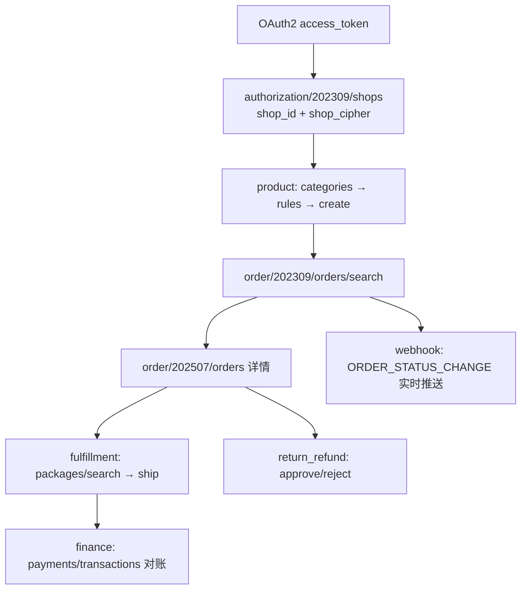
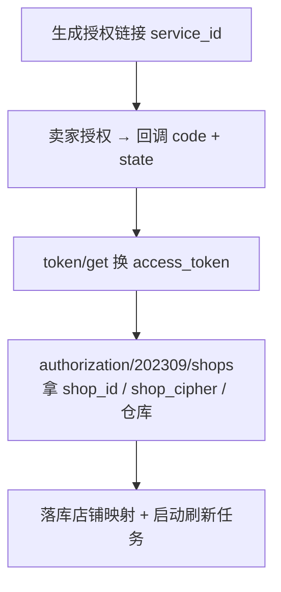
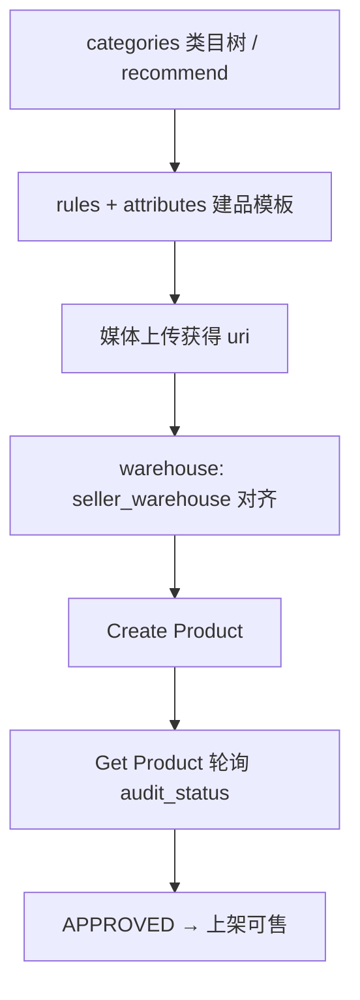
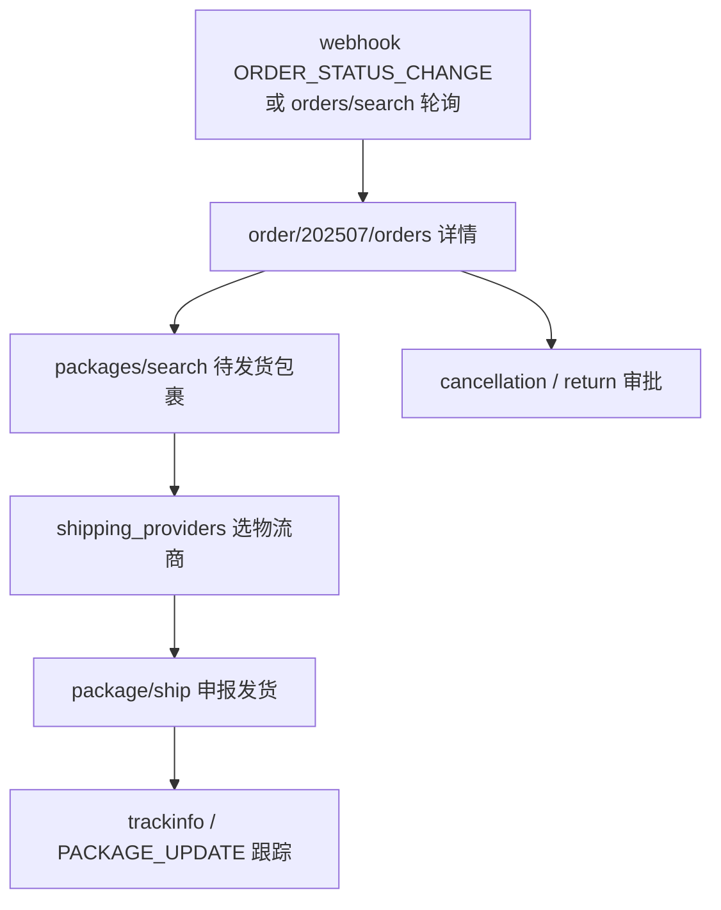

# TikTok Shop 开放平台 API 手册（AI 联调版）

> 数据来源：官方文档站 [Partner Center](https://partner.tiktokshop.com/docv2/page/tts-developer-guide) 及各接口详情页（文档站为 SPA，正文需浏览器/Playwright 渲染后抓取）。
> **用途**：给 AI / 开发者做本仓库 `testAPI/tiktok`（规划中）联调对照——接口做什么、关键参数必传什么、响应关键字段、模块间如何串。
> **版本策略**：与敦煌网不同，TikTok 的接口版本是**日期制**（如 `202309`、`202507`），URL 路径形如 `/{模块}/{日期版本}/{资源}`；新旧版本并存，本手册默认收录主流稳定版本，升级新版本时在附录「版本对照」登记。
> **统一入口**：
> - 业务 API：`https://open-api.tiktokglobalshop.com`（US 区应用使用对应 US 域名，以应用所在区控制台标注为准）
> - 授权/Token：`https://auth.tiktok-shops.com`（US 区对应 US 授权域名，以控制台为准）
> - 卖家授权页：`https://services.tiktokshop.com/open/authorize`（US 区 `https://services.us.tiktokshop.com/open/authorize`）

---

## 〇、背景知识（必读）

### 0.1 平台定位与整体架构

TikTok Shop 开放平台（Partner API）面向卖家、服务商（Partner）与达人（Creator）三类角色，覆盖商品、订单、履约、物流、售后、财务、达人分销、数据分析等域。与敦煌网手册（`dhgate_API.md`）对照，理解上有四个关键差异：

1. **授权体系更重**：OAuth2 授权码模式 + 每请求 HMAC 签名双保险；敦煌网只有简单公共参数。
2. **多店铺/多区域隔离**：一个 access_token 只属于一个店铺（一个国家站点）；跨店铺、跨区域调用需要各自独立的 token，且店铺级接口必须带 `shop_cipher`（店铺密文）。
3. **推拉结合**：平台有成熟的 Webhook 事件推送（订单状态、售后、包裹、商品审核、授权变化等），敦煌网是纯拉模式。生产建议「Webhook 实时 + 定时轮询兜底」双轨。
4. **强 scope 控制**：每个接口需要应用申请并获卖家授权的 scope；scope 不够时报 105005，需卖家重新授权。

### 0.2 三类角色与 token

| 角色 | 授权入口 | user_type | 说明 |
| --- | --- | --- | --- |
| Seller（卖家） | `services.{region}.tiktokshop.com/open/authorize?service_id=...` | 0 | 本仓库主要场景：店铺授权后操作商品/订单/履约 |
| Creator（达人） | `https://shop.tiktok.com/alliance/creator/auth?app_key=...&state=...` | 1 | 达人分销/联盟数据，token 与卖家 token **互不通用** |
| Partner（服务商/MCN） | 同卖家入口但选 partner 类型 | 3 | 代多卖家管理，使用 `category_asset_cipher` 标识资产 |

> ⚠️ 三类授权的端点和参数不同，token 不可混用；回调换 token 后必须校验 `user_type` 是否为预期值。

### 0.3 典型链路（优先级）

```text
授权 access_token（OAuth2）
  ├─ 店铺：authorization/202309/shops 拿 shop_id + shop_cipher（店铺映射落库）
  ├─ 商品：categories → rules/attributes → product.create → product.search
  ├─ 履约：order.search → order.detail → package.search → package.ship
  ├─ 售后：return.search → return.approve/reject；cancellation.approve/reject
  ├─ 财务：finance.payments → finance.transactions（对账）
  └─ 事件：event.webhooks 配置回调 + 每次推送验签
```



---

## 一、公共约定（所有接口）

### 1.1 公共参数（Query）

| 参数 | 类型 | 必须 | 说明 |
| --- | --- | --- | --- |
| `app_key` | String | 是 | 应用唯一标识（Partner Center 建应用获得） |
| `timestamp` | int | 是 | Unix 时间戳（秒，GMT/UTC+0）；与服务器偏差过大将被拒，务必 NTP 对时（建议 ±5 分钟内） |
| `sign` | String | 是 | 签名，算法见 1.3 |
| `access_token` | String | 视接口 | 少数接口允许放 query（如 authorization/202309/shops）；多数接口放请求头 |

### 1.2 请求头

| Header | 必须 | 说明 |
| --- | --- | --- |
| `content-type` | 是 | `application/json` |
| `x-tts-access-token` | 是（授权接口） | Get Access Token 返回的 access_token；按 user_type 区分卖家(0)/达人(1)/服务商(3) |

### 1.3 签名算法（sign）

> 以官方 [Sign your API request](https://partner.tiktokshop.com/docv2/page/sign-your-api-request) 页为准，此处为实操步骤摘要。

1. 取全部 **query 参数**，剔除 `sign` 与 `access_token`；
2. 按 key 的**字典序**排序，拼接为 `k1v1k2v2...` 形式；
3. **POST/PUT/PATCH 请求**：把**原始请求 body 字符串**（未经反序列化，与实际发送内容逐字节一致）追加到拼串末尾；
4. 在拼串**前后各拼接一次 `app_secret`**，得到待签名明文：`app_secret + k1v1k2v2... + body + app_secret`；
5. 以 `app_secret` 为密钥做 **HMAC-SHA256**，输出**小写十六进制**字符串即为 `sign`。

```python
import hashlib, hmac

def tts_sign(app_secret: str, params: dict, body: str | None = None) -> str:
    raw = "".join(f"{k}{params[k]}" for k in sorted(params) if k not in ("sign", "access_token"))
    if body:
        raw += body
    msg = f"{app_secret}{raw}{app_secret}"
    return hmac.new(app_secret.encode(), msg.encode(), hashlib.sha256).hexdigest()
```

> ⚠️ body 必须用「将要发送的原始字节」参与签名；若先签名后重新序列化（key 顺序、空格变化），签名必错——这是最常见的联调故障。

### 1.4 响应包络

所有业务接口返回统一结构，**成功判断看 body 的 `code == 0`，不能只看 HTTP 200**：

```json
{ "code": 0, "message": "Success", "request_id": "...", "data": { } }
```

### 1.5 分页

列表接口普遍使用 **page_token / cursor 游标分页**（不是页码）：首页不传 `page_token`，之后传上一页响应里的 `next_page_token` / `cursor`；时间范围过滤参数成对出现（`xxx_ge` / `xxx_lt`），**显式固定时间窗**以保证翻页结果稳定（默认窗口一般 3 个月，显式范围最长约 92 天，以各接口文档为准）。

### 1.6 错误码与限流

- 常见错误码：`105005` scope 不足（App 或 token 未授权该接口）；`36004004` auth_code 无效/已使用；`36009033` IP 不在白名单；`36009003` 平台内部错误；完整清单见官网 [Common errors](https://partner.tiktokshop.com/docv2/page/common-errors)。
- 每个接口文档页标注 Rate Limit（按应用/店铺维度计）；超限返回 429 与相应错误码，按 `Retry-After` 退避重试。
- **幂等性**：TikTok 的写操作不保证幂等，**POST/PUT/DELETE 失败后不要盲目自动重试**（GET 可安全重试）；重试前先查询确认当前状态。

---

## 二、授权模块（重点）

### 2.1 应用与凭证

在 [Partner Center](https://partner.tiktokshop.com) →「App & Service」创建应用后获得：

| 凭证 | 用途 | 存放要求 |
| --- | --- | --- |
| `app_key` | 标识应用，随每个请求发送 | 可明文 |
| `app_secret` | 生成签名、换取 token | **只存服务端**（密钥管理），禁止进前端/仓库 |
| `service_id` | 拼卖家授权链接 | 可明文 |
| `access_token` / `refresh_token` | 调用业务 API | 落库加密存储，绑定店铺 |

应用类型：**Custom App**（自用/定向分发，本仓库场景）与 **Public App**（上架应用市场）。应用创建后不可删除、只能停用；Redirect URL、Webhook URL 在应用配置里登记。scope 在「Manage API」中申请——只申请当前功能所需 scope，申请过多会拖长审核并降低卖家授权通过率。

### 2.2 Seller 授权流程（本仓库主流程）

1. **生成授权链接**（服务端生成，可绑定 `state` 防 CSRF）：

   ```text
   https://services.tiktokshop.com/open/authorize?service_id={service_id}
   ```
   US 区应用用 `https://services.us.tiktokshop.com/open/authorize`。

2. **卖家打开链接登录授权**：展示应用申请的 scope，卖家点击 Authorize（支持部分授权，实际范围以 `granted_scopes` 为准）。

3. **回调 Redirect URL**：平台带参跳回：

   ```text
   {redirect_url}?code={CODE}&state={state}
   ```
   拒绝授权时 `code=null&error=auth_denied`。回调处理必须：校验 `state` → 读 `code` → 立即换 token。

4. **换 token**：调用 `Get Access Token`（见 2.4.1）。`code` **30 分钟有效、单次使用**，超时/复用报 `36004004`。换 token 必须在**服务端**完成（需要 app_secret）。

5. **拉取店铺信息**：调用 `Get Authorized Shops`（见 2.4.3）拿 `shop_id` 与 `shop_cipher`，与 token 一起落库，建立「店铺 ↔ token ↔ cipher」映射。

### 2.3 Token 生命周期

| 事项 | 说明 |
| --- | --- |
| access_token 有效期 | 约 7 天（以返回的 `access_token_expire_in` Unix 时间戳为准，勿硬编码） |
| refresh_token | 有效期随卖家授权期（以 `refresh_token_expire_in` 为准） |
| 刷新 | 过期前用 Refresh Token 静默续期；刷新可能轮换 refresh_token，**必须持久化新值** |
| 失效兜底 | refresh_token 也过期 → 卖家需重新授权；平台提前 30 天推送 `UPCOMING_AUTHORIZATION_EXPIRATION`，主动解绑推送 `SELLER_DEAUTHORIZATION` |
| 校验 | 每次拿到新 token 后复查 `user_type`、`open_id`、`granted_scopes` |

### 2.4 授权接口详情

#### 2.4.1 Get Access Token

- **做什么**：用授权回调的 `code` 换取 access_token / refresh_token
- **HTTP**：`GET https://auth.tiktok-shops.com/api/v2/token/get`
- **鉴权**：无需 access_token（本接口用 app_secret 鉴权）

**Query 参数**

| 参数 | 必须 | 说明 |
| --- | --- | --- |
| `app_key` | 是 | 应用标识 |
| `app_secret` | 是 | 应用密钥 |
| `auth_code` | 是 | 回调返回的 `code`（单次、30 分钟内） |
| `grant_type` | 是 | 固定值 `authorized_code`（⚠️ 不是标准的 `authorization_code`，官方拼写如此） |

**响应 `data` 关键字段**

| 字段 | 说明 |
| --- | --- |
| `access_token` | 调用业务 API 的令牌（放 `x-tts-access-token` 头） |
| `access_token_expire_in` | 过期时间（Unix 秒） |
| `refresh_token` / `refresh_token_expire_in` | 刷新令牌及过期时间 |
| `open_id` | 被授权账号标识 |
| `user_type` | 0=卖家 / 1=达人 / 3=服务商，按业务预期校验 |
| `seller_name` | 卖家名称 |
| `granted_scopes` | 实际授权的 scope 列表，须校验覆盖业务最小集 |

**调用示例**

```bash
curl -G "https://auth.tiktok-shops.com/api/v2/token/get" \
  --data-urlencode "app_key=YOUR_APP_KEY" \
  --data-urlencode "app_secret=YOUR_APP_SECRET" \
  --data-urlencode "auth_code=CODE_FROM_CALLBACK" \
  --data-urlencode "grant_type=authorized_code"
# 成功判断：响应 body.code == 0
```

#### 2.4.2 Refresh Token

- **做什么**：用 refresh_token 换新 access_token
- **HTTP**：`GET https://auth.tiktok-shops.com/api/v2/token/refresh`

**Query 参数**

| 参数 | 必须 | 说明 |
| --- | --- | --- |
| `app_key` / `app_secret` | 是 | 同上 |
| `refresh_token` | 是 | 当前有效的 refresh_token |
| `grant_type` | 是 | 固定值 `refresh_token` |

**响应**：字段同 2.4.1；**若返回了新的 refresh_token 必须立即落库替换**。

```bash
curl -G "https://auth.tiktok-shops.com/api/v2/token/refresh" \
  --data-urlencode "app_key=YOUR_APP_KEY" \
  --data-urlencode "app_secret=YOUR_APP_SECRET" \
  --data-urlencode "refresh_token=YOUR_REFRESH_TOKEN" \
  --data-urlencode "grant_type=refresh_token"
```

#### 2.4.3 Get Authorized Shops

- **做什么**：查询该 access_token 已授权的店铺列表，拿 `shop_id` 与 **`shop_cipher`**
- **HTTP**：`GET /authorization/202309/shops`（业务域）
- **关联**：所有店铺级接口的 `shop_cipher` 均来源于此；多店编排按本接口结果建映射

**Query 参数**：`app_key`、`timestamp`、`sign`、`access_token`（query 传入）

**响应 `data.shops[]` 关键字段**

| 字段 | 说明 |
| --- | --- |
| `id` | shop_id（int） |
| `name` | 店铺名 |
| `region` | 国家/区域码（如 US、GB） |
| `cipher` | **shop_cipher**，店铺级接口必传 |
| `seller_warehouse` | 卖家仓库信息（含仓库 id，供商品库存/发货使用） |

```bash
TS=$(date +%s)
curl -G "https://open-api.tiktokglobalshop.com/authorization/202309/shops" \
  --data-urlencode "app_key=KEY" --data-urlencode "timestamp=$TS" \
  --data-urlencode "access_token=TOKEN" --data-urlencode "sign=$SIGN"
```

### 2.5 编码规范（本仓库约定）

1. **落库字段**（对应 `app/services/tiktok_oauth.py` 预留）：`store_id` ↔ `access_token`、`refresh_token`、`access_token_expire_in`、`refresh_token_expire_in`、`open_id`、`user_type`、`granted_scopes`、`shop_id`、`shop_cipher`、`seller_name`、`region`；token 建议加密存储。
2. **刷新任务**：定时任务扫描「距过期 < 24h」的 token 批量刷新；刷新失败立即告警，refresh 失效的店铺标记「需重新授权」并在管理端提示。
3. **state 规范**：服务端生成随机不可预测值、绑定授权会话、单次使用、回调严格校验；state 中禁止携带敏感数据。
4. **code 处理**：回调拿到 code 后同步换 token（即使走异步队列也不得超过 30 分钟）；换失败按错误码区分「可重试」与「需重新授权」。
5. **scope 最小化**：换 token 后校验 `granted_scopes` 覆盖业务最小集；缺 scope 引导卖家重新授权，而不是反复撞 105005。调接口报 105005 时先查 App scope、再查 token 的 granted_scopes。
6. **多店编排**：所有店铺级请求封装统一 client：注入 `app_key/timestamp/sign` + `x-tts-access-token` 头 + `shop_cipher` 参数；按 store_id 路由 token，禁止串店。
7. **审计日志**：授权、刷新、解绑事件全部落日志（含平台 request_id），便于排查与合规。

### 2.6 授权相关 Webhook

| Topic | 说明 |
| --- | --- |
| `SELLER_DEAUTHORIZATION` | 卖家主动解绑，立即停用该店 token 并告警 |
| `UPCOMING_AUTHORIZATION_EXPIRATION` | 授权 30 天内到期，提醒续约/重新授权 |

---

## 三、业务模块与接口详情

> 通用约定：以下所有接口 Domain 为 `https://open-api.tiktokglobalshop.com`；query 必带 `app_key/timestamp/sign`，授权接口加 `x-tts-access-token` 头，店铺级接口按详情页要求加 `shop_cipher`（多店/跨区场景一律带上）。示例中的签名参数省略，实际调用按 1.3 补齐。scope 键名以 Partner Center「Manage API」实际标注为准。

### 3.1 商品 API（Product）

- **模块说明**：类目/属性/规则 → 创建/编辑商品 → 库存/状态管理。商品上架有平台审核（`audit_status`）。
- **模块关联**：创建前需要 `categories`（类目树）+ `rules`（类目规则）+ `attributes`（必填属性）+ 仓库 `warehouse_id`（来自授权店铺的 seller_warehouse 或 logistics 仓库接口）；图片等媒体经独立上传接口获得 uri 后引用。
- **核心纪律（官方 Solution Guide）**：Edit Product 前必须先 Get Product 取全量、合并修改再提交（与敦煌网 item.update 同理）；Webhook 不是最终事实来源，重要状态以 Get Product 查询结果为准。

| 接口 | HTTP | path（202309） |
| --- | --- | --- |
| Get Categories | GET | `/product/202309/categories` |
| Recommend Category | POST | `/product/202309/categories/recommend` |
| Get Category Rules | GET | `/product/202309/categories/{category_id}/rules` |
| Get Attributes | GET | `/product/202309/categories/{category_id}/attributes` |
| Create Product | POST | `/product/202309/products` |
| Edit Product | PUT | `/product/202309/products/{product_id}` |
| Partial Edit Product | PATCH | `/product/202309/products/{product_id}/partial_edit` |
| Get Product | GET | `/product/202309/products/{product_id}` |
| Search Products | POST | `/product/202309/products/search` |
| Update Inventory | POST | `/product/202309/products/{product_id}/inventory/update` |
| Deactivate / Activate | POST | `/product/202309/products/deactivate`、`/product/202309/products/activate` |

#### 3.1.1 Get Categories

- **做什么**：按父类目查询子类目树；`category_id` 不传返回一级类目（对应敦煌网 `dh.category.list`）
- **关联**：结果 `id` 作为 Recommend/Rules/Attributes/Create 的 `category_id`

| Query 参数 | 必须 | 说明 |
| --- | --- | --- |
| `category_id` | 否 | 父类目 ID；空=一级类目 |

```bash
curl -G "https://open-api.tiktokglobalshop.com/product/202309/categories" \
  -H "x-tts-access-token: $TOKEN" \
  --data-urlencode "app_key=$KEY" --data-urlencode "timestamp=$TS" \
  --data-urlencode "shop_cipher=$CIPHER" --data-urlencode "sign=$SIGN"
```

#### 3.1.2 Recommend Category

- **做什么**：按商品标题/描述/图片推荐 TikTok 类目（对应敦煌网发布前置选类目的自动化）
- **关联**：推荐结果需运营确认后再进入 rules/attributes/create

**Body 关键参数**：`product_name`（必填）、`description`、`images[]`

#### 3.1.3 Get Category Rules / Get Attributes

- **做什么**：拉取叶子类目的**上架规则**（认证、包装尺寸、尺码表是否必填等）与**属性表**（必填/选填属性及候选值）
- **业务逻辑**：建品模板由此生成；**落库存 TikTok 的 attribute_id，不要只存属性名**（名称随市场/语言可变）。特定类目（如假发、3C）有强制认证与材质属性，缺失审核必拒。

#### 3.1.4 Create Product

- **做什么**：发布商品（`save_mode=LISTING` 直接提交审核，或 `DRAFT` 存草稿）
- **关联**：`category_id` ← Categories；`warehouse_id` ← 授权店铺仓库；`main_images[].uri` ← 媒体上传接口
- **响应**：`product_id`、`sku_id` 列表；提交后进入审核，状态以 Get Product 为准

**Body 关键参数（摘）**

| 参数 | 必须 | 说明 |
| --- | --- | --- |
| `title` | 是 | 商品标题 |
| `description` | 是 | HTML 描述 |
| `category_id` | 是 | 叶子类目 |
| `brand_id` | 视类目 | 品牌（部分类目必填） |
| `main_images[]` | 是 | 主图，`{ "uri": "..." }` |
| `skus[]` | 是 | SKU：`seller_sku`、`price{amount,currency}`、`inventory[{warehouse_id,quantity}]`、销售属性 |
| `package_dimensions` 等 | 视规则 | 由 Category Rules 指示 |

```bash
curl -X POST "https://open-api.tiktokglobalshop.com/product/202309/products?app_key=$KEY&timestamp=$TS&shop_cipher=$CIPHER&sign=$SIGN" \
  -H "content-type: application/json" -H "x-tts-access-token: $TOKEN" \
  -d '{
    "save_mode": "LISTING",
    "title": "Example cotton T-shirt",
    "description": "<p>HTML description</p>",
    "category_id": "123456",
    "main_images": [{ "uri": "tos-image-uri" }],
    "skus": [{
      "seller_sku": "TSHIRT-BLACK-M",
      "price": { "amount": "19.99", "currency": "USD" },
      "inventory": [{ "warehouse_id": "7000714532876273410", "quantity": 100 }]
    }]
  }'
```

#### 3.1.5 Edit / Partial Edit / Get Product

- **Edit（PUT）**：全量编辑——先 Get 取全量、合并改动后提交；响应含 `audit_status`（`AUDITING`=审核中 / `APPROVED`=通过 / `NONE`=不适用，如草稿/冻结态）。
- **Partial Edit（PATCH）**：定向修改内容字段；**不要用它改价格或库存**（库存走 Update Inventory，价格随 SKU 编辑）。
- **Get（GET）**：权威状态查询（审核结果、驳回原因、最终 SKU 映射）；Webhook 收到商品变更后以本接口复核。

```bash
curl -X PUT "https://open-api.tiktokglobalshop.com/product/202309/products/{product_id}?app_key=$KEY&timestamp=$TS&shop_cipher=$CIPHER&sign=$SIGN" \
  -H "content-type: application/json" -H "x-tts-access-token: $TOKEN" \
  -d '{ ...全量商品对象（Get 后合并修改）... }'
```

#### 3.1.6 Search Products

- **做什么**：按 `product_ids` / `product_name` / `status` 等条件分页检索店内商品（对应敦煌网 `dh.item.list`）

**Body 关键参数**：`product_ids[]`、`product_name`、`status`（如 LIVE/DRAFT/DEACTIVATED）、`page_size`、`cursor`；响应含 `products[]` 与 `next_page_token`。

#### 3.1.7 Update Inventory

- **做什么**：按 SKU×仓库 更新可售库存（对应敦煌网 `dh.item.update.stock` 系列）
- **业务逻辑**：多渠道共用库存时由此接口做扣减同步；先 Get Product 确认 sku_id 与仓库映射。

```bash
curl -X POST "https://open-api.tiktokglobalshop.com/product/202309/products/{product_id}/inventory/update?app_key=$KEY&timestamp=$TS&shop_cipher=$CIPHER&sign=$SIGN" \
  -H "content-type: application/json" -H "x-tts-access-token: $TOKEN" \
  -d '{ "skus": [{ "id": "1730", "inventory": [{ "warehouse_id": "7000714532876273410", "quantity": 12 }] }] }'
```

### 3.2 订单 API（Order）

- **模块说明**：订单检索与详情。订单状态机：`UNPAID → AWAITING_SHIPMENT → AWAITING_COLLECTION → IN_TRANSIT → DELIVERED → COMPLETED`，异常分支 `ON_HOLD`（风控/补充信息）/ `CANCEL`。
- **模块关联**：状态变化主要靠 Webhook `ORDER_STATUS_CHANGE` 实时感知（见 3.7），API 轮询兜底；发货走 Fulfillment（3.3）；退款/取消走 Return & Refund（3.5）。

| 接口 | HTTP | path |
| --- | --- | --- |
| Get Order List | POST | `/order/202309/orders/search` |
| Get Order Detail | GET | `/order/202507/orders` |

#### 3.2.1 Get Order List（orders/search）

- **做什么**：按时间/状态分页拉订单列表（简略信息），对应敦煌网 `dh.order.list.get`
- **业务逻辑**：增量同步以 `update_time_ge/lt` 滚动拉取，配合 Webhook 去重；显式固定时间窗保证翻页稳定

**Body 关键参数（摘）**

| 参数 | 必须 | 说明 |
| --- | --- | --- |
| `create_time_ge` / `create_time_lt` | 二选一组 | Unix 秒；显式提供窗口翻页更稳（最长约 92 天） |
| `update_time_ge` / `update_time_lt` | 二选一组 | 按更新时间增量拉取 |
| `order_status[]` | 否 | `UNPAID/AWAITING_SHIPMENT/AWAITING_COLLECTION/IN_TRANSIT/DELIVERED/COMPLETED/CANCELLED` 等 |
| `page_size` | 否 | 默认 20 |
| `cursor` | 否 | 翻页游标 |

**响应**：`orders[]`（id、status、create_time、行项目简略等）+ `next_page_token`。

```bash
curl -X POST "https://open-api.tiktokglobalshop.com/order/202309/orders/search?app_key=$KEY&timestamp=$TS&shop_cipher=$CIPHER&sign=$SIGN" \
  -H "content-type: application/json" -H "x-tts-access-token: $TOKEN" \
  -d '{ "order_status": ["AWAITING_SHIPMENT"], "update_time_ge": 1791222188, "update_time_lt": 1791229388, "page_size": 50 }'
```

#### 3.2.2 Get Order Detail（202507）

- **做什么**：批量查订单详情（收件人、支付、包裹、行项目、取消发起方），对应敦煌网 `dh.order.get`
- **业务逻辑**：单次最多 50 个 order_id；`is_exchange_order=true` 时为换货补发单（`exchange_source_order_id` 指原单），需正常履约；US 区 4PL 订单收件人地址/电话可能脱敏。

```bash
curl -G "https://open-api.tiktokglobalshop.com/order/202507/orders" \
  -H "x-tts-access-token: $TOKEN" \
  --data-urlencode "app_key=$KEY" --data-urlencode "timestamp=$TS" \
  --data-urlencode "shop_cipher=$CIPHER" --data-urlencode "sign=$SIGN" \
  --data-urlencode "order_ids=576461413038785752,576461413038785753"
```

### 3.3 履约 API（Fulfillment）

- **模块说明**：包裹维度发货——查询待发货包裹、申报发货（运单号+物流商）、更新物流信息、面单/报关文档。对应敦煌网 `dh.order.delivery.save` + 在线发货。
- **模块关联**：`shipping_provider_id` ← Get Shipping Providers（3.4.2）；包裹合并/拆分、状态变化推送 `PACKAGE_UPDATE`。

| 接口 | HTTP | path（202309） |
| --- | --- | --- |
| Search Packages | POST | `/fulfillment/202309/packages/search` |
| Ship Package | POST | `/fulfillment/202309/packages/{package_id}/ship` |
| Update Shipping Info | POST | `/fulfillment/202309/packages/{package_id}/shipping_info/update` |
| Get Shipping Documents | POST | `/fulfillment/202309/shipping_documents`（面单，参数以详情页为准） |

#### 3.3.1 Search Packages

- **做什么**：按 `package_ids` / `order_ids` / 时间窗分页查包裹（待发货队列）
- **响应**：`packages[]`（package_id、order_id、status、line_items、warehouse）+ 分页游标

#### 3.3.2 Ship Package（申报发货）

- **做什么**：对卖家自发货（3PL）包裹申报发货（Tracking + 物流商），对应敦煌网 `delivery.save`
- **业务逻辑**：仅 `AWAITING_SHIPMENT` 状态可发；SLA 内未发货会被平台处罚/接管，需监控滞留订单。

**Body 关键参数**：`tracking_number`（必填）、`shipping_provider_id`（必填，来自物流商接口）、其余如 `is_oversize` 见详情页。

```bash
curl -X POST "https://open-api.tiktokglobalshop.com/fulfillment/202309/packages/{package_id}/ship?app_key=$KEY&timestamp=$TS&shop_cipher=$CIPHER&sign=$SIGN" \
  -H "content-type: application/json" -H "x-tts-access-token: $TOKEN" \
  -d '{ "tracking_number": "1Z999AA10123456784", "shipping_provider_id": "123456" }'
```

#### 3.3.3 Update Shipping Info

- **做什么**：发货后修正运单号/物流商（发错单补救），路径与 Ship 同级。

### 3.4 物流 API（Logistics）

| 接口 | HTTP | path | 说明 |
| --- | --- | --- | --- |
| Get Warehouse List | GET | `/logistics/202309/warehouses` | 卖家仓库列表，产出 `warehouse_id` |
| Get Shipping Providers | GET | `/logistics/202309/shipping_providers` | 可用物流商列表（按包裹/区域查询），产出 `shipping_provider_id` |
| Check Shipping Template Existence | GET | `/logistics/202606/...`（模板检查，202606 版） | 检查指定业务仓是否配置运费模板；需要 `shop_id`、`biz_warehouse_id` |

#### 3.4.1 Get Warehouse List

- **关联**：响应中的仓库 ID → Create Product 的 `inventory[].warehouse_id`；与授权店铺接口返回的 seller_warehouse 对齐。

```bash
curl -G "https://open-api.tiktokglobalshop.com/logistics/202309/warehouses" \
  -H "x-tts-access-token: $TOKEN" \
  --data-urlencode "app_key=$KEY" --data-urlencode "timestamp=$TS" \
  --data-urlencode "shop_cipher=$CIPHER" --data-urlencode "sign=$SIGN"
```

#### 3.4.2 Get Shipping Providers

- **做什么**：查询某包裹/区域可用的物流承运商及 `shipping_provider_id`
- **关联**：Ship Package 前必调；具体 query 参数（package_id/shipment 等）以详情页为准。

### 3.5 售后 API（Return & Refund）

- **模块说明**：退货退款审批、买家取消审批、RMA/换货。对应敦煌网 `applymoney.* / dispute*`。
- **模块关联**：状态推送 `RETURN_STATUS_CHANGE`、`CANCELLATION_STATUS_CHANGE`；换货（EXCHANGE）会产生 `rma_id` 并自动创建 0 元换货 outbound 订单（订单接口标记 `is_exchange_order`）。
- **业务逻辑**：审批有响应时限，超时可能被平台自动同意；`return_type` 枚举含 `REFUND / REPLACEMENT / RETURN_AND_REFUND / EXCHANGE`。

| 接口 | HTTP | path（202309） |
| --- | --- | --- |
| Search Returns | POST | `/return_refund/202309/returns/search` |
| Approve Return | POST | `/return_refund/202309/returns/{return_id}/approve` |
| Reject Return | POST | `/return_refund/202309/returns/{return_id}/reject` |
| Get Decision Eligibility | GET | `/return_refund/202309/returns/{return_id}/decision_eligibility`（可审批/可选决策） |
| Approve Cancellation | POST | `/return_refund/202309/cancellations/{cancel_id}/approve` |
| Reject Cancellation | POST | `/return_refund/202309/cancellations/{cancel_id}/reject` |

#### 3.5.1 Search Returns

- **Body 关键参数**：`return_ids[]`、`order_ids[]`、`return_status`、`create_time_ge/lt`、`page_size`、`cursor`
- **响应 `returns[]`**：return_id、order_id、return_type、return_status、sku_info 等

#### 3.5.2 Approve / Reject Return

- **业务逻辑**：仅退款（REFUND_ONLY）需带退款原因码；退货退款需提供取件物流信息（参数视 return_type，详见详情页）；Reject 需原因码。

```bash
curl -X POST "https://open-api.tiktokglobalshop.com/return_refund/202309/returns/{return_id}/approve?app_key=$KEY&timestamp=$TS&shop_cipher=$CIPHER&sign=$SIGN" \
  -H "content-type: application/json" -H "x-tts-access-token: $TOKEN" \
  -d '{ "refund_only_reason": 1 }'
```

### 3.6 财务 API（Finance）

- **模块说明**：结算账单、货款流水。对应敦煌网较弱的对账域。
- **模块关联**：与订单/售后状态联动核对（订单结算状态受退货期影响）。

| 接口 | HTTP | path（202309） | 说明 |
| --- | --- | --- | --- |
| Get Payments | GET | `/finance/202309/payments` | 分页查询结算单（payment）列表 |
| Get Transactions | GET | `/finance/202309/transactions` | 按 `payment_id` 查该结算单内的交易明细 |

```bash
curl -G "https://open-api.tiktokglobalshop.com/finance/202309/payments" \
  -H "x-tts-access-token: $TOKEN" \
  --data-urlencode "app_key=$KEY" --data-urlencode "timestamp=$TS" \
  --data-urlencode "shop_cipher=$CIPHER" --data-urlencode "sign=$SIGN" \
  --data-urlencode "page_size=20"
```

### 3.7 事件 API（Webhook）

- **模块说明**：在应用配置（或经 API）登记 HTTPS 回调地址与订阅 topic；每条事件推送必须**验签**。
- **验签方式**：对**原始请求 body**（逐字节）以 `app_key + app_secret` 按官方规则计算签名，与请求头 `authorization` 比对；验签失败返回 401。处理端必须用 raw body（如 Express 的 `express.raw()` / FastAPI 的 `await request.body()`），不可先解析 JSON 再验。
- **响应要求**：收到事件尽快返回 2xx（如 200），业务处理异步化；平台对未响应的推送会重试。

| 接口 | HTTP | path（202309） | 说明 |
| --- | --- | --- | --- |
| Get Webhooks | GET | `/event/202309/webhooks` | 查询应用已配置的回调地址与已订阅 topic |
| Update Webhooks | PUT | `/event/202309/webhooks` | 更新回调地址/订阅 topic；Body：`address`、`topics[]` |

**常用 Topic 一览**

| Topic | 触发 | 建议处理 |
| --- | --- | --- |
| `ORDER_STATUS_CHANGE` | 订单状态流转 | 更新订单状态；AWAITING_SHIPMENT 进入待发货队列 |
| `PACKAGE_UPDATE` | 包裹创建/合并/拆分/状态 | 同步包裹，驱动履约 |
| `RETURN_STATUS_CHANGE` | 退货退款状态 | 待审批售后进审批队列 |
| `CANCELLATION_STATUS_CHANGE` | 买家取消请求 | 审批窗口内决策 approve/reject |
| `PRODUCT_UPDATE` / 商品创建/审核类 | 商品状态变化 | 以 Get Product 复核权威状态 |
| `SELLER_DEAUTHORIZATION` / `UPCOMING_AUTHORIZATION_EXPIRATION` | 授权变化 | 见 2.6 |

```python
# FastAPI 验签示意（规则以官方 Webhooks 文档为准）
@app.post("/webhooks/tiktok")
async def tiktok_webhook(request: Request):
    raw = await request.body()
    if not verify_tiktok_signature(raw, request.headers.get("authorization", "")):
        raise HTTPException(status_code=401)
    process_async(raw)   # 异步处理，立即返回
    return Response(status_code=200)
```

### 3.8 其他模块（按需展开）

| 模块 | 内容 | 说明 |
| --- | --- | --- |
| Promotion | 活动、优惠券（含 GWP 赠品/免费试用） | 营销自动化 |
| Affiliate | 达人带货：seller/partner/creator 三个视角（合作、样品、佣金单、达人内容） | TikTok 特色；creator 授权独立（见 0.2） |
| Analytics | 店铺/商品/SKU/视频/直播表现（Compass 数据） | 对应敦煌网 `wis.*` |
| FBT | TikTok 官方仓：入库单、库存、仓库 | 用官方仓履约时接入 |
| Customer Service | 买家会话、消息、客服配置 | 站内信对应物 |
| Seller / Shop | 已授权店铺、卖家权限、店铺分组 | 多店管理辅助 |
| Tools | 大文件断点续传上传 | 商品视频/大图上传前置 |

---

## 四、典型业务联动链路

### 4.1 授权与多店铺初始化



### 4.2 选品发布



- 要点：`attribute_id` 必须落库存；换货/预售/拍卖等特殊 Listing 走专用字段（见官方 Product Solution Guide）；编辑必须 Get 全量合并后 PUT。

### 4.3 订单履约



- 要点：US 区 4PL 订单由平台履约，地址可能脱敏，无需也不应自己发货；SLA 滞留监控 + 审批时限是两个必须的定时任务。

### 4.4 对账

`finance/payments` 拉结算单 → `finance/transactions` 按单查明细 → 与订单（收入）、售后（退款）三方核对；达人佣金走 Affiliate CAP 订单接口。

---

## 五、附录

### 5.1 错误码（联调高频）

| code | 含义 | 处理 |
| --- | --- | --- |
| 0 | 成功 | — |
| 105005 | scope 未授权 | 检查 App scope 与 token granted_scopes，引导重新授权 |
| 36004004 | auth_code 无效/已使用/过期 | 重新发起授权，code 单次 30 分钟 |
| 36009033 | 请求 IP 不在应用白名单 | 控制台更新 IP 白名单 |
| 36009003 | 平台内部错误 | 退避重试；持续失败提工单 |
| 429 | 限流 | 按 Retry-After 退避 |

### 5.2 版本对照（本文收录版本）

| 模块 | 版本 | 备注 |
| --- | --- | --- |
| authorization | 202309 | shops 查询 |
| product | 202309 | create/edit/search/inventory |
| order | 202309（search）/ 202507（detail） | detail 已有新版 202507 |
| fulfillment | 202309 | packages/ship |
| logistics | 202309 / 202606（模板检查） | |
| return_refund | 202309 | |
| finance | 202309 | |
| event | 202309 | webhooks |

> 官方持续发布新日期版本（如 order 202507、logistics 202606、affiliate 202603）；升级版本时先读对应 Changelog，旧版本在废弃期后下线。

### 5.3 与敦煌网手册的概念对照

| 概念 | 敦煌网 | TikTok Shop |
| --- | --- | --- |
| 鉴权 | method + v + timestamp + access_token | app_key + timestamp + sign + x-tts-access-token + shop_cipher |
| 版本 | `dh.xxx.get$2.0` | `/{module}/{202309}/{resource}` |
| 商品发布 | `dh.item.add` | `POST /product/202309/products` |
| 订单列表 | `dh.order.list.get` | `POST /order/202309/orders/search` |
| 申报发货 | `dh.order.delivery.save` | `POST /fulfillment/202309/packages/{id}/ship` |
| 数据看板 | `dh.wis.*` | Analytics 模块 |
| 事件推送 | 无（纯拉） | Webhook（验签 + 2xx 确认） |

### 5.4 维护说明

- 官方文档站为 SPA，直接 HTTP 抓取拿不到正文；如需像 `dhgate_API.md` 一样做全量抓取，用 Playwright 渲染 `partner.tiktokshop.com/docv2/page/*` 后解析，抓取脚本可参照 `script/scrape_dhgate_open_docs.py` 改造。
- 各接口的完整参数/枚举以官网详情页为准（本手册只收录联调高频字段）；发现字段缺失时优先查官网 + 实际回包校准，遵循「枚举勿编造」原则。

### 5.5 参考资料

- 开发者指南总览：<https://partner.tiktokshop.com/docv2/page/tts-developer-guide>
- 签名：<https://partner.tiktokshop.com/docv2/page/sign-your-api-request>
- 公共参数/公共错误/限流：`common-parameters` / `common-errors` / `rate-limits`
- 授权指南：<https://partner.tiktokshop.com/docv2/page/creator-authorization-guide>（含 seller/creator 流程对比）
- Product Solution Guide：<https://partner.tiktokshop.com/docv2/page/10lt0djm>
- Return & Exchange Solution Guide：<https://partner.tiktokshop.com/docv2/page/71ztxsw4>
